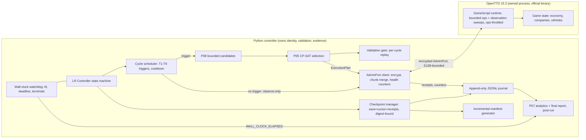
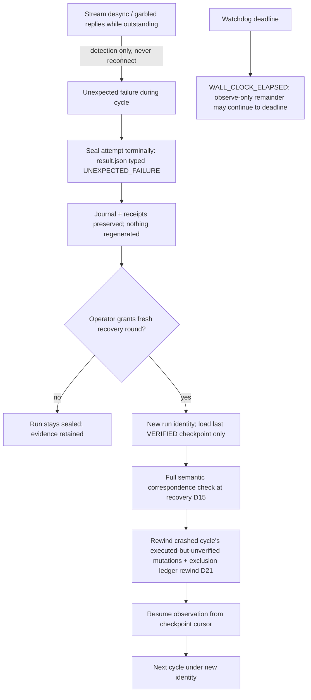

# LR — External Implementation Research and Architecture Synthesis, 2026-11-13

**Status: RESEARCH ARTIFACT — read-only study of external repositories. Grants no
runtime authority of any kind: no OpenTTD launch, no AdminPort connection, no
GameScript execution, no staging, no signing, no claim, no evidence mutation, no
commit, no push. No project source, documentation, ticket, or evidence byte was
modified. LR stays PROPOSED per
[the scope proposal](../../../docs/lr-long-run-scope-proposal-2026-11-13.md)
(M-LR-0 pending operator approval). E36 stays OPEN; FD-C-2 stays
`INCOMPLETE_EVIDENCE`.**

Inputs: source-level inspection of six primary/secondary repositories plus a
GitHub-wide discovery sweep (24 clones under `/tmp/opencode/lr-research/`,
shallow, 2026-11-13). Our LR constraints are those of the proposal of record
(D1–D21). Labels mean: **SOURCE-VERIFIED** (seen in inspected source at the cited
commit), **DOCUMENTED** (docs/README only), **INFERRED** (deduced),
**PROPOSED** (our design suggestion), **UNKNOWN**. Every external claim below
was made by an inspection agent that read the actual clones; the controller
independently spot-verified the decisive ones (chunk envelope, pause protocol,
version gates, throttle constants, save-table fields, directorate limits,
green-dalii's 15.3 pin) against the clones.

---

## 1. Executive Summary

1. **A whole ecosystem of real OpenTTD 15.3 controllers exists** and it validates
   our architecture direction: AdminPort + single GameScript bridge + external
   Python/TS controller is the dominant working pattern in 2026-era projects
   (`deepsaia/nttd`, `green-dalii/openttd-agent`, `OVER99K/openttd-directorate-mcp`,
   `DingoOz/openttd_llm_player`, `walter-grace/agent-openttd-arena`,
   `beyarkay/OpenTTD-Bench`). None uses a database, broker, or modified binary for
   the control plane. SOURCE-VERIFIED across all inspected repos.
2. **The single highest-value mechanism to adopt is nttd's chunked GameScript
   reply protocol**: size-estimated chunking with an
   `{id, _chunk, _total, _key, _meta}` envelope, verdict fields carried on chunk 0,
   and per-correlation-id merging on the Python side. It solves exactly our 512-byte
   reply-bound problem at scale, and a second project
   (directorate-mcp: 512-byte chunks, replay limit 128, max 256 plans) independently
   converged on bounded-chunk + bounded-journal design. ADAPT WITH CHANGES.
3. **The paused-world planning cycle is proven practice, with one sharp hazard**:
   nttd's `step()` (pause → flush commands while paused → unpause → wait until a
   target game date fixed before the world moves → pause → refresh) is the exact
   shape of our paused planning cycle; the hazard is that a long GS pathfinding
   (`Sleep()`-yielded) deadlocks while paused because `Sleep` counts game ticks.
   LR must keep all non-trivial pathfinding in Python (P08) and reserve the GS for
   bounded short commands. SOURCE-VERIFIED.
4. **GameScript scheduling discipline has a proven, small pattern set**
   (Production Booster): reserve+stride ops throttle (`GetOpsTillSuspend() < 2000`
   polled every 10th entity, single `Sleep(1)`), fixed per-wake batch with wake
   frequency as the only tunable (a formula that previously inverted itself is
   documented in-source), event-driven membership + periodic reconciliation purge,
   plain-data-only Save with scheduling state rebuilt on Load. ADAPT CONCEPTS,
   plus a month-boundary deadline prodboost does not need but LR does.
5. **OpenTTDLab contributes reproducibility discipline, not loop mechanics**: it
   has zero AdminPort usage and is fire-and-forget (incompatible with closed-loop),
   but its per-row provenance embedding, SHA-256 CDN verification,
   `threaded_saves=false`, and the hard evidence that 13.4 and 15.0-beta1 produce
   different money trajectories for the same seed/AI directly support our
   "13.4-era behavior does not transfer" premise. Its 15.x support runs through
   console-script saves; the highest in-repo tested pin is 15.0-beta1, so 15.3
   specifics stay UNKNOWN. ADOPT CONCEPTS; REJECT its execution model.
6. **AI-Trans donates heuristics, not runtime**: a closed-form route-profit
   objective (`365/days × income × capacity × fleet − cost`), unmet-supply scoring
   (`ProdValue`), saturation filters, one-route-per-source-per-cargo,
   time-growing distance windows, and road pathfinder cost weights are directly
   transferable to P05/P08 as *planning estimates*. Its "Cargo Concept"
   (many-to-one) is **roadmap intent only — not implemented** despite README
   claims. In-game NoAI limitations (no external channel, money-serialized greedy
   planning) confirm LR's external-controller choice. ADAPT WITH CHANGES.
7. **Nothing found justifies a new protocol, database, broker, or patched
   binary.** The one project that bypasses AdminPort entirely
   (`certator-projects/openttd-remote-control`, in-process ABI RPC) requires a
   patched OpenTTD fork — incompatible with our official-binary pinning. REJECT.
8. **Feasibility**: the 2-hour budget stays anchored to the proven T-032 envelope
   (E193: ≤7200 s, 10,861 requests, five economy years observed). Derived model:
   with the 2400 s paused cap binding fully, ≥4800 s of unpaused wall time at
   normal speed supports the ~3.5–7 economy-year expectation band; eight 6-minute
   cycles (48 min) would exceed the 2400 s cap, so the cap, not the cycle count,
   is the expected binding constraint. All band values remain derived estimates
   pending offline validation — the report adds no authorization and changes no
   parameter.

---

## 2. Research Methodology

- **Selection.** Five task-named repositories, plus a GitHub search sweep
  (~20 API queries: `openttd adminport`, `NoAI`, `gamescript`, `headless`,
  `savegame`, `docker`, `reinforcement learning`, `squirrel`, …) and web searches.
  ~25 candidates shallow-cloned; each kept only if OpenTTD interaction was
  confirmed **in source** (AdminPort framing, `.nut` API usage, savegame parsing,
  or engine forking). Generic game-AI and plain docker-image projects were
  dropped.
- **Inspection.** `git clone --depth 1` per repo; `git rev-parse HEAD` recorded
  per repository (§13). Source read with file:line citations; READMEs never
  treated as proof of runtime behavior. OpenTTD version support accepted only
  when evidenced in files (constants, config, CI, download URLs, comments pinned
  to a tag/commit).
- **Verification split.** Each inspection agent labeled its claims and listed
  what it could *not* verify. The controller then spot-checked the most
  load-bearing claims directly against the clones (nttd chunk envelope and
  paused-step protocol; OpenTTDLab version gate and `-G` seed path; prodboost
  throttle/batch/Save; directorate-mcp limit constants; green-dalii 15.3 pin).
  All spot-checks matched the agents' citations. Claims no one could verify are
  carried as UNKNOWN/DOCUMENTED, never promoted.
- **Boundary.** Read-only; clones live outside the project tree
  (`/tmp/opencode/lr-research/`). Full agent reports are retained there
  (`REPORT-nttd-source-research.md`, `OpenTTDLab-research-report.md`,
  `REPORT.md` (AI-Trans), `report.md` (prodboost), `openttd-programmatic-operators-report.md`).
- **Limitations.** Shallow clones (no tag/release history depth); no native run
  (none authorized, none attempted); GitHub API metadata snapshot 2026-11-13;
  engine-internal behavior (C++ admin-port semantics) is outside these repos and
  is listed as next-step research, not asserted.

---

## 3. Repository Inventory

### 3.1 Task-named targets

| Repository | Language | Mechanism | OpenTTD version evidenced | Inspected SHA | Activity |
|---|---|---|---|---|---|
| deepsaia/nttd | Python + Squirrel GS | AdminPort client + GS bridge (`GSEventAdminPort`), HTTP surface for contestants | **15.3** (download URL, cfg, `GetAPIVersion "15"`) | `49f21a76983d0c6d9d10d8280dd1136bbc68e55c` | 2026-10-27, active |
| deepsaia/nttd-workbench | Python | Pure HTTP client for nttd (imports nothing from nttd) | inherits nttd | `021f8525bff8a48ffe9c513914631756a00a78c0` | 2026-08-25 |
| michalc/OpenTTDLab | Python | CLI flags + console `.scr` scripts; **no AdminPort**; savegame parsing | gate: ≥15 console-script, 12–13 autosave; tested to 15.0-beta1 | `5c81bf08150a2da8324b39aa0bf2ff02da0794da` | 2025-06-04 |
| fanioz/AI-Trans | Squirrel NoAI | In-game AI (NoAI API v14) | API 14 (runs on 13.x–15.x AI API; not version-pinned in repo) | `4822c1bfb42f9b266a5ffc853c148adb7124ec6f` | 2026-06-26 |
| nelbin4/openttdprodboost | Squirrel GS | GameScript (API 15, requires ≥15.0) via industry control flags | ≥15.0 required (`info.nut`) | `b64fbc594b87f27f00488e6499ed84ba43ff1d5c` | 2026-08-05 |
| Sako404/openttd-blueprint | Bash/PowerShell | Config/content installer; launches OpenTTD only for content fetch + validation | min-version gate only; "stop promising exact version pinning" (final commit) | `d525bae4fd811d17bed3d55d744d7c049ccc2994` | 2026-08-31 |

### 3.2 Discovered additional candidates (OpenTTD interaction confirmed in source)

| Repository | Language | Mechanism | Version evidence | LR relevance |
|---|---|---|---|---|
| green-dalii/openttd-agent | TypeScript | AdminPort client + bridge GS + executor AI; decision loop, route ledger, freight attribution | 15.3 pinned in code ("tag 15.3, commit 14ec60f") | HIGH |
| OVER99K/openttd-directorate-mcp | TS + Squirrel | AdminPort full packet enum + GS JSON bridge; bounded plans, operation journal, replay-safe op IDs | 15.3 (README + constants) | HIGH |
| walter-grace/agent-openttd-arena | Python + Squirrel | stdlib AdminPort client + merged bridge GS (single-GS rule) + in-game AI hot-reload | 15.3 (code comment) | MEDIUM |
| DingoOz/openttd_llm_player | Python | JSON-RPC over AdminPort to LLMBridge GS with chunked-fragment reassembly | 15.3 (tests) | HIGH |
| beyarkay/OpenTTD-Bench | Python | AdminPort client + bridge GS (Pathfinder.Road) + savegame episode resume | 14.1 (README) | HIGH (pattern) |
| certator-projects/openttd-remote-control | C++ | OpenTTD **fork** + in-process ABI RPC plugin + gRPC/UDS | fork of 15.3 (commit 14ec60f) | MEDIUM (rejected approach) |
| internet-trains/ServerGS | Squirrel | GS exposing the whole GS API to admin clients | GS API symbols 1.3.2 | MEDIUM (stale, pattern) |
| erenard/AdminCmd | Squirrel | `GSEventAdminPort` + `GSAdmin.Send` JSON channel | none | MEDIUM (2013-era pattern) |
| Admin-port client library pool | — | xaroth/libottdadmin2, horazont/python3, liki-mc/pyOpenTTDAdmin, miltschek (Java), sdassow (Go), ThomasdenH (Rust), sambol (JS) | various | references only |
| TrueBrain/OpenTTD-savegame-reader | Py/Rust | savegame chunk-header parser | saveload revision ≥295 gate | MEDIUM (offline forensics) |
| JGRennison/OpenTTD-patches (JGRPP) | C++ | runtime patch pack | 15.x branch | context only (rejected: non-official binary) |

Rejected during discovery (no OpenTTD interaction found or unverifiable):
`vrtnis/tycoon-learning-environment` (JAX env, no OpenTTD), `internet-trains/ottd-rest`
(stub), assorted docker images (no control code), `andrea-peter/ottd_ctrl`
(mechanism unconfirmable), `quodlibetbv/openttd_llm` (description only, not
inspected — UNKNOWN, listed for completeness).

---

## 4. Source-Level Findings

### 4.1 nttd (primary reference)

 Ten-dimension summary; full detail in the retained agent report.

| Dimension | Finding (all SOURCE-VERIFIED unless labeled) |
|---|---|
| Runtime lifecycle | `SessionManager.start_session` (`src/nttd/runtime/session_manager.py:146-331`): ports reserved **at allocation** (a measured race fix), per-session generated `openttd.cfg`, spawn `openttd -D -c cfg [-G seed]`, stdout teed to `openttd.log` (preserves Squirrel stack traces), admin-port wait polls 0.5 s up to 15 s, handshake expects `ProtocolPacket` then `WelcomePacket`, then subscriptions incl. `GAMESCRIPT AUTOMATIC` (wrong subscription frequency drops the connection — `admin_client.py:212-215`). Shutdown (`session_manager.py:333-378`): **final save first** while connection is live → recorder merge → result write → runtime shutdown (cancel loops, rcon `quit`, SIGTERM, kill after 5 s, all in try/finally). `connect_to_existing` can attach to a live server (orphan recovery). |
| Observation | Two channels: (1) admin subscriptions — DATE daily, COMPANY_ECONOMY quarterly (`admin_client.py:200-206`); (2) pull-refresh of the whole world through GS queries (`orchestrator.py:301-375`), slow sections staggered every 5 cycles; tile map paged band-by-band (`session_runtime.py:311-351`) — one unbounded reply measured **524 KB / 7.2 s and timed out**; tile deltas re-read after every action and after autonomous events. |
| Control | HTTP envelope `{action_id, company_id, action_type, parameters, mode:"atomic"}`; **one admission gate** for both action paths (`actions/gate.py:1-27`); per-company `asyncio.Lock`; GS command timeout 120 s for `connect_*` else 10 s (`orchestrator.py:611-612`). Client-chosen `action_id` gives idempotency/retry-safety (DOCUMENTED in agent guide). |
| Scheduling | GS main loop `while(true){ events; drain pathfind queue; Sleep(1); }` (`main.nut:72-88`); long pathfinding yields via `_YieldAndProcessEvents()` every 500 steps (`main.nut:1060`); **`GetOpsTillSuspend` not used**. Paused-world stepping (`orchestrator.py:683-784` `step()`): pause → flush batch **while paused**, runtime-guarded on `construction.command_pause_level == 3` (`orchestrator.py:394`, cfg `:402/407`) → unpause → wait until a **target game date fixed before the world moves** (`:708-711`) → pause → refresh → snapshot. At pause level 1 a paused build times out, wedges the GS, and **has already executed** (`:736-743`). A long `connect_road` deadlocks while paused at any level because `Sleep` counts game ticks (`scripts/verify_environment.py:30-39`). |
| Persistence | GS Save/Load persists **only** `{cargo_banked, cargo_last_q0}` (`main.nut:99-107`); `Start()` guards init with `if (this._cargo_banked == null)` because "Load runs BEFORE Start" (`main.nut:39-43`). Final save is evidence: rcon `save final`, success *message* matched, then poll until file non-empty **and `openttd -q` exits 0** (`final_save.py:75-145`; `-q` catches a 40%-truncated save, `:19-22`). Interval saves during a run are explicitly "a convenience, not evidence" (`orchestrator.py:286-298`). World cache is rebuilt from refreshes, never saved; step math reads the live date (`orchestrator.py:786-811`) because the cached DATE is stale while paused. |
| Evidence | `SessionRecorder` (`store/recorder.py:110-190`): buffered per-type fragments flushed every 1 s to `_fragments/<type>_NNN.parquet`, merged at stop; **every action attempt recorded including refusals**, and "the audit trail must not be able to fail the action it describes" (`orchestrator.py:499-536`); recording failure never fails the action. Transport health counters (`unparseable_total/streak/resyncs`) are surfaced in results (`admin_client.py:540-551`). |
| Failure handling | `result_from_reply` (`actions/gs_reply.py:20-59`): SUCCESS / **PARTIAL** (`status:"partial"` + `built/existing/failed/gaps`, route re-walked for gaps, `main.nut:3190-3222`) / FAILED; `error_code` present **only when OpenTTD refused** — presence/absence is the engine-vs-controller discriminator; a failed compound build still returns `changed_entities`. Chunked replies keep the verdict on chunk 0 — hardcoding `success=true` there "would turn every large partial into a reported success" (`main.nut:517-545`). Transport-vs-slow: if unparseable packets arrived while a command was outstanding, the reply is classified "transport" (lost), not "timeout" (`admin_client.py:282-298`); ≥3 consecutive unparseable packets trigger resync-reconnect releasing all waiters (`:489-538`). |
| Performance | Chunk budget 1000 bytes against a **measured ~1400-byte admin packet limit** (comments with measurement claims at `main.nut:10, 383-386`; the 1400 figure itself is not verifiable from this repo). Size estimation via `_ApproxSize` before sending (`main.nut:392-423`). Memory-bounded buffers; staggered heavy refreshes. |
| Reproducibility | Seed reaches OpenTTD **only via `-G`** — the cfg seed does not pin world generation (`session_runtime.py:135-138`) — directly matching our `-G`/fresh-world discipline. OpenTTD 15.3 pinned by download URL + `scripts/verify_environment.py` ("load-bearing claims about OpenTTD 15.3"); no Dockerfile; CI never launches the game; native behavior re-verified manually. |
| Analytics | Quarterly economy events, snapshots parquet, per-company finance/stations/vehicles/cargo-flows queries, infrastructure costs, result record with wall seconds + capability digest. Benchmark scoring machinery is benchmark-specific (§ "Do not copy"). |

**Useful for LR** [SOURCE-VERIFIED → PROPOSED adaptations in §7]:
chunked-reply envelope + verdict-on-chunk-0 + per-id correlation; stream-health
counters as *detection* telemetry; the paused-flush `step()` protocol shape;
runtime fail-close check of the pause setting; authoritative live date reads;
honest PARTIAL semantics with engine-vs-controller discrimination; minimal GS
Save + `Start()` guard; confirmed-and-`-q`-validated saves; record-refusals-too
evidence discipline; single admission gate; band-paged tile reads; sequencing
hazards already solved (ports before spawn, no racing single-threaded GS,
staggered refreshes).

**Do not copy** [SOURCE-VERIFIED rationale]: HTTP/REST/MCP/Gym surfaces and
participant tokens (LR's controller is in-process); trust tiers/anti-cheat and
prompt-injection sanitisation (no adversary); benchmark scoring, leaderboard,
SCORE_VERSION, spend self-reporting; the workbench LLM agent tree; real-time
heartbeat mode (superseded by target-date stepping); screenshot/minimap capture;
the idle-AI-only world policy (a benchmark isolation decision, not ours).

**Cautions carried into LR** [SOURCE-VERIFIED]: (a) paused GS pathfinding
deadlocks — keep pathfinding in Python; (b) nttd's auto-resync-reconnect is
**not** adoptable under our no-retry/sealed-terminal rule — desync must type
`UNEXPECTED_FAILURE`; (c) their ~1400-byte packet claim does not transfer to our
encrypted 512-byte-bound path — numbers must be re-measured on our own wire.

### 4.2 OpenTTDLab (secondary reference)

| Dimension | Finding |
|---|---|
| Runtime lifecycle | Fire-and-forget: `openttd -snull -mnull -vnull:ticks=<74×days> -c cfg` then exit (`openttdlab.py:399-411`); one OS process per experiment via `multiprocessing.Pool` (`:286-301`); per-experiment sandbox dir with cwd-scoped config/content (`:345-353, 408`). No Dockerfile anywhere; no pause/resume; no mid-run decisions. |
| Observation | None during the run. Post-run savegame parsing (`parse_savegame`, `:772-1072`): pure-Python streaming table-chunk decoder; supports OTTN/OTTZ/OTTX, **deliberately not LZO/OTTD** (`:831-840`); header-driven, no version allowlist; correctness pinned by fixture tests on 12.0/13.4/15.0-beta1. GSDT/AIPL junk-tail allowance (`:989-993`) — corroborates our GSDT save-ride model (E174/E176). |
| Control | Console `.scr` scripts only; for ≥15 the sanctioned mechanism is scheduled `save N` on `on-next-calendar-month` (`:385-394`); version gate `console-script if major_version >= 15 / autosave if 12 ≤ major < 14 / unsupported` (`:196-201`). **14.x explicitly unsupported**; README:205's "latest known to work is 13.4" is stale — contradicted by code and the 15.0-beta1 test. |
| Scheduling | None (n/a for closed loop). |
| Persistence | `threaded_saves = false` forced for determinism (`:375-376`); month count approximated `days // 28` (`:386`) — calendar-imprecise. |
| Evidence | Provenance embedded **in every result row**: `openttd_version`, `opengfx_version`, `savegame_version`, the whole experiment dict (seed/ais/days/config string), date, error, console output (`:332-343`). No manifests, no JSONL; results are an in-memory list. |
| Failure handling | Error detected by substring `'The script died unexpectedly'` (`:338`); `subprocess.check_output` has **no timeout** — a hung run blocks a pool slot forever. |
| Performance | Worker-side `result_processor` shipped via `dill` so only reduced rows cross the process boundary (`:294-301`); documented "fairly poor" parallel scaling (README:60, notebook). |
| Reproducibility | Seed only via `-G` (`:402, 430`); SHA-256 of engine/OpenGFX archives verified against CDN `manifest.yaml` (`:218-219`); AI versions MD5-pinned only for whitelisted licenses (`:72-81, 746`); **test expectations differ between 13.4 and 15.0-beta1 for the same AI/seed** (`test_openttdlab.py:59-77` vs `:180-200`) — direct evidence for our no-13.4-transfer premise. |
| Analytics | Savegame table decode → `PLYR.money`, `PATS.difficulty.terrain_type`, etc. |

**Useful for LR**: per-row provenance; SHA-256 content verification (concept — we
already pin, this corroborates); `threaded_saves=false` and controlled
`savegame_format` (never LZO) as LR cfg hardening; sandbox-dir isolation;
console-script saves **as a studied fallback only** (see §11 — unacknowledged
saves re-introduce our E156 save-stall class). **Reject**: the whole
execution model (fire-and-forget, no pause/resume — structurally incompatible
with a closed loop), no-timeout subprocess, `days//28`, in-memory-only results,
GPL-2.0 code reuse without a license decision.

**Compatibility limits for 15.3** [SOURCE-VERIFIED facts, UNKNOWN outcomes]:
the repo gates 15.x *in* via console-script and 14.x *out*; highest tested pin
is 15.0-beta1; no `15.3` string exists in-repo; whether console scripts, cfg
keys, and savegame chunks behave identically on 15.3 is UNKNOWN — and per our
rules, a historical success (or 13.4 evidence) proves nothing for 15.3.

### 4.3 AI-Trans (algorithm reference)

NoAI "Trans", API v14, ~8.6k LOC Squirrel, SHA `4822c1bf…`, last commit
2026-06-26. Implemented-vs-roadmap table (SOURCE-VERIFIED per file): air
town-pax, road bus+truck, tram, marine, rail (raw industries only), double-track
logic, merger acceptance, air infrastructure-maintenance veto — all implemented.
**NOT implemented**: oil-rig choppers, rail town pax, **Cargo Concept
(many-to-one — roadmap intent at 50% only, `ROADMAP.md:25-31`, no
destination-type-unification code exists)**, making merged companies profitable,
CargoDist support. README claims about Cargo Concept are stale relative to the
roadmap.

Key mechanisms (all SOURCE-VERIFIED with citations in the retained report):

- **Pairing**: dest-first for road/water/air (`Service.FindDest` →
  `Service.FindSource`, `base/connector.nut:241-267`, `utilities/service.nut:76-170`);
  source-first for rail with a full per-destination fleet-profit closure
  (`railfirstconnector.nut:250-336`). Final pick uses a deterministic modulo
  sample to spread candidates across companies — not a "best pick".
- **Closed-form profit estimate** (`utilities/sandbox.nut:93-114`,
  `railfirstconnector.nut:307-327`):
  `days = dist × 56.83 / speed + 4`; `income = AICargo.GetCargoIncome(cargo, dist, days) × mult`;
  `fleet = Money.Maximum() / price × 10` (≈10% of funds in vehicles);
  `profit = 365/days × income × capacity × fleet − runningCost`.
  A simulation-free objective — a candidate **P05 scoring term** (as a planning
  estimate, never evidence).
- **Unmet-supply scoring** `ProdValue = production − transported ≥ engine
  capacity` (`ext/xindustry.nut:37-39`); **saturation filter** on last-month
  transported % (`service.nut:143-144`); **one-route-per-source-per-cargo**
  (`IsServed`, `service.nut:50-57`); **source-specific destination pools**
  (a failed source clears the dest pool — "dest profitability is
  source-specific", `railfirstconnector.nut:185-201`).
- **Mode choice has no scorer**: it emerges from per-mode distance windows that
  grow +3 tiles/year (`base/connector.nut:111-117`: air 150–300, rail 50–200,
  road 50–100, water 30–100), fleet caps, and setting vetoes (air killed by
  infrastructure maintenance). INFERRED: money is the global serialization point,
  making in-game multi-mode planning greedy/sequential — unlike CP-SAT.
- **Construction/maintenance**: per-tick state machines; step-budgeted resumable
  A* (`FindPath(200)` slices, `_MaxStep` 7000 for rail, `service.nut:364-394`);
  `AITestMode`+`AIAccounting` cost probes before real builds; rollback of a
  just-built station on depot failure (`roadconnector.nut:127-157`);
  `EnsureConnection` re-pathfinding as verification (`xroad.nut:223-233`);
  feedback control laws (add vehicle when waiting > 2× capacity, stop at rating
  >70, cap single-track rail at 2 trains — `task/route_man.nut:126-152`);
  periodic cleanup selling unprofitable/aging vehicles (`task/cleanup.nut`).
- **Tick budget**: `while(true){ Sleep(2); TaskManager.Run(); }`
  (`main.nut:71-75`); day-keyed task schedules (Events=1, Cleanup=3,
  RouteManager=10 days); events are drained **on save** into a serializable queue
  and consumed later (`task/events.nut:175-281`) — only 14 `Sleep()` call sites
  total; long work is made resumable rather than slept.
- **NoAI limitations** [SOURCE-VERIFIED]: state lives only in `Service.Data`
  serialized through Save/Load; no external planner channel; coarse failure
  telemetry (crashes/UFOs logged but not acted on); CargoDist invisible.

**Transfer to P05/P08** [PROPOSED, offline validation required]: closed-form
profit term; `ProdValue` headroom term; saturation filter as candidate pruning;
`IsServed`-style diversity constraint for CP-SAT; time-growing distance windows
as a typed P08 radius policy; road-pathfinder cost weights (rail-crossing veto,
turn/slope/station costs, bridge/tunnel per-tile costs, estimate multiplier 1.4
— `pathfinder/road_pf.nut:22-24,149-227`) as P08 cost-model calibration; step
budgets bounding P08 pathfinding per candidate. All **estimates in planning
only** — they must never become OBSERVED economics (ADR-0001 boundary).

### 4.4 Production Booster (GameScript scheduling reference)

Three files, 500 lines, GS API 15, requires OpenTTD ≥ 15.0, SHA `b64fbc59…`
(SOURCE-VERIFIED throughout; quotes confirmed directly against the clone):

- **Ops throttle**: exactly one `GetOpsTillSuspend()` call site (`main.nut:178`),
  inside `ThrottleIfLow()`: yield **once** (`Sleep(1)`, not a loop — "each
  GetOpsTillSuspend() call itself costs ops") when headroom drops below
  `OPS_RESERVE = 2000`; the poll itself is strided — `OPS_CHECK_STRIDE = 10`,
  "only poll GetOpsTillSuspend every N industries in a batch"
  (`main.nut:27-28, 347-350`).
- **Batch/wake decoupling**: fixed per-wake batch
  `batch_size = max(1, len/REFERENCE_DIVISOR)` (`:341`) so a full pass always
  takes ≈30 wakes; wake frequency is the only tunable
  `sleep_ticks = max(1, 74 × batch_divisor / 30)` (`:153-154`). In-source
  post-mortem (`main.nut:19-25`): an older formula that scaled **batch size**
  with the divisor "caused the old formula to invert itself above divisor=30".
  Default: 74 ticks sleep = one economy day per wake; full pass ≈ one month.
- **Membership**: event-driven — `DrainEvents()` (`ET_INDUSTRY_OPEN/CLOSE`) at
  the head of every batch (`:224-246`); round-robin over a cursor-walked array
  with an O(1) pending-set (`:92-95, 352-354`); stale IDs skipped via set
  membership; a reconciliation purge every 4 passes (`PURGE_EVERY_PASSES = 4`,
  `:326-330`); appending (not restarting the scan) on open "so industries late in
  scan order [are not] starved" (`:79-91`).
- **Cost discipline**: cache only expensive list/Valuate queries
  (`GSCargoList_IndustryProducing`, `:36-39`); re-read cheap getters every pass;
  early-exit guards in `ProcessOneIndustry` (`:262-291`); guarded logging via
  `ShouldLog` (`:170-172`); `GSAsyncMode(true)` for bulk flag application,
  synchronous execution when the return value must be checked (`:110, 293`);
  settings re-read per batch (cheap, `CONFIG_INGAME`).
- **Save/Load** (`:368-414`): persists **plain data only** — `id_set` (id→bool),
  `id_cargo_ids` (int arrays), `id_can_inc` (bool) — "No GSList objects, which
  OpenTTD's GS save system can't reliably round-trip" (engine-level claim from
  code comment only — UNKNOWN as a general rule, but the safe practice stands).
  All scheduling state rebuilt (`scan_ids = null; scan_pos = 0`); `Load(version,
  data)` ignores the version argument and migrates by **data shape** (current key
  vs legacy key — clever but fragile; LR should branch on an explicit schema
  version); missing caches become placeholders (`[]`, `false`) reconciled in
  `Start()`; if the engine discards incompatible state entirely, `Start()`
  rebuilds tracking from the live map.
- **Numbers**: `TICKS_PER_DAY = 74` (matches our day-roll anchor of record,
  74 script ticks/day).

**LR-relevant deltas** [PROPOSED]: adopt the throttle/batch/save patterns; add
(a) an explicit **month-boundary deadline** on observation passes — prodboost
needs none because its correctness is level-based, but our `GetLastMonth*`
observations are only valid inside the month window (our R11 gate), and
(b) an explicit schema `version` in GS Save, unlike prodboost's ignored
`version` argument. **Reject** for LR: silent rebuild-from-map after discarded
state (persist history; mark a lost month missing — never re-derive continuity),
the unbounded `DrainEvents` loop (throttle under event floods), and the
`while(true)` no-exit loop (LR needs a defined end-of-experiment state).

### 4.5 openttd-blueprint (environment reference)

Bash/PowerShell **config and content installer** for an existing install —
launches OpenTTD only as `openttd -D -x` for Online-Content fetching, `-h` name
resolution, and manual validation; never plays. SOURCE-VERIFIED:

- **Pinning is metadata-only**: manifest records `content_id`/`version`/
  `version_policy:"pinned"`, but acquisition resolves against the **live**
  BaNaNaS catalogue — the code itself admits it installs "a currently-listed
  version, not provably the exact version pinned" (`content.sh:182-188`). Engine:
  min-version gate only. **Zero checksums anywhere.** The final commit is
  literally "Docs: stop promising exact version pinning".
- **Config mechanics worth keeping**: manifest `order` field → `[newgrf]` line
  order = load order; parameters as space-separated ints; the hard-won 15.x ini
  gotcha that **multi-word `[game_scripts]` keys must be quoted** or OpenTTD's
  parser truncates and silently drops the script.
- **The gold nugget** is its own §5 "Stability check": *"none of them start
  OpenTTD with the result and watch what happens"* — after every config write,
  launch headless and grep the log for `error|fatal|not found|removed from
  list`; this caught 3 bugs that every offline dry-run/verify/idempotency check
  was structurally blind to.
- Machine-readable `dependencies[]`/`incompatibilities[]` feed refusal gates.

**For LR**: we are strictly stronger on identity (sha256-pinned binary and
graphics, sealed staged packages, preflight refusal gates). The adoptable ideas
are: (a) a **post-write headless-launch log-grep stability check inside an
authorized attempt's startup window** (PROPOSED — it is a native action, so it
can only ever ride an authorized launch, never become a new standing native
channel); (b) machine-readable dependency/incompatibility lists in the LR seal
schema; (c) the ini quoting gotcha as a packaging test. Reject the pinning model
and online-content acquisition outright.

### 4.6 Discovery-sweep findings (most relevant)

- **green-dalii/openttd-agent** (SHA `43755ffa…`, pushed 2026-11-12): the closest
  architectural sibling to LR — AdminPort client + bridge GS + executor AI,
  `decision-loop.ts` (snapshot + `sinceLastDecision`), `route-ledger.ts`, and
  `freight-attribution.ts` (per-cargo attribution — direct precedent for our
  delivered-cargo receipts). Design difference: its world **keeps running while
  the model thinks** (real-time), the opposite of our paused-world model.
  SOURCE-VERIFIED pins: `src/game/calendar.ts:14` — "事实来源：OpenTTD 15.3
  (tag `15.3`, commit `14ec60f`)"; `src/game/version.ts` reads `openttd --version`
  per run.
- **OVER99K/openttd-directorate-mcp** (SHA `b6eda7f4…`): full AdminPort packet
  enum incl. `AdminGameScript = 6`; GS `version.nut` declares hard limits —
  `M4_CHUNK_BYTES 512`, `M4_REPLAY_LIMIT 128`, `M4_MAX_PLANS 256`,
  `M4_MAX_OPERATION_ENTRIES 512` — with plan/apply/verify separation, replay-safe
  operation IDs, and an append-only operation journal. Independent corroboration
  that bounded chunks, bounded journals, and plan/verify gates are the right
  shapes for a 15.3 GS bridge. Their README stance — "a successful tool response
  is not treated as proof by itself" — mirrors our independent-readback rule.
- **walter-grace/agent-openttd-arena** (SHA `bd6d3094…`): proves in source that
  **OpenTTD allows only one GameScript per game** (it generates a merged
  per-scenario bridge GS) — corroborates our single staged-package model. Its
  in-game AI hot-reload via admin commands (`_reload_ai_via_admin`) is a
  capability we must NOT want: mutating running scripts violates our identity
  and evidence discipline.
- **DingoOz/openttd_llm_player** (SHA `3f1870d4…`): JSON-RPC over the admin port
  to a GS bridge with **chunked-fragment reassembly** (`ottd_bench/bridge.py`) —
  a third independent implementation of the chunking pattern.
- **beyarkay/OpenTTD-Bench** (SHA `b3beb5b1…`): long-horizon episodes with
  **interrupted-episode resume from savegames** (`tests/test_runner.py`); pins
  OpenTTD 14.1 (README) — a version we treat as historical only.
- **certator-projects/openttd-remote-control** (SHA `48e2525b…`): OpenTTD fork at
  the 15.3 commit with an in-process ABI RPC plugin and gRPC server. Powerful and
  clean, but requires a patched binary — incompatible with our official-binary
  pinning. Rejected as an approach; noted as the ceiling of what bypassing
  AdminPort would buy.

---

## 5. Cross-Project Comparison

| Axis | nttd | OpenTTDLab | AI-Trans | prodboost | blueprint | LR (ours) |
|---|---|---|---|---|---|---|
| Control plane | AdminPort + GS bridge (HTTP for clients) | CLI + console scripts only | none (in-game AI) | none (pure GS) | installer only | AdminPort + GS bridge |
| Loop shape | paused step cycles (target-date) | fire-and-forget batch | continuous in-game | continuous GS | n/a | paused planning cycles, event-driven |
| Seed/world identity | `-G` flag only; cfg seed does NOT pin generation | `-G` flag only | n/a | n/a | metadata-only | `-G` + sha256-pinned binary/graphics |
| Reply bounding | size-estimated chunks, budget 1000/~1400 | n/a | n/a | n/a | n/a | 512 B bound + per-request trust anchor |
| Partial outcomes | `status:"partial"` + engine-vs-controller discriminator | error substring | per-candidate drop/rollback | per-entity guards | n/a | typed per-cycle outcomes (D12) |
| Save discipline | minimal GS save; `-q`-confirmed final save | `threaded_saves=false`; console-script saves | `Service.Data` validated save | plain-data save; rebuild scheduling | n/a | console_ack handshake (E157) + verified-boundary checkpoints (D5) |
| Evidence | 1s-flush fragments; record refusals; transport counters | provenance per row | in-game only | logs | backup copies | append-only JSONL + receipts + incremental manifests (D6) |
| Failure→recovery | resync-reconnect (in-session) — **not ours** | none (no timeout!) | resumable tasks | rebuild from map | reinstall | fresh identity + fresh grant from verified checkpoint (D2/D21) |
| 15.3 support | pinned, files confirm | gated in, tested only to 15.0-beta1 | AI API 14 (not version-pinned) | requires ≥15.0 | min-version only | 15.3 primary, proven anchors |

Common pattern across all serious controllers: **single GS bridge + bounded
replies + id-correlated requests + explicit plan/verify separation**. Where they
differ from us is exactly where our constraints are stricter: no in-session
recovery, sealed terminals, digest-bound evidence, paused planning.

---

## 6. LR Adaptation Matrix

Recommendations: ADOPT CONCEPT / ADAPT WITH CHANGES / STUDY ONLY / REJECT /
UNKNOWN. "Required changes" states what makes it fit our boundaries; nothing
here authorizes implementation before M-LR-0/M-LR-2.

| External project | Source mechanism | Proven capability | Potential LR adaptation | Required changes | Compatibility risk | Recommendation |
|---|---|---|---|---|---|---|
| nttd | Size-estimated chunked GS replies `{id,_chunk,_total,_key,_meta}`, verdict on chunk 0 (`main.nut:380-546`) | Large GS replies over a bounded admin channel; partial results keep verdicts | GS bridge reply chunking for ≤512 B bound | Retune budget to our 512 B wire; keep per-request trust anchor; add offline wire tests | Low — same packet family we already use | **ADAPT WITH CHANGES** |
| nttd | Per-id correlation + async merge (`admin_client.py:243-361`) | Reliable request/response correlation under chunking | Extend existing correlation with `_chunk/_total` merge | Our per-cycle request namespaces (R12/E155 class) stay authoritative | Low | **ADAPT WITH CHANGES** |
| nttd | Stream-health counters + transport-vs-timeout classification (`admin_client.py:39-46, 282-298, 489-551`) | Cheap decisive telemetry for long sessions | Record counters in JSONL journal; classify desync as UNEXPECTED_FAILURE | **Drop auto-resync-reconnect** (violates no-retry/sealed-terminal) | Low | **ADOPT CONCEPT** (detection only; reconnect REJECTED) |
| nttd | Paused-flush `step()` protocol (`orchestrator.py:683-784`) | Build-while-paused at `command_pause_level=3`, exact day advance | Per-cycle gate shape for LR cycles | Gate on our paused-world proven path (E150/E198/E199/E201); runtime check of pause level fail-close | Low | **ADAPT WITH CHANGES** |
| nttd | Runtime check `command_pause_level == 3` before paused flush (`orchestrator.py:394`) | Prevents "timed out but already executed" wedged builds | Fail-close preflight assertion per cycle | Map to our sealed config validation | Low | **ADOPT CONCEPT** |
| nttd | Honest PARTIAL `{built,existing,failed,gaps}` + `error_code` presence discriminator (`gs_reply.py:20-59`, `main.nut:3190-3222`) | Partial success typed honestly; engine-vs-controller refusals distinguished | Per-cycle outcome taxonomy refinement | Align with D12 typed outcomes; no new failure classes invented | Low | **ADOPT CONCEPT** |
| nttd | Confirmed save: message match + on-disk poll + `openttd -q` validation (`final_save.py:75-145`) | Save is load-bearing evidence only when verified | Extend our console_ack checkpoint with offline `openttd -q` validation | `-q` runs offline on retained file (no game launch) | Low | **ADOPT CONCEPT** |
| nttd | Record every attempt incl. refusals; recorder never fails the action (`orchestrator.py:499-536`) | Complete audit trail under failure | Journal records typed refusals too | Already our direction (D6); add the "recording can't fail the action" rule | Low | **ADOPT CONCEPT** |
| nttd | HTTP/REST/MCP surfaces, trust tiers, scoring, heartbeat mode, agent tree | benchmark-only | — | — | Out of scope | **REJECT** |
| OpenTTDLab | Provenance embedded in every result row (`openttdlab.py:332-343`) | Self-describing results | Per-row provenance fields in JSONL journal (seed, versions, config string, run id) | Fit our digest-sourcing rules | Low | **ADOPT CONCEPT** |
| OpenTTDLab | `threaded_saves=false` + controlled `savegame_format` (`:375-376, 831-840`) | Deterministic, parseable saves | Add both keys to LR generated cfg (never LZO) | Offline cfg validation | Low | **ADOPT CONCEPT** |
| OpenTTDLab | Console-script `.scr` scheduled saves (≥15 path, `:385-394`) | Periodic saves without AdminPort | Fallback save channel | **None acceptable**: unacknowledged saves re-introduce the E156 save-stall class; our console_ack handshake is mandatory | Medium | **REJECT** for LR (STUDY ONLY as contingency research) |
| OpenTTDLab | Pure-Python savegame parser (OTTN/OTTZ/OTTX) | Offline structured inspection of saves | Recovery/forensics helper (read checkpoint saves offline) | GPL-2.0 license decision needed; never run natively; receipt-based evidence stays primary | Medium (license) | **STUDY ONLY** |
| OpenTTDLab | Fire-and-forget batch, no-timeout subprocess, `days//28` | n/a | — | — | Incompatible with closed loop | **REJECT** |
| AI-Trans | Closed-form route profit `365/days×income×capacity×fleet − cost` (`sandbox.nut:93-114`) | Simulation-free candidate scoring | P05 objective term for candidate ranking | Label ESTIMATE; never OBSERVED economics; respect ADR-0001 funds taxonomy | Low | **ADAPT WITH CHANGES** |
| AI-Trans | `ProdValue` unmet-supply + transported-% saturation filter (`xindustry.nut:37-39`, `service.nut:143-144`) | Demand-headroom pruning | P08/P05 candidate pruning terms | Needs our ≤32-industry observation caps | Low | **ADOPT CONCEPT** |
| AI-Trans | One-route-per-source-per-cargo (`IsServed`) + source-specific dest-pool invalidation | Diversity + invalidation order | CP-SAT constraint + candidate invalidation order | Our `exclude=` ledger already covers the service side | Low | **ADOPT CONCEPT** |
| AI-Trans | Time-growing per-mode distance windows (`connector.nut:111-117`) | Progressive widening over years | Typed P08 radius policy parameter | Must be a sealed, validated parameter — never automatic retuning (Phase D boundary) | Low | **STUDY ONLY** |
| AI-Trans | Road pathfinder cost weights + step-budgeted resumable A* (`road_pf.nut`, `service.nut:364-394`) | Bounded, calibrateable routing | P08 cost-model calibration + per-candidate step budgets | Offline tests against our 47-tile path of record | Low | **ADAPT WITH CHANGES** |
| AI-Trans | Cargo Concept many-to-one | claimed in README, **not implemented** | — | — | Insufficient evidence | **UNKNOWN / INSUFFICIENT EVIDENCE** |
| prodboost | Reserve+stride ops throttle (`main.nut:27-28, 174-181, 347-350`) | GS never suspends mid-sweep on ops exhaustion | Monthly observation sweep throttle in our GS runtime | Tune reserve to our command batch sizes; offline package-VM tests | Low | **ADOPT CONCEPT** |
| prodboost | Fixed batch, wake frequency as only tunable (`:19-26, 153-154, 341`) | Avoids the documented inversion failure | Same for our sweep scheduler | Add month-boundary deadline (they don't need one; we do — R11) | Low | **ADOPT CONCEPT** |
| prodboost | Plain-data GS Save + explicit schema version + Load→Start backfill (`:368-414`) | Reliable save round-trip | Our GS bridge state policy (already the `loop-excluded-sources` direction, R9) | Branch on version, not data shape; keep per-cycle state Python-side | Low | **ADOPT CONCEPT** |
| prodboost | Event-driven membership + reconciliation purge (`:224-246, 326-330`) | Robust entity tracking | Same for vehicle/industry sweeps | Bound the event drain (they don't) | Low | **ADOPT CONCEPT** |
| prodboost | Silent rebuild-from-map after discarded state (`:199-213`) | n/a | — | Violates evidence discipline (continuity never re-derived) | — | **REJECT** |
| blueprint | Post-write headless-launch log-grep stability check | Catches config rot dry-runs miss | Startup-window log scan during authorized attempts only | Must ride an authorized launch; never a standing channel | Medium | **ADAPT WITH CHANGES** |
| blueprint | Machine-readable `dependencies[]`/`incompatibilities[]` | Refusal gates see content conflicts | Seal-schema fields for `long-run-prelaunch-v1` | Offline only | Low | **ADOPT CONCEPT** |
| blueprint | Metadata-only pinning + online-content acquisition | n/a | — | Strictly weaker than our sha256 pins | — | **REJECT** |
| directorate-mcp | Hard limits: 512 B chunks, replay 128, max 256 plans, 512 op entries (`version.nut:5-14`) | Bounded journaling at 15.3 | Cap structure for `long-run-prelaunch-v1` | Our numbers (per-cycle namespaces, exchange caps) stay of record | Low | **ADOPT CONCEPT** |
| green-dalii | `freight-attribution.ts` per-cargo attribution | Delivered-cargo attribution precedent | Corroborates our DELIVERED-receipt requirement (E36) | None — we are stricter | Low | **ADOPT CONCEPT** (corroboration) |
| arena | Single merged GS per game (engine rule) + AI hot-reload | single-GS constraint proven | Corroborates our staged-package model; hot-reload rejected | — | — | **ADOPT CONCEPT** (constraint) / **REJECT** (hot-reload) |
| certator | In-process ABI RPC bypassing AdminPort | Full control without packet limits | — | Requires patched fork; violates official-binary pinning | High | **REJECT** |
| JGRPP | Patch-pack runtime features | n/a | — | Non-official binary | High | **REJECT** |

---

## 7. Recommended LR Architecture

All boundaries from AGENTS.md and the proposal are preserved: Python owns
planning/optimization/orchestration/validation/evidence; GameScript executes
bounded operations and observations; AdminPort stays the controlled encrypted
boundary; P05/P08/P07 keep their roles; no database, broker, framework, or new
protocol is introduced (none of the studied projects needed one either —
[SOURCE-VERIFIED pattern across nttd, directorate-mcp, DingoOz, arena]).

### 7.1 Component responsibility table

| Component | Responsibility | External lesson applied |
|---|---|---|
| Python LR Controller | State machine (OBSERVE → TRIGGER_EVAL → PLAN → EXECUTE → VERIFY → CHECKPOINT → terminal), per-cycle request namespaces, typed terminals (D12) | nttd's single-loop orchestration shape; **no** HTTP layer |
| Wall-clock watchdog | Deadline from owned process spawn (t0 typed into journal); binds before everything; Ctrl-C → `ENDED_BY_OPERATOR` | nttd's wall-seconds in result record; OpenTTDLab's no-timeout subprocess as anti-pattern |
| Cycle scheduler | Trigger set T1–T6, cooldown K after `ZERO_CANDIDATES`, anniversary floor | AI-Trans day-keyed task scheduling concept, but operator-owned thresholds (never automatic) |
| P05/P08 planning (paused) | Bounded candidates → CP-SAT selection; no GS pathfinding during pause | nttd's paused-pathfinding deadlock hazard → Python owns all real routing; AI-Trans closed-form profit as P05 estimate term (PROPOSED) |
| Validation gate | Per-cycle offline replay of receipts (`verify_loop_receipt` pattern, E144/E158) before checkpoint eligibility (D17) | nttd single admission gate concept; directorate's "tool response is not proof" stance |
| AdminPort client | Encrypted transport, 512 B reply bound, per-request wire trust anchor, correlation + chunk merge, stream-health counters | nttd chunk envelope + counters (detection only; desync → `UNEXPECTED_FAILURE`, no reconnect) |
| GameScript runtime | Bounded commands under `GSCompanyMode`; monthly observation sweeps; reserve+stride ops throttle; fixed batch + decoupled wake frequency; event membership + purge; plain-data Save with schema version | prodboost (all four patterns); month-boundary deadline added (R11) |
| Observation/event collector | Monthly proven-fact ticks (D18) + per-cycle observation receipts; band-paged reads | nttd band paging (524 KB unbounded reply lesson); OpenTTDLab per-row provenance |
| Checkpoint manager | Verified-boundary only: native save + journal cursor + receipt set, digest-bound; console_ack handshake mandatory | nttd `-q`-confirmed save concept added as offline validation; our E157 handshake unchanged |
| Append-only evidence journal | JSONL from t0; records every attempt incl. typed refusals; recording failure never fails the action | nttd recorder discipline; OpenTTDLab per-row provenance |
| Incremental manifest generator | Manifest chunks during run; complete `artifact-manifest.sha256` at terminal | Corroborated by directorate's bounded operation journal |
| P07 analytics | Post-run offline per-cycle P&L from receipts; aggregate-only OPEX; revenue never profit (D14) | green-dalii freight-attribution precedent (corroboration); AI-Trans estimates never imported as observations |
| Final report generator | New identity, never relabels prior records | OpenTTDLab per-row provenance informs report attribution |

### 7.2 Component diagram



### 7.3 Sequence diagram — one complete planning cycle

```mermaid
sequenceDiagram
  participant W as Watchdog
  participant C as LR Controller
  participant G as Validation gate
  participant A as AdminPort client
  participant GS as GameScript
  participant J as Journal
  W->>C: budget check (T1 wall remaining, T1' paused budget)
  C->>J: journal tick: monthly proven-fact set (OBSERVED, source digest)
  C->>C: trigger eval T2-T6
  alt no trigger or cooldown active
    C->>A: lightweight observation reads (reserve+stride GS sweep)
    A->>GS: bounded month-window reads
    GS-->>A: 512B-bounded replies (chunks merged)
    A-->>C: observations → journal
  else trigger fires
    C->>A: PAUSE world (proven path), runtime-check pause level
    C->>GS: read facts (cycle-0 facts + exclude ledger + fresh monthly deltas)
    C->>C: P08 candidates → P05 selection (Python, no GS pathfinding)
    alt zero candidates
      C->>J: typed ZERO_CANDIDATES outcome, cooldown K=2 armed
      C->>A: UNPAUSE until next observation window
    else plan selected
      C->>G: validate ExecutionPlan (offline, sealed budgets)
      G-->>C: rc 0
      C->>A: execute bounded build ops (quote-first, per-cycle budget)
      A->>GS: commands (correlated, chunked replies, verdict on chunk 0)
      GS-->>A: receipts (success/partial/typed refusal, engine-vs-controller flagged)
      C->>G: per-cycle verify replay (D17: receipts + rc 0 + observation receipt)
      alt replay rc 0
        C->>A: console save with console_ack handshake
        C->>CM: checkpoint = save digest + journal cursor + receipt set
        C->>J: checkpoint record; incremental manifest chunk
        C->>A: UNPAUSE until target observation date (fixed before unpause)
      else replay fails
        C->>J: typed failure; cycle NOT checkpoint-eligible
        C->>C: UNEXPECTED_FAILURE → sealed terminal
      end
    end
  end
  W->>C: deadline check → WALL_CLOCK_ELAPSED terminal
```

### 7.4 Failure and recovery flow



Ownership of state (explicit): **Python owns** run identity, cycle/terminal
taxonomy, budgets, exclusion ledger, journal, manifests, checkpoints, all
planning state. **GameScript owns** only the bounded in-game operation of the
moment plus minimal scalar state it persists in plain-data Save (id tables,
caches of scalars) — per-cycle planning state never lives in GS (our
`loop-excluded-sources` pattern; prodboost's rebuild discipline shows GS save
state stays minimal and rebuildable). **Neither side** owns "truth": truth is
what independent readback verifies.

Trust boundaries: (1) AdminPort is the only native channel, encrypted,
per-request wire trust anchor, 512 B reply bound; (2) every GS reply is
correlated by id and verdict-carrying on chunk 0; (3) Python never derives
in-game facts — OBSERVED numbers come from read families with source digests;
(4) GS never receives unvalidated Python values — requests ride the versioned
wire contract; (5) no auto-reconnect, no in-session retry, no hot-reload of
in-game scripts, no patched binaries; (6) saves without the `console_ack`
handshake are not checkpoints; (7) recovery requires a new run identity and a
fresh operator grant — always.

---

## 8. Two-Hour Feasibility Analysis

Anchors (our evidence of record): T-032 is the longest proven continuous native
session — ≤7200 s wall, 10,861 requests, five economy years observed (E193).
The pause model is natively proven four times (E150/E198/E199/E201). One economy
day = 74 script ticks, day rolls at tick 48 (CONTEXT day-roll anchor). LR never
exceeds the envelope; behavior beyond 2 h is UNKNOWN (R1).

| Quantity | Value | Class |
|---|---|---|
| Wall-clock budget | 7200 s | Decided (D1); matches T-032 envelope |
| Paused planning cap | 2400 s (33% of wall) | Decided cap (D11); cost model unvalidated |
| Unpaused simulation window | ≥ 4800 s | Derived from the two above |
| Economy-year yield | ~3.5–7 years at cap 8 | Derived estimate (proposal §1); recomputed after offline validation |
| Requests | 10,861 in T-032 | Measured (E193); LR adds build ops — per-cycle exchange counts sealed in `long-run-prelaunch-v1` with hard caps (R8) |
| Per-cycle paused cost | 3–6 min × ≤8 cycles | Estimated, pending offline validation (D11) |
| GS ops budget | reserve+stride throttle keeps sweeps from suspending | Pattern SOURCE-VERIFIED (prodboost); LR-specific op costs UNKNOWN until offline package-VM measurement |
| Checkpoint cost | console save + ack handshake; save write seconds-class | Mechanism proven (E157; save-stall class closed R10); exact 15.3 save latency UNKNOWN |
| Manifest generation | incremental chunks during run; final sweep at terminal | Design decided (D6); cost amortized; standing sweeps exist (E165/E195/E196) |
| Planning cycles | ≤8; paused cap likely binds first | Derived: 8 × 6 min = 48 min > 40 min cap → at 6 min/cycle the cap binds around cycle 7–8; at ≤5 min/cycle, 8 cycles fit. Consistent with "whichever binds first" (D11) |
| Worst case: repeated `ZERO_CANDIDATES` | Cooldown K=2 suppresses re-triggering; remaining cycles observe-only; run continues to `WALL_CLOCK_ELAPSED` | Typed per-cycle outcomes (D12); longitudinal record is the value (R6) |

**Conservative feasibility model.** If every cycle pauses 6 minutes, eight cycles
consume 48 minutes of the 40-minute pause budget — the pause cap binds first and
the run degrades gracefully to observe-only, still reaching `WALL_CLOCK_ELAPSED`
with ≥3.5 economy years plausibly observed. If cycles average ≤5 minutes, all
eight fit inside 2400 s and the unpaused window grows toward ~6–7 years. The
band's load-bearing measured anchor is T-032's five years in ≤7200 s; the tick-rate
arithmetic (74 ticks/day, normal speed) is DOCUMENTED/INFERRED and must be
re-validated offline, never promoted to a promise. Nothing here authorizes a run
or changes a parameter.

**Measurement gaps requiring offline validation** (task §7): per-cycle pause cost
decomposition (P05 1–60 s bound is of record; capture, verify replay, and save
latencies are not); GS ops cost per read family at LR depth; 15.3 checkpoint save
latency and size; packet-budget growth over hundreds of exchanges (R8) — all
shakedown/offline-testable without new authority beyond their own grants.

---

## 9. Failure and Recovery Design

Synthesis of external lessons under our stricter rules [PROPOSED, consistent
with D2/D15/D21]:

1. **Classify, never guess.** Adopt nttd's reply taxonomy: SUCCESS / PARTIAL
   (`built/existing/failed/gaps`) / FAILED with the `error_code`-presence rule
   separating engine refusals from controller-side precondition rejections. A
   failed compound operation still reports what it changed. This feeds directly
   into D12's typed per-cycle outcomes.
2. **Transport failure is a terminal, not a timeout.** nttd classifies
   garbled-during-outstanding as "transport" — adopt the *classification*; reject
   their reconnect. A desync during LR types `UNEXPECTED_FAILURE`, seals the
   attempt, and any continuation is a fresh recovery round under a fresh grant.
3. **Recovery reads verified state only.** Checkpoint = verified cycle boundary
   (D17): native save (console_ack'd, digest-bound, plus offline `openttd -q`
   validation of the retained file) + journal cursor + completed receipt set.
   Full semantic correspondence at recovery (D15). Unverified mutations of the
   crashed cycle are rewound together with the exclusion ledger (D21) — the
   AI-Trans "dest profitability is source-specific" invalidation lesson supports
   rewinding *derived candidate state* alongside world state.
4. **Evidence survives the crash.** nttd's 1 s-flush fragments + our incremental
   manifest chunks mean a killed process loses at most the current second — and
   the final merge-at-stop step (nttd) is exactly the failure point we must NOT
   have: manifests are written incrementally during the run (D6), and the journal
   is append-only per record, never batched to a single stop-time write.
5. **Recovery never re-derives history.** prodboost's rebuild-from-map is
   rejected: a lost month stays a typed gap, not a reconstructed number.

---

## 10. Evidence and Reproducibility Design

- **Journal**: append-only JSONL from t0 (D6). Every row carries provenance
  (OpenTTDLab pattern): run id, cycle id, request namespace, seed, pinned
  binary/graphics digests, exact config string, transport-health counters.
  Typed refusals and autonomous game events are recorded; a recording failure
  never fails the action it records (nttd).
- **Receipts**: per-cycle command receipts and observation receipts, each
  digest-sourced; delivered cargo only via actual DELIVERED receipts (E36
  discipline unchanged; green-dalii's freight-attribution corroborates the
  shape).
- **Manifests**: incremental chunks during the run, complete
  `artifact-manifest.sha256` at terminal, included in standing sweep rounds.
- **Reproducibility**: seed only via `-G` (nttd SOURCE-VERIFIED: cfg seed does
  not pin generation — matches our recipe discipline); sha256-pinned binary and
  graphics (already ours; OpenTTDLab's CDN-manifest verification is the same
  practice and adds nothing we lack); `threaded_saves=false` and non-LZO
  `savegame_format` in the generated cfg (OpenTTDLab); machine-readable
  dependency/incompatibility lists in `long-run-prelaunch-v1` (blueprint);
  the blueprint lesson that offline dry-runs are blind to startup rot — the
  authorized attempt's own startup log is the validation surface.
- **Environment identity stays ours**: no online-content acquisition, no
  metadata-only pins, no min-version gates where a digest exists.

---

## 11. Risks and Rejected Approaches

| # | Rejected approach / risk | Source | Why rejected |
|---|---|---|---|
| 1 | Auto-resync-reconnect on admin stream corruption | nttd `admin_client.py:489-538` | Violates our no-retry rule and sealed-terminal discipline; desync = `UNEXPECTED_FAILURE` + fresh recovery round |
| 2 | GS-side pathfinding during paused cycles | nttd `verify_environment.py:30-39`, `orchestrator.py:736-743` | Long GS A* deadlocks while paused (`Sleep` counts game ticks); paused level-1 builds "already executed" yet time out. LR keeps routing in Python |
| 3 | In-game AI hot-reload / script mutation at runtime | arena `_reload_ai_via_admin` | Mutating running scripts destroys identity binding and replayability |
| 4 | Patched-binary control planes (ABI RPC/gRPC fork) | certator repo | Violates official-binary sha256 pinning |
| 5 | Fire-and-forget experiment batches, no-timeout subprocesses | OpenTTDLab | Structurally incompatible with closed-loop paused cycles; a hang must hit the watchdog, not block forever |
| 6 | Console-script scheduled saves as LR's save channel | OpenTTDLab ≥15 path | Unacknowledged saves re-introduce the E156 save-stall class; every LR console save rides the `console_ack` handshake |
| 7 | LZO savegames (`savegame_format` default) | OpenTTDLab parser limitation | Off-evidence-path formats shrink forensic options; keep zlib/lzma |
| 8 | Metadata-only content pinning + online-content acquisition | blueprint | Strictly weaker than digest pinning; version drift by design |
| 9 | Silent rebuild-from-map after discarded GS state | prodboost `main.nut:199-213` | Evidence discipline: history is never re-derived; gaps are typed |
| 10 | Unbounded event drains and `while(true)` GS loops without exit | prodboost `main.nut:218-246` | Event floods and missing end-of-experiment state are unbounded risk in a 2 h run |
| 11 | Batch size scaled with the tunable (the inversion bug) | prodboost `main.nut:19-25` | Documented self-inverting formula; fix batch, tune wake frequency only |
| 12 | Real-time heartbeat / world-runs-while-model-thinks | nttd heartbeat mode, green-dalii design | Conflicts with paused-world planning (D4/pause model) and bounded budget accounting |
| 13 | HTTP/REST/MCP participant surfaces, trust tiers, leaderboard scoring | nttd api/, workbench | No adversary, no contestants; LR controller is in-process |
| 14 | Treating estimates as observations (AI-Trans "profit", README "Cargo Concept") | AI-Trans | Estimates label as ESTIMATE/PROPOSED only; Cargo Concept is not even implemented upstream; revenue never profit (D14) |
| 15 | GPL-2.0 code reuse (OpenTTDLab parser, prodboost, blueprint) | licenses | Any reuse needs an explicit license decision; prefer clean-room reimplementation of concepts |
| 16 | Unverified version claims | OpenTTDLab tested to 15.0-beta1; AI-Trans unpinned | 15.3-specific behavior of external tools stays UNKNOWN; our own 15.3 anchors (E193 etc.) remain the only accepted evidence |
| 17 | `days//28` month approximation | OpenTTDLab `:386` | Our day-roll anchor of record (74 ticks/day, tick 48) is exact; never approximate the clock |

---

## 12. Recommended Next Research Questions

1. **Engine-side admin/GS guarantees at 15.3** (offline source study of the
   OpenTTD repository at tag 15.3 / commit `14ec60f` — the pin both nttd and the
   certator fork cite): exact behavior of the admin↔GS channel
   (`GSAdmin.Send` ordering, delivery, sizing), `GetOpsTillSuspend` accounting,
   and GS Save size limits at LR depth (R9). No native run needed to read source.
2. **15.3 savegame surface** (offline): `openttd -q` on retained checkpoint-style
   saves; confirm `savegame_version`, GS data-chunk (GSDT) round-trip depth, and
   LZO default settings on 15.3-generated configs.
3. **Ops-cost measurement harness** (offline package-VM tests): instrument our
   GS read families to measure ops per entity so the reserve/stride constants
   and month-window deadline can be tuned on evidence.
4. **Pause-level semantics vs our secure path** (offline doc/source check):
   confirm `construction.command_pause_level=3` behavior against our encrypted
   bridge — the paused-build proven anchors (E150/E198/E199/E201) already cover
   our usage; record the mapping explicitly in the LR seal schema.
5. **GRF config-level pinning** (one offline cfg test): whether `[newgrf]`'s
   optional `grfid|md5sum|` prefix can pin content bytes at config level
   (blueprint UNKNOWN) — only relevant if LR ever adds content beyond base sets.
6. **Estimate-term calibration for P05** (offline): test the AI-Trans
   closed-form profit term against our seed-7 (E199) and battery planning
   fixtures — does it rank our known-feasible/known-zero cases correctly before
   it is ever proposed as a parameter?

---

## 13. Source References and Inspected Commit SHAs

Clones: `/tmp/opencode/lr-research/` (shallow, 2026-11-13). Retained agent
reports live beside the clones (see §2).

| Repository | Inspected SHA | Last commit | Key files cited |
|---|---|---|---|
| deepsaia/nttd | `49f21a76983d0c6d9d10d8280dd1136bbc68e55c` | 2026-10-27 | `src/nttd/runtime/{session_manager,session_runtime,orchestrator,final_save}.py`, `src/nttd/bridge/admin_client.py`, `src/nttd/actions/{gate,gs_reply}.py`, `src/nttd/store/recorder.py`, `ottd_config/game/nttd-gs/main.nut`, `scripts/verify_environment.py` |
| deepsaia/nttd-workbench | `021f8525bff8a48ffe9c513914631756a00a78c0` | 2026-08-25 | `agents/nttd_client.py`, `examples/minimal_runner.py` |
| michalc/OpenTTDLab | `5c81bf08150a2da8324b39aa0bf2ff02da0794da` | 2025-06-04 | `openttdlab.py`, `test_openttdlab.py`, `README.md` |
| fanioz/AI-Trans | `4822c1bfb42f9b266a5ffc853c148adb7124ec6f` | 2026-06-26 | `ROADMAP.md`, `main.nut`, `utilities/{service,sandbox,money}.nut`, `base/{connector,daily}.nut`, `manager/{roadconnector,railfirstconnector,airconnector}.nut`, `task/{events,route_man,cleanup}.nut`, `pathfinder/road_pf.nut` |
| nelbin4/openttdprodboost | `b64fbc594b87f27f00488e6499ed84ba43ff1d5c` | 2026-08-05 | `main.nut`, `info.nut`, `version.nut` |
| Sako404/openttd-blueprint | `d525bae4fd811d17bed3d55d744d7c049ccc2994` | 2026-08-31 | `content.sh`, `install-linux.sh`, manifest + README stability section |
| OVER99K/openttd-directorate-mcp | `b6eda7f433f28c86602181f059c8ae768e4d8579` | 2026-08-02 | `src/protocol/admin.ts`, `game/openttd_directorate/{version,route_planner,operation_journal,plan_store}.nut` |
| green-dalii/openttd-agent | `43755ffa8d7bb7169799617337db87947366d44d` | 2026-11-12 | `src/game/{admin-client,calendar,version}.ts`, `src/game/squirrel/`, `src/agent/{decision-loop,route-ledger,freight-attribution}.ts` |
| walter-grace/agent-openttd-arena | `bd6d3094823d7c5e83b8023088cddc520afff933` | 2026-08-17 | `agent/admin_client.py`, `agent/sandbox/bridge_gs.py`, `mcp_server.py` |
| DingoOz/openttd_llm_player | `3f1870d4a8ca5a91fb1d8c92e92360777c43b508` | 2026-10-05 | `ottd_bench/{bridge,admin,server}.py`, `tests/test_units.py` |
| beyarkay/OpenTTD-Bench | `b3beb5b12e59a2eeb26fcc7d8ef60567f0e06968` | 2026-08-01 | `benchmark/env/openttd/admin_client.py`, `tests/test_runner.py`, `scripts/fetch_script_libraries.py` |
| certator-projects/openttd-remote-control | `48e2525b8abd8f88a1d12494a7fd50c2913931e7` | 2026-07-24 | `contrib/grpc_server/`, `src/3rdparty/extras/abi_rpc/` |
| internet-trains/ServerGS | (pattern reference) | 2023-06-24 | `admin_port.nut`, `symbols.nut` |
| erenard/AdminCmd | (pattern reference) | 2013-12 | `src/main.nut` |

*This report is an uncommitted working-tree research artifact. It changes no
decision of record; where it recommends, it recommends for the M-LR-0/M-LR-1
design discussion, and every proposed parameter still requires its own offline
validation before any native use.*
