# OpenTTD AI handoff — 2026-10-17 (V2-capture addendum 2026-10-18)

This is a vendor-neutral continuation guide for the **actual local worktree**.
Read [CONTEXT](CONTEXT.md), this file, [TASKS](TASKS.md),
[EVIDENCE_INDEX](EVIDENCE_INDEX.md), then [REPRODUCE](REPRODUCE.md).
Use repository files and retained evidence as authority; prior chat, provider
memory, personal skills and temporary agent directories are not prerequisites.
This documentation task authorizes no game launch, AdminPort connection or retry.

## Checkout and transfer

Repository: https://github.com/Team-Project-SIET/softdev2.git
Branch: `devmodule2`. Inspected HEAD and stable playable-demo checkpoint:
`a3480169dcbefefff7b1adfb060449643c8eb04c`.
Primary target: OpenTTD 15.3, Linux amd64; Python 3.14+.

HEAD alone is incomplete: Random World, distance support and substantial earlier
engineering remain modified/untracked locally. See the exact
[status inventory](docs/handoff/2026-10-17/git-status-before.txt),
[tracked diff summary](docs/handoff/2026-10-17/tracked-diff-before.stat),
[implementation hashes](docs/handoff/2026-10-17/implementation-before.json) and
[ignored path inventory](docs/handoff/2026-10-17/ignored-paths-before.txt).
These are inspection snapshots, not commits or a substitute for file backups.
Preserve the unknown untracked root file `--version`; do not execute it.

Uncommitted implementation includes demo orchestration/monitoring/random staging,
P05 contracts/selection, P08 roads/network generation, supplemental capture,
freight runtime/replay, GameScript planner/funding, canonical fleet, continuous
operation/capacity, terrain preparation/proofs and associated tests. A change
being present here does not imply it was published or accepted natively.

Transfer tracked modifications and untracked source/tests/docs along with the
Git history. Transfer ignored evidence separately through a reviewed secure
archive; it is not backed up by Git. Exclude `.env`, private keys, account/cache
folders and temporary credentials. Preserve frozen attempt bytes and required
provenance paths. Missing artifacts on another machine are **UNKNOWN**, not a
reason to regenerate historical evidence. Compare hashes after transfer.

No AGENTS.md was found in this repository or its ancestor chain. Existing CONTEXT,
specifications, validators and evidence-preservation contracts apply. Recheck for
additional rules in the destination checkout. No Git staging, commit or push was
performed for this handoff. Older handoff versions are preserved under
[the dated snapshot](docs/handoff/2026-10-17/previous-AI_HANDOFF.md).

## Current evidence-backed state

VERIFIED below means supported by inspected retained reports, within the stated
scope. This handoff did not repeat native execution or comprehensively replay
all historical packages. Fresh controlled validation is recorded in REPRODUCE.
PREPARED is implementation awaiting native qualification; PARTIAL is incomplete
acceptance; FAILED is an immutable consumed outcome; UNKNOWN means missing facts.

| Area                                 | State and boundary                                                                                                                                                                                                                                                                                                                                                                                                                                                                                                                                                                                                                                                                                                                                                                                                                                                                                                                                                                                                                                                                                                                                                                                                                                                                                                                                                                                                                                                                                                                                                                                                                                                                                                                                                                                                                                                                                                                                                                                                                                                                                                                                                                                                                                                                                                                                                                                                                                                                                                                                                                                                                                                                                                                                                                                                                                                                                                                                                                                                                                                                                                                                                                                                                                                                                                                                                                                                                                                                                                                                                                                                                                                                                                                                                                                                                                                                                                                                         |
| ------------------------------------ | ---------------------------------------------------------------------------------------------------------------------------------------------------------------------------------------------------------------------------------------------------------------------------------------------------------------------------------------------------------------------------------------------------------------------------------------------------------------------------------------------------------------------------------------------------------------------------------------------------------------------------------------------------------------------------------------------------------------------------------------------------------------------------------------------------------------------------------------------------------------------------------------------------------------------------------------------------------------------------------------------------------------------------------------------------------------------------------------------------------------------------------------------------------------------------------------------------------------------------------------------------------------------------------------------------------------------------------------------------------------------------------------------------------------------------------------------------------------------------------------------------------------------------------------------------------------------------------------------------------------------------------------------------------------------------------------------------------------------------------------------------------------------------------------------------------------------------------------------------------------------------------------------------------------------------------------------------------------------------------------------------------------------------------------------------------------------------------------------------------------------------------------------------------------------------------------------------------------------------------------------------------------------------------------------------------------------------------------------------------------------------------------------------------------------------------------------------------------------------------------------------------------------------------------------------------------------------------------------------------------------------------------------------------------------------------------------------------------------------------------------------------------------------------------------------------------------------------------------------------------------------------------------------------------------------------------------------------------------------------------------------------------------------------------------------------------------------------------------------------------------------------------------------------------------------------------------------------------------------------------------------------------------------------------------------------------------------------------------------------------------------------------------------------------------------------------------------------------------------------------------------------------------------------------------------------------------------------------------------------------------------------------------------------------------------------------------------------------------------------------------------------------------------------------------------------------------------------------------------------------------------------------------------------------------------------------------------------- |
| Stable fixed demo                    | VERIFIED native 15.3 gameplay: P08/P05 selected 3 freight services, vehicles 4/5/6 constructed, 60 coal delivered, £1,022 revenue; spectator joined/inspected; fresh P07, cleanup and evidence checks passed. E1.                                                                                                                                                                                                                                                                                                                                                                                                                                                                                                                                                                                                                                                                                                                                                                                                                                                                                                                                                                                                                                                                                                                                                                                                                                                                                                                                                                                                                                                                                                                                                                                                                                                                                                                                                                                                                                                                                                                                                                                                                                                                                                                                                                                                                                                                                                                                                                                                                                                                                                                                                                                                                                                                                                                                                                                                                                                                                                                                                                                                                                                                                                                                                                                                                                                                                                                                                                                                                                                                                                                                                                                                                                                                                                                                          |
| Canonical creation Q3                | PROVEN in retained native engineering evidence; result `CANONICAL_CREATED_PENDING_FRESH_PROCESS_RELOAD`, 1 launch/connection, 27 mutations. E2.                                                                                                                                                                                                                                                                                                                                                                                                                                                                                                                                                                                                                                                                                                                                                                                                                                                                                                                                                                                                                                                                                                                                                                                                                                                                                                                                                                                                                                                                                                                                                                                                                                                                                                                                                                                                                                                                                                                                                                                                                                                                                                                                                                                                                                                                                                                                                                                                                                                                                                                                                                                                                                                                                                                                                                                                                                                                                                                                                                                                                                                                                                                                                                                                                                                                                                                                                                                                                                                                                                                                                                                                                                                                                                                                                                                                            |
| Fresh-process reload Q3              | PROVEN reload-only: `CANONICAL_RELOAD_ONLY_VERIFIED`, exact semantic correspondence, 1 launch/connection, 0 mutations. Purchase/dispatch/unpause disabled. E2.                                                                                                                                                                                                                                                                                                                                                                                                                                                                                                                                                                                                                                                                                                                                                                                                                                                                                                                                                                                                                                                                                                                                                                                                                                                                                                                                                                                                                                                                                                                                                                                                                                                                                                                                                                                                                                                                                                                                                                                                                                                                                                                                                                                                                                                                                                                                                                                                                                                                                                                                                                                                                                                                                                                                                                                                                                                                                                                                                                                                                                                                                                                                                                                                                                                                                                                                                                                                                                                                                                                                                                                                                                                                                                                                                                                             |
| Attempt 19                           | Five economy years recorded, original native terminal FAILED at finalization (`company-policy.json` already existed). Separate offline recovery valid within derived scope; never relabel original terminal. E3.                                                                                                                                                                                                                                                                                                                                                                                                                                                                                                                                                                                                                                                                                                                                                                                                                                                                                                                                                                                                                                                                                                                                                                                                                                                                                                                                                                                                                                                                                                                                                                                                                                                                                                                                                                                                                                                                                                                                                                                                                                                                                                                                                                                                                                                                                                                                                                                                                                                                                                                                                                                                                                                                                                                                                                                                                                                                                                                                                                                                                                                                                                                                                                                                                                                                                                                                                                                                                                                                                                                                                                                                                                                                                                                                           |
| Random World implementation          | Controlled/offline implementation available in dirty tree; native generation/discovery/GUI verified in Seed 17, native service execution remains unverified. E4/E5.                                                                                                                                                                                                                                                                                                                                                                                                                                                                                                                                                                                                                                                                                                                                                                                                                                                                                                                                                                                                                                                                                                                                                                                                                                                                                                                                                                                                                                                                                                                                                                                                                                                                                                                                                                                                                                                                                                                                                                                                                                                                                                                                                                                                                                                                                                                                                                                                                                                                                                                                                                                                                                                                                                                                                                                                                                                                                                                                                                                                                                                                                                                                                                                                                                                                                                                                                                                                                                                                                                                                                                                                                                                                                                                                                                                        |
| Tile Classification V2 capture       | NATIVE VERIFIED capture completed 2026-10-18 (90/90 pages, 450/450 tiles, schema 2, staged AI + GameScript startup, zero script deaths, 0 mutations, cleanup PASS); SOURCE_SAVE_FUSION verdict **REJECTED** — 83 projected-flag disagreements, nothing fused; the 19 historically UNKNOWN tiles were observed CLEAR in the fresh census and stay UNKNOWN in the retained assessment; P08 remains `INCOMPLETE_TILE_CLASSIFICATION`. E16.                                                                                                                                                                                                                                                                                                                                                                                                                                                                                                                                                                                                                                                                                                                                                                                                                                                                                                                                                                                                                                                                                                                                                                                                                                                                                                                                                                                                                                                                                                                                                                                                                                                                                                                                                                                                                                                                                                                                                                                                                                                                                                                                                                                                                                                                                                                                                                                                                                                                                                                                                                                                                                                                                                                                                                                                                                                                                                                                                                                                                                                                                                                                                                                                                                                                                                                                                                                                                                                                                                                    |
| D4 corridor construction             | Native road + station construction PROVEN for the reviewed v3 scope (candidate-5, `RECEIPT_VERIFIED`, authoritative after-save `a81ac836…ef261`; £492,149 funds pin). E35.                                                                                                                                                                                                                                                                                                                                                                                                                                                                                                                                                                                                                                                                                                                                                                                                                                                                                                                                                                                                                                                                                                                                                                                                                                                                                                                                                                                                                                                                                                                                                                                                                                                                                                                                                                                                                                                                                                                                                                                                                                                                                                                                                                                                                                                                                                                                                                                                                                                                                                                                                                                                                                                                                                                                                                                                                                                                                                                                                                                                                                                                                                                                                                                                                                                                                                                                                                                                                                                                                                                                                                                                                                                                                                                                                                                 |
| D5 corridor freight                  | ATTEMPTED, NOT DELIVERED: `D5-FREIGHT-1` consumed with the native delivery-stop cargo-1 acceptance 0 finding of record; no freight delivery, no OPEX/profit fact. M8 optimizer route-selection NOT demonstrated (no competing executable route). E36. **D5 FREIGHT V2 OFFLINE IMPLEMENTATION COMPLETE (2026-11-01, E51)**: additive protocol-8 v2 wire contract (`corridor_freight_v2.py`, plan digest `22bdb874…60f`, route `b2f80f46…7131` derived from the pinned 31-tile A1 witness minus indices 23/24, 30-exchange schedule version 2 = fixed 10 + 6×3 + tail 2), save-restore-bounded GameScript package `d5_freight_v2_package/` (`NetworkFreightProof` bridge), and native staging pipeline `proof/corridor_freight_v2_native.py` (pinned A1 candidate-3 prerequisite, preflight refusal gates, ACTIVE-only protocol-8 session with the production site request at exactly 640 B, per-request wire trust anchor, one-launch executor, replay arms `RECEIPT_VERIFIED` / `PHASE_HALTED_EVIDENCE_PRESERVED` / `UNRESOLVED_ATTEMPT_EVIDENCE_PRESERVED` / `ATTEMPT_FAILED_EVIDENCE_PRESERVED`); suites `tests/test_corridor_freight_v2.py` 48 passed + `tests/test_corridor_freight_v2_native.py` 67 passed (all offline, exit 0); v1 protocol-5 bytes unmodified; nothing staged, signed, authorized, launched, claimed or committed. Freight delivery remains unproven until a staged, reviewed, Gate-C-signed and separately launch-approved native attempt. **STAGED (2026-11-01, E52)**: `artifacts/experiments/d5-corridor-freight-native-candidate-2`, attempt `D5-FREIGHT-2`, schema `d5-freight2-prelaunch-v1`, seal `35557a74…67d4`, `PRELAUNCH PASS` first attempt (offline, argv never executed), `PREFLIGHT PASS` re-runnable, `verify` → `AUTHORIZATION_UNVERIFIED`/`CLAIM_ABSENT` exit 1; authorization `PENDING`, `AUTHORIZATION.json` absent; independent review, Gate C signing and launch approval remain ungranted. **FIX ROUND (2026-11-01, E53)**: independent review (§12) blockers (a)–(d) fixed fail-closed offline — no `ZERO_DEPARTED` off the verified pickup departure, LOADED bound to departure + matching monitor echo (`pickup_amount`), delivery accepted only at the pinned bay with echoed position, uniform 10-day leases on all three watch windows with the 60-day aggregate authority enforced pre-dispatch and in replay; suites 61 + 67 passed (exit 0); schedule/plan digest of record now `ed5bad82…b1ff4` (E52's `22bdb874…60f` is the staged pre-E53 schedule), plan-model/route/witness digests unchanged; `CONTEXT.md` restored byte-exact to the ADR-014 pin `36648f9c…cc29` (protected authority checks 118 passed); candidate-2 is stale-by-source-drift by construction, bytes untouched, authorization still `PENDING`; the next candidate must be staged fresh, reviewed, Gate-C-signed and separately launch-approved. **STAGED (2026-11-02, E54)**: `artifacts/experiments/d5-corridor-freight-native-candidate-3`, attempt `D5-FREIGHT-3` (identity bumped from `D5-FREIGHT-2` so the once-staged never-consumed name is not reused), schema `d5-freight2-prelaunch-v1`, seal `f308d327…18a0e`, `PRELAUNCH PASS` first attempt (offline, argv never executed), standalone `preflight` → `PREFLIGHT PASS`, `verify` → `AUTHORIZATION_UNVERIFIED`/`CLAIM_ABSENT` exit 1; binds the **E53 schedule of record** — plan digest `ed5bad82…b1ff4`, plan model `19112a9b…76e0` (attempt identity feeds the model), route/witness unchanged, budgets unchanged with `window_day_cap` 10; frozen closure 3,493 entries (GameScript `6704aa6e…952d` == shipped package); authorization `PENDING`, `AUTHORIZATION.json` absent; and candidate-2 byte-untouched and stale-by-drift as recorded in E53; the E53 fix round itself was committed by the operator as `a7d06fc` (2026-11-02 07:00 +0700) before this staging step, and the E54 identity edit and records are uncommitted on top of it; same-session read-only evidence verification passed all six recorded checks (seal, frozen manifest 3,493/3,493, source freeze against tree bytes, prerequisite chain, HEAD `a7d06fc`, working-tree identity; not a code review). **GATE C SIGNED (2026-11-02, E55)**: `AUTHORIZATION.json` written by the Option-1 checklist (operator-approved; one transport-interrupted invocation died before any write, complete checklist re-ran once, no double signature), payload sha `9cad63e4…fa62b`, record sha `3153d340…f1dda5`, `operator_key_identity` `sha256-ed25519-public-key:cbb63ff5…40c614` (pinned production anchor), `verify_authorization` → PASS binding attempt `D5-FREIGHT-3` to seal `f308d327…18a0e`, `preflight` → `PREFLIGHT PASS`, `verify` → `AUTHORIZATION_UNVERIFIED`/`CLAIM_ABSENT` (authorized, never consumed); the single remaining gate was one separate explicit operator launch approval for exactly one native attempt; **that approval was granted and the launch executed exactly once (2026-11-02, E56)**: `run` → exit 1, first exchange `site-00` read back `INVALID_SITE` (cost 0, funds 490257 unchanged, no dispatch, world `HALTED_BEFORE_MUTATION`), claim consumed once, certified cleanup all-complete, read-only replay `PHASE_HALTED_EVIDENCE_PRESERVED`; the attempt is terminal and byte-preserved for replay, no retry ever; diagnosis/fix and any `D5-FREIGHT-4` candidate are separate operator-approved gates. **READ-ONLY DIAGNOSIS CENSUS COMPLETE (2026-11-02, E57)**: the `site-00` `INVALID_SITE` fired the **F-12 directed depot-entry probe (branch 4 of 8)** — `edge = AreRoadTilesConnected(45743,45487) && AreRoadTilesConnected(45487,45743)` is deterministically false on this world: OpenTTD 15.3 needs the neighbor-facing bit on both tiles and the depot tile contributes only its exit bit, so both directions hinge on a north-facing road stub at the front tile 45743; the exhaustive sweep of retained build receipts shows tile 45487 appears only in `depot-06` (the depot build), the D4/A1 road schedule only ever laid corridor-facing bits, `CmdBuildRoadDepot` lays no stub and road cannot be laid into a depot tile — the bit never existed and was never constructed. F-12's design justification ("`BuildRoadFull` span endpoint bits … includes 45743", D4 op03 root-cause doc) covered corridor bits only and that doc itself states perpendicular pairs carry no facing bits; the D4-era `depot_linked` probe was deliberately identity-only, so the depot-edge fact was never built nor measured until the v2 gate demanded it. All earlier branches (pickup stop via D4 cand-4/5 `confirm-04` `front 45747`/`linked true`, delivery stop via A1 `station-03`), witness (28 route pairs ⊆ A1 `route-00` 30/30), zero-fleet and the 8/8 acceptance (census `accept-01`) are receipt-proven on the session world; the discovery-boxes branch stays UNKNOWN (never enumerated, moot after branch 4). Classification: stale assumption at the design layer — the session world matches every retained receipt; not a world mismatch, not a runtime defect; no fix round, no general code review performed; candidate-3 byte-preserved and terminal, E57 is an offline docs-only record. **F-12 + BRANCH-8 DESIGN RESOLUTION COMPLETE (2026-11-02, E58)**: offline docs-only; branch 4 (F-12) closed at design level — instrument kept, world fix prescribed (demolish 45487 → road pair 45743↔45487 laying the missing N stub → depot rebuild; new feasibility check `CmdBuildRoadDepot` auto-clears its tile, so the sequence is source-legal and the demolish unavoidable) and mandatory (plan ends each cycle `in_depot`), branch 4 stays strict; branch 8 (discovery boxes exactly-one) UNRESOLVED from retained evidence and thereby resolved *at the evidence level* — the only industry inventories on disk are attempt19-world (6-industry page, ids 0–5, all `tile = x + y·64`, max tile 3364 < 4096 vs the pinned 256×256 seed-17 world; `network-facts`/`world-planning-observation` same world; E49 aggregates cannot split member counts), so a read-only census candidate `D5-BOX-CENSUS-1` (E49 precedent, fresh identity, reports per-box per-industry lists, no exactly-one enforcement) is prescribed and sequenced: census → F-12 fix candidate (post-fix after-save) → fresh `D5-FREIGHT-4` with fresh staging, review, Gate C re-sign and separate launch approval. No fix round, no census launch, no code review; `artifacts/` byte-untouched; everything is evidence index E58. **BOX-CENSUS PROTOCOL DESIGNED (2026-11-02, E59)**: offline docs-only protocol of record for the E58-prescribed read-only census — new protocol 9 module `corridor_box_census.py` (additive; E51 precedent against retrofitting the consumed protocol-6 families) with the three E49 spot re-measures (radius 3, accept 50351 = 0, accept 50862 = 8, prod id 0 = 104; halt-on-divergence controls) and a new `box` op: 49-tile scan of each stop's radius-3 box in exact `DiscoveryBoxes` iteration order, row per distinct industry `{id, min member tile, p = GetLastMonthProduction, a = IsCargoAccepted}` (0 = not accepted, 1 = accepted, 2 = temp-refused), roles derived Python-side matching the v2 gate verbatim (producer iff `p > 0`, acceptor iff `a == 1`) so branch 8 is offline-replayable from census rows; static cursor grid 0/3/6 per box, drained pages measured READY-empty, past-page-3 `more = true` an explicit overflow finding — no exactly-one enforcement, nothing discarded; schedule of record 10 exchanges (spots first, then pbox/dbox pages), worst box request 217 B and worst page-3 response 431 B by measured audit; prerequisite A1 candidate-3 after-save `3748e00c…5420bd`, prelaunch schema `d5-box-census-prelaunch-v1`, attempt `D5-BOX-CENSUS-1`; separate composed package `d5_census_package/` keeps the frozen `d5_freight_package` source undrifted. Implementation, staging, review, Gate C signing and launch approval each remain separate operator gates; no commit. Evidence index E59. |
**BOX-CENSUS OFFLINE IMPLEMENTATION COMPLETE (2026-11-02, E60)**: the E59 protocol-9 census implemented per its design, strictly offline — wire module `corridor_box_census.py` (spot controls `acc-00: 0`/`acc-01: 8`/`prod 104` halt-on-divergence, box pages on cursor grid 0/3/6 with `more == (count > cursor + len(rows))` so drained pages measure absence READY-empty), staging pipeline `proof/corridor_box_census_native.py` (pinned consumed A1 prerequisite `3748e00c…5420bd`, hypotheses `RETAINED_CENSUS_REBOUND` re-bound from the E49 receipt, verify arms `CENSUS_COMPLETION_VERIFIED`/`PHASE_HALTED_EVIDENCE_PRESERVED`), census package `d5_census_package/` (`census_planned` == the Python schedule, bridge `NetworkFreightProof extends D5CensusProof`); suites 34 + 8 + 35 = 77 passed exit 0 (E59 §9 items 4–6 as three files: wire `tests/test_corridor_box_census.py` 34, package-VM `tests/test_corridor_box_census_vm.py` 8, native `tests/test_corridor_box_census_native.py` 35), ruff clean, `git diff --check` clean, `ty` only the frozen-mirror `connect` override diagnostic; one offline `/tmp` probe `prepare` proved staging end-to-end (`PRELAUNCH PASS`, discarded); implementation-round disclosures: E59 §3.4's drafted drained-page validator (which contradicted the READY-empty rule) was not implemented, the re-measured wire audit confirms 217/431/478 B exact and adds the null-inclusive parse-side 471 B (never wire bytes; no wire byte changed), and three runtime defects were fixed (verifier membership lookup, request `rows` lifted to tuple, per-box `last_id` seeded `-1`); `artifacts/` byte-untouched, no staging/signing/claim/launch, no commit. Next gates unchanged: census staging approval, independent review, Gate C signing, separate launch approval — then interpretation per the E59 matrix (1/1 → F-12 fix then `D5-FREIGHT-4`; ≠1/empty/overflow → site-plan adaptation round first). Evidence index E60. **BOX-CENSUS STAGED (2026-11-02, E61)**: `artifacts/experiments/d5-box-census-native-candidate-1` staged offline, operator-authorized, one first-attempt `prepare` run: `PRELAUNCH PASS` exit 0; seal (PRELAUNCH.json sha256) `c4497053…e381`; attempt `D5-BOX-CENSUS-1`, schema `d5-box-census-prelaunch-v1`, 10 exchanges / 32-request / 1-launch / max_cost-0 / funds £490,257 budgets, GameScript identity `NetworkFreightProof`/`RoadFreightProof`; prerequisite binding end-to-end = the consumed A1 candidate-3 after-save `3748e00c…5420bd` (prereq seal `404d42d9…acd8`), world mode `PREREQUISITE_ATTEMPT_SOURCE_SAVE_LOAD` (seed 17, rev 15.3, start_day 712223); binary sha `276d5b69…1904c`, public_key `cdc03e4b…0706`; authorization `PENDING`, no AUTHORIZATION.json or CLAIM.json in the candidate. Independent read-only gates: re-run `preflight` `PREFLIGHT PASS`; `verify` → `AUTHORIZATION_UNVERIFIED`/`CLAIM_ABSENT` exit 1. The E60 `/tmp` probe stays discarded; `run` never invoked — independent review, Gate C signing and separate launch approval remain ungranted; no evidence bytes mutated. Evidence index E61. **BOX-CENSUS INDEPENDENT VERIFICATION PASS (2026-11-02, E62)**: read-only 13-axis audit of candidate-1 — READY-FOR-GATE-C; `preflight` `PREFLIGHT PASS`, `verify` still `CLAIM_ABSENT` exit 1; seal/world (three-way after-save `3748e00c…5420bd`)/binary/graphics/composition/planned-table/budgets/cross-guard/refusal-surface/lineage/key-pair/frozen-record (3495 entries) all re-derived PASS from the sources of record; disclosed: the fresh-context subagent was unavailable (provider free-usage limit) so the audit was in-session independent-machinery (no candidate writes); a true fresh-context review remains an operator option. No sign/claim/launch; no commit. Evidence index E62. **CENSUS ADAPTATION ROUND IMPLEMENTED AND STAGED (2026-11-02, E65/E66)**: the E64 terminal halt (`dbox-00` `UNSUPPORTED_NATIVE_FACT` on the delivery box) root-caused at source — the 15.3 `GetLastMonthProduction` of record returns -1 for any industry that does not handle the census cargo as produced (`IsCargoAccepted` never throws for valid args); adapted contract carries the fact verbatim as `CensusRow.p == -1` (domain `{-1} ∪ [0, 2^31-1]`), roles untouched (producer iff `p > 0`, acceptor iff `a == 1`), handler additionally logs `D5_CENSUS_BOX_NON_PRODUCER` and `D5_CENSUS_THROW`, every other negative read still refused; design record = §12 addendum in the census design doc; attempt identity → `D5-BOX-CENSUS-2`. Suites 35+8+35 = 78 passed; ruff clean; `uvx ty` only the one tolerated frozen-mirror `connect` diagnostic. Candidate-2 staged (`PRELAUNCH PASS`, 23 files), seal `deb121ada1e7337692b4daadb01e59978b066d00298ceca00dc51f6b2684690f`, authorization payload digest `1116d140c2c0b423…` (two independent derivations agree), plan digest `ee47cc…` survives byte-exact, package bytes tree↔candidate identical, preflight re-run PASS, `verify` `CLAIM_ABSENT` exit 1 by design. READY-FOR-GATE-C. Remaining gates: Gate C signing (one separate operator approval) then launch (one further explicit operator approval, one attempt, no retry). E64's candidate-1 stays terminal and byte-unchanged. **D5-BOX-CENSUS-2 GATE C SIGNED (2026-11-02, E67)**: `AUTHORIZATION.json` written exactly once into candidate-2 from the clean refusal gates, operator-authorized in-session for exactly the signing gate; payload sha256 `1116d140…86`, record sha256 `ea74e1f8…c9`, key identity `cbb63ff5…40c614` (unchanged production anchor), binds attempt `D5-BOX-CENSUS-2` to seal `deb121ada…84690f` with plan `operation_schedule`+`plan_digest`, A1 source_world `3748e00c…`, budgets and the exact `execution_command`; `CLAIM.json`/`LAUNCH-CONSUMED.json` stay absent; post-gate `preflight` `PREFLIGHT PASS`, `verify` `CLAIM_ABSENT` exit 1 by design. Signature binding only and NOT launch approval — the final remaining gate is one separate explicit operator launch approval for exactly one native attempt. **D5-BOX-CENSUS-2 LAUNCHED AND CONSUMED (2026-11-02, E68)**: one in-session operator launch approval consumed for exactly one attempt on the E67-signed candidate-2 (seal and AUTHORIZATION bytes re-verified post-launch). All 10 exchanges measured READY (funds £490257 constant, cost £0, state_changed false, phase verification `CENSUS_COMPLETE`, plan `ee47cc…` byte-pinned), and the both-boxes membership answer of the whole census round is measured: pickup box 45748 = exactly-one producer member (industry 0, tile 44983, p 104, a 0); delivery box 50862 = exactly-one acceptor member (industry 1, tile 51116, p -1 — the carried 15.3 native non-producer fact —, a 1); branch-8 recompute `CENSUS_GATE_PASSES`, role_counts {producer: 1, acceptor: 1}. Terminal classification: run exit 1 `FAILED_CLEANUP` (prior_status `NATIVE_CENSUS_COMPLETE`) — the one unmet completion gate is the post-reap endpoint observation, kernel TCP_CLOSING (state 11, inode 0) on client socket 42838→57125 instead of TIME_WAIT (6); the frozen endpoint policy of record (`TCP_TIME_WAIT_ONLY`, no sleeps/retries) refused certification though the process reaped cleanly. Independent replay `verify` → `ATTEMPT_FAILED_EVIDENCE_PRESERVED` exit 1, no forced relabel; 58 files retained incl. the ten READY request/response JSONs (first-ever READY dbox pages). Interpretation per the E59 §8 matrix: the “both boxes 1/1” FACTS ARE MET on the measured bytes and prescribe no site-plan adaptation; the attempt verdict of record stays FAILED_CLEANUP (attempt-ceremony refusal, never a census finding); F-12-fix → `D5-FREIGHT-4` sequencing on these bytes is a design-review decision; a census re-run needs a fresh staging → review → Gate C + separate launch approval (this candidate terminal; attempt 1 on candidate-1 stays terminal). Evidence index E68. **DEPOT-MUTATION PROTOCOL OFFLINE IMPLEMENTATION COMPLETE (2026-11-02, E69–E71)**: the E58 §2.1 F-12 fix implemented as its own non-retrofittable family — protocol 10 — per the [design record](docs/d5-f12-depot-mutation-protocol-2026-11-02.md): wire module `corridor_depot_mutation.py` (six-exchange schedule before-00→demo-00→road-00→depot-00→after-00→fleet-00, plan/schedule digest `8be74b2c…ccc18`, attempt `D5-F12-DEPOT-1`/milestone `D5-F12-DEPOT`, schemas `d5-f12-depot-prelaunch-v1`/`-mutation-profile`/`-cross-guard`, receipt `company-depot-mutation-receipt-v1`, max_cost 3000, funds chain enforced verbatim 490257→490357→490157→488957→488957→488957, before-gate = E57 diagnosis verbatim both directions **false**, after-gate = same identity both **true**, fleet gate zero with per-vehicle `in_depot` rows, `STALE_PIN` halt preserves the prefix), package `d5_depot_mutation_package/` (`NetworkFreightProof extends D5DepotMutationProof`, pin table bound to the Python schedule), pipeline `proof/corridor_depot_mutation_native.py` (staging/preflight/run/verify over the frozen machinery; prerequisite re-binds the shared A1 `D5-CORRIDOR-EXTENSION-3` after-save `3748e00c…5420bd`; hypotheses `RETAINED_E58_REBOUND` from the E58 doc sha `39b44853…d6b8`, absent → `RETAINED_E58_ABSENT`; forced completion label without authorization verifies `AUTHORIZATION_UNVERIFIED`); suites 29 + 8 + 36 = 73 passed exit 0, ruff clean, `uvx ty` clean, `git diff --check` clean, `CONTEXT.md` pin intact; one real preflight defect (demo-00's None front) found by the suite and fixed; no staging/signing/launch/claim, no `artifacts/` write, `E68` stays `FAILED_CLEANUP`, no census or `D5-FREIGHT-3` rerun, no commit. Remaining gates: fresh `D5-F12-DEPOT-1` staging approval → independent review → Gate C → separate launch approval. Evidence index E69–E71. **F-12 DEPOT MUTATION CONSUMED — TERMINAL HALT + READ-ONLY A1 EVIDENCE REVIEW (2026-11-03, E72)**: the three remaining gates were granted and consumed in-session as separate operator approvals — staged `d5-corridor-depot-mutation-native-candidate-1` (`PRELAUNCH PASS`, seal `9b0e0141…12fe`, plan schedule `49f5b510…1382`/mutation `8be74b2c…ccc18`, independent read-only verification READY-FOR-GATE-C), Gate C signed once (Option-1; one prior invocation died before any write and was correctly re-run once from the refusal gates; AUTHORIZATION record `73734487…463`, payload `f2ab5cd9…9085`, verified under the pinned anchor `cbb63ff5…40c614`, binds_seal true), and ONE launch approval consumed exactly once — the first exchange `before-00` measured `depot_present False / front_read −1 / owner −1 / depot_linked False` against the E58 before-gate and the harness refused fail-closed `STALE_PIN` before any dispatch (`exchanges []`, `mutated []`, 1 request, `state_changed false`, run exit 1 `PHASE_HALTED_PREFIX_PRESERVED`); claim consumed once (`CLAIM.json`/`LAUNCH-CONSUMED.json` bind auth+seal), cleanup verdict `cleanup_failure: true` on the live-or-ambiguous-endpoint socket fact (process reaped cleanly, returncode 0); attempt terminal, byte-preserved, never retried or relabeled. **E72 read-only review then resolved the halt** ([design doc](docs/d5-e72-a1-world-f12-instrument-review-2026-11-03.md)): the A1 world matches E58 — depot 45487 EXISTS company-0/front 45743/identity-linked (D4 protocol-4 `depot-06` BUILT + `confirm-06` READ; A1 `after.sav` re-digests `3748e00ce57bcb076466f50cac3776c202b4fd130d6c6071935e9d43e45420bd` on disk), the directed depot edge is false both ways (E56/E57), census boxes exactly-one re-measured (44983 producer p 104; 51116 acceptor) — and the before-00 depot-absent read is CONTRADICTED as an **instrument false negative**: the 15.3 script road probes fail closed while the per-script current road type is unset (`ottd/src/script/script_storage.hpp:67` `INVALID_ROADTYPE`; `ottd/src/script/api/script_road.cpp:44-51`/`:111`/`:497-502`), and the F-12 package is the only family member whose observe/gate dispatch never calls `SetCurrentRoadType` (its two call sites sit AFTER the road/depot ops' own STALE_PIN pre-checks; D4 `main.nut:660-662` and D5-v2 `main.nut:1684-1690` set+assert per request before ops). No E58 world assumption was incorrect; the defect is bridge-layer, script-only. Corrected design (F-12b): set+assert `GSRoad.ROADTYPE_ROAD` at `DepotHandle` dispatch entry before any probe (D4/v2 pattern verbatim), no runner/contract change, fresh identity `D5-F12-DEPOT-2` through the full gate sequence; consumed `D5-F12-DEPOT-1` stays terminal `PHASE_HALTED_PREFIX_PRESERVED`; `D5-FREIGHT-4` staging stays blocked until verified F-12 completion + certified cleanup. Evidence index E72. **F-12b FIX ROUND IMPLEMENTED OFFLINE (2026-11-03, E73)**: the E72 §6.1 correction applied exactly — `d5_depot_mutation_package/main.nut` `DepotHandle` dispatch entry sets+asserts `GSRoad.ROADTYPE_ROAD` before any probe (`GetCurrentRoadType() != 0 || !IsRoadTypeAvailable(0)` → `UNSUPPORTED_NATIVE_FACT`, the D4/v2 per-request pattern verbatim; in-op sets kept as idempotent re-asserts; no runner/contract/schedule/gate/budget/E58 change). The shared VM stub `GSRoad` now models the 15.3 fail-close faithfully (context init `INVALID_ROADTYPE = 63`, depot/edge probes gate on the current road type, set no-ops unavailable types, `IsRoadTile` unguarded like the engine; offline fidelity probe reproduces the consumed attempt's exact unset-read `IsRoadDepotTile(45487) false` → after set `true`), and two focused tests pin the fix (`test_dispatch_establishes_the_native_road_context_before_probes`, `test_dispatch_assert_refuses_when_the_road_type_is_unavailable`): suites `29 + 10 + 36 = 75 passed` exit 0, ruff clean, `uvx ty` clean, `git diff --check` clean, E68 `FAILED_CLEANUP` untouched, no staging/signing/claim/launch, no commit. Remaining: the road-context fact is native-runtime behavior — the next native proof is the `D5-F12-DEPOT-2` launch itself (expected before-00 read pinned at E72 §6.4); staging approval for fresh identity `D5-F12-DEPOT-2` ungranted; `D5-FREIGHT-4` stays blocked until verified F-12 completion + certified cleanup. **D5-F12-DEPOT-2 STAGED + INDEPENDENT AUDIT PASS (2026-11-03, E74)**: operator blanket approval ("agree Stage D5-F12-DEPOT-2 allow and agree all") consumed as the chain authorization (staging → verification → Gate C → one launch). Identity bump (E24 precedent): `DEPOT_MUTATION_ATTEMPT` → `"D5-F12-DEPOT-2"` in `proof/corridor_depot_mutation_native.py` (consumed attempt-1 stays terminal `PHASE_HALTED_PREFIX_PRESERVED`; drift-tamper test value moved to `"D5-F12-DEPOT-3"`); suites 75 dots exit 0, `uvx ruff`/`uvx ty`/`git diff --check` clean. `prepare d5-corridor-depot-mutation-native-candidate-2` → `PRELAUNCH PASS` exit 0; seal `16592103df23669ab46210d956d337344722b3dc9c61877ba0417e743fd8544a`; plan digest `49f5b510…1382` + plan model `8be74b2c…ccc18` unchanged; budgets/schedule/`3748e00c…5420bd` A1 prereq identical; binary `276d5b69…1904c`; session key `3796139a…` (not the anchor). Audit: frozen closure 3496/0 mismatch; staged mutation package `isolated/openttd-15.3-y687ctzl/game/RoadFreightProof/main.nut` ≡ live fixed package `e00eeecb…5d67`; gate files absent; `preflight` PASS exit 0; `verify` → `AUTHORIZATION_UNVERIFIED`/`CLAIM_ABSENT` exit 1. **D5-F12-DEPOT-2 GATE C SIGNED, LAUNCHED ONCE, `NATIVE_DEPOT_MUTATION_COMPLETE` + CERTIFIED CLEANUP (2026-11-03, E75)**: Option-1 checklist first-invocation success (payload sha `1957e2dc…3171`, record sha `9628bcb5…450b`, key identity `cbb63ff5…40c614` anchor unchanged, verified under the pinned anchor before write, seed env-only + cleared both shells). ONE launch consumed (binary `276d5b69…1904c` + gfx `43a0c1da…03be` digest-verified pre-launch): run exit 0 — 1 launch, 1 connection, 6/6 exchanges READY; `before-00` measured **exactly the E72 §6.4 pinned expected read** (`depot_present true / front_read 45743 / owner 0 / depot_linked true / both directions false`) proving the F-12b fix natively and closing the instrument false negative; mutations demo-00 £60 → road-00 £142 → depot-00 £405 with funds chain 490257→490197→490055→489650→489650→489650 enforced verbatim; `after-00` both `AreRoadTilesConnected` directions TRUE with identical identity facts; `fleet-00` zero fleet; `DEPOT_MUTATION_GATE_PASSES` (vacuous `in_depot` satisfied), `DEPOT_MUTATION_COMPLETE`, receipts carry seal + plan digest `8be74b2c…ccc18`. Replay `verify` → **`F12_MUTATION_COMPLETION_VERIFIED` exit 0**; `before_save_sha256` `34903af7…2bc`. World binding of record: the depot milestone issues **no authoritative new save** — its binding stays the pinned A1 prerequisite after-save `3748e00c…5420bd`, re-digested intact on disk post-run; candidate saves are retained `session-before.sav` (`34903af7…2bc`) and diagnostic-only `after-diagnostic.sav` (`d18caff4…7d0b`). Cleanup certified complete (pid 38112 reaped rc 0, credential removed, workspace disposed, sockets closed, `remaining_processes []`; one client row `127.0.0.1:37226 → 40873` `TIME_WAIT (inode 0)` — the policy state E68's `TCP_CLOSING` refused, so `cleanup_complete: true`; preserved as-is). Post-run `preflight` cannot reopen the disposed workspace — terminal-expected consume-once shape, recorded verbatim. Manifest audit 28/28 (attempt-1 16/16 unchanged). Attempt-2 terminal COMPLETE, attempt-1 stays terminal `PHASE_HALTED_PREFIX_PRESERVED`, E68 stays `FAILED_CLEANUP`, no commit, `CONTEXT.md` pin intact. `D5-FREIGHT-4` staging unblocked by verified F-12 completion + certified cleanup; its staging remains its own operator approval ask. **D5-FREIGHT-4 STAGED (2026-11-03, E76)**: separate operator staging approval (prepare only + read-only gates; STOP before sign/launch). Identity bump `FREIGHT_ATTEMPT_V2` → `"D5-FREIGHT-4"` (`corridor_freight_v2.py`; consumed terminal attempt-3 preserved); suites 128 passed exit 0, `uvx ruff` clean, `uvx ty` = the five tolerated `bf6cc0b` diagnostics, `git diff --check` clean. `prepare d5-corridor-freight-native-candidate-4` → `PRELAUNCH PASS` exit 0; seal `82effd43…5540`; plan digest `ed5bad82…b1ff4` byte-exact, fresh plan-model `885d9200…a7ff` (identity feeds the model, E54 precedent); route/witness unchanged; frozen closure 3497 (v2 GameScript `6704aa6e…952d` == live package); prereq = A1 after-save `3748e00c…5420bd` (E75-established world binding); binary `276d5b69…1904c`; gate files absent; `preflight` PASS exit 0; `verify` → `AUTHORIZATION_UNVERIFIED`/`CLAIM_ABSENT` exit 1 pre-auth. Independent review, Gate C signing and a separate launch approval each remain ungranted operator approvals. **D5-FREIGHT-4 BLOCKED BEFORE GATE C (2026-11-03, E77 — no signature, nothing consumed)**: the operator six-step workflow consumed steps 1–2 read-only. Step 1 staged review PASS (frozen 3497/0, composed package ≡ live `6704aa6e…952d`, seal `82effd43…5540` ≡ PRELAUNCH.sha256, plan/route/witness/budgets as staged, gate files absent). Step 2 world-lineage verification NEGATIVE on measured evidence: the freight runtime loads the A1 after-save `3748e00c…5420bd` verbatim, and the F-12-DEPOT-2 run **measured that same loaded world** — its `before-00` read `connected_depot_to_front false` / `connected_front_to_depot false` before mutating its own disposed copy; no authoritative post-fix save exists anywhere (the depot pipeline issues none by design; its diagnostic-only `after-diagnostic.sav d18caff4…7d0b` has zero consumers on disk) and the freight contract/package/runner carry no mutation ops. The `site-00` admission demands `depot_edge is True` (`corridor_freight_v2.py:1276-1278`, E58 branch-4 strict) and will read false — a foreknown single-exchange refusal (`E56` `INVALID_SITE` shape). Classification: design-level lineage gap between the E58 sequencing ("post-fix after-save") and the implemented depot pipeline (consume-once isolation, no authoritative save emission) — not a runtime defect, not a world mismatch, nothing relabeled. EXIT; D5-FREIGHT-4 stays staged-only/unconsumed. Not attempted and out of scope: any new design round to close the gap (the three listed E77 paths each need their own design record + gate sequence).  **PATH A R2 OFFLINE IMPLEMENTATION DONE (2026-11-03, operator-approved; design record `docs/d5-authoritative-post-mutation-save-pipeline-2026-11-03.md` = E78)**: `DEPOT_MUTATION_ATTEMPT` bumped `D5-F12-DEPOT-2` → `D5-F12-DEPOT-3` (consumed -1/-2 terminal histories kept; prelaunch schema `d5-f12-depot-prelaunch-v2`; Path A constants `after.sav`/`after-save-binding.json`/`d5-f12-depot-after-save-binding-v1`/`saved_at fleet-00`), strict authoritative `after.sav` emission on the `DEPOT_MUTATION_COMPLETE` branch (`after_save_sha256` + `after_save_size_bytes` bound into result.json and receipt.json), save refusal on the complete path terminal `PHASE_COMPLETE_SAVE_REFUSED` (never diagnostic-only), prerequisite after-save retention check (regular file + recorded digest) in `depot_prerequisite_binding`, and the verify arm now demands the hard result/receipt/retained-save digest+size triple and derives (or byte-exactly re-derives) the after-save binding of record (edge facts + funds close + zero fleet + source world = pinned A1 after-save). Suites 41 + 29 + 8 native/wire/VM green, `uvx ruff`/`uvx ty` clean, `git diff --check` clean; no staging, no signing, no launch, nothing consumed; `D5-F12-DEPOT-1`/`-2`, `D5-FREIGHT-4` and all historical bytes verbatim; `CONTEXT.md` pin `36648f9c2fee4106` intact. NEXT GATES (each its own explicit operator approval): staging approval for `D5-F12-DEPOT-3` → read-only review → Gate C → one launch; then R3 reload family.  **D5-F12-DEPOT-3 STAGED (2026-11-03, E79 — operator staging approval, PRELAUNCH only)**: one prepare run → `PRELAUNCH PASS`; seal `4df12e1fbc15e164…00` (matches PRELAUNCH.sha256; full digest on disk), attempt `D5-F12-DEPOT-3`, schema `d5-f12-depot-prelaunch-v2`, prerequisite A1 after-save `3748e00c…5420bd` with E78 retention check passing, frozen closure 3496/0, composed GameScript ≡ live depot package `e00eeecb…` (E73 fix byte), save_policy binds the strict after.sav duty; gate files and `after-save-binding.json` absent; re-run `preflight` → `PREFLIGHT PASS`; `verify` → `AUTHORIZATION_UNVERIFIED`/`CLAIM_ABSENT` exit 1 pre-auth. NEXT GATES: independent read-only review → Gate C → one launch, each an explicit operator ask — nothing is signed or launched on this seat.  **D5-F12-DEPOT-3 INDEPENDENT REVIEW PASS — READY-FOR-GATE-C (2026-11-03, E80)**: 35-axis in-session read-only audit re-derived every staged fact (seal, identity v2, prereq binding + retention check, world/welcome pins, staged source.sav digest, frozen 3496/0, composed package ≡ live `e00eeecb…` E73 fix byte, plan digest `49f5b510…1382`/model `8be74b2c…ccc18`, budgets/profile/pins/hypotheses, Path A save_policy/cleanup/pin_provenance duties, execution_command + binary `276d5b69…1904c`, gate files + binding absent, historical manifests candidate-1 16/16 + candidate-2 28/28 intact): ALL PASS. Disclosures: three first-script audit bugs re-ran PASS (no staging defect); in-session machinery per E62 precedent. NEXT: Gate C (one signing, Option-1) then one separate launch approval, each explicitly asked.  **D5-F12-DEPOT-3 GATE C SIGNED (2026-11-03, E81 — operator approval, Option-1 checklist, one write, signature only NOT launch approval)**: refusal gates clean + re-checked; payload digest `14f6dc92…90822` over the exact canonical bytes; seed env-only never printed/filed/arg-passed (pipefail + exit-status + `^[0-9a-f]{64}$` checks); seed-derived public key == pinned anchor `5063982b…4880f` BEFORE signing; signed once `sign_authorization_record`; 64-byte RFC 8032 signature verified under the pinned anchor over the exact canonical bytes BEFORE any write; `AUTHORIZATION.json` written exactly once — record/authorization sha256 `2d318dbe…accf2`, operator_key_identity `cbb63ff5…40c614` unchanged, binds `D5-F12-DEPOT-3` to seal `4df12e1fbc15e164…df9dabc`; seed cleared (unset, empty verified). Post-write read-only gates: `PREFLIGHT PASS`, `verify` CLAIM_ABSENT exit 1 (authorized, never consumed); CLAIM/LAUNCH-CONSUMED absent; 5 candidate files. FINAL REMAINING GATE: ONE separate explicit operator launch approval (both outcomes terminal, no retry), then post-run read-only replay gates.  **D5-F12-DEPOT-3 LAUNCHED ONCE — NATIVE_DEPOT_MUTATION_COMPLETE + STRICT AFTER-SAVE EMITTED (2026-11-03, E82)**: pre-launch digest gates PASS (binary `276d5b69…1904c`, OpenGFX `43a0c1da…03be`, exclusivity, gate-file shape, budget 1); ONE run exit 0 `NATIVE_DEPOT_MUTATION_COMPLETE` verified=true (before-00 = E58 diagnosis verbatim both-false, after-00 both-TRUE front 45743 owner 0, fleet 0, funds `490257→490197→490055→489650→489650→489650`, gate `DEPOT_MUTATION_GATE_PASSES`, halt null); Path A strict save emitted — authoritative `after.sav` 61992 bytes digest `183b20273a54ebe1…1efe6a6` triple-bound result==receipt==file; `PHASE_COMPLETE_SAVE_REFUSED` did not occur; replay `verify` → `F12_MUTATION_COMPLETION_VERIFIED` exit 0 with `after-save-binding.json` derived byte-exactly and idempotent; cleanup certified; manifest 29/29 including after.sav (only the derived binding unmanifested, by the manifest-balance rule); diagnostic save diagnostic-only; A1 prerequisite after-save re-digested byte-exact. Candidate terminal COMPLETE; never re-launch; world of record = candidate-3/after.sav for R3/R4. NEXT: R3 (`D5-F12-DEPOT-RELOAD-1` observe-only reload family) needs its own operator approval. Evidence index E82. **PATH A R3 OFFLINE IMPLEMENTATION DONE (2026-11-03, E83 — no staging, no signing, no launch, nothing consumed)**: the `D5-F12-DEPOT-RELOAD-1` observe-only reload family implemented per the E78 design record — additive GameScript package `d5_depot_recheck_package/` (323 lines, `NetworkFreightProof extends D5DepotRecheckProof`, one planned exchange `reload-00` over the depot observe subset, zero spend/zero tile/zero fleet/no save of any kind, E72 road-context set+assert carried) and pipeline `proof/corridor_depot_recheck_native.py` (2135 lines, KIND `depot-recheck`, prelaunch schema `d5-f12-depot-reload-prelaunch-v1`, receipt `after-reload-receipt.json`/`d5-f12-depot-reload-receipt-v1`, budgets 1/1/1, zero-mutation markers, arms `DEPOT_RELOAD_OBSERVED`/`DEPOT_RELOAD_INCOMPLETE`, gate passes/diverged/undecided, verify arm `DEPOT_RELOAD_FACTS_VERIFIED`, prerequisite = pinned copy of the consumed `D5-F12-DEPOT-3` after-save `183b2027…6a6` re-verifying the round-2 facts through the consumed depot binding, zero-save discipline forbidding after/receipt/session artifact names, loaded-source three-way binding); suites `tests/test_d5_depot_recheck_package_vm.py` 12 passed + `tests/test_corridor_depot_recheck_native.py` 28 passed, companion depot suites re-run 39 + 41 green, all offline; ruff clean, `uvx ty` `All checks passed!`, `git diff --check` clean, ws-clean — `artifacts/` byte-untouched (candidate-3 after.sav `183b2027…6a6` and binding re-digested), `CONTEXT.md` pin `36648f9c2fee4106` intact, root `--version` intact; suite-caught defects fixed in round (real `outbound` NameError in verify; dead staging local; nested-first receipt; halted-collection request-file guard; tile-guard type-shape fix; depot-session cross-arm corrected). NEXT GATES (each its own explicit operator approval): staging approval for `D5-F12-DEPOT-RELOAD-1` → read-only review → Gate C → one launch. Evidence index E83. **D5-F12-DEPOT-RELOAD-1 STAGED (2026-11-03, E84 — operator staging approval, PRELAUNCH only; no review, no Gate C, no launch, nothing consumed)**: refusal gates clean; ONE first-attempt `prepare artifacts/experiments/d5-corridor-depot-recheck-native-candidate-1` → `PRELAUNCH PASS` exit 0; seal `0093577a…c2e6` == `PRELAUNCH.sha256`; attempt `D5-F12-DEPOT-RELOAD-1`, schema `d5-f12-depot-reload-prelaunch-v1`, kind `depot-recheck`, milestone `D5-F12-DEPOT-RELOAD`; prerequisite = the consumed `D5-F12-DEPOT-3` after-save `183b2027…6a6` (staged `world.save_sha256` equal) with retention check passing; binary `276d5b69…1904c` == pin, no other openttd process; fresh session key `b02eea77…` (not the anchor); frozen closure 3497/0; budgets 1 launch/1 connection/1 request/512/512 bytes/max_cost 0; schedule = the one pinned `reload-00` observe exchange; composed GameScript `isolated/openttd-15.3-ncjrhz4i/game/RoadFreightProof/main.nut` ≡ live recheck package `5e2ee281…a243` byte-exact with bridge `… extends D5DepotRecheckProof`; AUTHORIZATION/CLAIM/LAUNCH-CONSUMED absent. Read-only gates: re-run `preflight` → `PREFLIGHT PASS` exit 0; `verify` → `AUTHORIZATION_UNVERIFIED`/`CLAIM_ABSENT` exit 1 (pre-auth by design). NEXT: independent read-only review → Gate C signing → one launch, each an explicit operator ask. Evidence index E84. **D5-F12-DEPOT-RELOAD-1 INDEPENDENT REVIEW PASS — READY-FOR-GATE-C (2026-11-03, E85 — operator review approval, in-session read-only, no candidate writes, no signing)**: 38-check audit ALL PASS (seal `0093577a…c2e6` ≡ `PRELAUNCH.sha256`; identity exact; binary `276d5b69…1904c` == pin; the module's own prerequisite re-derivation `staged_prerequisite == _recheck_prerequisite_record(recheck_prerequisite_binding())` exact — pinned consumed `D5-F12-DEPOT-3` after-save `183b2027…6a6`, retention check PASS, depot binding `source_world` = A1 pin `3748e00c…5420bd`, round-2 facts both-TRUE/front 45743/owner 0, funds 489650, fleet 0; staged `source.sav` digest-verified, welcome floor 712223; plan policy single `reload-00` observe exchange, plan model `8be74b2c…`, budgets 1/1/1/max_cost 0, profile observe-only/zero-mutation, wire echo 3000, zero-save `save_policy`; composition `isolated/openttd-15.3-ncjrhz4i/game/RoadFreightProof/main.nut` ≡ live package `5e2ee281…a243`, OpenGFX `43a0c1da…03be` == pin, frozen 3497/0, fresh session key `b02eea77…` not the anchor; refusal gates clean — gate files and every zero-save artifact name absent, candidate files exactly 3; `preflight` re-run `PREFLIGHT PASS` exit 0, `verify` CLAIM_ABSENT exit 1; historical manifests depot 29/29+28/28+16/16, census 36/36+31/31, D5-FREIGHT-4 seal `82effd43…5540` byte-exact; `CONTEXT.md` pin intact; `git diff --check` clean). Disclosures: two first-script audit bugs re-ran PASS — no staging defect; in-session machinery per E62/E80 precedent. NEXT: Gate C signing (one explicit operator approval, Option-1, seed env-only, verify under the pinned anchor before write) → one separate launch approval. Evidence index E85. **D5-F12-DEPOT-RELOAD-1 GATE C SIGNED (2026-11-03, E86 — operator approval, Option-1 checklist, one write, signature only NOT launch approval)**: refusal gates re-checked (seal `0093577a…c2e6` re-verified; AUTHORIZATION/CLAIM/LAUNCH-CONSUMED absent); seed env-only via operator-held PEM → 32-byte RFC 8032 hex never printed/filed/arg-passed (pipefail + `^[0-9a-f]{64}$` shape check); seed-derived public key == pinned anchor `5063982b…4880f` BEFORE signing; signed once over the canonical payload bytes — payload digest `002f336d…6856` binding attempt/schema/milestone/workspace/binary/seal/target/company/command/stale_rule/max_cost + the pinned `183b2027…6a6` source world + budgets + `execution_command` + `operation_schedule` `reload-00`/`plan_digest`; signature verified under the pinned anchor BEFORE any write; `AUTHORIZATION.json` written exactly once — record sha256 `e2b5ebb0…4864`; `verify_authorization` PASS binding `D5-F12-DEPOT-RELOAD-1` to the seal, `operator_key_identity` `sha256-ed25519-public-key:cbb63ff5…40c614` (unchanged production anchor); seed cleared (unset, empty verified). Post-write read-only gates: `PREFLIGHT PASS`; `verify` → `AUTHORIZATION_UNVERIFIED`/`CLAIM_ABSENT` exit 1 (authorized, never consumed); CLAIM/LAUNCH-CONSUMED absent; 5 candidate files. FINAL REMAINING GATE: ONE separate explicit operator launch approval (both outcomes terminal, no retry), then post-run read-only replay gates. Evidence index E86. **D5-F12-DEPOT-RELOAD-1 LAUNCHED ONCE — NATIVE_DEPOT_RELOAD_COMPLETE + DEPOT_RELOAD_FACTS_VERIFIED (2026-11-03, E87 — operator launch approval, terminal COMPLETE, no retry)**: env-of-record binary `276d5b69…1904c` == pin + OpenGFX `43a0c1da…03be` == pin, no other openttd process; ONE run exit 0 `NATIVE_DEPOT_RELOAD_COMPLETE` verified=true (1 launch/1 connection/1 request; the single `reload-00` observe exchange READY measuring the round-2 facts verbatim — depot_present true/front 45743/owner 0/depot_linked true/BOTH directions TRUE; funds 489650 constant; cost 0; `mutated []`; `state_changed false`; gate `DEPOT_RELOAD_GATE_PASSES`; observation digest `c48a2618…c8e5`; `loaded_source_sha256 183b2027…6a6` three-way staged==run==retained depot after-save); zero save of any kind emitted — the world of record stays candidate-3/after.sav. Post-run read-only gates: replay `verify` → `DEPOT_RELOAD_FACTS_VERIFIED` exit 0 with `after-reload-receipt.json` (`d5-f12-depot-reload-receipt-v1`, seal-bound, phase `DEPOT_RELOAD_OBSERVED`, funds 489650, fleet 0) deriving byte-identically; claim consumed once; cleanup certified (pid 75588 reaped rc 0, TIME_WAIT+closed, workspace disposed, credential removed, `remaining_processes []`); manifest 15/15 exactly balanced; A1 prereq after-save re-digested byte-exact; `CONTEXT.md` pin intact. Candidate terminal COMPLETE; never re-launch. R3 outcome: the round-2 world survives its own re-measure. NEXT: R4 (freight v3 world-pin version `WORLD_PIN_VERSION 3`, identity `D5-FREIGHT-5`, R2+R3 receipts required in `freight_facts()`, source world = fresh copy of R2 after.sav) — offline implementation is its own round with its own explicit operator approvals. Evidence index E87. **PATH A R4 OFFLINE IMPLEMENTATION DONE (2026-11-03, E88 — operator-approved scope; no staging, no signing, no launch, nothing consumed)**: freight v3 `WORLD_PIN_VERSION 3` implemented per the E78 design record — schema `D5_FREIGHT_V2_PRELAUNCH_SCHEMA "d5-freight2-prelaunch-v2"` (byte-verbatim once-staged `D5-FREIGHT-4` v1 record never re-labeled), identity `FREIGHT_ATTEMPT_V2 "D5-FREIGHT-5"`, `FUNDS_AT_DEPOT_MUTATION_CLOSE 489650` beside the kept A1 pin 490257; `freight_facts()` restructured to the full chain of record (A1 candidate-3 lineage unchanged + consumed `D5-F12-DEPOT-3` depot chain with after-save `183b2027…6a6`, both-TRUE edge facts, front 45743, owner 0, funds 489650, fleet 0, saved-at fleet-00 + consumed `D5-F12-DEPOT-RELOAD-1` reload chain binding `loaded_source_sha256` three ways with `DEPOT_RELOAD_FACTS_VERIFIED`); `prerequisite_binding()` nested provenance (`world_pin_version` flat, `a1_extension_lineage`/`depot_mutation_chain`/`reload_chain`); plan/budgets/policy/source-world/preflight/replay guards all re-pointed (plan model digest fresh `1acaa75d4ae2b00e…`); package/composition/schedule/route/witness/max_cost byte-identical v2 policies (no package edit); site gate `corridor_freight_v2.py:1277-1278` (`depot_edge is True`) untouched; suites wire 61 + native 67 = 128 passed exit 0; ruff clean (one I001 import-order repair), ty only the 5 baseline diagnostics in untouched regions, `git diff --check` clean, ws-clean byte-untouched (candidate-3 `after.sav` `183b2027…6a6`, binding `0d7fc617f058b12b…`, D5-FREIGHT-4 seal `82effd43…5540`, `CONTEXT.md` pin `36648f9c2fee4106`, root `--version` preserved). NEXT: the R4 staging gate = ONE fresh `D5-FREIGHT-5` prepare + read-only preflight/verify, then independent review → Gate C → one launch — each an explicit operator approval never assumed from prior gates. Evidence index E88. **D5-FREIGHT-5 STAGED (2026-11-03, E89 — operator staging approval, ONE prepare run + read-only preflight/verify; no review, no Gate C, no launch, nothing consumed)**: first prepare invocation refused fail-closed before any write (`--prerequisite` CLI default drift — one-line default fix into `DEPOT_PREREQUISITE`; no bytes written; ruff + both suites re-run green post-fix 67+61); the approved `prepare d5-corridor-freight-native-candidate-5` → `PRELAUNCH PASS` exit 0, seal `57e37573f46ffa57…6bf9` ≡ `PRELAUNCH.sha256`; attempt `D5-FREIGHT-5`/schema `d5-freight2-prelaunch-v2`/kind `freight`; plan digest `ed5bad8237dd6898…` byte-identical to the stale candidate-4's (schedule digest policy unchanged by design), plan model fresh `1acaa75d4ae2b00e…`; prerequisite = consumed `D5-F12-DEPOT-3` at candidate-3 (seal `4df12e1f…9dabc`, after-save `183b2027…6a6`), provenance `world_pin_version 3`; world `PREREQUISITE_ATTEMPT_SOURCE_SAVE_LOAD` with staged `source.sav` digest == depot pin (fresh COPY verified); gate files absent. Read-only gates: `preflight` → `PREFLIGHT PASS` exit 0; `verify` → `AUTHORIZATION_UNVERIFIED`/`CLAIM_ABSENT` exit 1 (authorized, never consumed). ws-clean byte-untouched (candidate-3 after.sav/binding, D5-FREIGHT-4 seal `82effd43…5540`, `CONTEXT.md` pin `36648f9c2fee4106`, root `--version`); `git diff --check` clean. Candidate staged-only, byte-frozen. NEXT: independent read-only review → Gate C signing → one launch, each its own explicit operator approval. Evidence index E89. **D5-FREIGHT-5 INDEPENDENT REVIEW PASS — READY-FOR-GATE-C (2026-11-03, E90 — operator review approval, in-session read-only per E80/E85 precedent; no writes, no signing, no launch)**: 26-axis audit — seal `57e37573f46ffa57…6bf9` ≡ sidecar; identity/binary `276d5b69…904c`/process exclusivity/fresh session key/4-file root shape/gate-files-absent all PASS; **retained bytes immutable across the FULL replay** (snapshot before/after one full `freight_facts()` — depot after.sav/binding, reload receipt, all prelaunch digests identical; both replays verified: `F12_MUTATION_COMPLETION_VERIFIED`, `DEPOT_RELOAD_FACTS_VERIFIED`; A1 lineage funds 490257 + seal `404d42d9…` sidecar; depot seal `4df12e1f…9dabc` sidecar + consumed claim + binding `source_world` = A1 pin); staged prerequisite == live binding per key, provenance byte-equal with `world_pin_version 3`; staged `source.sav` == depot pin fresh COPY; welcome floor 712223; schedule v2/30/ids/cycles exact; plan digest `ed5bad8237dd6898…` byte-identical to candidate-4's, model FRESH `1acaa75d4ae2b00e…`; budgets/readback == module, funds 489650; composed GameScript ≡ live `6704aa6e…952d`; graphics OpenGFX pin; frozen closure **3498 entries, 8 sampled re-hashes exact** (closure binds staged source.sav + v3 chain modules + `CONTEXT.md`); `preflight` → `PREFLIGHT PASS` exit 0 re-run; `verify` → `CLAIM_ABSENT` exit 1. Disclosures: two audit-script bugs rerun PASS (frozen flat-dict mis-read; dict slicing), no candidate defect; binding digest shorthand corrected — full `0d7fc617f058b12b…9b95` (head `0d7fc617…` stable in every check), reload receipt JSON `abf6a79eca21dd05…151d`. Historical bytes untouched; pin intact; `git diff --check` clean. NEXT: Gate C signing (one explicit operator approval, Option-1: refusal gates re-checked, seed env-only never printed/filed/arg-passed, verify under the pinned anchor before write, cleared after) → THEN one separate launch approval. Evidence index E90. **D5-FREIGHT-5 GATE C SIGNED (2026-11-03, E91 — operator Gate C approval, Option-1, ONE write, signature only NOT launch approval)**: refusal gates re-checked (gate files absent; live seal re-digested `57e37573f46ffa57…6bf9` == sidecar == reviewed record); seed env-only via the operator-held PEM, never printed/filed/arg-passed; seed-derived public key == pinned anchor `5063982b…4880f` BEFORE signing, key identity `sha256-ed25519-public-key:cbb63ff5…40c614` unchanged; canonical payload digest `cdd1185900f37610f6ee1e777dcfa76472b03db55db8606ab04d272057405276` binding `D5-FREIGHT-5`/`d5-freight2-prelaunch-v2`/seal/source world `183b2027…6a6`/`operation_schedule` (30 exchanges) + `plan_digest` `ed5bad8237dd6898…`; signature verified under the pinned anchor BEFORE any write; `AUTHORIZATION.json` written exactly once — record sha256 `83ca881e7cebd3d903889c83b5e9ebb6b09b3ce189fb85d80c8332f6c65c3a68`; `verify_authorization` PASS; seed cleared (unset, empty verified). Disclosures: two earlier gate-script invocations exited 94 (seed-extractor off-by-one, `range(len(der) - 32)` excludes the final 32-byte window of the 48-byte PKCS#8 DER) and died before any write — seed never rested on disk (captured extraction file deleted before the re-run); fixed extractor (`len(der) - 31`, validated by `public_from_seed` == pinned anchor) consumed in the single successful invocation; no candidate defect, seed not visible in any output. Post-write read-only gates: `PREFLIGHT PASS` exit 0; `verify` → `AUTHORIZATION_UNVERIFIED`/`CLAIM_ABSENT` exit 1 (authorized, never consumed — pre-launch state shape of E67/E81/E86); CLAIM/LAUNCH-CONSUMED/receipt absent; root = 5 entries (4 staged + AUTHORIZATION.json); staged seal re-digested byte-exact. ws-clean all pins hold; `git diff --check` clean. FINAL REMAINING GATE: ONE separate explicit operator launch approval (both outcomes terminal, no retry), then post-run replay verification + cleanup certification + manifest audit. Evidence index E91. **D5-FREIGHT-5 LAUNCHED ONCE — TERMINAL HALT AT `order-00` `READBACK_MISMATCH` (2026-11-03, E92 — one run, no retry, evidence preserved)**: pre-launch gates PASS; run exit 1 `PHASE_HALTED_PREFIX_PRESERVED` verified=false (1 launch/1 connection/5 requests; prefix preserved exactly: `site-00` SITE_ADMITTED `depot_edge true`/accept 8/production 104/sids 0+2 — **the site gate passes natively on the v3 world** —, `engine-00` ENGINE_ADMITTED quote 4429, `purchase-00` BUILT cost 4429 funds 489650→485221 vehicle 1, `vread-00` READ; halt at `order-00` with `status READBACK_MISMATCH`, `world_state UNCERTAIN_AFTER_FAILED_COMMAND`, 0 cycles completed, `PARTIAL_EXECUTION_EVIDENCE`); replay `verify` → `PHASE_HALTED_EVIDENCE_PRESERVED` exit 1 (no relabel); claim consumed once (CLAIM + LAUNCH-CONSUMED bind authorization `83ca881e…`); certified cleanup (reaped rc 0, credential removed, workspace disposed, socket `TIME_WAIT (inode 0)`, `remaining_processes []`, `cleanup_complete true`); manifest 25/25 exact; diagnostic-only save `fa32868b…` digest-bound — no authoritative new save. **Root-cause diagnosis (read-only, source-level — instrument defect, E72 class)**: the 15.3 script order API is natively TILE-based both directions (`AppendOrder` stores `MakeGoToStation(GetStationIndex(tile))` `script_order.cpp:455-500`; `GetOrderDestination` returns the station's canonical tile `truck_stops->xy` `script_order.cpp:241,267-284`), while the package order readback compares against site-latched StationIDs (`main.nut:937-939`, `:978-980`; N1 comment `:897-900` assumed sid-form) and the offline stub shares the conflation (`canonical_protocol_vm.nut:94` tile-as-GetStationID, `:112` tile-form readback) so suites stayed green. First family member ever past the site gate (candidates 1/3 halted at `site-00`; 4 never launched) — first native producer of this readback observation. NOT a world defect and not a staging/signing defect; AppendOrder returned true; the comparison model mis-reads 15.3. Staged seal/authorization bytes re-digested unchanged; all pins hold; `git diff --check` clean. NEXT: fresh design round for the instrument fix (15.3 tile-form-faithful order readback + faithful stub modeling; fresh identity `D5-FREIGHT-6`) with its own design record and explicit operator approvals — nothing slated in-session. Evidence index E92. **ORDER-READBACK FIX IMPLEMENTED OFFLINE + DESIGN RECORD APPROVED (2026-11-03, E93 — three explicit operator gates: design-record approval → implementation approval → disclosed scope-correction approval; no staging, no signing, no launch, nothing consumed)**: design record `docs/d5-order-readback-tile-form-2026-11-03.md` (gate sha `538065fd89ea5ea3…03a6`, amended §3.4 → `e3897c8d8494b560…7b160` naming the actual fixture file). Implemented: both package readback condition blocks + N1 re-statements (`main.nut:939-942, 983-990` — tile-form equality DEEPENED with `GSStation.GetStationID(d) == latched sid`), `canonical_protocol_vm.nut` stub membership edit (parse-verified via the embedded 15.3 Squirrel `compile`), identity `FREIGHT_ATTEMPT_V2 → "D5-FREIGHT-6"` (attempt-5 spent) + the native suite pin literal moved (E74 precedent). Disclosed scope correction (operator-approved): first battery run 100 passed / 28 failed — fail-closed: the wire suite's OWN embedded `GSOrder` fixture (`test_corridor_freight_v2.py:386-409`) still stored the sid-form destination; corrected to `{d = appended stop tile, sid = resolved sid, f = flags}` + `IsGotoStationOrder` via sid + the evidence test asserting the stored shape (d == pinned tiles, sid == 0/2). Second battery: **128 passed exit 0** (61 + 67). Standalone squirrel validator not runnable here (prepared 15.3 Squirrel source tree absent — environment prerequisite, never a recorded gate this session); scoped `ruff` (REPRODUCE.md touched paths) clean, `uvx ty` = the 5 baseline diagnostics (untouched regions), `git diff --check` clean, ws-clean pins all hold (incl. candidate-5 seal + AUTHORIZATION `83ca881e…` byte-exact). Full-tree lint/type health stays UNKNOWN (record discipline). NEXT: staging approval for `D5-FREIGHT-6` → independent read-only review (composed GameScript digest re-derived against the new package bytes) → Gate C → one launch, each an explicit ask. Evidence index E93. **D5-FREIGHT-6 STAGED (2026-11-03, E94 — operator staging approval, PRELAUNCH only; no review, no Gate C, no launch, nothing consumed)**: ONE prepare → `PRELAUNCH PASS artifacts/experiments/d5-corridor-freight-native-candidate-6` exit 0, first-attempt success (no refusal this time); seal `b2ff1b40471810f52586a8051eeb62bd7849fd17691b4d55780058f8afccd639` ≡ `PRELAUNCH.sha256`; attempt `D5-FREIGHT-6`/schema `d5-freight2-prelaunch-v2`/kind `freight`; provenance `world_pin_version 3`; plan digest `ed5bad8237dd6898…` byte-identical (schedule policy unchanged), plan model FRESH `da576ae59527aa53…`; prerequisites = the consumed chain of record, staged `source.sav` == depot pin fresh COPY; budgets funds 489650; fresh session key `3600fd62…` (not the anchor); gate files absent, root 4 entries. **Composed GameScript `isolated/openttd-15.3-g1gbthgk/game/RoadFreightProof/main.nut` ≡ live fixed package `e8c603d5be1a41d6…` byte-exact** (new digest after the order-readback fix; the retired `6704aa6e…952d` lives only in the historical candidates). Read-only gates: `preflight` → `PREFLIGHT PASS` exit 0; `verify` → `AUTHORIZATION_UNVERIFIED`/`CLAIM_ABSENT` exit 1 (authorized, never consumed). ws-clean all pins hold (depot after.sav/binding, reload receipt `abf6a79e…151d`, D5-FREIGHT-4 seal `82effd43…5540`, candidate-5 seal + AUTHORIZATION `83ca881e…` byte-exact — consumed-side evidence untouched); seal re-digested unchanged post-gates; `git diff --check` clean. NEXT: independent read-only review → Gate C signing → one launch, each its own explicit operator approval. Evidence index E94. **D5-FREIGHT-6 INDEPENDENT READ-ONLY REVIEW PASS (2026-11-03, E95 — in-session per E80/E85/E90 precedent; no writes into artifacts/, no signing, no launch, nothing consumed)**: `/tmp/opencode/r5_review_c6.py` 20 axes → **20 PASS / 0 FAIL, exit 0 FIRST invocation** (no rerun). Identity: seal == sidecar `b2ff1b40471810f5…d639`; attempt/schema/kind/milestone == staged == module (`D5-FREIGHT-6`/`d5-freight2-prelaunch-v2`/`freight`); binary pin `276d5b69…904c` == staged == disk; process exclusivity; staged key `3600fd62…` ≠ anchor; root exactly 4 entries; gate files absent. **Full prerequisite replay read-only with before==after snapshots byte-identical across all 9 pins** (depot after `183b2027…6a6`, binding `0d7fc617…9b95`, reload receipt `abf6a79e…151d`, depot/reload prelaunch `4df12e1f…`/`0093577a…`, A1 after `3748e00c…5420bd` + prelaunch `404d42d9…6acd8`, candidate-5 seal `57e37573…6bf9` + AUTHORIZATION `83ca881e…3a68`). Facts re-derived: wpv3, save == depot pin, funds 489650, `F12_MUTATION_COMPLETION_VERIFIED`+`DEPOT_RELOAD_FACTS_VERIFIED`, A1 funds 490257, welcome `start_day 712223`; prerequisite binding == staged per key incl. provenance; staged `source.sav` == pin fresh COPY; schedule v2/30/ids + 6 cycles; plan digest `ed5bad8237dd6898…` byte-identical, model FRESH `da576ae59527aa53…`; budgets 489650/5000/1450/1-connection/0-retries; engine 123, target 45748, company 0. **The FIX verified in the staged record**: live package carries the approved tile-form conditions verbatim; composed GameScript ≡ live package byte-exact at the NEW digest `e8c603d5be1a41d6…`; retired `6704aa6e…` absent; OpenGFX pin in graphics identity; frozen closure 3498/8 sampled exact; candidate-5 consumed evidence immutable. NEXT: Gate C signing (one explicit approval, Option-1 re-derived for candidate-6: attempt `D5-FREIGHT-6`, seal `b2ff1b40…d639`, source world `183b2027…6a6`, `operation_schedule` 30 + `plan_digest` `ed5bad82…` in payload; seed env-only, anchor-verified pre-write, unset after) → then ONE separate launch approval. Evidence index E95. **D5-FREIGHT-6 GATE C SIGNED (2026-11-03, E96 — operator Gate C approval, Option-1, ONE write, signature only NOT launch approval)**: gate scripts RE-DERIVED for candidate-6 first (fresh `/tmp/opencode/r5_gate_c.sh` + `r5_sign_gate_c.py`; the candidate-5-bound `r4_*` pair never invoked); refusal gates re-checked pre-sign (gate files absent; live seal `b2ff1b40471810f5…d639` == sidecar == reviewed record); seed env-only via the fixed extractor, never printed/filed/arg-passed; seed-derived public key == pinned anchor `5063982b…4880f` BEFORE signing, key identity `sha256-ed25519-public-key:cbb63ff5…40c614` unchanged; canonical payload digest `9b11f2c6af4d2269c1b3e994eec77b1e7dd78850fd566b14d5299a40987d3084` binding `D5-FREIGHT-6`/`d5-freight2-prelaunch-v2`/seal/source world `183b2027…6a6`/`operation_schedule` (30) + `plan_digest` `ed5bad82…`; signature verified under the pinned anchor BEFORE any write; `AUTHORIZATION.json` written exactly once — record sha256 `2701cd8703266d35754446216d75d4fe31ba1d29c3053bef0710df2073d5eef2`; `verify_authorization` PASS; seed cleared (unset, empty verified). Exit 0 FIRST invocation — no refusal, no extractor incident to disclose. Post-write read-only gates: `preflight` → `PREFLIGHT PASS` exit 0; `verify` → `AUTHORIZATION_UNVERIFIED`/`CLAIM_ABSENT` exit 1 (authorized, never consumed — pre-launch state shape of E67/E81/E86/E91); gate files absent; root = 5 entries; staged seal re-digested byte-exact. ws-clean all pins hold; `git diff --check` clean. FINAL REMAINING GATE: ONE separate explicit operator launch approval (both outcomes terminal, no retry), then post-run replay verification + cleanup certification + manifest audit. Evidence index E96. **D5-FREIGHT-6 LAUNCHED ONCE — TERMINAL HALT AT `transit-00` `WINDOW_EXHAUSTED` AFTER THE ORDER FIX MEASURED NATIVE (2026-11-03, E97 — one run, no retry, evidence preserved)**: pre-launch gates PASS; run exit 1 `PHASE_HALTED_PREFIX_PRESERVED` verified=false (1 launch/1 connection/**12 requests**; prefix preserved: `site-00` SITE_ADMITTED accept 8/production 104/sids 0+2/`depot_edge true` → `engine-00` ENGINE_ADMITTED engine 123 quote 4429 → `purchase-00` BUILT cost 4429 funds 489650→485221 vehicle 1 → `vread-00` VAN `IN_DEPOT` speed 0 → **`order-00` ORDERED `dest 45748 stop_tile flags 0 goto true` / `order-01` ORDERED `dest 50862 flags 128 goto true` → `order-read-00` `NATIVE_ORDER_SET_VERIFIED` `dest0 45748 flags 0 / dest1 50862 flags 128` — the E92 instrument fix VERIFIED NATIVE at the family's first order-set verification ever, the old `READBACK_MISMATCH` never recurred** → `monitor-00` NATIVE_MONITOR_ARMED baseline 0 → `start-00` NATIVE_STATE_CHANGED → `vread-01` VAN **`RUNNING` speed 2 `in_depot false`** (vehicle departed depot 45487) → `load-00` day 712234 tick 485 `load 0` `pickup_amount 0` typed `ZERO_DEPARTED` (F-11, `NATIVE_ZERO_DEPARTED`) → halt at `transit-00` day 712244 tick 1158 second full window `WINDOW_EXHAUSTED`, funds 485221→485214 running costs, `world_state INCONCLUSIVE_WINDOW` `zero_seen false`, 0 cycles, `PARTIAL_EXECUTION_EVIDENCE`); replay `verify` → `PHASE_HALTED_EVIDENCE_PRESERVED` exit 1 (no relabel); claim consumed once (CLAIM+LAUNCH-CONSUMED bind signed record `2701cd87…eef2` + seal `b2ff1b40…d639`, launches 1/consumed true/retries 0); certified cleanup (reaped rc 0, credential removed, workspace disposed, socket `TIME_WAIT (inode 0)`, `remaining_processes []`, `cleanup_complete true`); manifest **39/39 exact**; diagnostic-only save `2f6ba84a…` digest-bound — no authoritative new save. **Diagnosis boundary (read-only)**: NOT an instrument defect (the E92 fix of record verified natively and the old mismatch never recurred), NOT staging/signing; the halt is a **world-behavior observation of record**: zero cargo dispatch flow into the pickup stop and zero vehicle departure across two full typed watch windows (~2 × 10 days/2048 ticks, start-day clock 712223; vehicle RUNNING throughout) — the family's ZERO_DEPARTED/F-11 typed-class machinery measured first-hand; departure-to-delivery mechanics in this loaded-pin v3 world unproven, the next design round's investigation subject (industrial cargo distribution to the fixed pickup station), nothing slated in-session. Staged + signed bytes re-digested byte-exact; all historical zones + `CONTEXT.md` pin `36648f9c2fee4106` + root `--version` + write-surface pins hold; `git diff --check` clean. NEXT: fresh design round for the departure/cargo-flow investigation (own design record + explicit operator approvals) — nothing slated in-session. Evidence index E97. **R5a CARGO-DISPATCH PROBE IMPLEMENTED OFFLINE (2026-11-04, E98)**: the E97 design round's probe family implemented strictly offline per the approved design record [`docs/d5-cargo-dispatch-probe-2026-11-04.md`](docs/d5-cargo-dispatch-probe-2026-11-04.md) (sha `d7dab83c…ecdc`, plan digest `d7bf7466…0fb7`) — read-only observation only, zero company commands, `D5-FREIGHT-6` stays terminal, probe verdicts never re-open a freight attempt: protocol-10 wire contract `corridor_cargoflow.py` (`ce15bbd4…4445ecc`; identity `D5-CARGOFLOW-1`, 14 samples offset 0..65 step 5, window echo class {`WINDOW_EXHAUSTED`, `CLOCK_STALLED`} carries exactly {anchor,tick,day}, other refusals zero observation fields, E65 -1 fact family incl. prod/trans, fail-closed phase verifier + `CARGOFLOW_GATE_UNDECIDED_INCOMPLETE`, request budget 32); read-only GameScript package `d5_cargoflow_package/` (`NetworkFreightProof extends D5CargoFlowProof`, census-identical halt discipline, SQVM compile-verified, three suite-caught handler defects fixed: planned-index offset match, guard prod/trans -1 allowance, catch-path prelude deletion); native pipeline `proof/corridor_cargoflow_native.py` (`b76dc20c…04685`; prerequisite = imported `freight_v2_native.prerequisite_binding` → consumed `D5-F12-DEPOT-3` after-save `183b2027…6a6`; hypotheses `RETAINED_CENSUS_REBOUND` from the census receipt; arms `CARGOFLOW_COMPLETION_VERIFIED`/`PHASE_HALTED_EVIDENCE_PRESERVED`/`AUTHORIZATION_UNVERIFIED`); suites probe trio 85 passed + touched-path neighbors green (census trio, freight wire pair, native battery freight_native 55 + freight_v2_native 67 + depot 29/10/41 + recheck 28 = 230 exit 0), ruff clean on the 5 touched paths, ty = the one frozen-mirror `connect` diagnostic (census baseline), `git diff --check` clean, `artifacts/` byte-untouched, no staging/review/Gate C/launch, nothing consumed, no commit. NEXT GATES (each its own explicit operator ask): probe staging (ONE prepare + read-only preflight/verify) → independent review → Gate C → ONE launch. Evidence index E98. **E99 (2026-11-04): R5b PROBE CONSUMED ONCE — TERMINAL HALT `PHASE_HALTED_PREFIX_PRESERVED` AT `sample-07` (2026-11-04, single operator blanket approval ("agrees all approval all") consumed per the E74 precedent as chain authorization: staging → read-only gates → review → Gate C → ONE launch, in order, first refusal stops everything; one attempt, no retry, no relaunch ever; R4c stays terminal; probe verdicts never re-open a freight attempt)**: staging ONE `prepare` → `PRELAUNCH PASS` first attempt (candidate `artifacts/experiments/d5-corridor-cargoflow-native-candidate-1`, seal `41ca61c4…ba60` ≡ sidecar, root 4 staged entries, read-only preflight PASS exit 0, pre-auth verify `AUTHORIZATION_UNVERIFIED`/`CLAIM_ABSENT` exit 1); independent read-only review `/tmp/opencode/e98_review_c1.py` re-derived fresh — **30/30 PASS exit 0, READY-FOR-GATE-C** (production preflight/verify re-derived inside; historical zones re-digested intact), two disclosed audit-script incidents with zero staged defects and zero staging rewrites; Gate C fresh signer `/tmp/opencode/e98_gate_c.sh` — operator seed env-only `CARGOFLOW_GATE_SEED` (never printed/filed/argument-passed, unset + printenv-empty verified after), disclosed pre-write refusal invocation-1 (E91's recorded `len(der) - 31` window does not fit this host's 48-byte PKCS#8 DER; measured seed window = final 32 bytes `len(der) - 32`, no write in the refusing invocation), signed exit 0: canonical payload `c114e185…d7d53`, record `AUTHORIZATION.json` `523ace64…ad0eb`, operator identity unchanged `sha256-ed25519-public-key:cbb63ff5…40c614`, post-write preflight PASS/verify still `CLAIM_ABSENT`/seal byte-equal; ONE launch consumed (binary `276d5b69…904c` + OpenGFX `43a0c1da…03be` pre-verified, no other openttd process) → terminal halt `PHASE_HALTED_PREFIX_PRESERVED` at `sample-07` on the funds-fence refusal `cargo-flow funds must equal the close-out level exactly` raised fail-closed by the `corridor_cargoflow.py` fence, preserved prefix = 7 completed MEASURED exchanges `sample-00`…`sample-06` (offsets 0–30, days 712228–712258), 8 requests, 1 launch/1 connection, returncode 0, `state_changed false`, `verified false`; run of record = appended `/tmp/opencode/probe_run.log` line `run exit=1` (an interactive chained-`$?` echo printed `run exit=0`, not a verdict); replay `verify` → `PHASE_HALTED_EVIDENCE_PRESERVED` exit 1 (no relabel, prefix untouched); claim consumed once (`CLAIM.json` + `LAUNCH-CONSUMED.json` bind record `523ace64…ad0eb` + seal `41ca61c4…ba60`, `launches_allowed 1`, `retries 0`); cleanup certified (pid 22584 reaped rc 0, TIME_WAIT inode-0 socket state, `remaining_processes []`, `cleanup_complete true`, workspace disposed); manifest 31/31 exact; no authoritative new save (`after-diagnostic.sav` diagnostic-only, no consumers). Measured facts of record: anchor 712228, halt world `HALTED_BEFORE_MUTATION`, prefix `stock_pickup [-1 ×7]`/`stock_bay [0 ×7]`/waits all 0, funds constant 489650 across all seven prefix samples spanning the February rollover, `prod_pickup [104,104,104,104,104,104,117]` (rose at the rollover), `sampled_months [[1950,1],[1950,2]]`, partial verdict `DISPATCH_STOCKPILE_STATIC` ("no measured stockpile nor pickup waiting ever rose above its anchor sample: the production-to-stockpile path itself stayed closed across the sampled span (H1)"); halt diagnosis boundary — NOT an instrument defect: `sample-07` measured READY with the observation intact (stockpiles/waits zero, `prod_pickup 117`, cost 0) and funds `489458` vs the funds-of-record 489650, i.e. the zero-fleet, zero-command observe-only world self-drained company funds by **192** in the sampled-gap span between the last clean funds reading (day 712258) and the halt reading (day 712263; round shorthand `(712259, 712263]`) with zero vehicles/commands/cost, mechanism not established and not troubleshooted, not month-start infrastructure maintenance (funds unchanged across Feb 1 = day 712254), the funds fence refused fail-closed exactly as designed and preserves the halt evidence; funds-drain hypothesis NOT confirmed this round and never reused as a finding — the dedicated observe-only funds-telemetry probe (its own design record + explicit operator approvals) is the recorded next-round subject; attempt terminal and consumed, `sample-07` left pending with suffix `sample-08`…`sample-13`, no relaunch and no further candidate work beyond `d5-corridor-cargoflow-native-candidate-1` without its own operator design + gates; E98's per-gate NEXT-GATES plan was consumed this round as ONE blanket chain approval; `git diff --check` clean, `CONTEXT.md` pin `36648f9c2fee4106`, root `--version` preserved, historical zones byte-untouched, no commit. Evidence index E99. |
| D5 corridor extension                | A0 SURVEY COMPLETE — VERIFIED NATIVE (E40); A1 NATIVE COMPLETE, VERIFIED (`D5-CORRIDOR-EXTENSION-3` consumed, `EXTENSION_COMPLETION_VERIFIED`, after-save `3748e00c…5420bd`, funds £490,257; E42–E44, phase-a §15–§17). **POST-A1 CENSUS OFFLINE IMPLEMENTATION COMPLETE (E46, design §8)**: protocol-6 retargeted to `D5-ACCEPT-SURVEY-2` — version selector `SURVEY_SCHEDULE_VERSION = 2` + versioned plan contract in the wire module (v1 plan digest `2d2e47b2…02e7` byte-preserved, consumed candidate-1 still replays `SURVEY_COMPLETION_VERIFIED` through the production verifier), native versioning on the extension precedent (attempt map, schema map, prerequisite pins with v2 = consumed A1 candidate-3 end-to-end re-verified), 4-exchange census (radius-00, accept-00 control 50351 = 0, accept-01 stop 50862, prod-00), B1 GameScript re-bake (4 rows, `ACCEPT_CANDIDATES [50862]`, no handler-logic change), suites green (65 + four-suite 148/1-skip + freight 42 + A1 240-baseline). **CENSUS FRESH CANDIDATE STAGED, READY-FOR-GATE-C (E47, design §9)**: `d5-accept-survey-native-candidate-2/` staged offline via production `prepare` → `PRELAUNCH PASS`, read-only `preflight` → `PREFLIGHT PASS`, `verify` → `AUTHORIZATION_UNVERIFIED`/`CLAIM_ABSENT` (exit 1); seal `237a4f84…37daa4`, v2 plan digest `67fce856…80be2`, schedule digest `1222db02…389d`, authorization payload digest `b1f3e209…00bd`, world = A1 after-save `3748e00c…5420bd` (staged source.sav verified), hypotheses {50351: 0, 50862: 8}, funds 490,257 proven from A1 route receipts, frozen closure 3,491 entries, no authorization/claim/journal anywhere; independent fresh-context prerequisite inspection `PREREQUISITE VERIFIED` and staged-byte review `READY-FOR-GATE-C` (0 blockers/majors/minors). **GATE C OPTION-1 SIGNED (E48, design §10)**: `AUTHORIZATION.json` written exactly once after full identity re-validation and clean refusal gates; record sha == `authorization_sha256` `d87c2c450e192e4341f8bf4ac6a6ff553194ac0134f8353293bff42250bf4ae3`, `operator_key_identity` `sha256-ed25519-public-key:cbb63ff5…c614`, payload binds attempt `D5-ACCEPT-SURVEY-2`/milestone `D5-ACCEPT-SURVEY`/seal `237a4f84…37daa4`; seed env-only and cleared after final use; two earlier internal script invocations refused cleanly before any write (recorded in §10); post-signing `verify` → `AUTHORIZATION_UNVERIFIED`/`CLAIM_ABSENT` (exit 1), `preflight` → `PREFLIGHT PASS`, exactly one new file in the candidate root; all consumed precedent records re-sealed byte-identical. **CENSUS NATIVE LIFECYCLE COMPLETE (E49, design §11)**: operator-approved one-shot run executed exactly once (pid 71098, 1 encrypted connection, 4/32 requests, 0 retries) — observed radius **3**, control 50351 acceptance **0**, A1 station 50862 acceptance **8/8**, production **104**, funds £490,257, every response `cost: 0`, `state_changed: false`, no gameplay mutation; run exit 0 `NATIVE_SURVEY_COMPLETE`/`verified: true`, replay `verify` → `SURVEY_COMPLETION_VERIFIED` exit 0; `CLAIM.json` consumed (`launches_allowed: 1`, retries 0), `LAUNCH-CONSUMED.json` written with the same bindings; cleanup certified (reaped returncode 0, credentials removed, sockets closed, ports released, workspace disposed, manifest 24/24 match); A1 record byte-intact post-run. The census proves native cargo-1 acceptance and production observation only — no freight delivery, no vehicle reachability, no traversal, no YAPF, no M8 claims. **The authorized census lifecycle is complete; no further census gate remains.** Freight delivery and M8 route-selection proof remain separate future attempts; wheel reachability, road-bit directions and pathfinding stay UNKNOWN (census proves acceptance only, never traversal). E37–E47, phase-a record §10–§17, [design doc](docs/d5-post-a1-acceptance-survey-design.md) §1–§9. |
| D5 cargo-flow 2                      | OFFLINE IMPLEMENTATION + STAGE-GATE CYCLE (2026-11-04/05): protocol-11 wire contract `corridor_cargoflow2.py` (plan digest of record `5c0998f2d164…bf2d`, corridor route of record v1: pickup 45748/front 45747/sid 0, bay 50862/front 50863/sid 2, depot 45487/front 45743, industries 0/1, cargo 1, engine 123, funds 489,650, launch day 712228, ladder grid `d5-cargoflow2-ladder-grid-v1`, 25 planned exchanges, 60-day authority), GameScript package `d5_cargoflow2_package/` (`RoadFreightProof` save-restore bridge), native pipeline `proof/corridor_cargoflow2_native.py` (`prepare|preflight|run|verify`, seal-per-round, freeze-pin preflight refusal, one-launch executor, pre-auth `CLAIM_ABSENT` exit 1). Suites of record 133 (wire 83 + VM 11 + native 39; pre-07 baseline 126). Rounds of record: candidate-1 and candidate-2 consumed with native verdicts of record (round-2 ONE launch E110); **ticket-07 route-admission parameterization** (2026-11-05, commit `e177d03`/merged `26568af`): versioned binding family (`Cargoflow2RouteBinding` id 1|2, fail-closed registration, `CARGOFLOW2_ROUTE_BINDINGS`, default v1 byte-equal every recorded digest; binding-derived schedule/pin-table/plan/funds-model factory with per-instance census display pin; cross-version composition refusal fail-closed; tests insert-only +7). **T-009 census display-pin fix** (GS join `display != this.RUNNING_DISPLAY_PIN`, no second shift; byte-locked). **Round 3**: candidate-3 seal `42f6bbafc19b…e41d` staged PRE-07 then seal-superseded (freeze pin refused the post-07 parametrization — by-design refusal, round-3 review verdict `REVIEW-FINDINGS` 45/46, script `/tmp/opencode/t002_r3_review_cargoflow2_c3.py` + transcript). **Round 4**: candidate-4 seal `325910c3a4df…c9f` staged post-07 (plan digest still `5c0998f2…bf2d` — parameterization invariance held), then seal-superseded by the post-staging shared-language/wording write cluster (three freeze-pin mismatches). Standing discipline of record: model/doc writes and stage freezes do not interleave. **Round 5 (2026-11-05, terminal)**: identity advance `candidate-4` → `candidate-5` + ONE `prepare` from the settled tree — `PRELAUNCH PASS` first attempt, **ZERO freeze-pin mismatches (3502)**, plan digest still `5c0998f2…bf2d`, seal `d4715fd3b2d0…41ad`; independent review **`READY-FOR-GATE-C` 50/50, zero findings, zero debt** (`/tmp/opencode/t002_r5_review_cargoflow2_c5.py` + transcript); Gate C Option-1 signed (payload `aa936f19…518d25`, record `57284ae0…b01e`, operator anchor `cbb63ff5…40c614`); THE ONE launch executed exactly once, rc 1: `PHASE_HALTED_PREFIX_PRESERVED` + `CARGOFLOW2_GATE_UNDECIDED_INCOMPLETE` — **10/15 exchanges clean (`site-00 READY`, `engine-00 READY` — round-2's `ENGINE_PIN_MISMATCH` class did NOT recur; the T-009 and E111 fixes measured live-true; `purchase-00 BUILT`, orders verified, monitor armed, engine STARTED; funds fence held at 4,429 < 5,000)** — halt of record at `arrive-00`: funds trajectory divergence observed 485217 vs modeled 485216 (residual 1), status ANCHORED, `HALTED_BEFORE_MUTATION`; read-only replay reconciles exactly (`PHASE_HALTED_EVIDENCE_PRESERVED`); certified cleanup all-true, manifest 37/37 OK, workspace disposed; the consumed candidate-5 identity is terminal history, never relabeled or relaunched. Lineage vocabulary: route binding / expand-only parameterization / staged candidate / freeze pin / seal / reconciliation debt (CONTEXT.md shared language, 2026-11-05). The two commits carrying the ticket-07 work reached `origin/miles/fright-delivery` by an operator-side manual push (ledger correction row 2026-11-05); agent sessions never push. After the round-5 launch nothing is signed or launched; NEW frames — halt-class (ticket 05) / delivered-class (06) — need explicit operator task direction, and an `arrive-00` funds-residual round starts diagnostic-first (read-only). **Round-5 halt arm CLOSED (2026-11-05, E112→E115; commits `ef66108`, `d9ced1e`, `1724b00`, + this round's settle-then-freeze commit)**: the `arrive-00` funds residual +1 resolved diagnostic-first — E112 root-cause diagnosis (the fence hit the model's own day-frame walk, not the world; the T-009/E111 fixes stood live-true), E113 15.3 source pin (ONE billing mechanism: charge events at `T0+1+74k` — day-roll anchor 48, vehicle-1 slot — billed through the `SubtractMoneyFromCompanyFract` uint8-wrap borrow kernel; the +1 refined to the start-day rt frame error 47 vs 21), E114 offline fix of record (`Cargoflow2FundsModel` walked to the charge-event lattice — pinned constants `CARGOFLOW2_DAY_ROLL_ANCHOR = 48` + `CARGOFLOW2_CHARGE_SLOT = 1`, events keyed by their own rolled day, unstop count start = latched tick + 1, rt ≤ 0 events silent, rows `(event_day, rt, whole)`, kernel byte-unchanged, `reconcile` zero-residual fence unchanged; toy twin re-drawn one-law-both-frames; the failing regression lock ran RED pre-fix then GREEN; funds figures of record re-derived from the walk itself — flow-01 485217, flow-06 484996, flow-11 484775, borrow rows [712234, 712241, 712247, 712254, 712261, 712267, 712274, 712280], tail fraction 166; 134 focused tests green, ruff/ty/diff-check clean). **Ticket 05 CLOSED (2026-11-05, E115 — the settle-then-freeze doc cluster landed as its final gate under one operator approval)**: design record §4.2 item 4 + §4.3 re-worded to the E113 event law, the corridor spec's funds taxonomy + funds-walk levels re-carried (485221 → 484775), CONTEXT.md row additions (day-roll anchor, charge event, unstop count start) via authority transition 3 (supersession `current_sha256` re-bound to the live bytes, zero earlier bytes changed, supersession suite green), this row refreshed, ticket-05 status closed + backlog close-out; ticket 05 issues no candidate actions. Books: `.scratch/d5-corridor-poc-tail/` per-round tickets + `docs/poc-ticket-backlog-2026-11-04.md` status log. AFTER 05: the re-entry obligation is carried in full by the round-6 gate ladder on tickets 01–04 — `candidate-5` → `candidate-6` + ONE prepare (staging approval), fresh review (ticket 02 method), Gate C signing (ticket 03), ONE launch (ticket 04) — four separate explicit operator approvals, none granted by ticket 05's close. ROUND-6 TERMINAL COMPLETE (2026-11-05, each gate separately approved in-session): the round-6 gate ladder ran true on tickets 01–04 — stage commit `a671f92` (candidate-6 staged, seal `e929d7b2…ec49`), fresh review commit `7801ce2` (READY-FOR-GATE-C 54/54, zero findings), Gate C commit `164d041` (authorization record `e938eb62…c7e5c` bound to the seal), and the ONE launch executed under its own in-session approval with run rc 0 `NATIVE_CARGOFLOW2_COMPLETE` (`verified/cleanup_complete/state_changed` true, `halt` null, 1 launch / 1 connection / 25 requests; `CLAIM.json` consumed single-use bound seal `e929d7b2…ec49` + record `e938eb62…c7e5c` + identity `cbb63ff5…40c614`, `LAUNCH-CONSUMED.json` `329334b7…f02`). Ladder of record: site-00 READY 489650 → engine-00 READY (E111 fix live-true) → purchase-00 BUILT 485221 (quote 4429 exact) → orders verified → **arrive-00 ANCHORED** (712232, 292) 485217 — the round-5 `CARGOFLOW2_FUNDS_DIVERGED` halt class did not recur — flow-00..flow-11 READY with the native funds series [485217, 485212, 485206, 485201, 485195, 484997, 484991, 484986, 484980, 484974, 484776, 484770], finance-00 FINANCE_VERIFIED 484769 income 0 delivered 0, finish-00 PHASE_STOPPED. Delivery verdict of record `CARGOFLOW2_LOADED_NEVER_DELIVERED` ("a load was latched, but no unloaded amount reached the bay acceptance chain inside the ladder"): empty bay arrival 712251 (flow-04), pickup arrival 712270 (flow-08), loads 5/10/15 at 712271 + 20 at 712272, loaded departure 20 t at 712274 (flow-09), the delivery leg in transit at finish (location 50095, RUNNING) with `unloadings []`, the 55-day ladder's last stop 712287 (anchor 712232 + 55) preceding the delivery leg's return — a COMPLETE-not-delivered outcome class. E114-twin-vs-native funds cross-reality booked UNKNOWN for ticket 06 (every production fence of record passed; the probe/VM walk figures to 484775 against native 484769/484770 — never reconciled by hand, never fudged). Binary correction of record: the cargo-flow-2 run needs no env export — the binary resolves from the harness filesystem pin (sha re-verified at run start). Post-consume state verified: root 68 entries, manifest 66/66 OK, seal byte-equal after the run, post-consume `verify` exit 0, certified cleanup all-true (game 36457 / admin 58297), no openttd process remains; candidates 1–6 seals == sidecars; `CONTEXT.md` pin == manifest current `847d710a…984d`; books committed (E116). Candidate-6 identities are consumed terminal history (never relabeled/re-launched; a further candidate needs a fresh round identity `candidate-7` under a new explicit approval chain). NEXT FRONTIER: ticket 06 delivered-class reconciliation — the round-6 class is COMPLETE-not-delivered, which 06's current text does not spell out; adjudication resolved 2026-11-05 by explicit operator decision: 06 reframed to cover the COMPLETE-not-delivered class (the E117 reconciliation of record (2026-11-05, its own in-session approval; read-only): `T06 RECONCILIATION PASS` — zero residual at all 25 observed instants with the model ending exactly at the finance level 484769, the delivery-ledger finding of record is the complete-not-delivered class `CARGOFLOW2_LOADED_NEVER_DELIVERED` (the old "attempted, not delivered" finding closes by this terminal record), and the E114 twin-vs-native cross-reality is typed open — structural (two law-consistent walks of the same formal model at different instant vectors; twin-of-record equal at the anchor, +5/+4 label drift with +197 at each monthly-boundary label), carried UNKNOWN, never reconciled by hand. NEW FRONTIER: ticket 08 (second-route admission; ticket 07 done at `e177d03`) — its gates need their own explicit operator approvals, none granted by this booking; tickets 09–13 unchanged blocked. TICKET 08 COMPLETE (2026-11-05→06, E118 — the offline admission round granted in-session; the binding-v2 registration granted on its presented outcome; the books commit covered by the same grant; no run, no staging, no claim, no signature, no push): the offline bounded-pipeline round (`T08 ADMISSION-AUDIT PASS`, rc 0, driver `/tmp/opencode/c6_t08_admit.py` + transcript `/tmp/opencode/c6_t08_admit_output.txt`) re-verified the facts of record (31-tile A1 witness == retained D4 route-read prefix; 30 unique road tiles; the only unmeasured road adjacency = (50351, 50352); funds gates 4429 ≤ 5000 ≤ 489650 via `_validated_input`) and enumerated: the optimizer's own 3..24 instance bound refuses the delivered class outright (`RouteOptimizationError`, recorded not stretched); at the freight-v2 3..32 bound class the completed search returns EXACTLY TWO distinct simple paths between the pinned stops, both 29 tiles and both passing `_validate_freight_route_v2`: the delivered route of record (descriptive duplicate, digest `b2f80f46…1f7131` == `FREIGHT_ROUTE_DIGEST_V2`) and the second candidate `witness[:23] + (50351, 50352) + witness[27:]` (distinct digest `d14587b2…c4dd482`; the enumeration exhaustive under the 30-road-tile facts surface — all inside the 2..47/3..32 bound classes). Binding v2 registered through ticket 07's parameterization on the operator's explicit grant: `CARGOFLOW2_ROUTE_SECOND_ADMISSION` (route_version 2, pins pin-for-pin equal to the route of record — the candidate's physical tile path lives in the derived evidence, never in the binding contract) in `CARGOFLOW2_ROUTE_BINDINGS` {1, 2}, module import guard widened truthfully, the two ticket-07 v1-only tests advanced + a new composition-of-record test; every v1 digest untouched byte-equal (`REQUEST_PLAN_DIGEST` `98d055c4…f506ca`); native pipeline stays v1-locked (`proof/corridor_cargoflow2_native.py` untouched); digests of record: binding v2 `26408e77…6b274`, binding v1 `9a4a0778…93e45e` (unchanged), plan v2 `e1cafb23…c08b0`. The corner edge 50351↔50352 rides as a typed open precondition on the admitted binding (never traversed in any retained witness; the stale D4 bay's drive-through axis unmeasured offline; native connectivity resolvable only by a later native route-read probe under its own explicit operator approval). Suites 135 passed (85 wire + 11 VM + 39 native), `ruff check` + `uvx ty check` clean on both touched paths, `git diff --check` clean, `CONTEXT.md` pin `847d710a…984d` intact. E36 stays open (a genuinely competing route carries no native receipts yet — that closes only per the spec's finding rule; ticket 10's ground). TICKET 09 COMPLETE (2026-11-06, E119 — the offline selection round granted in-session covering the derivation + reproducibility proof + refused-arm documentation + ledger/books and ONE commit; no run, no staging, no claim, no signature, no push, no repo code touched): the selection round (`T09 SELECTION-AUDIT PASS`, rc 0, driver `/tmp/opencode/c6_t09_select.py` + transcript `/tmp/opencode/c6_t09_select_output.txt`, 13 PASS / 0 FAIL) froze the input set of record — the two ticket-08 admitted bindings (v1 `9a4a0778…93e45e` / v2 `26408e77…6b274`) + the corridor facts surface of record + ONE frozen enumeration (`_bounded_paths` at the freight-v2 3..32 class returning exactly the two 29-tile candidates, both re-validated through `_validate_freight_route_v2`; the SAME frozen candidate list reused by every selection run) — and drove the selection layer of record (`_scenario` → P05 `optimize_candidate_network` under its standing boundedness ≤16 relationships / ≤8 services / bounded solve time) with the exact `optimize_corridor_route` validation checks byte-equal, the route-tile bound moved to the freight-v2 3..32 class (the optimizer module's own 3..24 instance bound refuses both admitted candidates — the bound-class mismatch property-recorded, never stretched). SELECTION OF RECORD: the delivered route of record (v1 arm) — candidate id `corridor-b2f80f46513436a102005f10`, route digest == `FREIGHT_ROUTE_DIGEST_V2` `b2f80f46…1f7131` (the ticket-08 descriptive duplicate is the route the selection carries; the capex-equal £55/£55 admitted set resolved by the deterministic machinery, never by hand), 29 tiles, pickup 45748 / bay 50862 endpoints exact, depot 45487 touching exactly one corridor interior (front 45743). Refused arm of record: the second admission (v2, corner-swap; digest `d14587b2…c4dd482`) — still ticket-08-admitted, never de-admitted, never relabeled, a registry citizen. Reproducibility 5/5 selection runs identical (selected action ids + route tiles + solver plan hash byte-equal). Solver-reported metrics of record: plan hash `313294ab4163364724f3b994514a902b8c1da38b467c962229f8f1110118fd93`, estimator `candidate-network-optimizer` v1, assumptions digest `8801de2c…9ef5e`, infrastructure spend £55, vehicle purchase £4429, horizon 1. Post-selection re-validation: the selected v1 binding's plan digest `98d055c4…f506ca` byte-equal, ladder rows byte-equal, funds pins 489650/4429; fresh wire+VM suites 96 passed; native 39 untouched (truly no repo code changed — the selection drives the module's own machinery; its landing surface needs no edit). The typed infeasibility arm (OptimizerFailure verbatim → recorded refusal, never a soft default to either arm) is wired in the driver and NOT exercised — the machinery returned a selection. `git diff --check` clean; `CONTEXT.md` pin `847d710a…984d` intact. M8-tail reading typed, not stretched: the optimizer's selection of record carries the delivered route — ticket 10's selected-route delivered attempt proceeds per the spec's own optimizer sentence (a fresh candidate round identity + its own full stage/review/Gate C/launch ladder, each gate its own explicit operator approval); the corner-swap v2 stays admitted-but-unselected; E36 still closes only when a genuinely competing executable route carries NATIVE receipts (ticket 10 is not that closure by default — its full meaning is settled at ticket 10 under its own approvals). TICKET 10 ADJUDICATED + RUNNING SURFACE WIDENED (2026-11-06, E120 — the adjudication + code round granted in-session; one commit; no push, no staging, no claim, no signature, no launch, no native run): the ticket-09 selection of record (E119, the v1 arm — the delivered route's descriptive duplicate) conflicts with the ticket's own goal sentence ("ending the finding with the delivered receipts of a second route") and the spec's M8 rule (duplicates do not count; E36 closes only on a genuinely competing executable route with native receipts) — both readings cannot hold, so the operator adjudicated explicitly ("Carry v2, competing route"; the ticket-06 reframe precedent): **the ticket-10 attempt carries the second admission (v2, the corner-swap competing route, binding id 2)**; the selection artifact of record stays pointing at the v1 arm (never relabeled); E36 closes only per the spec's own rule, on the competing route's native receipts. The widening round of record: the native pipeline `proof/corridor_cargoflow2_native.py` widened from v1-locked to route-binding-parameterized with the fail-closed default byte-equal — the plan guard resolves the plan's schema version through the route registry and pins its digest to that binding's own guarded factory derivation (explicit exact pin at the verify gates); `cargoflow2_pipeline_plan(route_version)` derives the named binding's admitted plan (default v1 byte-equal); the plan policy carries its own `route_version` beside the unchanged `schedule_version = 1` with a fail-closed resolver (absent fields — every retained pre-parameterization candidate — fall back to the route of record; foreign/string/None/bool refuse); the staged schedule gate binds the pairing; the policy cross-locks its ladder rows against the binding's wire derivation; `prepare_cargoflow2_candidate(..., route_version=...)`, preflight, identity verify, replay verify and the run executor resolve the binding from the staged record's policy end-to-end. The five binding-shared pin tables (schedule gate, E99 hypothesis record, ladder grid, funds fence, budgets) stay untouched, byte-equal across both bindings by proof. Wire contract module untouched (ticket 07/08 family surface); binding digests unchanged (v1 `9a4a0778…93e45e`, v2 `26408e77…6b274`); plan digests (v1 `98d055c4…f506ca`, plan v2 `e1cafb23…c08b0`); the one ladder's staged schedule digest stays `5c0998f2…bf2d` (rows byte-equal across bindings); the staged candidate directory constant stays `candidate-6` until this ticket's own identity-advance staging round. Tests: the ladder-of-record test advanced truthfully + seven new inserts; suites 142 passed (85 wire + 46 native + 11 VM); `ruff check` clean both paths, `uvx ty check` clean test path + ONE pre-existing `connect`-override diagnostic on the native path (untouched region, present at HEAD; recorded not introduced); `git diff --check` clean; `CONTEXT.md` pin `847d710a…984d` intact. The corner edge 50351↔50352 rides the attempted route as its typed open precondition — native connectivity resolves only through a real attempt's own gates, with the typed halt risk a preserved halt class on the ONE launch (terminal for that round identity, re-entering via ticket 05's mechanism). ROUND-7 STAGED (2026-11-06, E121 — the staging round granted in-session; one commit; no claim, no signature, no launch, no native run, no push): the round identity advanced candidate-6 → candidate-7 at the module's round-identity constant (lineage comment carried truthfully — never relabeled: candidates 1–2 consumed with verdicts of record; 3–4 seal-superseded staged never launched; candidate-5 terminal halt-class history; candidate-6 terminal COMPLETE-not-delivered history; candidate-7 composes from the widened tree carrying the adjudicated second admission), the CLI gained its `--route-version` option (default = the route binding of record, byte-equal for v1 rounds), and the candidate of record was composed once: `prepare artifacts/experiments/d5-corridor-cargoflow2-native-candidate-7 --route-version 2` → `PRELAUNCH PASS` first attempt (exit 0), standalone `preflight` → `PREFLIGHT PASS` (exit 0), pre-auth `verify` → `AUTHORIZATION_UNVERIFIED` / `CLAIM_ABSENT` (exit 1). Staged figures of record: seal `9c5f7272…e19257` (sidecar byte-equal); staged plan policy `route_version 2` / `schedule_version 1` (ladder schema `d5-cargoflow2-ladder-grid-v1`); plan-model digest `e1cafb23…c08b0` (binding 2's admitted plan — the corner-swap competing route); staged schedule digest `5c0998f2…bf2d` (unchanged, the one ladder); frozen chain 3,502 entries; prerequisite D5-F12-DEPOT-3 after-save `183b2027…6ea6` re-verified on disk; budgets 1 launch / 0 retries / 32 requests; hypothesis state `RETAINED_PROBE_REBOUND`; no CLAIM.json / AUTHORIZATION.json / launch artifact in the candidate root (verified pre-consumption state). Transcripts `/tmp/opencode/c7_stage_output.txt`, `c7_preflight_output.txt`, `c7_verify_output.txt`; native composition suite re-run after the identity advance — 46 passed; `git diff --check` clean; `CONTEXT.md` pin `847d710a…984d` intact. The corner edge 50351↔50352 rides the staged route as its typed open precondition — a preserved halt class on the ONE launch is terminal for candidate-7 and re-enters through ticket 05's mechanism. ROUND-7 REVIEWED (2026-11-06, E122 — the review round granted in-session; one commit; fresh-context read-only re-derivation audit per the per-round method; script + transcript outside the repo tree; no repo write by the audit, no staging rerun, no signing, no claim, no launch, no native run, no push): the fresh per-round audit script (`/tmp/opencode/c7_review.py`, transcript `/tmp/opencode/c7_review_output.txt`) re-derived every binding from disk and the live widened tree against the staged candidate-7 bytes and ended in **`READY-FOR-GATE-C` — 21/21 checks, exit 0, zero findings, zero reconciliation debt**: round identity candidate-7 (no consumed round-6 identity on any staged byte; the retained candidate-6 record byte-intact — nothing relabeled); lineage quartet at the module pins; seal `9c5f7272…e19257` == sidecar == the staging figure (before == after the audit); the freeze-pin chain re-derived clean with the D2 closure + dependency inventory re-verified against `CARGOFLOW2_CLOSURE_ROOT`; the staged GameScript identity byte-checked the live save-restore composition (`staged_cargoflow2_composition()`); the v2-carrying derivation held — `route_version 2` beside `schedule_version 1`, plan-model digest `e1cafb23…c08b0` == binding 2's own live guarded factory derivation, the one ladder `5c0998f2…bf2d` (`cargoflow2_schedule()` == the wire module's `cargoflow2_schedule_rows(binding 2)`); the staged plan policy equal to the full live `cargoflow2_plan_policy(2)` field-for-field (zero diff); the five binding-shared instrument tables byte-equal across both admitted bindings' live derivations (the E120 invariance promise, now evidenced by audit); metadata expected-readback + budgets equal to their live derivations (1 launch / 1 connection / 0 retries / 32 requests); prerequisite `D5-F12-DEPOT-3` after-save `183b2027…6ea6` with the staged source save re-verified on disk; the candidate root exactly the staged 4 entries, pre-consumption, no CLAIM / AUTHORIZATION / LAUNCH-CONSUMED / result marker anywhere; the pinned binary re-digested `276d5b69…904c`; the production preflight re-ran clean (`PREFLIGHT PASS`, exit 0). Audit-side honesty: the first execution aborted 10/21 (exit 1) on an audit-side mis-placement of the expected-readback axis (staged at the metadata level beside the budgets, not inside the plan policy); nothing repo-side touched, the corrected script re-ran the full table end-to-end to 21/21, the first-pass transcript (one output path, overwritten by the re-run) is not retained — recorded, not re-created. Review book formed: `.scratch/d5-corridor-poc-tail/issues/02-round7-independent-review.md` (the ticket-02 review precedent); ticket-10 record + backlog row + E122 landed. NEW FRONTIER: the Gate C signature round (the Option-1 checklist bound to the fresh seal `9c5f7272…e19257`, one write — the round-5/6 precedent), then the ONE launch (the corner edge 50351↔50352 rides the staged route as its typed open precondition; a preserved halt class on the ONE launch is terminal for candidate-7 and re-enters through ticket 05's mechanism) — each its own explicit operator approval, none granted by this round; tickets 11–13 unchanged blocked. GATE C SIGNED (2026-11-06, E123 — the signing approval in-session in one action; one commit booking; no staging rerun, no claim, no launch, no native run, no push): the operator's Option-1 signature over the reviewed candidate-7 via the production signing surface only — one signing operation, first invocation, zero refusals, zero re-writes, fresh round-7 signer driver `/tmp/opencode/gate_c_cargoflow2_c7.py` + transcript `/tmp/opencode/gate_c_c7_output.txt` (outside the repo tree; the round-bound prior drivers never reused). Pre-write refusal gates held before anything was signed or written: gate surface absent; live seal == sidecar == the operator-approved `9c5f7272…e19257`; the authorization payload digest of record `f1d210cf…df15c` staged == production re-derivation; the attempted scope binding this round's own staged identity (route_version 2 beside schedule_version 1, plan digest `5c0998f2…bf2d`, attempt `D5-CARGOFLOW-2`). Seed mechanics of record: the operator-held armored PKCS#8 PEM's 48-byte DER final-32 RFC 8032 seed window, memory-only, env-only `CARGOFLOW_GATE_SEED` — never printed/filed/argument-passed; `public_from_seed(seed)` == the pinned anchor `5063982b…880f` and the operator key identity unchanged of record `sha256-ed25519-public-key:cbb63ff5…40c614` (a wrong extraction would have refused before any write). `AUTHORIZATION.json` written exactly once — **record sha256 of record `24ccab3ec5b1140cb2c008eda7217810f4612aa4254e8bd98166813a3d9b6417`** — and production `verify_authorization` read the written record and passed against the seeded anchor (the seed-window variables dropped from the driver's memory immediately after the write). Post-write read-only state: root exactly the staged 4 entries + `AUTHORIZATION.json` (no CLAIM / no LAUNCH-CONSUMED); the seal byte-equal after the write; all seven candidates' PRELAUNCH byte-pictures before == after; production `preflight` re-run `PREFLIGHT PASS` exit 0 with the authorization present; standalone `verify` still `AUTHORIZATION_UNVERIFIED` / `CLAIM_ABSENT` exit 1 by design (the claim mints at the launch boundary only); the seed env unset + empty verified at the end in a fresh shell; `git diff --check` clean; `CONTEXT.md` pin `847d710a…984d` intact. Signing book formed: `.scratch/d5-corridor-poc-tail/issues/03-round7-gate-c-signing.md` (+ the ticket-10 Gate C record + backlog row). NEW FRONTIER: ticket 10's ONE launch round — the only remaining gate of the ticket and the only true native-run gate of it: the single native launch of the signed candidate-7 bound to the record digest `24ccab3e…6417` via the production pipeline CLI, ONE attempt, no retry, no reconnect, needing an explicit in-session native-run approval (never granted by any book or doc); the binary resolves from the harness filesystem pin (sha re-verified at run start, no env export); the corner edge 50351↔50352 rides the staged route as its typed open precondition — native connectivity resolves only through this attempt's own gates, with the typed halt risk a preserved halt class on the ONE launch (terminal for candidate-7, re-entering via ticket 05's mechanism per the corrective-loop semantics); tickets 11–13 unchanged blocked. ROUND-7 TERMINAL COMPLETE (2026-11-06, E124 — the explicit native-run approval in-session in one action; one commit booking; rc recorded verbatim, never stretched): THE ONE launch executed exactly once under its native-run approval — rc 0 `NATIVE_CARGOFLOW2_COMPLETE` (`verified: true, cleanup_complete: true, state_changed: true, halt: null`, 1 native launch / 1 connection / 25 requests; `CLAIM.json` consumed single-use bound seal `9c5f7272…e19257` + record `24ccab3e…6417` + identity `cbb63ff5…40c614`, `LAUNCH-CONSUMED.json` binding the same record). Ladder of record: site-00 READY 489650 → engine-00 READY → purchase-00 BUILT 485221 (quote 4429 exact) → orders verified → monitor armed → **arrive-00 ANCHORED** (712232, 289) 485217 — the round-5 funds-residual halt class did not recur, no halt class fired anywhere — flow-00..flow-11 READY with the native funds series [485217, 485212, 485206, 485201, 485195, 484997, 484991, 484985, 484980, 484974, 484776, 484770], finance-00 FINANCE_VERIFIED 484769 income 0 delivered 0, finish-00 PHASE_STOPPED. Delivery verdict of record `CARGOFLOW2_LOADED_NEVER_DELIVERED` — the round-6 terminal COMPLETE-not-delivered class, now carried by the adjudicated v2 arm: empty bay arrival 712250 (flow-04, at the bay 50862), pickup arrival 712270 (flow-08), loads 5/10/15 at 712271, loaded departure 20 t at 712274 (flow-09), the delivery leg in transit at finish (50095, RUNNING, load 20) with `unloadings: []`. The v2 arm's native executable-divergence evidence stands: round-7's empty bay arrival is one day earlier than round-6's on the v1 arm (712250 vs 712251 — same endpoints), and the funds series differs by exactly one unit at offset 35 (484985 vs 484986) — never reconciled by hand. The corner edge 50351↔50352: not a pinned observation instant; the vehicle drove the staged v2 order path across its full outbound + return span un-halted (observed positions 45748 … 50862 bay … 50095 … 45743 depot … 50095) — the v2 arm's native end-to-end driveability is evidence of record while the strict direct corner-tile observation stays open. Post-run read-only replay: production `verify` → `CARGOFLOW2_COMPLETION_VERIFIED` exit 0. Post-consume state certified: root 68 entries, manifest 66/66 OK, seal byte-equal after the run, certified cleanup all-true (pid 14346 reaped rc 0, game 56209 / admin 58985 closed, no openttd process remains, workspace disposed), candidates 1–7 seals == sidecars; `CONTEXT.md` pin == manifest current `847d710a…984d`. Candidate-7 identities are consumed terminal history (never relabeled/re-launched). TICKET-10 terminal: items 1–4 + ledger closed, item 5 (the E36 closure) UNCHECKED BY ITS OWN RULE — **E36 stays OPEN**: it closes only per the spec's rule on a genuinely competing route's native DELIVERED receipts, the delivered-receipts state was not reached, and a succeeding round needs fresh operator direction on a fresh round identity. NEW FRONTIER: tickets 11–13 unblocked (11 funds-taxonomy ADR, 12 P07 replay closure, 13 PoC completion declaration) — each needs its own explicit operator approval, none granted by this booking. Evidence index E124. | TICKET-11 COMPLETE (2026-11-06, E125 — the draft round granted in-session as the frontier instruction "do Ticket 11"; the operator confirmation session held in-session; one commit; no push, no mutation, no native run): **ADR-0001 landed CONFIRMED DECISION OF RECORD** (`docs/adr/0001-funds-taxonomy-of-record.md`, the repo's first ADR-class record; supersession-only thereafter; no `CONTEXT.md` change). The taxonomy of record in seven decisions: D1 the charge set {vehicle purchase, monthly loan interest, station-value fee, road-vehicle running cost} — one category per mechanism, NO per-calendar-day OPEX bucket, running cost billed at every E113-lattice charge event (8.8 carry, borrow kernel unchanged); D2 income measured never modeled; D3 OPEX = OBSERVED native deltas only (the four label classes OBSERVED/DERIVED/CONTROLLED/UNKNOWN spelled with their truth conditions); D4 unexplained movement stays UNKNOWN and closes by the fence, never by the taxonomy; D5 revenue never profit; D6 the zero-residual fence carries into every replay (failures report findings, never normalize); D7 reporting rules (attribution travels, labels travel, script-tick rates, fresh sibling outputs). Rejected alternatives recorded with reasons: calendar-day bucketing (the round-5 `arrive-00` day-frame residual is the recorded example), nearest-exchange allocation, DERIVED-as-truth, revenue-as-profit. Evidence anchors bound: round-3-class depot-chain receipts (`D5-F12-DEPOT-3`), round-6 corridor v1 receipts (E116/E117), round-7 corridor second-route receipts (E124), spec M7 + design record §4.2–4.4. Offline-only — the decision licenses no native run. NEW FRONTIER: ticket 12 (P07 replay closure, T-021b; blocked by 11 — now satisfied) needs its own explicit operator approval; ticket 13 unchanged blocked behind 12. Evidence index E125. | TICKET-12 COMPLETE (2026-11-06, E126 — the round granted in-session as the frontier instruction "do Ticket 12"; offline reporting only; one commit; no push, no staging, no claim, no signature, no launch, no native run): **three fresh sibling outputs of record** under `artifacts/experiments/p07-replay-d5-corridor-2026-11-06/` (`round3-depot-chain/`, `route-v1-round6/`, `route-v2-round7/` — one `analyze-native-attempts` invocation per consumed identity; commands of record in REPRODUCE.md); retained zone re-hash byte-stable (46,723 files before == after, only 15 fresh output files added). **The replay widening** (`app/experiments/native_attempt_analytics.py`, insert-only, D2/D3/D4 `phase.completed` reader byte-untouched): the generation-agnostic `phase.receipts` (depot + corridor receipt generations) + `funds_chain` join + optional `funds_before`/`funds_after`/`seed`/`finance`/`route_version` fields + the ADR-0001 label note in the document limitations (OBSERVED/DERIVED/CONTROLLED/UNKNOWN with script-tick instants and revenue-never-profit). **Replayed figures**: depot chain 6 receipt rows with the zero-residual funds chain (founding funds 489650); corridor rounds 25 exchange receipt rows each with the funds echo at every exchange instant — round-7 [485217 … 484770], round-6 the same with 484986 at the offset-35 one-unit divergence (484986 vs 484985, carried verbatim side by side never reconciled), finance close funds 484769 / income 0 / delivered 0 verbatim both, statuses verbatim (`NATIVE_DEPOT_MUTATION_COMPLETE`, `NATIVE_CARGOFLOW2_COMPLETE` ×2, verified true) — COMPLETE-not-delivered reported as observed, revenue never printed as profit. **Attribution audit** (`/tmp/opencode/c12_p07_replay_audit.py` + transcript, 64/64 PASS 0 FAIL): per-attempt world/save/seed(17)/plan identity rows; prelaunch == sidecar seals (`e929d7b2…ec49` round-6 vs `9c5f7272…e19257` round-7); result digests re-hashed; corridor arms share the pinned corridor world, depot world distinct; ladder `5c0998f2…bf2d` byte-equal across arms; plan-model digests distinct v1 `98d055c4…f506ca` / v2 `e1cafb23…c08b0`; route_version None (round-6 pre-parameterization) vs 2 (round-7). **Distinct identities**: the attempt-identity guard refuses two shared-`attempt_id` directories in one invocation BY DESIGN — the arms replay as separate siblings, no pooled comparison, no comparison artifact; the fixed-demo baseline never sourced, byte-untouched; failed plannings (staged-superseded candidates 3–4) entered no report. **Gates**: analytics suite 39 passed (five new inserts), insights suite 28 passed, corridor trio 142 passed (wire 85 + VM 11 + native 46); `ruff check` clean; `uvx ty check` = the 3 pre-existing analytics diagnostics of record (lines 346/348/778, untouched regions, count unchanged); `git diff --check` clean; `CONTEXT.md` pin `847d710a…984d` intact. Books: the three outputs + ticket `12-p07-replay-closure.md` + backlog row + E126 + this tail + REPRODUCE.md command block. NEXT FRONTIER: ticket 13 (PoC completion declaration, T-022) needs its own explicit operator approval; its "delivered receipts of both attempts" evidence item needs the operator's adjudication first (rounds 6–7 are both COMPLETE-not-delivered). Evidence index E126. | TICKET-13 COMPLETE — **PHASE A TERMINALLY CLOSED** (2026-11-06, E127 — the round granted in-session as the frontier instruction "do next Ticket"; offline assembly only; one commit; no push, no staging, no claim, no signature, no launch, no native run): **the operator adjudication of record BEFORE assembly** (per the ticket-06/ticket-10 precedents): the item "full delivery receipts of both delivered attempts" is satisfied by the **COMPLETE-not-delivered class of record** — both consumed corridor rounds terminated `NATIVE_CARGOFLOW2_COMPLETE` verified true with verdict `CARGOFLOW2_LOADED_NEVER_DELIVERED`, no freight-DELIVERED receipt exists in the retained lineage, **E36 stays open by its own rule and is carried open**, the wording-vs-record divergence recorded, never silently reinterpreted. **The declaration of record** `docs/poc-completion-declaration-2026-11-06.md`: the corridor receipts verbatim (depot chain founding 489,650 zero-residual; round-6 seal `e929d7b2…ec49` + E117 reconciliation; round-7 seal `9c5f7272…e19257` + E124; freight facts loads 5/10/15 @712,271 / departure 20 t @712,274 / bay 712,250 v2 vs 712,251 v1 / `unloadings []` / corner edge unobserved; funds series [485,217 … 484,770] with 484,986 vs 484,985 at the offset-35 divergence carried verbatim; finance close 484,769 / 0 / 0 both), the **≥2-routes record with the selection artifact** (E118 two distinct simple paths; E119 selection of record **v1**, candidate id `corridor-b2f80f46513436a102005f10`, digest == `FREIGHT_ROUTE_DIGEST_V2` `b2f80f46…1f7131`; v2 admitted-and-natively-true E122/E124, never de-admitted or relabeled; ladder `5c0998f2…bf2d` byte-equal, plan-models `98d055c4…f506ca` / `e1cafb23…c08b0` distinct, arms never pooled), **ADR-0001** (E125), the **three replayed sibling outputs + 64/64 audit** (E126). **Fresh precondition verification this round**: corridor trio **142 exit 0** + P07 pair **67 exit 0** (`/tmp/opencode/c13_trio.log`, `/tmp/opencode/c13_p07.log`); authority manifest re-verified == `CONTEXT.md` (pin `847d710a…984d`, `manifest-current-match: True`); full retained seal sweep **40/40 `PRELAUNCH.json` == sidecars, 0 mismatches, 32 `LAUNCH-CONSUMED.json` markers** (consumed candidates 1–2 of every lineage included); retained zone byte-stable vs the ticket-12 close (0 files added/removed/changed); terminal verdicts verbatim, no relabel. **Acceptance checklist one-by-one with anchors PASS**: FD-A-2 (E104/E107/E108/E110/E116/E121/E122/E124), FD-A-3 (E117, delivered class adjudicated), FD-A-4 (E118/E119), FD-A-5 (E125/E126), FD-A-6 (the declaration). **E127 appended after the operator's in-session landing confirmation** ("Confirm — land the declaration"), every prior row preserved. **TERMINAL STATE**: spec `docs/specs/d5-corridor-poc-tail.md` discharged — roadmap `docs/roadmap-and-scope-2026-11-05.md` §2 FD-A-2 … FD-A-6 walked under per-round operator gates, **Phase A terminally closed** with E36 (native freight delivery not proven; closes only on a genuinely competing route's native DELIVERED receipts) and E114 (cross-reality UNKNOWN) carried open, observed not resolved; nothing post-PoC opened — any successor work is a new spec under its own explicit operator authorization. Evidence index E127. | **DELIVERED-CLASS TAIL OPENED (2026-11-06, Door 1 per the operator's explicit in-session three-door adjudication; commits `5e3270e` + this round's booking — local commits #30/#31, no push)**: the new spec program `docs/specs/d5-delivered-class-tail.md` + tickets 01–08 under `.scratch/d5-delivered-class-tail/issues/` landed on the operator's "Confirm — land the spec + tickets" — the E36 closure: one read-only diagnosis, the offline delivered-cycle fix, the staging (round 8) and its unchanged review/Gate-C/ONE-launch gate ladder, ticket 03 carrying the binding adjudication in-session (spec default = v2 corner-swap per ticket-08's admission), ticket 06 needing its own explicit native-run grant. **TAIL TICKET-01 COMPLETE (2026-11-06, E128 — the round granted in-session as the frontier instruction "do next move"; offline-only; script + transcript `/tmp/opencode/t01_delivered_class_diagnosis.py` + `/tmp/opencode/t01_delivered_class_diagnosis_output.txt`, 19/19 PASS 0 FAIL; read-only over the retained bytes and the live module surface — the diagnosis of record: the plan's ladder composition, not any world or machinery defect)**: (a) PROVEN no cycle-completion observation exists — the 25-exchange ladder ends `flow-11`/`finance-00`/`finish-00` at anchor+55 = 712,287 (`CARGOFLOW2_FLOW_OFFSETS = tuple(range(0, 60, 5))`, `CARGOFLOW2_SPAN_DAYS = 55` — one interval short of its own 60-day authority framing); (b) PROVEN the loaded return misses the final stand by 2–3 days — trace: loaded departure 712,274 → (175,178)@712,277 (20 t) → (175,186)@712,282 → (175,195)@712,287 still carrying 20 t, ~4 straight-tile units short of the bay (174,198), ETA ≈ 712,289–712,290 = anchor+57/+58 > +55 (outbound empty legs 19 days round-6 / 20 days round-7); (c) the acceptance machinery PRESENT + PREEMPTED, not defective — unload latches per (day, tick) in `main.nut`, the wire maps `kind == "unload"` → `phase.unloadings`, `CARGOFLOW2_DELIVERY_VERIFIED` + the seven §7 criteria already typed — `unloadings []` is the preempted outcome of (a)+(b), never a missing row class. Fix space of record: extend the ladder one interval through anchor+60 (day 712,292) — the funds fence's two new instants (E113 walk across 712,289…712,292) + `schedule_version`/digest advance are ticket-02's composition; the delivered typing needs no code change. Like-for-like retained-zone re-hash over the c13-covered file set: 0 removed, 0 changed across 46,738 paths (the raw scan's extra 1,082 runtime-owned `isolated/`/`.runtime-cache` files dated Sep 28/29, never covered by the c13 generator's scan — recorded, nothing deleted or rewritten). Spec header flipped `ready-for-operator-review` → `ready-for-agent`. NEXT FRONTIER: tail ticket 02 (the offline delivered-cycle fix + typing locks) — its own explicit operator approval, none granted. Evidence index E128. | TICKET-02-TAIL COMPLETE (2026-11-06, E129 — the offline fix round granted in-session as the frontier instruction "do next move"; offline-only — no staging, no claim, no signature, no launch, no native run; one commit; no push): the delivered arm of record keyed by the (route_version=2, schedule_version=2) pairing, never a binding-id branch — the 26-exchange ladder lands `flow-12` at anchor+60 = day 712,292 (the settle margin over the E128 bay-arrival ETA 712,289–712,290) with both tails riding that same economy day, all inside the 65-economy-day authority (last admissible observation day 712,293 = launch 712,228 + 65); the (1,2) pairing refuses pairwise everywhere, the (2,1) arm keeps the v1 rows byte-equal on every surface, and `schedule_version` rides the plan, the requests and the readbacks as the arm key resolved always from the record's own field (the tail ids are arm-ambiguous; the handler never echoes it — `parse_for` injects the correlated request's arm and a disagreeing frame refuses; the verification gates gained the arm-op map). A corridor-local canonical encoder drops the None `schedule_version` key from the bytes, so every v1 digest of record stays byte-equal (`REQUEST_PLAN_DIGEST` `98d055c4…f506ca`, binding v1 `9a4a0778…93e45e`, binding v2 `26408e77…6b274`, the (2,1) plan `e1cafb23…c08b0`, v1 schedule digest `5c0998f2…bf2d`); no fail-closed pin modified. Figures of record at the GREEN gate (never assumed): delivered plan digest `313879bd…216fda`, delivered schedule digest `3132bfa0…5e0527`, delivered funds-walk finish figure 488,069 (finance-00/flow-12/finish-00 all at day 712,292 tick 4,414), leg charges 6 across flow-11 (712,287) → flow-12 (712,292), anchor of record 712,232. RED-first locks: five wire + two native delivered locks observed RED pre-fix / GREEN post-fix; the verdict lock replays the retained round-6/7 phases and types `CARGOFLOW2_LOADED_NEVER_DELIVERED` (never the delivered class); the funds-fence walk covers the unload leg. Arm-aware machinery: the native pipeline gained `cargoflow2_schedule(schedule_version)`, the staged-pairing set {(1,1), (2,1), (2,2)} with a fail-closed mis-pairing refusal, ladder grid `d5-cargoflow2-ladder-grid-v2`, arm-aware plan-policy/budgets/prepare/preflight/verify gates and timeout function; the shipped package `main.nut` advanced to the delivered composition (26 planned rows, `DAY_BUDGET` 65, `AUTHORITY_LAST_DAY` 712293, the `flow-12` row, tails echoing their own planned tail step, offset bound 55→60). Gates of record: wire 90 + native 48 (both `-m "not openttd"`, +5 wire / +2 native delivered locks) + P07 pair 39/28 unchanged, combined run 205 passed; `ruff` clean on all touched paths; `uvx ty` = the one pre-existing tolerated corridor `connect` diagnostic + the 3 pre-existing analytics diagnostics; `git diff --check` clean; `CONTEXT.md` pin `847d710a…984d` intact; zone = the tree's diff against `5cdfb83` names exactly the planned files (the five code/test/package files, the ticket book plus the three booking files), no untracked, zero `artifacts/` bytes moved (the `/tmp/opencode` zone baseline was absent on re-check — /tmp cleaned between sessions; recorded honestly). Books: ticket `.scratch/d5-delivered-class-tail/issues/02-offline-fix-delivered-cycle.md` (status done, all four checklist items checked) + backlog status-log row + E129 + this tail. NEXT FRONTIER: tail ticket 03 — staging (round 8) + the binding adjudication carried in-session (spec default = v2 corner-swap) — its own explicit operator approval, none granted by this round; ticket 06 needs its own explicit native-run grant; E36 and E114 stay open per their own rules. Evidence index E129. | TICKET-03-TAIL COMPLETE (2026-11-06, E130 — the full-tail direction granted in-session by the operator's "do all tasks until end"; the binding adjudication carried on the spec default = the v2 corner-swap, binding id 2; offline staging only — no native run; one commit; no push): the first composition identity candidate-8 froze its staged bytes and was refused by the attempt's own preflight surface — the staged budget and expected-readback pins had ridden the v1 arm (planned_exchanges 25) over the correct delivered policy (route 2 / schedule 2, 26 rows); found BY the staged refuse, never stretched: the tree's `prepare` arm-fixed in place (budget + expected-readback pins and the new CLI `--schedule-version` surface now resolve the arm), the failed staged bytes preserved at their failed state — never signed, claimed or launched, never relabeled — identity advanced candidate-8 → candidate-9 by the stale-supersession rule. ONE `prepare` from the arm-fixed tree: `PRELAUNCH PASS` first attempt, `preflight` → `PREFLIGHT PASS` exit 0, pre-auth `verify` → `AUTHORIZATION_UNVERIFIED` / `CLAIM_ABSENT` exit 1 by design. Staged figures of record: seal == sidecar `b29c03a4…9389fa`; `schedule_version` 2 beside `route_version` 2; staged plan digest `313879bd…216fda` + staged schedule digest `3132bfa0…5e0527` (26 rows, tails at 60); frozen chain 3,502; prerequisite after-save `183b2027…6ea6` re-verified; grid `d5-cargoflow2-ladder-grid-v2` (budget 65, tail 60, offsets 0..60); pre-consumption root exactly the staged 4 entries, no CLAIM / no AUTHORIZATION / no LAUNCH-CONSUMED / no result marker. Native composition suite 48 passed after the identity advance; `ruff` clean; `git diff --check` clean; `CONTEXT.md` pin `847d710a…984d` intact. NEXT FRONTIER: tail ticket 04 — the candidate-9 independent review (the E122 fresh-context method) — then Gate C (the operator-held seed) and the ONE launch under the operator's full-tail direction; E36 and E114 stay open per their own rules. Evidence index E130. | TICKET-04-TAIL COMPLETE (2026-11-06, E131 — the candidate-9 independent review; the fresh-context read-only re-derivation audit per the E122 per-round method; script + transcript `/tmp/opencode/t04_c9_review.py` + `/tmp/opencode/t04_c9_review_output.txt`; no repo write by the audit, no staging rerun, no signing, no claim, no launch, no native run; one commit; no push): verdict `READY-FOR-GATE-C` — 39 checks, 0 findings, exit 0, zero reconciliation debt — with every binding re-derived from disk and the live tree against the staged candidate-9 bytes: staged plan policy == live `cargoflow2_plan_policy(2, 2)` field-for-field (zero diff); staged schedule == `cargoflow2_schedule(2)` re-digesting to its own `plan_digest`; the staged instrument tables == their live arm derivations (budgets, expected-readback, ladder grid `d5-cargoflow2-ladder-grid-v2`, funds fence, world); seal == sidecar == the staging figure `b29c03a4…9389fa` before == after the audit; the freeze-pin chain + D2 closure + dependency inventory re-verified against `CARGOFLOW2_CLOSURE_ROOT`; the binding-shared tables byte-equal across the admitted bindings with the v1 digests of record byte-equal (`98d055c4…f506ca` request-plan, `9a4a0778…93e45e` binding 1, `26408e77…6b274` binding 2, `e1cafb23…c08b0` the (2,1) plan, `5c0998f2…bf2d` the one ladder shared by both v1 arms); the depot prerequisite re-hashed on disk (prelaunch `4df12e1f…9aab`, after-save `183b2027…6ea6`) with the staged source save re-verified through the production surface `verify_staged_source_save`; the round identity candidate-9 carrying no candidate-7 identity anywhere, the candidate-8 failed bytes holding their own staging-defect story untouched (budget pin still planned_exchanges 25 over its sv-2 policy, sidecar byte-equal), and the candidates 3–7 seal sweep all byte-equal to their sidecars. The delivered composition verified: the staged 26-row ladder ends `flow-12` / `finance-00` / `finish-00` at 60 with the full 0..60 offset set; the authority bounds held (5 + 60 == 65; launch 712228 + 65 == 712293); budgets 1 launch / 0 retries / 32 requests; the execution command runs this candidate; the world mode `PREREQUISITE_ATTEMPT_SOURCE_SAVE_LOAD`; the pre-consumption root exactly the staged 4 entries with no CLAIM / no AUTHORIZATION / no LAUNCH-CONSUMED / no result marker anywhere; `binary_sha256` at the pinned `276d5b69…904c`; authorization still `PENDING`. Audit-side honesty: the first executions aborted on audit-side key-shape and path-join mis-readings (a placeholder line, digest literals corrected to the recorded values, the source-save path joined from the depot lineage directory, the staged prerequisite record compared field-semantics rather than raw shape, the execution-command slice and the world-mode literal) — nothing repo-side touched; the corrected script re-ran the full table end-to-end to 39/39, the first-pass transcripts overwritten by the re-run — recorded, not re-created; the tree's `git diff --check` clean and `CONTEXT.md` pin `847d710a…984d` intact. NEXT FRONTIER: tail ticket 05 — the candidate-9 Gate C signature, whose pre-write gates are the seal == sidecar == `b29c03a4…9389fa` figure and the operator-held seed env `CARGOFLOW_GATE_SEED` (the human-held input this gate consumes in-session, never printed or filed) — then ticket 06, the ONE launch, under the operator's full-tail native-run direction; E36 and E114 stay open per their own rules. Evidence index E131. | TICKET-05-TAIL COMPLETE (2026-11-06, E132 — the candidate-9 Gate C signature; the operator's combined in-session grant "Grant Gate C + ONE launch — Recommended" covering this round and the ONE native launch of ticket 06 with no further pausing; fresh round-bound signer driver `/tmp/opencode/gate_c_cargoflow2_c9.py`, transcript `/tmp/opencode/gate_c_c9_output.txt`; ONE signing operation, first invocation, zero refusals, zero re-writes; one commit; no push): pre-write refusal gates all held BEFORE any write — the gate surface absent (root exactly the 4 staged entries), the live seal == sidecar == the operator-approved seal `b29c03a4…9389fa` hard-asserted, the authorization payload digest of record `14cec703…76b40` staged == production re-derivation (`staged_cargoflow2_authorization_payload_digest` reprised inside the driver == the digest derived from `authorization_payload(read_prelaunch, seal)` first), and the attempted scope binding this round's staged identity (candidate-9 at the lineage constant, route 2 beside schedule 2, plan digest `3132bfa0…5e0527`, attempt `D5-CARGOFLOW-2`). Seed mechanics exactly as the rounds of record ran them: the operator-held armored PKCS#8 PEM (`~/.local/share/openttd-operator/operator-private.pem`, 48-byte DER carrying the final-32 RFC 8032 seed window) parsed in memory only, never printed, never filed, never passed on any command line, carried memory-only, env-only `CARGOFLOW_GATE_SEED` (base64); pre-write `public_from_seed(seed)` == the pinned anchor `5063982b…880f` and the operator key identity unchanged of record `sha256-ed25519-public-key:cbb63ff5…40c614`. `AUTHORIZATION.json` written exactly once — record sha256 of record `0cbc505e…6095`; production `verify_authorization` passes against the seeded anchor (record digest bound: True); no signing ever repeated; the seed-window variables dropped from the driver's memory immediately after the write and the env unset. Post-write read-only state: root = 5 entries (4 staged + `AUTHORIZATION.json`, no CLAIM / no LAUNCH-CONSUMED); the seal byte-equal after the write; `preflight` → `PREFLIGHT PASS` exit 0 with the authorization present; standalone `verify` still `AUTHORIZATION_UNVERIFIED` / `CLAIM_ABSENT` exit 1 by design (the claim mints at the launch boundary only); the seed env unset + empty in a fresh shell; all seven candidates' PRELAUNCH byte-pictures before == after. NEXT FRONTIER: tail ticket 06 — the ONE native launch of candidate-9 under the combined grant's native authorization (one attempt, no retry, no reconnect); E36 and E114 stay open per their own rules. Evidence index E132. | TICKET-06-TAIL COMPLETE (2026-11-06, E133 — the ONE native launch of candidate-9; under the operator's combined in-session grant "Grant Gate C + ONE launch — Recommended"; exactly one attempt, no retry, no reconnect; outcome terminal, rc-verbatim, never stretched; run transcript `/tmp/opencode/t06_c9_run.txt`; one commit; no push): pre-launch gates re-verified fresh — no openttd process, root 5 entries, seal == sidecar == `b29c03a4…9389fa`, `verify_authorization` → record `0cbc505e…6095` at identity `cbb63ff5…40c614`, binary pin `276d5b69…904c`, budgets 1/0/0. The ONE launch: exit 0 (`returncode` 0, `native_launches` 1, `connections` 1, `requests` 26, preflight PASS at run start), `CLAIM.json` consumed single-use bound to seal + record + identity, `LAUNCH-CONSUMED.json` written (`d5-native-launch-consume`). THE OUTCOME OF RECORD: verification `CARGOFLOW2_COMPLETE` with the verdict `CARGOFLOW2_LOADED_NEVER_DELIVERED` — the full 26-row delivered ladder ran with zero halts (anchor 712232 at tick 289; loads 5/10/15 latched at flow-08 day 712271; departure cargo 20 flow-09 day 712274; arrival_bay cargo 20 flow-12 day 712291; finance-00 `FINANCE_VERIFIED` delivered 0 income 0; finish-00 `PHASE_STOPPED`, the vehicle RUNNING at the bay tile 50862 carrying load 20) while `unloadings` stayed empty and no bay acceptance ever moved: a load was latched and carried to the bay, but nothing unloaded inside the ladder. E36 stays open; delivered-miss → ticket 07 proceeds. Post-consume certified: 68-entry manifest OK, cleanup all-true (credential_removed, graceful_attempted, reaped, sockets_closed, workspace_disposed), no openttd process remains, workspace disposed, seal byte-equal after the run, candidates 3–9 byte-pictures unchanged, `CONTEXT.md` pin intact. THE FINDING OF RECORD carried to ticket 07: the post-run standalone `verify` refuses (`finance-00`/`finish-00`/`flow-12` retained responses fail the readback ladder pins) because the file-replay path parses retained responses WITHOUT the arm inheritance the wire seam `parse_for` applies — retained requests carry the arm key `schedule_version` 2, retained responses never do (the composer never carries it, by design), so the replay defaults to the v1 arm; the run-time reconciliation was arm-correct (`verified: true`); no retained byte is wrong; an E129-class verification-surface defect found by the retained bytes' refuse, the ticket-07 round fixing the narrowest layer and re-reconciling. Evidence index E133. | TICKET-07-TAIL COMPLETE (2026-11-06, E134 — the delivered-class reconciliation over the retained one-launch evidence; the round that fixed the E133 find at the narrowest layer and re-reconciled; driver `/tmp/opencode/t07_c9_reconcile.py` + transcript `/tmp/opencode/t07_c9_reconcile_output.txt`; one replay invocation, read-only; no native action, no candidate writes; one commit; no push): the verification-surface fix of record — `verify_cargoflow2_attempt`'s response-file replay loop now inherits the arm from the correlated retained request exactly as the wire seam `parse_for` does (the response composer never carries the arm key; the retained requests carry `schedule_version` 2, the retained responses never do, so a raw re-parse defaulted to the v1 arm and refused the delivered-ladder responses `finance-00`/`finish-00`/`flow-12`) — the narrowest ~5-line change in `app/simulation/openttd/proof/corridor_cargoflow2_native.py`, no retained byte touched, no run behavior change, the v1 candidates' replay math untouched (`parse_for` with an unnamed arm skips the injection and validates exactly as before); the focused regression chip `test_delivered_replay_inherits_the_retained_request_arm` pins the defect class of record at the readback resolution (`parse_for` accepts the delivered-arm finance pair at tail 60 while a raw `model_validate_json` re-parse refuses at the v1 tail 55); native suite 49/49 (including the new chip), planning suite 18/18, `ruff` clean, `uvx ty` at the pre-existing LSP diagnostic ceiling (the `connect` override, untouched by this round). The fixed surface's own re-reconcile: production `verify` on candidate-9 → `CARGOFLOW2_COMPLETION_VERIFIED` exit 0 with the phase verdict verbatim `CARGOFLOW2_LOADED_NEVER_DELIVERED` — the engine of record re-derives the whole attempt from the retained bytes fail-closed; no relabel, no stretch. The offline truth replay: `T09-CLASS RECONCILIATION PASS` — 14 PASS / 0 FAIL — the load → departure → arrival → unload-attraction → bay-acceptance chain reconciled rows-verbatim (loads 5/10/15 at flow-08 day 712271; departure cargo 20 flow-09 day 712274 tick 3395; bay arrivals cargo 0 flow-04 day 712250 tick 1674 and cargo 20 flow-12 day 712291 tick 4646; `unloadings` empty — the chain stops after the bay arrival; bay acceptance never moved: finance delivered 0, income 0, last_accepted 0); the funds fence via the engine of record (`cf.cargoflow2_phase_outcome` re-derivation == the retained rails) zero-residual at every observed instant (running cost 421 exact under the E113/E114 charge-event lattice, the purchase debit 4429 whole-unit at purchase-00, the walk 489650 → 484764 over 26 receipts, every income delta 0); ADR-0001 labels travel (OBSERVED retained rows, DERIVED attribute sums, UNKNOWN the E114 rail); every quoted day figure rides its observation tick; audit-side honesty recorded (the first passes aborted on the driver's own drafting defects — an interval-attribution rule that mis-typed the fence rows and a schema-key mis-read `d5-native-launch-consume` against the actual literal `d5-native-launch-consumed` — corrected in-session; retained evidence never touched; the failed transcripts overwritten by the final corrected run). THE DELIVERED-MISS BRANCH OF RECORD, never stretched: the delivered class did NOT land — the attempt's verdict of record stays `CARGOFLOW2_COMPLETE` + `CARGOFLOW2_LOADED_NEVER_DELIVERED` (a load was latched and carried to the bay, but no unloaded amount reached the bay acceptance chain inside the ladder); the E114 comparison rides read-only as observed (twin 484775 vs native close 484764) and stays UNKNOWN; `git diff --check` clean; the `CONTEXT.md` pin `847d710a…984d` intact; E36 stays open for the ticket-08 closure decision — no definition is stretched to close it. NEXT FRONTIER: tail ticket 08 — the E36 closure addendum on the completion declaration recording the OPEN state (the delivered-miss verdict of record), supersession-disciplined; then the README how-to-run. Evidence index E134. | TICKET-08-TAIL COMPLETE (2026-11-06, E135 — the E36 closure decision of record: OPEN, carried; the completion declaration addendum landed; the tail's final gate; the disposition adjudicated by the operator's own standing rule `docs/specs/d5-delivered-class-tail.md` ("decided in-session on the actual DELIVERED receipts; if the receipts do not materialize, E36 stays open — no definition is stretched to close it"); the receipts did not materialize; exercised under the operator's combined in-session grant with no further pausing; one commit; no push): the addendum of record landed as a fresh-identity append to `docs/poc-completion-declaration-2026-11-06.md`, every prior byte of the declaration preserved verbatim (supersession-disciplined). THE DISPOSITION OF RECORD: E36 stays OPEN, carried observed with the terminal state of record as the latest observed class — D5 native freight delivery remains not proven after three distinct native attempts (round-6 v1 arm, round-7 v2 arm, and the delivered-arm candidate-9), each loading, departing and arriving at the bay with zero unloadings and zero bay acceptance; no delivered receipt exists anywhere in the retained lineage; E36 keeps its own closing rule (closes only when a genuinely competing executable route carries native DELIVERED receipts) and the addendum neither stretches that rule nor declares it satisfied. The addendum records the delivered-class bundle verbatim (candidate-9's ladder: anchor 712,232 tick 289; loads 5/10/15 @712,271 flow-08; departure 20 t @712,274 flow-09 tick 3,395; bay arrivals empty 712,250 tick 1,674 / loaded 712,291 tick 4,646; `unloadings []`; finance day 712,292 delivered 0 income 0 funds 484,764; the verdict `CARGOFLOW2_COMPLETE` + `CARGOFLOW2_LOADED_NEVER_DELIVERED` never stretched) with the reconciliation of record `T09-CLASS RECONCILIATION PASS` 14/0 (E134) and the round anchors E131/E132/E133/E134 cited; E114 stays UNKNOWN (twin 484,775 vs native close 484,764 — carried verbatim, never reconciled by hand). Books of the round: ticket 08 done (all eight tail tickets done, no `ready-for-agent` remains), backlog row, E135, REPRODUCE.md command block for the new command of record (the production offline `verify` over the consumed candidate-9 deliverable). Integrity close: focused suites green, `ruff` clean, `git diff --check` clean. THE DELIVERED-CLASS TAIL IS COMPLETE. Evidence index E135. | PRODUCTION-ROUND TICKET-01 COMPLETE (2026-11-06, E136 — candidate-11 staged and reviewed `READY-FOR-GATE-C` 40/0; under the operator's in-session directive "now I want it can play on real OpenTTD pls do it … goal is do the production not demo" — the combined grant for the round: staging+review, Gate C + ONE launch, reconciliation; review script + transcript `/tmp/opencode/t01_c11_review.py` + `_output.txt`; read-only audit; one commit; no push): the staging-defect find of record — the round's first staging (`…candidate-10`) composed exit 0 `PRELAUNCH PASS` over the delivered arm but carried the un-bumped round-identity badge (`candidate_directory` literal `…candidate-9` over the `…candidate-10` tree; the per-round badge convention candidates 6→7→8→9 missed its move); its staged bytes preserved at that failed-identity state (seal `a01a5929…f8da68`), never signed, claimed or launched, never relabeled or regenerated (the candidate-8 precedent), and after the fix its `preflight` refuses through the frozen-source gate — fail-closed, recorded. THE FIX OF RECORD: `CARGOFLOW2_CANDIDATE_DIRECTORY` advanced candidate-9 → candidate-11 (supersession = fresh identity only), the lineage comment extended, the pinned test literal moved; suites green (native 49/49, planning 18/18), `ruff` clean. Candidate-11 staged fresh: `PRELAUNCH PASS` exit 0, badge == constant == disk (`…candidate-11`, 32 path literals, zero stale 7/8/9/10 literals), seal `a6aa529f…4473c564` == sidecar, root exactly the 4 staged entries, no consumption marker. THE INDEPENDENT REVIEW: `READY-FOR-GATE-C` — 40 checks, 0 findings, exit 0 — staged policy == live `cargoflow2_plan_policy(2, 2)` zero-diff, the 26-row delivered ladder with the full 0..60 offsets, authority bounds held (5 + 60 == 65; launch + 65 == 712293), plan digests byte-equal (`3132bfa0…5e0527`, `313879bd…16fda`), instrument tables == live derivations, freeze-pin chain + D2 closure + dependencies re-verified, the v1 digest set of record byte-equal (98d055c4/9a4a0778/26408e77/e1cafb23/5c0998f2 figures), the depot prerequisite re-hashed on disk with the staged source save re-verified, the seal sweep candidates 3–10 all byte-equal, prior-round identity literals absent, binary `276d5b69…904c`, budgets 1/0/32, world mode `PREREQUISITE_ATTEMPT_SOURCE_SAVE_LOAD`, authorization `PENDING`. NEXT FRONTIER: round ticket 02 — the Gate C signature then the ONE launch, under the round grant; E36 and E114 stay open per their own rules. Evidence index E136. | PRODUCTION-ROUND TICKET-02 COMPLETE (2026-11-06, E137 — Gate C signed once and THE ONE native launch of the delivered arm executed on candidate-11, rc verbatim 0; under the round grant of E136; signer script + transcript `/tmp/opencode/gate_c_cargoflow2_c11.py` + `/tmp/opencode/gate_c_c11_output.txt`; full run JSON `/tmp/opencode/t03_c11_run.txt`; one commit; no repo code change; no push): the Gate C mechanics of record held exactly once — pre-write refusal gates all held (root the 4 staged entries, live seal == sidecar == `a6aa529f…4473c564` hard-asserted pre-write, `public_from_seed` == the pinned anchor, operator key identity unchanged `cbb63ff5…40c614`, the scope binding candidate-11 with the plan digest `3132bfa0…5e0527`, the payload digest staged == production re-derivation `945b28d3…b4181d4`); the seed parsed from the operator-held PEM in memory (final-32 RFC 8032 window), carried env-only `CARGOFLOW_GATE_SEED`, never printed/filed/argv; ONE sigop, ONE `AUTHORIZATION.json` write; the production `verify_authorization` PASS record-digest-bound (`c6ff5a9c…40ddf1`); the seed dropped from process memory immediately after the write. Post-sign gates: the prelaunch byte-equal sweep candidates 3–11 re-run byte-equal (the seal never changed by a signature), `PREFLIGHT PASS`, the standalone `verify` refused `CLAIM_ABSENT` exit 1 by design. THE ONE launch executed exactly once: exit 0 `NATIVE_CARGOFLOW2_COMPLETE` rc 0, native_launches 1, connections 1, requests 26 over the full 26-exchange ladder, state_changed true, halt null, last_status verbatim `PHASE_STOPPED`. THE LAUNCHED PHASE OUTCOME OF RECORD (verbatim from the run JSON): the anchor 712232 tick 291; loads 5/10/15 @flow-08 day 712271 (ticks 3173/3193/3213) plus a NEW 20-load @flow-09 day 712272 tick 3233 (four loads this round; candidate-9 had three); the departure 20 @flow-09 day 712274 tick 3397; the bay arrivals 0 @flow-04 day 712251 tick 1676 and 20 @flow-12 day 712291 tick 4648; the finance observation day 712292 delivered 0 income 0 last_accepted 0 funds 484764 tick 4711; `unloadings` [] EMPTY verbatim; the finish-00 vehicle RUNNING (load 20, location 50862, speed 36) at the last sample; the sampled months 1950-01/02/03, prod_pickup 104, trans_pickup 67, wait_pickup 0→126; the sampled funds walk 485217→484765; verification `CARGOFLOW2_COMPLETE` with the phase verdict **`CARGOFLOW2_LOADED_NEVER_DELIVERED`** ("a load was latched, but no unloaded amount reached the bay acceptance chain inside the ladder" — verbatim). THE DELIVERED-MISS REPRODUCES ON THE FRESH STAGING — twice-reproduced now (candidate-9 E131–E135, candidate-11 here); E36 stays open (the same delivered arm, not a genuinely competing route) and E114 stays UNKNOWN per its own rule. The post-run state checks: `CLAIM.json` consumed (1/0), `LAUNCH-CONSUMED.json` at `d5-native-launch-consumed` binding seal + record + identity, the artifact manifest sha-verified 68/68 via `sha256sum -c` (transcript note: the first in-chat probe mis-parsed the 2-column manifest rows and printed 68 bogus mismatches, corrected end-to-end in-session; retained bytes never touched), cleanup all-true, no `openttd` process, the seal byte-equal post-run, the sweep byte-equal post-run, the `CONTEXT.md` pin `847d710a…` intact. NEXT FRONTIER: round ticket 03 — the production verify + the offline truth reconciliation driver, books + E138; then the README how-to-run update. Evidence index E137. | PRODUCTION-ROUND TICKET-03 COMPLETE (2026-11-06, E138 — the production verify exit 0 `CARGOFLOW2_COMPLETION_VERIFIED` and the offline truth reconciliation `T09-CLASS RECONCILIATION PASS — 18 PASS / 0 FAIL` exit 0 over candidate-11's consumed ONE launch; under the round grant of E136; reconcile script + transcript `/tmp/opencode/t03_c11_reconcile.py` + `/tmp/opencode/t03_c11_reconcile_output.txt`, read-only; one commit; no repo code change; no push): the verify (the E134 arm-inheritance-fixed verifier in the tree) re-derived `CARGOFLOW2_COMPLETE` with the phase verdict `CARGOFLOW2_LOADED_NEVER_DELIVERED` verbatim, arm-correct, figure-for-figure with the launch (anchor 712232 tick 291; the four loads; the departure flow-09 20 day 712274 tick 3397; the bay arrivals flow-04 0 day 712251 tick 1676 and flow-12 20 day 712291 tick 4648; `unloadings` []; the finance day 712292 delivered 0 income 0 funds 484764 tick 4711; the finish-00 `PHASE_STOPPED` RUNNING speed 36 tick 4712; running cost 421). The reconciliation's 18 checks all PASS: the run terminal fact (rc 0 + complete + verified), `CLAIM.json` single-use bound to the seal `a6aa529f…4473c564` + the record `c6ff5a9c…40ddf1` + the identity `cbb63ff5…40c614` (1/0), the chain rows verbatim (the three flow-08 loads 5/10/15 day 712271 ticks 3173/3193/3213 plus the NEW flow-09 20-load day 712272 tick 3233 — four loads, candidate-9 had three; the departure; the bay arrivals; the chain stops after the bay arrival with `unloadings` empty and the bay acceptance never moving), the finish-00 of record `PHASE_STOPPED` RUNNING (load 20, speed 36, tick 4712), the ADR-0001 funds fence zero-residual at every observed instant via the driver's own ONE offline replay over the retained request/response files (delivered schedule, arm-correct `parse_for`, every chain row byte-equal to the retained rails), the funds walk 489650 → 484764 over 26 receipts with the purchase instant 489650 → 485221 at tick 17 (purchase 4429), every engine income delta 0 (26 deltas, ADR D2), the D1 running-cost 421 exact (E114-class), the script-tick discipline 26/26, the E114 twin figure read-only UNKNOWN (twin 484775 vs native 484764). E36/E114 DISPOSITION OF THE ROUND: E36 stays OPEN — candidate-11 is the same delivered arm through the same discharged-bay spec, not a genuinely competing executable route; the delivered-miss is twice-reproduced on fresh identities (candidate-9 E131–E135, candidate-11 E136–E138) and E36's own rule keeps it open until a genuinely competing route carries native DELIVERED receipts; E114 stays UNKNOWN. NEXT FRONTIER: the README how-to-run update, then the round is closed. Evidence index E138. |
| Seed 17 smoke                        | FAILED under old capture-area gate; no service construction/delivery; P05 NOT_RUN. E4.                                                                                                                                                                                                                                                                                                                                                                                                                                                                                                                                                                                                                                                                                                                                                                                                                                                                                                                                                                                                                                                                                                                                                                                                                                                                                                                                                                                                                                                                                                                                                                                                                                                                                                                                                                                                                                                                                                                                                                                                                                                                                                                                                                                                                                                                                                                                                                                                                                                                                                                                                                                                                                                                                                                                                                                                                                                                                                                                                                                                                                                                                                                                                                                                                                                                                                                                                                                                                                                                                                                                                                                                                                                                                                                                                                                                                                                                     |
| Larger random capture                | Controlled/offline correction, no new native run: 512 fully observed tiles per rectangle; fixed demo stays 256; road path stays 47. E5.                                                                                                                                                                                                                                                                                                                                                                                                                                                                                                                                                                                                                                                                                                                                                                                                                                                                                                                                                                                                                                                                                                                                                                                                                                                                                                                                                                                                                                                                                                                                                                                                                                                                                                                                                                                                                                                                                                                                                                                                                                                                                                                                                                                                                                                                                                                                                                                                                                                                                                                                                                                                                                                                                                                                                                                                                                                                                                                                                                                                                                                                                                                                                                                                                                                                                                                                                                                                                                                                                                                                                                                                                                                                                                                                                                                                                    |
| Fourth vehicle / matched experiments | Native intervention and matched A/B outcome not established by reload-only Q3. Retain as future scoped work.                                                                                                                                                                                                                                                                                                                                                                                                                                                                                                                                                                                                                                                                                                                                                                                                                                                                                                                                                                                                                                                                                                                                                                                                                                                                                                                                                                                                                                                                                                                                                                                                                                                                                                                                                                                                                                                                                                                                                                                                                                                                                                                                                                                                                                                                                                                                                                                                                                                                                                                                                                                                                                                                                                                                                                                                                                                                                                                                                                                                                                                                                                                                                                                                                                                                                                                                                                                                                                                                                                                                                                                                                                                                                                                                                                                                                                               |
| OpenTTD 13.4 proofs                  | Historical regression evidence only; cannot establish 15.3 compatibility.                                                                                                                                                                                                                                                                                                                                                                                                                                                                                                                                                                                                                                                                                                                                                                                                                                                                                                                                                                                                                                                                                                                                                                                                                                                                                                                                                                                                                                                                                                                                                                                                                                                                                                                                                                                                                                                                                                                                                                                                                                                                                                                                                                                                                                                                                                                                                                                                                                                                                                                                                                                                                                                                                                                                                                                                                                                                                                                                                                                                                                                                                                                                                                                                                                                                                                                                                                                                                                                                                                                                                                                                                                                                                                                                                                                                                                                                                  |

The fixed demo remains the stable default. Its CLI is:

```bash
.venv/bin/python -m app.openttd_demo --view-seconds 300
```

This command **launches native processes**; use only under separate runtime
authorization. The client is a spectator. Direct player control of the
Python-operated company is unsupported. Services run serial delivery batches,
one vehicle per service, then trucks park. Revenue is timing-dependent and is
not profit. The bundled Attempt 17 sample (£1,018) is a different run.

## Architecture map and code entry points

```mermaid
flowchart LR
  CLI[Python demo CLI] --> R[Isolated OpenTTD runtime]
  R --> O[Qualified world and supplemental facts]
  O --> P08[Bounded P08 road candidates]
  P08 --> P05[P05 CP-SAT selection]
  P05 --> P[Validated ExecutionPlan]
  P --> C[Checked freight compiler]
  C --> A[Encrypted AdminPort and GameScript]
  A --> N[Company commands and independent readback]
  N --> V[Retained receipts and replay]
  V --> P07[P07 evaluation and reports]
```



| Responsibility                                                     | Read these files when changing it                                                                                                                             |
| ------------------------------------------------------------------ | ------------------------------------------------------------------------------------------------------------------------------------------------------------- |
| Public fixed/random CLI, spectator lifecycle                       | `app/openttd_demo.py`, `tests/test_openttd_demo.py`, `examples/openttd-demo/README.md`                                                                        |
| Random recipe, discovery, budgets, diagnostics, bounded solver     | `app/demo_random.py`, `app/demo_random_native.py`, `tests/test_demo_random*.py`, `tests/test_random_*.py`                                                     |
| Native lifecycle, isolated assets/configuration, cleanup/retention | `app/simulation/openttd/proof/freight_delivery.py`, `proof/harness.py`, `runtime/`, `proof/ownership.py`, `proof/historical_protection.py`                    |
| Qualified observations and complete supplemental capture           | `freight_runtime_planning.py`, `supplemental_planning_facts.py`, `world_planning_observation.py`, `planning_fact_input.py` under `app/simulation/openttd/`    |
| P08 adaptation/road search/network composition                     | `app/planning/p08_adapter.py`, `p08_road.py`, `p08_network.py`, `preparation/`                                                                                |
| P05 pure selection and contracts                                   | `app/planning/domain.py`, `canonical.py`, `optimizer.py`, `validation.py`; `docs/specs/planning-executor-boundary.md`                                         |
| Compile/admit/execute/replay                                       | `app/simulation/openttd/freight_planning.py`, `freight_native_network.py`, `freight_delivery.py`, `freight_planning_replay.py`                                |
| Wire transport and native bridge                                   | `gamescript_transport.py`, `secure_admin.py`, `freight_delivery_package/*.nut, d5_freight_package/*.nut, d5_freight_v2_package/*.nut`; planner, network and funding composition is staged by the Python proof runner |
| P07 and operational monitoring                                     | `app/planning/network_cli.py`, `app/experiments/freight_network.py`, `app/demo_operations.py`, `tests/test_demo_operations.py`                                |
| Canonical state/save/reload                                        | `app/simulation/openttd/proof/canonical_fleet.py`, `freight_canonical*.py`, package `canonical*.nut`; `docs/capacity-experiment.md`                           |

Python owns optimization, identity, validation, deadlines and evidence binding.
GameScript executes synchronous commands under `GSCompanyMode`, returns bounded
correlated messages and exposes readback. Keep route optimization in Python.
P05 selects supplied candidates; P08 is bounded flat-land routing. Neither is
OpenTTD YAPF or an arbitrary-world route planner. Source trust and prepared-save,
world/scenario/plan identities remain mandatory through compilation and replay.

Random staging adapts the fixed bridge to 256×256 and sealed budgets. Editing the
base `.nut` source alone is insufficient: inspect staged package correspondence,
legacy sealed profiles and independent replay. GUI lifecycle owns only its client;
cleanup must reap owned processes, close sockets, remove credentials and dispose
owned workspaces while retaining observations. PostgreSQL is optional research
persistence, not a prerequisite for the public demo.

## Random World limits and Seed 17

Read [random demo](docs/random-world-demo.md) for interfaces and CLI, and
[distance correction](docs/random-world-distance-support.md) for the current gate.
Native generation accepts explicit seed/settings, supports 256×256 only, observes
at most 32 industries, considers at most 16 relationships and selects up to
8 services/vehicles. One vehicle per service; effective capacity is the smaller
service/vehicle ceiling. P05 is bounded to 1–60 seconds. Fixed Scenario is default.

Seed 17 used temperate, terrain 0, towns 1, industries 2. Retained native evidence
shows 10 industries, 11 cargo types and six compatible relationships, with native
generation, discovery and spectator navigation verified. All six failed the old
256-tile **rectangular area** limit, not a 256 Manhattan-distance limit.
No service was built/delivered and P05 did not run. Funding setup is separate from
service construction; the smoke records one funding mutation.

| Cargo     | Manhattan distance | Rectangle area (tiles) | New 512-tile capture admission |
| --------- | -----------------: | ---------------------: | ------------------------------ |
| Coal      |                 37 |                    450 | YES, observation only          |
| Wood      |                185 |                   1122 | NO                             |
| Livestock |                260 |                  17947 | NO                             |
| Grain     |                260 |                  17947 | NO                             |
| Oil       |                179 |                   8436 | NO                             |
| Iron ore  |                 94 |                   2457 | NO                             |

New random profile `random-rectangle-512-v1` requires every tile and both declared
cargo-coverage scopes, 45 seconds per capture and at most 546 reads. The global
guard is `(capture_tile_limit + 36) × max_relationships + 1` (8769 at 16).
Replies remain bounded to 512 bytes, with exactly 19 integers per tile response.
Fixed and legacy sealed random captures remain 256; preserve their old identities.
Native road paths still require 2..47 road tiles and independent admission.

The consumed Seed 17 run has no planning tile/engine capture. Terrain, vacancy,
catchment, compatible engine/capacity and costs are missing. Coal admission only
means 450 tiles fit the budget. The synthetic flat fixture's 31-road-tile route,
one selected service and £1,830 estimated construction/purchase are CONTROLLED,
not Seed 17 native results. A new native run needs fresh reviewed frozen inputs
and separate authorization. Never retry a consumed identity.

## Reports and financial boundaries

Terminal monitoring reads existing retained files, adding no Admin requests.
P07 final reporting requires independent replay of native receipts. Outputs include
`results.md`, `evaluation.json`, `operations.html`, SVG charts and
`operational-history.json`; comparisons retain distinct seed/config/experiment
identities. Failed planning retains JSON/HTML diagnostics, not delivery receipts.

Keep OBSERVED native measurements, DERIVED aggregates/rates and CONTROLLED inputs
separate. Missing samples are UNKNOWN. Cargo waiting is a backlog point sample,
not demand. Milestone rates use script ticks and include serial setup/waiting;
they are not steady-state throughput. Full OPEX, net profit and ROI remain UNKNOWN.
Unallocated cash decreases do not establish operating expense categories.

## Preservation and next action

Preserve every consumed attempt, seal, source archive, save, manifest, log and
terminal result. Offline recovery belongs in a separate derived directory.
Do not reset/clean, broad-stage, overwrite historical files, recreate consumed
packages, weaken correspondence checks or infer runtime proof from controlled tests.
Use a reviewed staging allowlist only if a later commit is explicitly requested.

Next (per the 2026-10-18 addendum): the Seed 17 smoke and the Tile
Classification V2 capture are consumed (E8, E16). The open continuation is the
offline semantic reconciliation of the fresh V2 census against the historical
TileFact projection — analyzing the 83 `PROJECTED_FLAGS_DIFFER` disagreements,
the 19 fresh-CLEAR/retained-UNKNOWN tiles and the resulting feasibility
statement — which needs its own reviewed record; anything beyond offline
analysis requires fresh, separately authorized frozen inputs. Stable demo
verification and canonical engineering do not remove the missing random facts.

Next for D5 (per the 2026-10-31 record): D5-CORRIDOR-EXTENSION-3 **Phase A-A0
is COMPLETE — VERIFIED NATIVE (E40)**: candidate-3 `D5CE3-SURVEY-3` was
launched exactly once under all operator gates, the one-shot claim was
consumed, the replay verdict is `SURVEY_COMPLETION_VERIFIED`, cleanup is
certified, and the ten-exchange survey observed delivery-stop tile `50862`
at 8/8 cargo-1 acceptance (control `50351` 0/8). The candidate is consumed
history: never re-run, re-signed or re-claimed; candidate-2 (stale,
never-consumed) stays preserved untouched. The next step is **A1
(corridor spur + bay-truck-stop construction, phase-a §1 solver work)**, a
separate native attempt: its **v2 design is now carried offline (2026-11-01,
phase-a §14, E41)** — the postmortem §3 four-op schedule (dedicated `spur`
road op 50864→50863 then the bay stop 50862 fronting 50863 with
`STATION_NEW`) is implemented in the shared protocol-4 contract, the
extension staging pipeline (`EXTENSION_SCHEDULE_VERSION = 2`, attempt
`D5-CORRIDOR-EXTENSION-3`) and the GameScript handler, validated by the
five focused suites (240 tests) plus a read-only replay of the consumed v1
candidate-2 that still returns `ATTEMPT_FAILED_EVIDENCE_PRESERVED`. What
remains for A1 is exactly the gated sequence: a fresh never-consumed
candidate staging (`d5-corridor-extension-native-candidate-3`), PRELAUNCH
plus independent review, Gate C Option-1 signing and a separate explicit
launch approval. All of the signing-side work is now done (2026-11-01,
phase-a §16, E43): the candidate is staged, reviewed (READY-FOR-GATE-C)
and Gate-C-signed — `AUTHORIZATION.json` sha
`371a524b85add4347a991478909a04da3e7dac8b62b2636b6c7694b32bebe200`
verified under the pinned production anchor (operator identity
`sha256-ed25519-public-key:cbb63ff5…40c614`) over seal
`404d42d9…6acd8` / payload `c511dd38…f94f`; `PREFLIGHT PASS`; claim and
launch-consumed markers absent; `verify` →
`AUTHORIZATION_UNVERIFIED`/`CLAIM_ABSENT`. The remaining gate for A1 is
a separate explicit operator launch approval, then a single native
attempt through the remediated lifecycle. The attempt has now been
granted and executed exactly once (2026-11-01, phase-a §17, E44):
exit 0, `NATIVE_EXTENSION_VERIFIED` — all four v2 ops built and
independently confirmed (spur 50864→50863 and bay stop 50862 fronting
50863 included), route `ROUTE_VERIFIED` 30/30 pairs with funds read
natively £490,257, replay `EXTENSION_COMPLETION_VERIFIED`, certified
cleanup all-true, manifest 0 mismatches, claim consumed once. The
remaining D5 A1 gate is the cargo-1 acceptance census on this
attempt's after-save (a separate read-only survey session, required
before any freight order or vehicle purchase); freight delivery and
M8 route selection remain unproven and are never covered by A1. The
census is now designed offline (2026-11-01,
[docs/d5-post-a1-acceptance-survey-design.md](docs/d5-post-a1-acceptance-survey-design.md),
E45): a versioned `D5-ACCEPT-SURVEY-2` retarget of the protocol-6
survey pipeline bound to the consumed A1 candidate-3 after-save
`3748e00c…5420bd`, 4-exchange census (radius 3 first, control 50351
= 0, stop 50862 = 8/8, prod 104), zero mutation, replay
`SURVEY_COMPLETION_VERIFIED`; independent review applied (v2
GameScript pin-table re-bake required; plan contract versioned).
**The implementation of that design is complete offline (2026-11-01,
E46, design §8), the fresh census candidate
`d5-accept-survey-native-candidate-2/` is STAGED, READY-FOR-GATE-C
(2026-11-01, E47, design §9: seal `237a4f84…37daa4`), and Gate C
Option-1 signing is EXECUTED (2026-11-01, E48, design §10:
`AUTHORIZATION.json` record sha `d87c2c45…4ae3`, verified under the
production anchor; signature only — no claim, no launch).** The
signature is a prerequisite, not approval: the separate explicit
native launch approval was GRANTED and the census lifecycle to
completion is recorded (2026-11-01, E49, design §11: exit 0
`NATIVE_SURVEY_COMPLETE`, replay `SURVEY_COMPLETION_VERIFIED`, all
four observations verified, `state_changed: false`, cleanup
certified); freight delivery and M8 stay unproven. Freight
delivery and M8 route-selection proof remain separate, unsatisfied D5
requirements and are never covered by the A0 survey. CONTEXT.md is not
edited here: its bytes stay pinned by the E26 authority record.

Next for D5 (per the 2026-11-01 record, E50): the D5 Freight Delivery v2
design was reviewed offline under three fresh-context read-only workstreams
(engine/world, protocol/budget, accounting/proof) with cross-review; verdict
**`DESIGN READY WITH CONDITIONS`** — the locked D1–D8 decisions are internally
consistent, but implementation must not start until (a) engine-ID provenance
is resolved (no offline engine-list authority exists in the repository;
`OpenTTD-Knowledge/` has none and stays untouched) and (b) the operator
approves the funds taxonomy (running-cost category under the
halt-on-unexplained-drift rule). Implementation requirements land as a
versioned v2 protocol/package: 29-tile vehicle-legal route + 31-tile witness
rebinding, A1-world pins (funds 490,257, bay 50862/sid 2, delivery industry
observed natively), no-`OF_FULL_LOAD` departure gate `0 < load ≤ capacity`,
cycle-looped schedule/verifier with per-cycle monitor snapshots, pinned-engine
admission with default-cargo-1 gate, per-attempt 60-day authority, budget
pre-checks, typed zero-cycle status. Request arithmetic of record: v1-style
schedule = fixed 10 + per-cycle 3 + tail 2 inside cap 32 → at most **6** cycles code-verified (5 with a per-cycle finance read, ~4 wall-saturated); the
planned cycle count is derived at staging. Zero completed cycles remains a
valid but unsuccessful outcome. Record:
[docs/d5-freight-delivery-v2-design-review-2026-11-01.md](docs/d5-freight-delivery-v2-design-review-2026-11-01.md).
Freight delivery and M8 route selection remain unproven; nothing above
authorizes a launch, staging, signing or claim.

Next for D5 (per the 2026-11-01 record, E51): the D5 Freight Delivery v2
implementation of record is complete offline and additive over the frozen v1
protocol-5 bytes, which were never modified — wire contract
`app/simulation/openttd/corridor_freight_v2.py`, save-restore-bounded
GameScript package `app/simulation/openttd/d5_freight_v2_package/`, staged
runner `app/simulation/openttd/proof/corridor_freight_v2_native.py` and the
repo-local stub `typings/squirrel.pyi`. The E50 conditions are applied as
implemented: engine pin 123 as provisional census verified natively
fail-closed per Option B, quote-first purchase ≤ £5,000, a 60-day
per-attempt spending authority with 10-day cycle leases, 6 cycles fixed by
the §4 arithmetic, the partial-departure gate `0 < load ≤ capacity` with
`OF_FULL_LOAD` never issued, monitor latch with typed ZERO_DEPARTED, and a
funds ledger with a 0-residual equation and duration echoes. Offline
validation recorded `tests/test_corridor_freight_v2.py` 48 passed and
`tests/test_corridor_freight_v2_native.py` 67 passed (both exit 0); digests
of record: plan/schedule `22bdb874…60f`, plan model `779ff9ee…12c4`, route
`b2f80f46…7131`, witness `f1f00e13…686c` (31→29-tile route, stale D4 bay and
its backtrack duplicate removed), and the production site request measures
exactly 640 bytes. The v2 implementation and its E52 staging-record
documentation were committed as `bf6cc0b` ("D5 Freight Delivery v2 Offline
Implementation Complete", branch `miles/fright-delivery`) before the E53 fix
round; the offline validation itself was staged-signed-authorized-launched-
claimed or committed nothing beyond that. Nothing was written under
`artifacts/` by the validation; the root `--version` file was left
unexecuted. Staging approval, independent review, Gate C
signing and a separate explicit launch approval each remain ungranted
operator gates (review §10 item 5).

Next for D5 (staging record, E52): with the explicit in-session operator
staging authorization, the v2 candidate of record
`artifacts/experiments/d5-corridor-freight-native-candidate-2` was staged
offline in one first-attempt run (`prepare` with its self-run preflight →
`PRELAUNCH PASS`, exit 0): attempt `D5-FREIGHT-2`, schema
`d5-freight2-prelaunch-v1`, seal (`PRELAUNCH.json` sha256)
`35557a74c33188fb2555a43871025099b2998eea317d8bbf9cf047a8d5b676d4`, the A1
prerequisite `d5-corridor-extension-native-candidate-3` re-verified with
after-save `3748e00c…5420bd`, plan digest `22bdb874…60f` and the 1-launch /
32-request / 60-day budgets unchanged, binary sha `276d5b…904c` verified
with no identical OpenTTD process running, endpoints game 57627 / admin
34189 reserved and released, the isolated retained workspace composed with
the v2 GameScript, and the launch argv recorded and never executed.
Read-only proofs re-run clean: standalone `preflight` → `PREFLIGHT PASS`;
`verify` → `AUTHORIZATION_UNVERIFIED` / `CLAIM_ABSENT`, exit 1 —
`AUTHORIZATION.json` does not exist and no claim was consumed. Nothing was
signed, launched, connected or attempted. The remaining operator gates are
independent read-only review, Gate C signing and a separate explicit launch
approval.

## Shared language for continuation

**Canonical constructed fleet**: The common paused state containing the three
original services and three stopped empty vehicles, before intervention or dispatch.
A matching DTO alone is not native state correspondence.

**Matched arm**: A separately authorized experimental branch of that same verified
canonical state. Historical Attempt 19 is a contextual baseline, not matched arm A.

**Native terminal result**: The immutable result of a consumed game-process attempt.
Separate derived offline recovery does not change that result.

**Prepared qualification**: Frozen inputs and controlled checks awaiting separate
native authorization. It is not an accepted save, reload, or experiment.

## CONTEXT.md addendum status (committed and pinned; E53 update)

The 2026-10-18 header addendum to [CONTEXT.md](CONTEXT.md) — the brief current
handoff plus the shared-language definitions above — is prepend-only. The
retained authority manifest supersession record
([docs/authority/context-authority-supersession.json](docs/authority/context-authority-supersession.json))
scopes a byte-exact transition to current canonical bytes
(sha256 `36648f9c…cc29`, decision ADR-014, explicit operator authorization);
commit `bf6cc0b` carried those bytes but the E53 review found two editor
code-fence hunks in it had re-tabbed JSON examples, breaking the pin. The E53
fix round (2026-11-01) restored the exact pinned bytes (verified by sha256
against `fee7459:CONTEXT.md`), and with them
tests/test_authority_supersession.py, tests/test_historical_protection.py
and test_industry_production_proof::test_architecture_authority_unchanged
all pass (118 passed across the four recorded check files). No further byte
change may land without a separate, explicitly authorized re-capture or
supersession decision.

## Starter instruction for the next AI provider

> Work in this repository on `devmodule2`. Read CONTEXT.md, AI_HANDOFF.md,
> TASKS.md, EVIDENCE_INDEX.md and REPRODUCE.md before editing. Verify live Git
> identity/status against the dated snapshot; preserve all dirty and ignored
> evidence. Continue with the offline Random World readiness task in TASKS.
> Keep the fixed demo stable. Do not launch OpenTTD, connect to AdminPort, retry
> a consumed attempt, overwrite evidence or stage/commit/push without the relevant
> explicit authority. Report native observations, controlled results, derived
> recovery and missing facts separately. Use source files and local reports,
> not assumptions from earlier provider conversations.

The final documentation/architecture review is recorded in
[review.md](docs/handoff/2026-10-17/review.md).

## 2026-11-07 Phase C addendum (offline; no runtime authority consumed or granted)

Project Phase C ran offline in this session and left two deliverables, both
recorded in [docs/phase-c-reconciliation-feasibility-2026-11-07.md](docs/phase-c-reconciliation-feasibility-2026-11-07.md)
with the ledger rows `2026-11-07` in TASKS.md, E142 in EVIDENCE_INDEX.md and
the checked commands in REPRODUCE.md. FD-C-1: the Oct-18/25 V1/V2 semantic
reconciliation chain was re-derived byte-exactly from the retained seed-17
census (77 definitional + 6 temporal, 0 contradictions; ADR-012/013 derived
P08 binding `allowed=true`, `p08_complete=false`; sealed fusion verdict
untouched). FD-C-2: the new typed decision engine
`app/planning/phase_c_feasibility.py` (offline CLI, policy
`phase-c-feasibility/1`) derives the Random World feasibility decision of
record `INCOMPLETE_EVIDENCE` into the git-ignored derived directory
`artifacts/experiments/phase-c-feasibility-2026-11-07/` (byte-deterministic
across independent derivations). No Random World delivery was delivered or
proven; no observed-world infeasibility is claimed anywhere because every
recorded bounded random-world search was truncated. The recorded next
operator decision is the capture-pacing design (ticket-03 family), then a
fresh gated native capture round — per-attempt fences in
[the roadmap](docs/roadmap-and-scope-2026-11-05.md) still govern every
launch. Full offline regression (53 sealed legacy reds) remains the
wayfinder EXIT gate, not this round's subject.

## 2026-11-07 Phase C continuation addendum (offline; no runtime authority consumed or granted)

Ticket 05's loop engine is built and offline-verified this round, recorded at
`.scratch/ramrom-product/issues/05-build-loop-product.md` (build record +
native proof requirements), `.scratch/ramrom-product/map.md`, ledger row
`2026-11-07` in TASKS.md, E143 in EVIDENCE_INDEX.md and the checked commands
in REPRODUCE.md. The engine `run_loops`/`loop_gate` runs sealed `--cycles`
on one launch with one connect per cycle, per-cycle `loop-cycle-{k}`
recording, and typed `ZERO_SERVICE`/`abandoned_world` soft ends;
`exclude=()` threading makes every cycle plan only new services
(`SERVICE_ALREADY_BUILT` rejections; an all-excluded attempt is a typed
zero-service outcome, never infeasibility). The M2 capture-pacing question is
a decision of record: `docs/random-world-capture-pacing-decision-2026-11-07.md`
— pause the world clock around each random-world supplemental capture
(`paused_world_clock`), bounded settings and per-attempt fences included.
Touched suites total 151 passed; the 53-legacy-red FULL regression remains
the map EXIT gate. The remaining Phase C remainder is native-gated: ONE
operator grant for the loop command of record in the ticket file (first
cycle delivering ≥1 verified service, per-cycle replay
`verified_loop_cycles`, pacing fences observed), after which FD-C-2's
`INCOMPLETE_EVIDENCE` decision gains its first new native evidence under the
new pacing.

## 2026-11-07 native attempt E145 — GRANTED ATTEMPT FAILED TYPED PRE-LAUNCH (staging seam drift)

Operator granted ONE two-cycle attempt of record this session. The attempt
ran the exact command of record (`--cycles 2`, seed 2026, towns 3,
industries 3, headless, stop-on-delivery) under the pinned binary and
OpenGFX archive. **Terminal result: typed FAIL before any OpenTTD launch and
before any AdminPort connection** — `Demo startup/run failed:
STAGING_SEAM_DRIFT: delivery.nut seam drequests>=87 matched 0 times,
expected 1`, exit code 1. Run directory retained untouched:
`artifacts/demos/playable-demo-7b178d7093d9452a8f4d08806efa1b60` (only
`graphics-identity.json` and an empty `isolated/` staging tree; no runtime
workspace, no runtime-identity, no process ever started). No retry, no
second launch, no relabeling; the grant is consumed by the attempt of
record. Root cause recorded under E146 and fixed offline the same day.

## 2026-11-07 E146 — loop staging seam fix (offline; E143/E144's scaled composition broke the stage's own audit)

Root cause: since the E143 round, the network composition stamped the
loop-scaled floor (`network_budgets(..., loop_cycles)["requests"]` = 174)
into `delivery.nut` **before** `stage_random` ran, but `stage_random`'s
seam-shape audit (`_SEAM_COUNTS`) anchors the pre-stage template on the
proven serial-executor shape (`drequests>=87` once in `delivery.nut`,
once in `main.nut`) and stamps the final run-level floor itself. Every
`--cycles 2` staging thus died typed `STAGING_SEAM_DRIFT` pre-launch — the
E143 path was never integration-exercised, and no offline test composed the
full package at `loop_cycles=2`. Fix of record: composition restores the
legacy per-run pre-stage seam byte-for-byte
(`f"drequests>={network_budgets(network_service_limit)['requests']}"`,
audited shape intact), `stage_random` takes a keyword-only
`seam_requests` (default keeps the
retained-copy-compatible `29*limit` behavior; loop attempts pass the
network-scaled value, stamping `drequests>=174` in `delivery.nut` and
`main.nut` post-stage), and the reopen-verify replica now recomposes with
`loop_cycles=m.get("loop_cycles", 1)` (a second drift in the same family:
without it every loop attempt would later trip "stale delivery package").
Byte-parity at `loop_cycles=1` asserted against the proven composition.
New offline tests: `test_loop_staging_keeps_the_audited_pre_stage_seam`,
`test_staged_package_loop_cycles_stamps_the_scaled_seam` in
`tests/test_random_capture_budgets.py` (256 passed with the full adjacent
tuple of record: capture budgets, demo-random-native, native network,
network-world-preparation, loops, scenario capital, canonical persistence
and transport, continuous, finance, demo, delivery, network). ruff/format/
`py_compile`/`git diff --check` clean; `uvx ty check` clean on the three
touched paths. **Next action is again the operator's:** the E145 grant is
consumed; a fresh explicit grant is required before the next attempt of
record (same command; the staging path now passes its audit offline).

## 2026-11-07 loop verify/record fix-round addendum (offline, E144; corrects E143's false verify claims)

This addendum supersedes the verification claims of the addendum above where
they conflict; the historical text is retained verbatim. E144 (EVIDENCE
index) is the operative record; one commit, no push.

**What E143 got wrong:** it claimed `verify_network_receipt` recomputes
sealed budgets including `loop_cycles`, and that the per-cycle
`verify <run-dir>` command works. At its commit (`6dbbcf5`) both were false:
the verify prologue omitted `loop_cycles` (every cycle verify failed typed
"network seal or budgets mismatch") and the loop-cycle directories carried no
retrievable per-connection recording, so no loop attempt could have satisfied
that command. No scientific conclusion ever rested on the false claims —
no native loop attempt had been run — so the failures were Implementation
Level and are repaired, never relabeled.**What this round added (all offline):** per-cycle `loop-cycle-{k}`
recordings now hold their own `frames.json` (root-frame slice per the sealed
`loop-cycle.json` marker), a sliced
`qualification-prefix-frames.json`, a scoped `result.json`/`cycle-result.json`
pinned at one connection, and cleanup/log copies with final manifests
written in `run()`'s `finally` (early-exit paths still finalize); fresh
`ScenarioPlanningAccounting` + `enter("setup")` + re-subscribe on every
reconnect; funding verified exactly once per attempt (cycle 1 holds the
capital copies, later cycles skip via the marker, the root funding replays
once via `verify_capital_frames(root, frames[5:9])`); prior cycles' plan
digests thread as `foreign_plans` through the construction-line provenance;
prior-cycle excludes derive from new sealed per-cycle
`loop-excluded-sources.json` files; and the new `verify_loop_receipt`
(directory) is the `verify` CLI entry for loop attempts — root checks, then
per-cycle delivery replay via `verify_network_receipt(exclude=…,
foreign_plans=…)` or zero-service replay via the new
`verify_loop_zero_service_cycle`, summing scoped counters back to the root.

**Verification of record:** touched suites of record 160 passed (151
previous + 9 new offline loop-verify tests); ruff/format/`py_compile` clean
on all touched paths; `git diff --check` clean; `uvx ty check` "All checks
passed!" on all six touched paths (the two E143-era repo-gate lint
regressions are repaired too). Offline preflight of record: binary/OpenGFX
pinned (`check(graphical=False)`), `--cycles 2` seal budgets
(requests 87→174, mutations 33→66, supplemental_requests 33345→66690,
total_seconds 1200→2400, construction_commands 192→384, selected_services
3, launches 1), and `verify` on a recording-less loop root fails typed rc 1.
Retained E139 demo directory read-only, `frames.json` prefix==slice intact.

**State:** everything offline is done; the next action is the operator's.
The native loop command of record (`--cycles 2`) plus its per-cycle
`verify` printing `verified_loop_cycles` needs ONE fresh per-attempt grant
(the E141 grant stays consumed; no grant exists). Known risks carried into
that attempt: native pause behavior on a paused-world console unproven;
per-cycle `verified_exchanges` byte-counted uniqueness could false-trip on
identical response bytes across cycles (accepted); reconnect establishment
never natively exercised; two-cycle pacing budget; abandon semantics
exercised offline only. FD-C-2's `INCOMPLETE_EVIDENCE` (E142) flips only on
completed bounded native search evidence.
