# OpenTTD AI handoff — 2026-10-17 (V2-capture addendum 2026-10-18)

This is a vendor-neutral continuation guide for the **actual local worktree**.
Read [CONTEXT](CONTEXT.md), this file, [TASKS](TASKS.md),
[EVIDENCE_INDEX](EVIDENCE_INDEX.md), then [REPRODUCE](REPRODUCE.md).
Use repository files and retained evidence as authority; prior chat, provider
memory, personal skills and temporary agent directories are not prerequisites.
This documentation task authorizes no game launch, AdminPort connection or retry.

## Checkout and transfer

Repository: https://github.com/Team-Project-SIET/softdev2.git
Branch: `devmodule2`. Inspected HEAD and stable playable-demo checkpoint:
`a3480169dcbefefff7b1adfb060449643c8eb04c`.
Primary target: OpenTTD 15.3, Linux amd64; Python 3.14+.

HEAD alone is incomplete: Random World, distance support and substantial earlier
engineering remain modified/untracked locally. See the exact
[status inventory](docs/handoff/2026-10-17/git-status-before.txt),
[tracked diff summary](docs/handoff/2026-10-17/tracked-diff-before.stat),
[implementation hashes](docs/handoff/2026-10-17/implementation-before.json) and
[ignored path inventory](docs/handoff/2026-10-17/ignored-paths-before.txt).
These are inspection snapshots, not commits or a substitute for file backups.
Preserve the unknown untracked root file `--version`; do not execute it.

Uncommitted implementation includes demo orchestration/monitoring/random staging,
P05 contracts/selection, P08 roads/network generation, supplemental capture,
freight runtime/replay, GameScript planner/funding, canonical fleet, continuous
operation/capacity, terrain preparation/proofs and associated tests. A change
being present here does not imply it was published or accepted natively.

Transfer tracked modifications and untracked source/tests/docs along with the
Git history. Transfer ignored evidence separately through a reviewed secure
archive; it is not backed up by Git. Exclude `.env`, private keys, account/cache
folders and temporary credentials. Preserve frozen attempt bytes and required
provenance paths. Missing artifacts on another machine are **UNKNOWN**, not a
reason to regenerate historical evidence. Compare hashes after transfer.

No AGENTS.md was found in this repository or its ancestor chain. Existing CONTEXT,
specifications, validators and evidence-preservation contracts apply. Recheck for
additional rules in the destination checkout. No Git staging, commit or push was
performed for this handoff. Older handoff versions are preserved under
[the dated snapshot](docs/handoff/2026-10-17/previous-AI_HANDOFF.md).

## Current evidence-backed state

VERIFIED below means supported by inspected retained reports, within the stated
scope. This handoff did not repeat native execution or comprehensively replay
all historical packages. Fresh controlled validation is recorded in REPRODUCE.
PREPARED is implementation awaiting native qualification; PARTIAL is incomplete
acceptance; FAILED is an immutable consumed outcome; UNKNOWN means missing facts.

| Area                                 | State and boundary                                                                                                                                                                                                                                                                                                                                                                                                                                                                                                                                                                                                                                                                                                                                                                                                                                                                                                                                                                                                                                                                                                                                                                                                                                                                                                                                                                                                                                                                                                                                                                                                                                                                                                                                                                                                                                                                                                                                                                                                                                                                                                                                                                                                                                                                                                                                                                                                                                                                                                                                                                                                                                                                                                                                                                                                                                                                                                                                                                                                                                                                                                                                                                                                                                                                                                                                                                                                                                                                                                                                                                                                                                                                                                                                                                                                                                                                                                                                         |
| ------------------------------------ | ---------------------------------------------------------------------------------------------------------------------------------------------------------------------------------------------------------------------------------------------------------------------------------------------------------------------------------------------------------------------------------------------------------------------------------------------------------------------------------------------------------------------------------------------------------------------------------------------------------------------------------------------------------------------------------------------------------------------------------------------------------------------------------------------------------------------------------------------------------------------------------------------------------------------------------------------------------------------------------------------------------------------------------------------------------------------------------------------------------------------------------------------------------------------------------------------------------------------------------------------------------------------------------------------------------------------------------------------------------------------------------------------------------------------------------------------------------------------------------------------------------------------------------------------------------------------------------------------------------------------------------------------------------------------------------------------------------------------------------------------------------------------------------------------------------------------------------------------------------------------------------------------------------------------------------------------------------------------------------------------------------------------------------------------------------------------------------------------------------------------------------------------------------------------------------------------------------------------------------------------------------------------------------------------------------------------------------------------------------------------------------------------------------------------------------------------------------------------------------------------------------------------------------------------------------------------------------------------------------------------------------------------------------------------------------------------------------------------------------------------------------------------------------------------------------------------------------------------------------------------------------------------------------------------------------------------------------------------------------------------------------------------------------------------------------------------------------------------------------------------------------------------------------------------------------------------------------------------------------------------------------------------------------------------------------------------------------------------------------------------------------------------------------------------------------------------------------------------------------------------------------------------------------------------------------------------------------------------------------------------------------------------------------------------------------------------------------------------------------------------------------------------------------------------------------------------------------------------------------------------------------------------------------------------------------------------------------- |
| Stable fixed demo                    | VERIFIED native 15.3 gameplay: P08/P05 selected 3 freight services, vehicles 4/5/6 constructed, 60 coal delivered, £1,022 revenue; spectator joined/inspected; fresh P07, cleanup and evidence checks passed. E1.                                                                                                                                                                                                                                                                                                                                                                                                                                                                                                                                                                                                                                                                                                                                                                                                                                                                                                                                                                                                                                                                                                                                                                                                                                                                                                                                                                                                                                                                                                                                                                                                                                                                                                                                                                                                                                                                                                                                                                                                                                                                                                                                                                                                                                                                                                                                                                                                                                                                                                                                                                                                                                                                                                                                                                                                                                                                                                                                                                                                                                                                                                                                                                                                                                                                                                                                                                                                                                                                                                                                                                                                                                                                                                                                          |
| Canonical creation Q3                | PROVEN in retained native engineering evidence; result `CANONICAL_CREATED_PENDING_FRESH_PROCESS_RELOAD`, 1 launch/connection, 27 mutations. E2.                                                                                                                                                                                                                                                                                                                                                                                                                                                                                                                                                                                                                                                                                                                                                                                                                                                                                                                                                                                                                                                                                                                                                                                                                                                                                                                                                                                                                                                                                                                                                                                                                                                                                                                                                                                                                                                                                                                                                                                                                                                                                                                                                                                                                                                                                                                                                                                                                                                                                                                                                                                                                                                                                                                                                                                                                                                                                                                                                                                                                                                                                                                                                                                                                                                                                                                                                                                                                                                                                                                                                                                                                                                                                                                                                                                                            |
| Fresh-process reload Q3              | PROVEN reload-only: `CANONICAL_RELOAD_ONLY_VERIFIED`, exact semantic correspondence, 1 launch/connection, 0 mutations. Purchase/dispatch/unpause disabled. E2.                                                                                                                                                                                                                                                                                                                                                                                                                                                                                                                                                                                                                                                                                                                                                                                                                                                                                                                                                                                                                                                                                                                                                                                                                                                                                                                                                                                                                                                                                                                                                                                                                                                                                                                                                                                                                                                                                                                                                                                                                                                                                                                                                                                                                                                                                                                                                                                                                                                                                                                                                                                                                                                                                                                                                                                                                                                                                                                                                                                                                                                                                                                                                                                                                                                                                                                                                                                                                                                                                                                                                                                                                                                                                                                                                                                             |
| Attempt 19                           | Five economy years recorded, original native terminal FAILED at finalization (`company-policy.json` already existed). Separate offline recovery valid within derived scope; never relabel original terminal. E3.                                                                                                                                                                                                                                                                                                                                                                                                                                                                                                                                                                                                                                                                                                                                                                                                                                                                                                                                                                                                                                                                                                                                                                                                                                                                                                                                                                                                                                                                                                                                                                                                                                                                                                                                                                                                                                                                                                                                                                                                                                                                                                                                                                                                                                                                                                                                                                                                                                                                                                                                                                                                                                                                                                                                                                                                                                                                                                                                                                                                                                                                                                                                                                                                                                                                                                                                                                                                                                                                                                                                                                                                                                                                                                                                           |
| Random World implementation          | Controlled/offline implementation available in dirty tree; native generation/discovery/GUI verified in Seed 17, native service execution remains unverified. E4/E5.                                                                                                                                                                                                                                                                                                                                                                                                                                                                                                                                                                                                                                                                                                                                                                                                                                                                                                                                                                                                                                                                                                                                                                                                                                                                                                                                                                                                                                                                                                                                                                                                                                                                                                                                                                                                                                                                                                                                                                                                                                                                                                                                                                                                                                                                                                                                                                                                                                                                                                                                                                                                                                                                                                                                                                                                                                                                                                                                                                                                                                                                                                                                                                                                                                                                                                                                                                                                                                                                                                                                                                                                                                                                                                                                                                                        |
| Tile Classification V2 capture       | NATIVE VERIFIED capture completed 2026-10-18 (90/90 pages, 450/450 tiles, schema 2, staged AI + GameScript startup, zero script deaths, 0 mutations, cleanup PASS); SOURCE_SAVE_FUSION verdict **REJECTED** — 83 projected-flag disagreements, nothing fused; the 19 historically UNKNOWN tiles were observed CLEAR in the fresh census and stay UNKNOWN in the retained assessment; P08 remains `INCOMPLETE_TILE_CLASSIFICATION`. E16.                                                                                                                                                                                                                                                                                                                                                                                                                                                                                                                                                                                                                                                                                                                                                                                                                                                                                                                                                                                                                                                                                                                                                                                                                                                                                                                                                                                                                                                                                                                                                                                                                                                                                                                                                                                                                                                                                                                                                                                                                                                                                                                                                                                                                                                                                                                                                                                                                                                                                                                                                                                                                                                                                                                                                                                                                                                                                                                                                                                                                                                                                                                                                                                                                                                                                                                                                                                                                                                                                                                    |
| D4 corridor construction             | Native road + station construction PROVEN for the reviewed v3 scope (candidate-5, `RECEIPT_VERIFIED`, authoritative after-save `a81ac836…ef261`; £492,149 funds pin). E35.                                                                                                                                                                                                                                                                                                                                                                                                                                                                                                                                                                                                                                                                                                                                                                                                                                                                                                                                                                                                                                                                                                                                                                                                                                                                                                                                                                                                                                                                                                                                                                                                                                                                                                                                                                                                                                                                                                                                                                                                                                                                                                                                                                                                                                                                                                                                                                                                                                                                                                                                                                                                                                                                                                                                                                                                                                                                                                                                                                                                                                                                                                                                                                                                                                                                                                                                                                                                                                                                                                                                                                                                                                                                                                                                                                                 |
| D5 corridor freight                  | ATTEMPTED, NOT DELIVERED: `D5-FREIGHT-1` consumed with the native delivery-stop cargo-1 acceptance 0 finding of record; no freight delivery, no OPEX/profit fact. M8 optimizer route-selection NOT demonstrated (no competing executable route). E36. **D5 FREIGHT V2 OFFLINE IMPLEMENTATION COMPLETE (2026-11-01, E51)**: additive protocol-8 v2 wire contract (`corridor_freight_v2.py`, plan digest `22bdb874…60f`, route `b2f80f46…7131` derived from the pinned 31-tile A1 witness minus indices 23/24, 30-exchange schedule version 2 = fixed 10 + 6×3 + tail 2), save-restore-bounded GameScript package `d5_freight_v2_package/` (`NetworkFreightProof` bridge), and native staging pipeline `proof/corridor_freight_v2_native.py` (pinned A1 candidate-3 prerequisite, preflight refusal gates, ACTIVE-only protocol-8 session with the production site request at exactly 640 B, per-request wire trust anchor, one-launch executor, replay arms `RECEIPT_VERIFIED` / `PHASE_HALTED_EVIDENCE_PRESERVED` / `UNRESOLVED_ATTEMPT_EVIDENCE_PRESERVED` / `ATTEMPT_FAILED_EVIDENCE_PRESERVED`); suites `tests/test_corridor_freight_v2.py` 48 passed + `tests/test_corridor_freight_v2_native.py` 67 passed (all offline, exit 0); v1 protocol-5 bytes unmodified; nothing staged, signed, authorized, launched, claimed or committed. Freight delivery remains unproven until a staged, reviewed, Gate-C-signed and separately launch-approved native attempt. **STAGED (2026-11-01, E52)**: `artifacts/experiments/d5-corridor-freight-native-candidate-2`, attempt `D5-FREIGHT-2`, schema `d5-freight2-prelaunch-v1`, seal `35557a74…67d4`, `PRELAUNCH PASS` first attempt (offline, argv never executed), `PREFLIGHT PASS` re-runnable, `verify` → `AUTHORIZATION_UNVERIFIED`/`CLAIM_ABSENT` exit 1; authorization `PENDING`, `AUTHORIZATION.json` absent; independent review, Gate C signing and launch approval remain ungranted. **FIX ROUND (2026-11-01, E53)**: independent review (§12) blockers (a)–(d) fixed fail-closed offline — no `ZERO_DEPARTED` off the verified pickup departure, LOADED bound to departure + matching monitor echo (`pickup_amount`), delivery accepted only at the pinned bay with echoed position, uniform 10-day leases on all three watch windows with the 60-day aggregate authority enforced pre-dispatch and in replay; suites 61 + 67 passed (exit 0); schedule/plan digest of record now `ed5bad82…b1ff4` (E52's `22bdb874…60f` is the staged pre-E53 schedule), plan-model/route/witness digests unchanged; `CONTEXT.md` restored byte-exact to the ADR-014 pin `36648f9c…cc29` (protected authority checks 118 passed); candidate-2 is stale-by-source-drift by construction, bytes untouched, authorization still `PENDING`; the next candidate must be staged fresh, reviewed, Gate-C-signed and separately launch-approved. **STAGED (2026-11-02, E54)**: `artifacts/experiments/d5-corridor-freight-native-candidate-3`, attempt `D5-FREIGHT-3` (identity bumped from `D5-FREIGHT-2` so the once-staged never-consumed name is not reused), schema `d5-freight2-prelaunch-v1`, seal `f308d327…18a0e`, `PRELAUNCH PASS` first attempt (offline, argv never executed), standalone `preflight` → `PREFLIGHT PASS`, `verify` → `AUTHORIZATION_UNVERIFIED`/`CLAIM_ABSENT` exit 1; binds the **E53 schedule of record** — plan digest `ed5bad82…b1ff4`, plan model `19112a9b…76e0` (attempt identity feeds the model), route/witness unchanged, budgets unchanged with `window_day_cap` 10; frozen closure 3,493 entries (GameScript `6704aa6e…952d` == shipped package); authorization `PENDING`, `AUTHORIZATION.json` absent; and candidate-2 byte-untouched and stale-by-drift as recorded in E53; the E53 fix round itself was committed by the operator as `a7d06fc` (2026-11-02 07:00 +0700) before this staging step, and the E54 identity edit and records are uncommitted on top of it; same-session read-only evidence verification passed all six recorded checks (seal, frozen manifest 3,493/3,493, source freeze against tree bytes, prerequisite chain, HEAD `a7d06fc`, working-tree identity; not a code review). **GATE C SIGNED (2026-11-02, E55)**: `AUTHORIZATION.json` written by the Option-1 checklist (operator-approved; one transport-interrupted invocation died before any write, complete checklist re-ran once, no double signature), payload sha `9cad63e4…fa62b`, record sha `3153d340…f1dda5`, `operator_key_identity` `sha256-ed25519-public-key:cbb63ff5…40c614` (pinned production anchor), `verify_authorization` → PASS binding attempt `D5-FREIGHT-3` to seal `f308d327…18a0e`, `preflight` → `PREFLIGHT PASS`, `verify` → `AUTHORIZATION_UNVERIFIED`/`CLAIM_ABSENT` (authorized, never consumed); the single remaining gate was one separate explicit operator launch approval for exactly one native attempt; **that approval was granted and the launch executed exactly once (2026-11-02, E56)**: `run` → exit 1, first exchange `site-00` read back `INVALID_SITE` (cost 0, funds 490257 unchanged, no dispatch, world `HALTED_BEFORE_MUTATION`), claim consumed once, certified cleanup all-complete, read-only replay `PHASE_HALTED_EVIDENCE_PRESERVED`; the attempt is terminal and byte-preserved for replay, no retry ever; diagnosis/fix and any `D5-FREIGHT-4` candidate are separate operator-approved gates. **READ-ONLY DIAGNOSIS CENSUS COMPLETE (2026-11-02, E57)**: the `site-00` `INVALID_SITE` fired the **F-12 directed depot-entry probe (branch 4 of 8)** — `edge = AreRoadTilesConnected(45743,45487) && AreRoadTilesConnected(45487,45743)` is deterministically false on this world: OpenTTD 15.3 needs the neighbor-facing bit on both tiles and the depot tile contributes only its exit bit, so both directions hinge on a north-facing road stub at the front tile 45743; the exhaustive sweep of retained build receipts shows tile 45487 appears only in `depot-06` (the depot build), the D4/A1 road schedule only ever laid corridor-facing bits, `CmdBuildRoadDepot` lays no stub and road cannot be laid into a depot tile — the bit never existed and was never constructed. F-12's design justification ("`BuildRoadFull` span endpoint bits … includes 45743", D4 op03 root-cause doc) covered corridor bits only and that doc itself states perpendicular pairs carry no facing bits; the D4-era `depot_linked` probe was deliberately identity-only, so the depot-edge fact was never built nor measured until the v2 gate demanded it. All earlier branches (pickup stop via D4 cand-4/5 `confirm-04` `front 45747`/`linked true`, delivery stop via A1 `station-03`), witness (28 route pairs ⊆ A1 `route-00` 30/30), zero-fleet and the 8/8 acceptance (census `accept-01`) are receipt-proven on the session world; the discovery-boxes branch stays UNKNOWN (never enumerated, moot after branch 4). Classification: stale assumption at the design layer — the session world matches every retained receipt; not a world mismatch, not a runtime defect; no fix round, no general code review performed; candidate-3 byte-preserved and terminal, E57 is an offline docs-only record. **F-12 + BRANCH-8 DESIGN RESOLUTION COMPLETE (2026-11-02, E58)**: offline docs-only; branch 4 (F-12) closed at design level — instrument kept, world fix prescribed (demolish 45487 → road pair 45743↔45487 laying the missing N stub → depot rebuild; new feasibility check `CmdBuildRoadDepot` auto-clears its tile, so the sequence is source-legal and the demolish unavoidable) and mandatory (plan ends each cycle `in_depot`), branch 4 stays strict; branch 8 (discovery boxes exactly-one) UNRESOLVED from retained evidence and thereby resolved *at the evidence level* — the only industry inventories on disk are attempt19-world (6-industry page, ids 0–5, all `tile = x + y·64`, max tile 3364 < 4096 vs the pinned 256×256 seed-17 world; `network-facts`/`world-planning-observation` same world; E49 aggregates cannot split member counts), so a read-only census candidate `D5-BOX-CENSUS-1` (E49 precedent, fresh identity, reports per-box per-industry lists, no exactly-one enforcement) is prescribed and sequenced: census → F-12 fix candidate (post-fix after-save) → fresh `D5-FREIGHT-4` with fresh staging, review, Gate C re-sign and separate launch approval. No fix round, no census launch, no code review; `artifacts/` byte-untouched; everything is evidence index E58. **BOX-CENSUS PROTOCOL DESIGNED (2026-11-02, E59)**: offline docs-only protocol of record for the E58-prescribed read-only census — new protocol 9 module `corridor_box_census.py` (additive; E51 precedent against retrofitting the consumed protocol-6 families) with the three E49 spot re-measures (radius 3, accept 50351 = 0, accept 50862 = 8, prod id 0 = 104; halt-on-divergence controls) and a new `box` op: 49-tile scan of each stop's radius-3 box in exact `DiscoveryBoxes` iteration order, row per distinct industry `{id, min member tile, p = GetLastMonthProduction, a = IsCargoAccepted}` (0 = not accepted, 1 = accepted, 2 = temp-refused), roles derived Python-side matching the v2 gate verbatim (producer iff `p > 0`, acceptor iff `a == 1`) so branch 8 is offline-replayable from census rows; static cursor grid 0/3/6 per box, drained pages measured READY-empty, past-page-3 `more = true` an explicit overflow finding — no exactly-one enforcement, nothing discarded; schedule of record 10 exchanges (spots first, then pbox/dbox pages), worst box request 217 B and worst page-3 response 431 B by measured audit; prerequisite A1 candidate-3 after-save `3748e00c…5420bd`, prelaunch schema `d5-box-census-prelaunch-v1`, attempt `D5-BOX-CENSUS-1`; separate composed package `d5_census_package/` keeps the frozen `d5_freight_package` source undrifted. Implementation, staging, review, Gate C signing and launch approval each remain separate operator gates; no commit. Evidence index E59. |
**BOX-CENSUS OFFLINE IMPLEMENTATION COMPLETE (2026-11-02, E60)**: the E59 protocol-9 census implemented per its design, strictly offline — wire module `corridor_box_census.py` (spot controls `acc-00: 0`/`acc-01: 8`/`prod 104` halt-on-divergence, box pages on cursor grid 0/3/6 with `more == (count > cursor + len(rows))` so drained pages measure absence READY-empty), staging pipeline `proof/corridor_box_census_native.py` (pinned consumed A1 prerequisite `3748e00c…5420bd`, hypotheses `RETAINED_CENSUS_REBOUND` re-bound from the E49 receipt, verify arms `CENSUS_COMPLETION_VERIFIED`/`PHASE_HALTED_EVIDENCE_PRESERVED`), census package `d5_census_package/` (`census_planned` == the Python schedule, bridge `NetworkFreightProof extends D5CensusProof`); suites 34 + 8 + 35 = 77 passed exit 0 (E59 §9 items 4–6 as three files: wire `tests/test_corridor_box_census.py` 34, package-VM `tests/test_corridor_box_census_vm.py` 8, native `tests/test_corridor_box_census_native.py` 35), ruff clean, `git diff --check` clean, `ty` only the frozen-mirror `connect` override diagnostic; one offline `/tmp` probe `prepare` proved staging end-to-end (`PRELAUNCH PASS`, discarded); implementation-round disclosures: E59 §3.4's drafted drained-page validator (which contradicted the READY-empty rule) was not implemented, the re-measured wire audit confirms 217/431/478 B exact and adds the null-inclusive parse-side 471 B (never wire bytes; no wire byte changed), and three runtime defects were fixed (verifier membership lookup, request `rows` lifted to tuple, per-box `last_id` seeded `-1`); `artifacts/` byte-untouched, no staging/signing/claim/launch, no commit. Next gates unchanged: census staging approval, independent review, Gate C signing, separate launch approval — then interpretation per the E59 matrix (1/1 → F-12 fix then `D5-FREIGHT-4`; ≠1/empty/overflow → site-plan adaptation round first). Evidence index E60. **BOX-CENSUS STAGED (2026-11-02, E61)**: `artifacts/experiments/d5-box-census-native-candidate-1` staged offline, operator-authorized, one first-attempt `prepare` run: `PRELAUNCH PASS` exit 0; seal (PRELAUNCH.json sha256) `c4497053…e381`; attempt `D5-BOX-CENSUS-1`, schema `d5-box-census-prelaunch-v1`, 10 exchanges / 32-request / 1-launch / max_cost-0 / funds £490,257 budgets, GameScript identity `NetworkFreightProof`/`RoadFreightProof`; prerequisite binding end-to-end = the consumed A1 candidate-3 after-save `3748e00c…5420bd` (prereq seal `404d42d9…acd8`), world mode `PREREQUISITE_ATTEMPT_SOURCE_SAVE_LOAD` (seed 17, rev 15.3, start_day 712223); binary sha `276d5b69…1904c`, public_key `cdc03e4b…0706`; authorization `PENDING`, no AUTHORIZATION.json or CLAIM.json in the candidate. Independent read-only gates: re-run `preflight` `PREFLIGHT PASS`; `verify` → `AUTHORIZATION_UNVERIFIED`/`CLAIM_ABSENT` exit 1. The E60 `/tmp` probe stays discarded; `run` never invoked — independent review, Gate C signing and separate launch approval remain ungranted; no evidence bytes mutated. Evidence index E61. **BOX-CENSUS INDEPENDENT VERIFICATION PASS (2026-11-02, E62)**: read-only 13-axis audit of candidate-1 — READY-FOR-GATE-C; `preflight` `PREFLIGHT PASS`, `verify` still `CLAIM_ABSENT` exit 1; seal/world (three-way after-save `3748e00c…5420bd`)/binary/graphics/composition/planned-table/budgets/cross-guard/refusal-surface/lineage/key-pair/frozen-record (3495 entries) all re-derived PASS from the sources of record; disclosed: the fresh-context subagent was unavailable (provider free-usage limit) so the audit was in-session independent-machinery (no candidate writes); a true fresh-context review remains an operator option. No sign/claim/launch; no commit. Evidence index E62. **CENSUS ADAPTATION ROUND IMPLEMENTED AND STAGED (2026-11-02, E65/E66)**: the E64 terminal halt (`dbox-00` `UNSUPPORTED_NATIVE_FACT` on the delivery box) root-caused at source — the 15.3 `GetLastMonthProduction` of record returns -1 for any industry that does not handle the census cargo as produced (`IsCargoAccepted` never throws for valid args); adapted contract carries the fact verbatim as `CensusRow.p == -1` (domain `{-1} ∪ [0, 2^31-1]`), roles untouched (producer iff `p > 0`, acceptor iff `a == 1`), handler additionally logs `D5_CENSUS_BOX_NON_PRODUCER` and `D5_CENSUS_THROW`, every other negative read still refused; design record = §12 addendum in the census design doc; attempt identity → `D5-BOX-CENSUS-2`. Suites 35+8+35 = 78 passed; ruff clean; `uvx ty` only the one tolerated frozen-mirror `connect` diagnostic. Candidate-2 staged (`PRELAUNCH PASS`, 23 files), seal `deb121ada1e7337692b4daadb01e59978b066d00298ceca00dc51f6b2684690f`, authorization payload digest `1116d140c2c0b423…` (two independent derivations agree), plan digest `ee47cc…` survives byte-exact, package bytes tree↔candidate identical, preflight re-run PASS, `verify` `CLAIM_ABSENT` exit 1 by design. READY-FOR-GATE-C. Remaining gates: Gate C signing (one separate operator approval) then launch (one further explicit operator approval, one attempt, no retry). E64's candidate-1 stays terminal and byte-unchanged. **D5-BOX-CENSUS-2 GATE C SIGNED (2026-11-02, E67)**: `AUTHORIZATION.json` written exactly once into candidate-2 from the clean refusal gates, operator-authorized in-session for exactly the signing gate; payload sha256 `1116d140…86`, record sha256 `ea74e1f8…c9`, key identity `cbb63ff5…40c614` (unchanged production anchor), binds attempt `D5-BOX-CENSUS-2` to seal `deb121ada…84690f` with plan `operation_schedule`+`plan_digest`, A1 source_world `3748e00c…`, budgets and the exact `execution_command`; `CLAIM.json`/`LAUNCH-CONSUMED.json` stay absent; post-gate `preflight` `PREFLIGHT PASS`, `verify` `CLAIM_ABSENT` exit 1 by design. Signature binding only and NOT launch approval — the final remaining gate is one separate explicit operator launch approval for exactly one native attempt. **D5-BOX-CENSUS-2 LAUNCHED AND CONSUMED (2026-11-02, E68)**: one in-session operator launch approval consumed for exactly one attempt on the E67-signed candidate-2 (seal and AUTHORIZATION bytes re-verified post-launch). All 10 exchanges measured READY (funds £490257 constant, cost £0, state_changed false, phase verification `CENSUS_COMPLETE`, plan `ee47cc…` byte-pinned), and the both-boxes membership answer of the whole census round is measured: pickup box 45748 = exactly-one producer member (industry 0, tile 44983, p 104, a 0); delivery box 50862 = exactly-one acceptor member (industry 1, tile 51116, p -1 — the carried 15.3 native non-producer fact —, a 1); branch-8 recompute `CENSUS_GATE_PASSES`, role_counts {producer: 1, acceptor: 1}. Terminal classification: run exit 1 `FAILED_CLEANUP` (prior_status `NATIVE_CENSUS_COMPLETE`) — the one unmet completion gate is the post-reap endpoint observation, kernel TCP_CLOSING (state 11, inode 0) on client socket 42838→57125 instead of TIME_WAIT (6); the frozen endpoint policy of record (`TCP_TIME_WAIT_ONLY`, no sleeps/retries) refused certification though the process reaped cleanly. Independent replay `verify` → `ATTEMPT_FAILED_EVIDENCE_PRESERVED` exit 1, no forced relabel; 58 files retained incl. the ten READY request/response JSONs (first-ever READY dbox pages). Interpretation per the E59 §8 matrix: the “both boxes 1/1” FACTS ARE MET on the measured bytes and prescribe no site-plan adaptation; the attempt verdict of record stays FAILED_CLEANUP (attempt-ceremony refusal, never a census finding); F-12-fix → `D5-FREIGHT-4` sequencing on these bytes is a design-review decision; a census re-run needs a fresh staging → review → Gate C + separate launch approval (this candidate terminal; attempt 1 on candidate-1 stays terminal). Evidence index E68. **DEPOT-MUTATION PROTOCOL OFFLINE IMPLEMENTATION COMPLETE (2026-11-02, E69–E71)**: the E58 §2.1 F-12 fix implemented as its own non-retrofittable family — protocol 10 — per the [design record](docs/d5-f12-depot-mutation-protocol-2026-11-02.md): wire module `corridor_depot_mutation.py` (six-exchange schedule before-00→demo-00→road-00→depot-00→after-00→fleet-00, plan/schedule digest `8be74b2c…ccc18`, attempt `D5-F12-DEPOT-1`/milestone `D5-F12-DEPOT`, schemas `d5-f12-depot-prelaunch-v1`/`-mutation-profile`/`-cross-guard`, receipt `company-depot-mutation-receipt-v1`, max_cost 3000, funds chain enforced verbatim 490257→490357→490157→488957→488957→488957, before-gate = E57 diagnosis verbatim both directions **false**, after-gate = same identity both **true**, fleet gate zero with per-vehicle `in_depot` rows, `STALE_PIN` halt preserves the prefix), package `d5_depot_mutation_package/` (`NetworkFreightProof extends D5DepotMutationProof`, pin table bound to the Python schedule), pipeline `proof/corridor_depot_mutation_native.py` (staging/preflight/run/verify over the frozen machinery; prerequisite re-binds the shared A1 `D5-CORRIDOR-EXTENSION-3` after-save `3748e00c…5420bd`; hypotheses `RETAINED_E58_REBOUND` from the E58 doc sha `39b44853…d6b8`, absent → `RETAINED_E58_ABSENT`; forced completion label without authorization verifies `AUTHORIZATION_UNVERIFIED`); suites 29 + 8 + 36 = 73 passed exit 0, ruff clean, `uvx ty` clean, `git diff --check` clean, `CONTEXT.md` pin intact; one real preflight defect (demo-00's None front) found by the suite and fixed; no staging/signing/launch/claim, no `artifacts/` write, `E68` stays `FAILED_CLEANUP`, no census or `D5-FREIGHT-3` rerun, no commit. Remaining gates: fresh `D5-F12-DEPOT-1` staging approval → independent review → Gate C → separate launch approval. Evidence index E69–E71. **F-12 DEPOT MUTATION CONSUMED — TERMINAL HALT + READ-ONLY A1 EVIDENCE REVIEW (2026-11-03, E72)**: the three remaining gates were granted and consumed in-session as separate operator approvals — staged `d5-corridor-depot-mutation-native-candidate-1` (`PRELAUNCH PASS`, seal `9b0e0141…12fe`, plan schedule `49f5b510…1382`/mutation `8be74b2c…ccc18`, independent read-only verification READY-FOR-GATE-C), Gate C signed once (Option-1; one prior invocation died before any write and was correctly re-run once from the refusal gates; AUTHORIZATION record `73734487…463`, payload `f2ab5cd9…9085`, verified under the pinned anchor `cbb63ff5…40c614`, binds_seal true), and ONE launch approval consumed exactly once — the first exchange `before-00` measured `depot_present False / front_read −1 / owner −1 / depot_linked False` against the E58 before-gate and the harness refused fail-closed `STALE_PIN` before any dispatch (`exchanges []`, `mutated []`, 1 request, `state_changed false`, run exit 1 `PHASE_HALTED_PREFIX_PRESERVED`); claim consumed once (`CLAIM.json`/`LAUNCH-CONSUMED.json` bind auth+seal), cleanup verdict `cleanup_failure: true` on the live-or-ambiguous-endpoint socket fact (process reaped cleanly, returncode 0); attempt terminal, byte-preserved, never retried or relabeled. **E72 read-only review then resolved the halt** ([design doc](docs/d5-e72-a1-world-f12-instrument-review-2026-11-03.md)): the A1 world matches E58 — depot 45487 EXISTS company-0/front 45743/identity-linked (D4 protocol-4 `depot-06` BUILT + `confirm-06` READ; A1 `after.sav` re-digests `3748e00ce57bcb076466f50cac3776c202b4fd130d6c6071935e9d43e45420bd` on disk), the directed depot edge is false both ways (E56/E57), census boxes exactly-one re-measured (44983 producer p 104; 51116 acceptor) — and the before-00 depot-absent read is CONTRADICTED as an **instrument false negative**: the 15.3 script road probes fail closed while the per-script current road type is unset (`ottd/src/script/script_storage.hpp:67` `INVALID_ROADTYPE`; `ottd/src/script/api/script_road.cpp:44-51`/`:111`/`:497-502`), and the F-12 package is the only family member whose observe/gate dispatch never calls `SetCurrentRoadType` (its two call sites sit AFTER the road/depot ops' own STALE_PIN pre-checks; D4 `main.nut:660-662` and D5-v2 `main.nut:1684-1690` set+assert per request before ops). No E58 world assumption was incorrect; the defect is bridge-layer, script-only. Corrected design (F-12b): set+assert `GSRoad.ROADTYPE_ROAD` at `DepotHandle` dispatch entry before any probe (D4/v2 pattern verbatim), no runner/contract change, fresh identity `D5-F12-DEPOT-2` through the full gate sequence; consumed `D5-F12-DEPOT-1` stays terminal `PHASE_HALTED_PREFIX_PRESERVED`; `D5-FREIGHT-4` staging stays blocked until verified F-12 completion + certified cleanup. Evidence index E72. **F-12b FIX ROUND IMPLEMENTED OFFLINE (2026-11-03, E73)**: the E72 §6.1 correction applied exactly — `d5_depot_mutation_package/main.nut` `DepotHandle` dispatch entry sets+asserts `GSRoad.ROADTYPE_ROAD` before any probe (`GetCurrentRoadType() != 0 || !IsRoadTypeAvailable(0)` → `UNSUPPORTED_NATIVE_FACT`, the D4/v2 per-request pattern verbatim; in-op sets kept as idempotent re-asserts; no runner/contract/schedule/gate/budget/E58 change). The shared VM stub `GSRoad` now models the 15.3 fail-close faithfully (context init `INVALID_ROADTYPE = 63`, depot/edge probes gate on the current road type, set no-ops unavailable types, `IsRoadTile` unguarded like the engine; offline fidelity probe reproduces the consumed attempt's exact unset-read `IsRoadDepotTile(45487) false` → after set `true`), and two focused tests pin the fix (`test_dispatch_establishes_the_native_road_context_before_probes`, `test_dispatch_assert_refuses_when_the_road_type_is_unavailable`): suites `29 + 10 + 36 = 75 passed` exit 0, ruff clean, `uvx ty` clean, `git diff --check` clean, E68 `FAILED_CLEANUP` untouched, no staging/signing/claim/launch, no commit. Remaining: the road-context fact is native-runtime behavior — the next native proof is the `D5-F12-DEPOT-2` launch itself (expected before-00 read pinned at E72 §6.4); staging approval for fresh identity `D5-F12-DEPOT-2` ungranted; `D5-FREIGHT-4` stays blocked until verified F-12 completion + certified cleanup. Evidence index E73. |
| D5 corridor extension                | A0 SURVEY COMPLETE — VERIFIED NATIVE (E40); A1 NATIVE COMPLETE, VERIFIED (`D5-CORRIDOR-EXTENSION-3` consumed, `EXTENSION_COMPLETION_VERIFIED`, after-save `3748e00c…5420bd`, funds £490,257; E42–E44, phase-a §15–§17). **POST-A1 CENSUS OFFLINE IMPLEMENTATION COMPLETE (E46, design §8)**: protocol-6 retargeted to `D5-ACCEPT-SURVEY-2` — version selector `SURVEY_SCHEDULE_VERSION = 2` + versioned plan contract in the wire module (v1 plan digest `2d2e47b2…02e7` byte-preserved, consumed candidate-1 still replays `SURVEY_COMPLETION_VERIFIED` through the production verifier), native versioning on the extension precedent (attempt map, schema map, prerequisite pins with v2 = consumed A1 candidate-3 end-to-end re-verified), 4-exchange census (radius-00, accept-00 control 50351 = 0, accept-01 stop 50862, prod-00), B1 GameScript re-bake (4 rows, `ACCEPT_CANDIDATES [50862]`, no handler-logic change), suites green (65 + four-suite 148/1-skip + freight 42 + A1 240-baseline). **CENSUS FRESH CANDIDATE STAGED, READY-FOR-GATE-C (E47, design §9)**: `d5-accept-survey-native-candidate-2/` staged offline via production `prepare` → `PRELAUNCH PASS`, read-only `preflight` → `PREFLIGHT PASS`, `verify` → `AUTHORIZATION_UNVERIFIED`/`CLAIM_ABSENT` (exit 1); seal `237a4f84…37daa4`, v2 plan digest `67fce856…80be2`, schedule digest `1222db02…389d`, authorization payload digest `b1f3e209…00bd`, world = A1 after-save `3748e00c…5420bd` (staged source.sav verified), hypotheses {50351: 0, 50862: 8}, funds 490,257 proven from A1 route receipts, frozen closure 3,491 entries, no authorization/claim/journal anywhere; independent fresh-context prerequisite inspection `PREREQUISITE VERIFIED` and staged-byte review `READY-FOR-GATE-C` (0 blockers/majors/minors). **GATE C OPTION-1 SIGNED (E48, design §10)**: `AUTHORIZATION.json` written exactly once after full identity re-validation and clean refusal gates; record sha == `authorization_sha256` `d87c2c450e192e4341f8bf4ac6a6ff553194ac0134f8353293bff42250bf4ae3`, `operator_key_identity` `sha256-ed25519-public-key:cbb63ff5…c614`, payload binds attempt `D5-ACCEPT-SURVEY-2`/milestone `D5-ACCEPT-SURVEY`/seal `237a4f84…37daa4`; seed env-only and cleared after final use; two earlier internal script invocations refused cleanly before any write (recorded in §10); post-signing `verify` → `AUTHORIZATION_UNVERIFIED`/`CLAIM_ABSENT` (exit 1), `preflight` → `PREFLIGHT PASS`, exactly one new file in the candidate root; all consumed precedent records re-sealed byte-identical. **CENSUS NATIVE LIFECYCLE COMPLETE (E49, design §11)**: operator-approved one-shot run executed exactly once (pid 71098, 1 encrypted connection, 4/32 requests, 0 retries) — observed radius **3**, control 50351 acceptance **0**, A1 station 50862 acceptance **8/8**, production **104**, funds £490,257, every response `cost: 0`, `state_changed: false`, no gameplay mutation; run exit 0 `NATIVE_SURVEY_COMPLETE`/`verified: true`, replay `verify` → `SURVEY_COMPLETION_VERIFIED` exit 0; `CLAIM.json` consumed (`launches_allowed: 1`, retries 0), `LAUNCH-CONSUMED.json` written with the same bindings; cleanup certified (reaped returncode 0, credentials removed, sockets closed, ports released, workspace disposed, manifest 24/24 match); A1 record byte-intact post-run. The census proves native cargo-1 acceptance and production observation only — no freight delivery, no vehicle reachability, no traversal, no YAPF, no M8 claims. **The authorized census lifecycle is complete; no further census gate remains.** Freight delivery and M8 route-selection proof remain separate future attempts; wheel reachability, road-bit directions and pathfinding stay UNKNOWN (census proves acceptance only, never traversal). E37–E47, phase-a record §10–§17, [design doc](docs/d5-post-a1-acceptance-survey-design.md) §1–§9. |
| Seed 17 smoke                        | FAILED under old capture-area gate; no service construction/delivery; P05 NOT_RUN. E4.                                                                                                                                                                                                                                                                                                                                                                                                                                                                                                                                                                                                                                                                                                                                                                                                                                                                                                                                                                                                                                                                                                                                                                                                                                                                                                                                                                                                                                                                                                                                                                                                                                                                                                                                                                                                                                                                                                                                                                                                                                                                                                                                                                                                                                                                                                                                                                                                                                                                                                                                                                                                                                                                                                                                                                                                                                                                                                                                                                                                                                                                                                                                                                                                                                                                                                                                                                                                                                                                                                                                                                                                                                                                                                                                                                                                                                                                     |
| Larger random capture                | Controlled/offline correction, no new native run: 512 fully observed tiles per rectangle; fixed demo stays 256; road path stays 47. E5.                                                                                                                                                                                                                                                                                                                                                                                                                                                                                                                                                                                                                                                                                                                                                                                                                                                                                                                                                                                                                                                                                                                                                                                                                                                                                                                                                                                                                                                                                                                                                                                                                                                                                                                                                                                                                                                                                                                                                                                                                                                                                                                                                                                                                                                                                                                                                                                                                                                                                                                                                                                                                                                                                                                                                                                                                                                                                                                                                                                                                                                                                                                                                                                                                                                                                                                                                                                                                                                                                                                                                                                                                                                                                                                                                                                                                    |
| Fourth vehicle / matched experiments | Native intervention and matched A/B outcome not established by reload-only Q3. Retain as future scoped work.                                                                                                                                                                                                                                                                                                                                                                                                                                                                                                                                                                                                                                                                                                                                                                                                                                                                                                                                                                                                                                                                                                                                                                                                                                                                                                                                                                                                                                                                                                                                                                                                                                                                                                                                                                                                                                                                                                                                                                                                                                                                                                                                                                                                                                                                                                                                                                                                                                                                                                                                                                                                                                                                                                                                                                                                                                                                                                                                                                                                                                                                                                                                                                                                                                                                                                                                                                                                                                                                                                                                                                                                                                                                                                                                                                                                                                               |
| OpenTTD 13.4 proofs                  | Historical regression evidence only; cannot establish 15.3 compatibility.                                                                                                                                                                                                                                                                                                                                                                                                                                                                                                                                                                                                                                                                                                                                                                                                                                                                                                                                                                                                                                                                                                                                                                                                                                                                                                                                                                                                                                                                                                                                                                                                                                                                                                                                                                                                                                                                                                                                                                                                                                                                                                                                                                                                                                                                                                                                                                                                                                                                                                                                                                                                                                                                                                                                                                                                                                                                                                                                                                                                                                                                                                                                                                                                                                                                                                                                                                                                                                                                                                                                                                                                                                                                                                                                                                                                                                                                                  |

The fixed demo remains the stable default. Its CLI is:

```bash
.venv/bin/python -m app.openttd_demo --view-seconds 300
```

This command **launches native processes**; use only under separate runtime
authorization. The client is a spectator. Direct player control of the
Python-operated company is unsupported. Services run serial delivery batches,
one vehicle per service, then trucks park. Revenue is timing-dependent and is
not profit. The bundled Attempt 17 sample (£1,018) is a different run.

## Architecture map and code entry points

```mermaid
flowchart LR
  CLI[Python demo CLI] --> R[Isolated OpenTTD runtime]
  R --> O[Qualified world and supplemental facts]
  O --> P08[Bounded P08 road candidates]
  P08 --> P05[P05 CP-SAT selection]
  P05 --> P[Validated ExecutionPlan]
  P --> C[Checked freight compiler]
  C --> A[Encrypted AdminPort and GameScript]
  A --> N[Company commands and independent readback]
  N --> V[Retained receipts and replay]
  V --> P07[P07 evaluation and reports]
```



| Responsibility                                                     | Read these files when changing it                                                                                                                             |
| ------------------------------------------------------------------ | ------------------------------------------------------------------------------------------------------------------------------------------------------------- |
| Public fixed/random CLI, spectator lifecycle                       | `app/openttd_demo.py`, `tests/test_openttd_demo.py`, `examples/openttd-demo/README.md`                                                                        |
| Random recipe, discovery, budgets, diagnostics, bounded solver     | `app/demo_random.py`, `app/demo_random_native.py`, `tests/test_demo_random*.py`, `tests/test_random_*.py`                                                     |
| Native lifecycle, isolated assets/configuration, cleanup/retention | `app/simulation/openttd/proof/freight_delivery.py`, `proof/harness.py`, `runtime/`, `proof/ownership.py`, `proof/historical_protection.py`                    |
| Qualified observations and complete supplemental capture           | `freight_runtime_planning.py`, `supplemental_planning_facts.py`, `world_planning_observation.py`, `planning_fact_input.py` under `app/simulation/openttd/`    |
| P08 adaptation/road search/network composition                     | `app/planning/p08_adapter.py`, `p08_road.py`, `p08_network.py`, `preparation/`                                                                                |
| P05 pure selection and contracts                                   | `app/planning/domain.py`, `canonical.py`, `optimizer.py`, `validation.py`; `docs/specs/planning-executor-boundary.md`                                         |
| Compile/admit/execute/replay                                       | `app/simulation/openttd/freight_planning.py`, `freight_native_network.py`, `freight_delivery.py`, `freight_planning_replay.py`                                |
| Wire transport and native bridge                                   | `gamescript_transport.py`, `secure_admin.py`, `freight_delivery_package/*.nut, d5_freight_package/*.nut, d5_freight_v2_package/*.nut`; planner, network and funding composition is staged by the Python proof runner |
| P07 and operational monitoring                                     | `app/planning/network_cli.py`, `app/experiments/freight_network.py`, `app/demo_operations.py`, `tests/test_demo_operations.py`                                |
| Canonical state/save/reload                                        | `app/simulation/openttd/proof/canonical_fleet.py`, `freight_canonical*.py`, package `canonical*.nut`; `docs/capacity-experiment.md`                           |

Python owns optimization, identity, validation, deadlines and evidence binding.
GameScript executes synchronous commands under `GSCompanyMode`, returns bounded
correlated messages and exposes readback. Keep route optimization in Python.
P05 selects supplied candidates; P08 is bounded flat-land routing. Neither is
OpenTTD YAPF or an arbitrary-world route planner. Source trust and prepared-save,
world/scenario/plan identities remain mandatory through compilation and replay.

Random staging adapts the fixed bridge to 256×256 and sealed budgets. Editing the
base `.nut` source alone is insufficient: inspect staged package correspondence,
legacy sealed profiles and independent replay. GUI lifecycle owns only its client;
cleanup must reap owned processes, close sockets, remove credentials and dispose
owned workspaces while retaining observations. PostgreSQL is optional research
persistence, not a prerequisite for the public demo.

## Random World limits and Seed 17

Read [random demo](docs/random-world-demo.md) for interfaces and CLI, and
[distance correction](docs/random-world-distance-support.md) for the current gate.
Native generation accepts explicit seed/settings, supports 256×256 only, observes
at most 32 industries, considers at most 16 relationships and selects up to
8 services/vehicles. One vehicle per service; effective capacity is the smaller
service/vehicle ceiling. P05 is bounded to 1–60 seconds. Fixed Scenario is default.

Seed 17 used temperate, terrain 0, towns 1, industries 2. Retained native evidence
shows 10 industries, 11 cargo types and six compatible relationships, with native
generation, discovery and spectator navigation verified. All six failed the old
256-tile **rectangular area** limit, not a 256 Manhattan-distance limit.
No service was built/delivered and P05 did not run. Funding setup is separate from
service construction; the smoke records one funding mutation.

| Cargo     | Manhattan distance | Rectangle area (tiles) | New 512-tile capture admission |
| --------- | -----------------: | ---------------------: | ------------------------------ |
| Coal      |                 37 |                    450 | YES, observation only          |
| Wood      |                185 |                   1122 | NO                             |
| Livestock |                260 |                  17947 | NO                             |
| Grain     |                260 |                  17947 | NO                             |
| Oil       |                179 |                   8436 | NO                             |
| Iron ore  |                 94 |                   2457 | NO                             |

New random profile `random-rectangle-512-v1` requires every tile and both declared
cargo-coverage scopes, 45 seconds per capture and at most 546 reads. The global
guard is `(capture_tile_limit + 36) × max_relationships + 1` (8769 at 16).
Replies remain bounded to 512 bytes, with exactly 19 integers per tile response.
Fixed and legacy sealed random captures remain 256; preserve their old identities.
Native road paths still require 2..47 road tiles and independent admission.

The consumed Seed 17 run has no planning tile/engine capture. Terrain, vacancy,
catchment, compatible engine/capacity and costs are missing. Coal admission only
means 450 tiles fit the budget. The synthetic flat fixture's 31-road-tile route,
one selected service and £1,830 estimated construction/purchase are CONTROLLED,
not Seed 17 native results. A new native run needs fresh reviewed frozen inputs
and separate authorization. Never retry a consumed identity.

## Reports and financial boundaries

Terminal monitoring reads existing retained files, adding no Admin requests.
P07 final reporting requires independent replay of native receipts. Outputs include
`results.md`, `evaluation.json`, `operations.html`, SVG charts and
`operational-history.json`; comparisons retain distinct seed/config/experiment
identities. Failed planning retains JSON/HTML diagnostics, not delivery receipts.

Keep OBSERVED native measurements, DERIVED aggregates/rates and CONTROLLED inputs
separate. Missing samples are UNKNOWN. Cargo waiting is a backlog point sample,
not demand. Milestone rates use script ticks and include serial setup/waiting;
they are not steady-state throughput. Full OPEX, net profit and ROI remain UNKNOWN.
Unallocated cash decreases do not establish operating expense categories.

## Preservation and next action

Preserve every consumed attempt, seal, source archive, save, manifest, log and
terminal result. Offline recovery belongs in a separate derived directory.
Do not reset/clean, broad-stage, overwrite historical files, recreate consumed
packages, weaken correspondence checks or infer runtime proof from controlled tests.
Use a reviewed staging allowlist only if a later commit is explicitly requested.

Next (per the 2026-10-18 addendum): the Seed 17 smoke and the Tile
Classification V2 capture are consumed (E8, E16). The open continuation is the
offline semantic reconciliation of the fresh V2 census against the historical
TileFact projection — analyzing the 83 `PROJECTED_FLAGS_DIFFER` disagreements,
the 19 fresh-CLEAR/retained-UNKNOWN tiles and the resulting feasibility
statement — which needs its own reviewed record; anything beyond offline
analysis requires fresh, separately authorized frozen inputs. Stable demo
verification and canonical engineering do not remove the missing random facts.

Next for D5 (per the 2026-10-31 record): D5-CORRIDOR-EXTENSION-3 **Phase A-A0
is COMPLETE — VERIFIED NATIVE (E40)**: candidate-3 `D5CE3-SURVEY-3` was
launched exactly once under all operator gates, the one-shot claim was
consumed, the replay verdict is `SURVEY_COMPLETION_VERIFIED`, cleanup is
certified, and the ten-exchange survey observed delivery-stop tile `50862`
at 8/8 cargo-1 acceptance (control `50351` 0/8). The candidate is consumed
history: never re-run, re-signed or re-claimed; candidate-2 (stale,
never-consumed) stays preserved untouched. The next step is **A1
(corridor spur + bay-truck-stop construction, phase-a §1 solver work)**, a
separate native attempt: its **v2 design is now carried offline (2026-11-01,
phase-a §14, E41)** — the postmortem §3 four-op schedule (dedicated `spur`
road op 50864→50863 then the bay stop 50862 fronting 50863 with
`STATION_NEW`) is implemented in the shared protocol-4 contract, the
extension staging pipeline (`EXTENSION_SCHEDULE_VERSION = 2`, attempt
`D5-CORRIDOR-EXTENSION-3`) and the GameScript handler, validated by the
five focused suites (240 tests) plus a read-only replay of the consumed v1
candidate-2 that still returns `ATTEMPT_FAILED_EVIDENCE_PRESERVED`. What
remains for A1 is exactly the gated sequence: a fresh never-consumed
candidate staging (`d5-corridor-extension-native-candidate-3`), PRELAUNCH
plus independent review, Gate C Option-1 signing and a separate explicit
launch approval. All of the signing-side work is now done (2026-11-01,
phase-a §16, E43): the candidate is staged, reviewed (READY-FOR-GATE-C)
and Gate-C-signed — `AUTHORIZATION.json` sha
`371a524b85add4347a991478909a04da3e7dac8b62b2636b6c7694b32bebe200`
verified under the pinned production anchor (operator identity
`sha256-ed25519-public-key:cbb63ff5…40c614`) over seal
`404d42d9…6acd8` / payload `c511dd38…f94f`; `PREFLIGHT PASS`; claim and
launch-consumed markers absent; `verify` →
`AUTHORIZATION_UNVERIFIED`/`CLAIM_ABSENT`. The remaining gate for A1 is
a separate explicit operator launch approval, then a single native
attempt through the remediated lifecycle. The attempt has now been
granted and executed exactly once (2026-11-01, phase-a §17, E44):
exit 0, `NATIVE_EXTENSION_VERIFIED` — all four v2 ops built and
independently confirmed (spur 50864→50863 and bay stop 50862 fronting
50863 included), route `ROUTE_VERIFIED` 30/30 pairs with funds read
natively £490,257, replay `EXTENSION_COMPLETION_VERIFIED`, certified
cleanup all-true, manifest 0 mismatches, claim consumed once. The
remaining D5 A1 gate is the cargo-1 acceptance census on this
attempt's after-save (a separate read-only survey session, required
before any freight order or vehicle purchase); freight delivery and
M8 route selection remain unproven and are never covered by A1. The
census is now designed offline (2026-11-01,
[docs/d5-post-a1-acceptance-survey-design.md](docs/d5-post-a1-acceptance-survey-design.md),
E45): a versioned `D5-ACCEPT-SURVEY-2` retarget of the protocol-6
survey pipeline bound to the consumed A1 candidate-3 after-save
`3748e00c…5420bd`, 4-exchange census (radius 3 first, control 50351
= 0, stop 50862 = 8/8, prod 104), zero mutation, replay
`SURVEY_COMPLETION_VERIFIED`; independent review applied (v2
GameScript pin-table re-bake required; plan contract versioned).
**The implementation of that design is complete offline (2026-11-01,
E46, design §8), the fresh census candidate
`d5-accept-survey-native-candidate-2/` is STAGED, READY-FOR-GATE-C
(2026-11-01, E47, design §9: seal `237a4f84…37daa4`), and Gate C
Option-1 signing is EXECUTED (2026-11-01, E48, design §10:
`AUTHORIZATION.json` record sha `d87c2c45…4ae3`, verified under the
production anchor; signature only — no claim, no launch).** The
signature is a prerequisite, not approval: the separate explicit
native launch approval was GRANTED and the census lifecycle to
completion is recorded (2026-11-01, E49, design §11: exit 0
`NATIVE_SURVEY_COMPLETE`, replay `SURVEY_COMPLETION_VERIFIED`, all
four observations verified, `state_changed: false`, cleanup
certified); freight delivery and M8 stay unproven. Freight
delivery and M8 route-selection proof remain separate, unsatisfied D5
requirements and are never covered by the A0 survey. CONTEXT.md is not
edited here: its bytes stay pinned by the E26 authority record.

Next for D5 (per the 2026-11-01 record, E50): the D5 Freight Delivery v2
design was reviewed offline under three fresh-context read-only workstreams
(engine/world, protocol/budget, accounting/proof) with cross-review; verdict
**`DESIGN READY WITH CONDITIONS`** — the locked D1–D8 decisions are internally
consistent, but implementation must not start until (a) engine-ID provenance
is resolved (no offline engine-list authority exists in the repository;
`OpenTTD-Knowledge/` has none and stays untouched) and (b) the operator
approves the funds taxonomy (running-cost category under the
halt-on-unexplained-drift rule). Implementation requirements land as a
versioned v2 protocol/package: 29-tile vehicle-legal route + 31-tile witness
rebinding, A1-world pins (funds 490,257, bay 50862/sid 2, delivery industry
observed natively), no-`OF_FULL_LOAD` departure gate `0 < load ≤ capacity`,
cycle-looped schedule/verifier with per-cycle monitor snapshots, pinned-engine
admission with default-cargo-1 gate, per-attempt 60-day authority, budget
pre-checks, typed zero-cycle status. Request arithmetic of record: v1-style
schedule = fixed 10 + per-cycle 3 + tail 2 inside cap 32 → at most **6** cycles code-verified (5 with a per-cycle finance read, ~4 wall-saturated); the
planned cycle count is derived at staging. Zero completed cycles remains a
valid but unsuccessful outcome. Record:
[docs/d5-freight-delivery-v2-design-review-2026-11-01.md](docs/d5-freight-delivery-v2-design-review-2026-11-01.md).
Freight delivery and M8 route selection remain unproven; nothing above
authorizes a launch, staging, signing or claim.

Next for D5 (per the 2026-11-01 record, E51): the D5 Freight Delivery v2
implementation of record is complete offline and additive over the frozen v1
protocol-5 bytes, which were never modified — wire contract
`app/simulation/openttd/corridor_freight_v2.py`, save-restore-bounded
GameScript package `app/simulation/openttd/d5_freight_v2_package/`, staged
runner `app/simulation/openttd/proof/corridor_freight_v2_native.py` and the
repo-local stub `typings/squirrel.pyi`. The E50 conditions are applied as
implemented: engine pin 123 as provisional census verified natively
fail-closed per Option B, quote-first purchase ≤ £5,000, a 60-day
per-attempt spending authority with 10-day cycle leases, 6 cycles fixed by
the §4 arithmetic, the partial-departure gate `0 < load ≤ capacity` with
`OF_FULL_LOAD` never issued, monitor latch with typed ZERO_DEPARTED, and a
funds ledger with a 0-residual equation and duration echoes. Offline
validation recorded `tests/test_corridor_freight_v2.py` 48 passed and
`tests/test_corridor_freight_v2_native.py` 67 passed (both exit 0); digests
of record: plan/schedule `22bdb874…60f`, plan model `779ff9ee…12c4`, route
`b2f80f46…7131`, witness `f1f00e13…686c` (31→29-tile route, stale D4 bay and
its backtrack duplicate removed), and the production site request measures
exactly 640 bytes. The v2 implementation and its E52 staging-record
documentation were committed as `bf6cc0b` ("D5 Freight Delivery v2 Offline
Implementation Complete", branch `miles/fright-delivery`) before the E53 fix
round; the offline validation itself was staged-signed-authorized-launched-
claimed or committed nothing beyond that. Nothing was written under
`artifacts/` by the validation; the root `--version` file was left
unexecuted. Staging approval, independent review, Gate C
signing and a separate explicit launch approval each remain ungranted
operator gates (review §10 item 5).

Next for D5 (staging record, E52): with the explicit in-session operator
staging authorization, the v2 candidate of record
`artifacts/experiments/d5-corridor-freight-native-candidate-2` was staged
offline in one first-attempt run (`prepare` with its self-run preflight →
`PRELAUNCH PASS`, exit 0): attempt `D5-FREIGHT-2`, schema
`d5-freight2-prelaunch-v1`, seal (`PRELAUNCH.json` sha256)
`35557a74c33188fb2555a43871025099b2998eea317d8bbf9cf047a8d5b676d4`, the A1
prerequisite `d5-corridor-extension-native-candidate-3` re-verified with
after-save `3748e00c…5420bd`, plan digest `22bdb874…60f` and the 1-launch /
32-request / 60-day budgets unchanged, binary sha `276d5b…904c` verified
with no identical OpenTTD process running, endpoints game 57627 / admin
34189 reserved and released, the isolated retained workspace composed with
the v2 GameScript, and the launch argv recorded and never executed.
Read-only proofs re-run clean: standalone `preflight` → `PREFLIGHT PASS`;
`verify` → `AUTHORIZATION_UNVERIFIED` / `CLAIM_ABSENT`, exit 1 —
`AUTHORIZATION.json` does not exist and no claim was consumed. Nothing was
signed, launched, connected or attempted. The remaining operator gates are
independent read-only review, Gate C signing and a separate explicit launch
approval.

## Shared language for continuation

**Canonical constructed fleet**: The common paused state containing the three
original services and three stopped empty vehicles, before intervention or dispatch.
A matching DTO alone is not native state correspondence.

**Matched arm**: A separately authorized experimental branch of that same verified
canonical state. Historical Attempt 19 is a contextual baseline, not matched arm A.

**Native terminal result**: The immutable result of a consumed game-process attempt.
Separate derived offline recovery does not change that result.

**Prepared qualification**: Frozen inputs and controlled checks awaiting separate
native authorization. It is not an accepted save, reload, or experiment.

## CONTEXT.md addendum status (committed and pinned; E53 update)

The 2026-10-18 header addendum to [CONTEXT.md](CONTEXT.md) — the brief current
handoff plus the shared-language definitions above — is prepend-only. The
retained authority manifest supersession record
([docs/authority/context-authority-supersession.json](docs/authority/context-authority-supersession.json))
scopes a byte-exact transition to current canonical bytes
(sha256 `36648f9c…cc29`, decision ADR-014, explicit operator authorization);
commit `bf6cc0b` carried those bytes but the E53 review found two editor
code-fence hunks in it had re-tabbed JSON examples, breaking the pin. The E53
fix round (2026-11-01) restored the exact pinned bytes (verified by sha256
against `fee7459:CONTEXT.md`), and with them
tests/test_authority_supersession.py, tests/test_historical_protection.py
and test_industry_production_proof::test_architecture_authority_unchanged
all pass (118 passed across the four recorded check files). No further byte
change may land without a separate, explicitly authorized re-capture or
supersession decision.

## Starter instruction for the next AI provider

> Work in this repository on `devmodule2`. Read CONTEXT.md, AI_HANDOFF.md,
> TASKS.md, EVIDENCE_INDEX.md and REPRODUCE.md before editing. Verify live Git
> identity/status against the dated snapshot; preserve all dirty and ignored
> evidence. Continue with the offline Random World readiness task in TASKS.
> Keep the fixed demo stable. Do not launch OpenTTD, connect to AdminPort, retry
> a consumed attempt, overwrite evidence or stage/commit/push without the relevant
> explicit authority. Report native observations, controlled results, derived
> recovery and missing facts separately. Use source files and local reports,
> not assumptions from earlier provider conversations.

The final documentation/architecture review is recorded in
[review.md](docs/handoff/2026-10-17/review.md).
