# System architecture overview (customer presentation)

**Scope:** describes the system as implemented on branch `miles/fright-delivery`
(HEAD `90ebadb`, inspected 2026-11-13). Offline inspection only — no OpenTTD
launch, no AdminPort connection. Architecture authority: [CONTEXT.md](../CONTEXT.md)
§5 (prepend-only) and [AI_HANDOFF.md](../AI_HANDOFF.md). Every statement below is
re-checked against source; the security-specific views (trust boundaries, data
flows) are in [customer-security-threat-analysis.md](customer-security-threat-analysis.md).

## 1. One-paragraph summary

A Python system plans freight transport services and executes them in a real
OpenTTD 15.3 game world. Planning is owned by Python: observation qualification,
bounded road-candidate generation (P08), service selection by OR-Tools CP-SAT
(P05), and plan validation. Execution is owned by a thin GameScript bridge inside
OpenTTD that performs company commands under `GSCompanyMode`, driven over one
X25519-encrypted AdminPort connection. Every action is independently read back,
replayed offline against retained receipts, and reported by P07 analytics. The
GameScript never plans; Python never trusts a GameScript "success" without
independent world-state readback.

## 2. Pipeline (the path a plan travels)

```mermaid
flowchart LR
  CLI[Python demo CLI<br/>app/openttd_demo.py] --> R[Isolated OpenTTD 15.3 runtime<br/>proof/freight_delivery.py + runtime/]
  R --> O[Qualified observations + supplemental facts<br/>world_planning_observation.py, planning_fact_input.py]
  O --> P08[Bounded P08 road candidates<br/>app/planning/p08_adapter.py, p08_road.py, p08_network.py]
  P08 --> P05[P05 CP-SAT selection<br/>app/planning/optimizer.py]
  P05 --> P[Validated ExecutionPlan<br/>app/planning/validation.py]
  P --> C[Checked freight compiler<br/>app/simulation/openttd/freight_planning.py]
  C --> A[Encrypted AdminPort + GameScript bridge<br/>secure_admin.py, gamescript_transport.py, *.nut packages]
  A --> N[Company commands + independent readback]
  N --> V[Retained receipts + offline replay<br/>verify subcommands, artifact manifests]
  V --> P07[P07 evaluation + analytics<br/>app/experiments/]
```

The same shape, in words, with the module of record for each stage:

| Stage | Responsibility | Module(s) |
| --- | --- | --- |
| CLI / orchestration | `check`, `plan`, `run`, `report`, `compare`; GUI spectator lifecycle | `app/openttd_demo.py`, `app/demo_operations.py`, `Viewer` class (`app/openttd_demo.py:95-238`) |
| Native lifecycle | Attempt staging (`prepare`), preflight, one authorized launch, cleanup | `app/simulation/openttd/proof/freight_delivery.py` (2,659 lines), `proof/harness.py`, `proof/native.py`, `runtime/` |
| Random world | Recipe generation, relationship discovery, bounded budgets, bounded solver worker | `app/demo_random.py`, `app/demo_random_native.py` |
| Observation | Qualified world observation + supplemental facts + prepared-source correspondence | `world_planning_observation.py`, `supplemental_planning_facts.py`, `planning_fact_input.py` (under `app/simulation/openttd/`) |
| P08 adaptation | Admission seam: revalidate facts, project industries/cargos/supplies, typed rejection codes | `app/planning/p08_adapter.py` (`adapt_planning_facts`, 17 `RoadOutcome` codes at `:19-36`) |
| P08 road/network | Bounded corridor search (2..47 interior road tiles), station/depot placement, multi-OD network merge | `app/planning/p08_road.py` (`generate_road_scenario` `:322`), `p08_network.py` (`generate_freight_network` `:32`), `p08_terrain.py` |
| P05 selection | CP-SAT maximize cargo then minimize CAPEX; pure function of typed contracts | `app/planning/optimizer.py` (`optimize_candidate_network` `:573-609`) |
| Validation | Cross-check plan against scenario; identity/digest match; anti-bypass re-parse | `app/planning/validation.py` (`validate_execution_plan` `:67`) |
| Identity | Canonical JSON, plan/scenario/world hashes (SHA-256) | `app/planning/canonical.py` |
| Compilation | ExecutionPlan → native freight intent; native-selection cross-check | `app/simulation/openttd/freight_planning.py` (`compile_freight_service` `:151`) |
| Transport | X25519 authorized-key handshake, packet AEAD, bounded framing, correlated request/response | `secure_admin.py`, `admin_crypto.py`, `admin_protocol.py`, `admin_session.py`, `gamescript_transport.py` |
| Wire contracts | Versioned per-milestone protocol families (construction, survey, census, freight v1/v2, cargo-flow) | `corridor_construction.py`, `corridor_accept_survey.py`, `corridor_freight.py`/`_v2.py`, `corridor_box_census.py`, `corridor_depot_mutation.py`, `corridor_cargoflow2.py` |
| GameScript | Thin Squirrel bridge: `GSCompanyMode` command execution, paginated world queries, bounded responses (≤1450 B `GSAdmin.Send`) | `app/simulation/openttd/freight_delivery_package/`, `d5_*_package/`, `gamescript_bridge_package/` (`.nut`) |
| Evidence | One-shot claim, artifact manifests, replay verifiers, cleanup certification | `proof/harness.py`, `proof/operator_authorization.py`, `proof/ownership.py`, per-pipeline `verify` subcommands |
| P07 reporting | Planned-vs-actual evaluation, run history (SQLAlchemy/SQLite/PostgreSQL), evidence-aware analytics, SVG charts | `app/experiments/freight_network.py`, `performance_insights.py`, `app/experiments/cli.py` |

## 3. Responsibility split: Python vs GameScript (why it is shaped this way)

- Python owns optimization, identity, validation, deadlines, budgets and evidence
  binding ([CONTEXT.md](../CONTEXT.md) §21 refactoring principle; AI_HANDOFF map).
- The GameScript executes synchronous company commands under `GSCompanyMode` and
  returns bounded, correlated messages; it is staged per attempt by the Python
  runner, so editing a base `.nut` file alone changes nothing until a fresh
  candidate is staged (AI_HANDOFF "Architecture map and code entry points").
- Readback is independent of execution: every construction/vehicle/delivery claim
  is re-read from native state and replayed offline from retained bytes. A
  GameScript ACK alone never establishes delivery (README "Known limits").

## 4. Runtime and deployment view

- **Process model:** each native attempt launches exactly one isolated dedicated
  OpenTTD 15.3 process on IPv4 loopback with OS-assigned distinct game/admin ports
  (`proof/harness.py:107-139` `EndpointReservation`), a generated isolated config
  and workspace that never touches the user's OpenTTD profile
  (`runtime/config.py:52-56`), and an ephemeral X25519 key with mode-0600 files.
- **Isolation:** env vars (`HOME`, `XDG_*`) are redirected into the workspace
  (`runtime/config.py:160-170`); owned process/credential/workspace lifecycle is
  tracked by an ownership graph (`runtime/ownership.py`, `proof/ownership.py`) and
  cleanup is certified before any completion verdict.
- **Authorization model (operator-gated):** preparation and preflight are offline
  and authorize nothing. A launch requires: staged candidate with `PRELAUNCH PASS`
  → read-only `PREFLIGHT PASS` → independent review → Gate C Ed25519 signature
  under a pinned operator anchor (`proof/operator_authorization.py`) → one
  explicit launch approval. The claim is consumed at the launch boundary
  (`LAUNCH-CONSUMED.json`); no retry, reconnect or relabel, ever.
- **Environment pins:** OpenTTD 15.3 Linux amd64 binary
  (`276d5b69…1904c`), OpenGFX 8.0 archive (`43a0c1da…03be`), Python 3.14+ via
  `uv sync --locked`. PostgreSQL/Docker are optional research persistence for the
  history path, never a demo prerequisite (README "Optional historical experiments").
- **Module layout:** `app/planning/` (typed contracts, P08, P05, validation,
  canonical identity), `app/simulation/openttd/` (transport, observation,
  delivery verification, wire contracts), `app/simulation/openttd/proof/`
  (staging, launch, replay, authorization), `app/experiments/` (P07 analytics and
  persistence), `tests/` (controlled suites; native runs are marker-gated).

## 5. Data and protocol shape

- One encrypted Admin connection per attempt; GameScript JSON messages are small
  and paginated. Application bounds of record: 512 B default / 640 B protocol-4 /
  768 B protocol-5 responses inside the documented 1450 B `GSAdmin.Send` ceiling,
  inside the 32767 B Admin frame ceiling (`gamescript_transport.py:83-87`,
  `corridor_freight_v2.py:94-103`, `corridor_construction.py:56-58`).
- Every externally initiated operation carries a stable `request_id`; responses
  are correlated by identity, and duplicates, surplus, stale or malformed frames
  fail closed (`gamescript_transport.py:321-322, 568-569, 611-612`).
- Evidence artifacts per attempt: `PRELAUNCH.json` (+sha256), staged package and
  frozen-source inventory, `AUTHORIZATION.json`, `CLAIM.json`,
  `LAUNCH-CONSUMED.json`, per-exchange request/response JSONs, `receipt.json`,
  `result.json`, `cleanup.json`, `artifact-manifest.sha256`, saves and logs
  (README "Inspect results and receipts" table).

## 6. Architecture invariants a customer can rely on

1. **Deterministic identity:** every plan/scenario/world carries a SHA-256 digest;
   replay must reproduce digests byte-for-byte (`app/planning/canonical.py`).
2. **One-shot native attempts:** launches are 1, retries 0, reconnects 0; failure
   is a typed, retained outcome (`proof/native.py:275-276`; `harness.py:644-649`).
3. **Fail-closed seams:** budgets, decode, admission and correspondence all refuse
   rather than guess ([customer-error-handling.md](customer-error-handling.md)).
4. **Evidence preservation:** retained attempt bytes are immutable; manifests
   re-hash; FAILED stays FAILED (`proof/historical_protection.py`).
5. **Separation of concerns:** planning stays in Python; execution stays in the
   GameScript; reporting is offline and read-only.

## 7. What this architecture deliberately does not include

No arbitrary-world route planning (P08 is bounded, P05 selects supplied
candidates — neither is OpenTTD YAPF), no concurrent native vehicles, no rail
execution (planned offline-only in Phase D, [customer-future-development.md](customer-future-development.md)),
no closed-loop automatic optimization (planned as opt-in, typed feedback only),
and no GUI product surface beyond the verified spectator probes (E170/E180).
