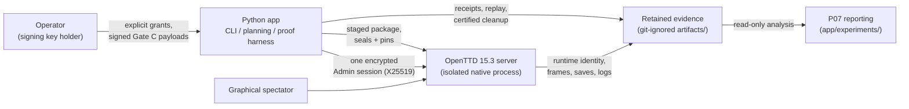
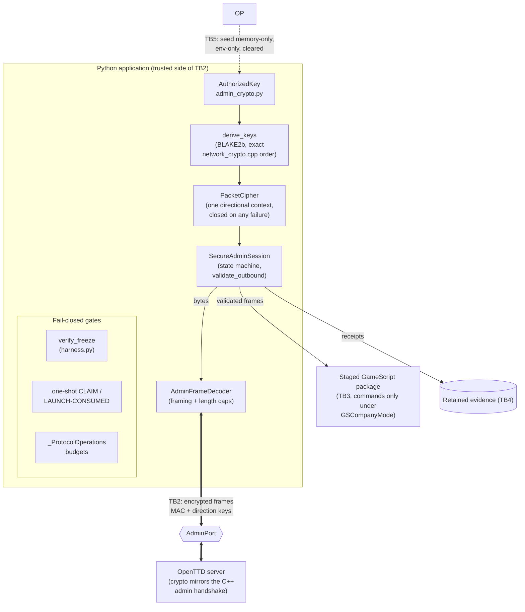

# Security and threat analysis (2026-11-13)

This document answers the customer security question: system context and data
flow with trust boundaries (DFD), asset inventory, misuse cases, security
requirements, a risk register, the secure-coding practices actually visible in
the source, and the rationale for security-relevant refactors. It is a
design-level threat analysis backed by source inspection — **not a third-party
audit and not a penetration test** — and it authorizes no runtime action.

Transport design of record: [secure-admin-transport.md](secure-admin-transport.md).
Branch of record: `miles/fright-delivery`, HEAD `90ebadb`.

## 1. System context (DFD level 0)

Trust boundaries:

| Boundary | What it separates |
| --- | --- |
| **TB1 — process/host** | The isolated OpenTTD server process (and the spectator) versus the Python application; server runs with its own workspace and settings, never the user's profile |
| **TB2 — AdminPort wire** | The encrypted Admin protocol between Python and the game server |
| **TB3 — staged package boundary** | What the harness stages and seals (`PRELAUNCH` seal, frozen source pins) versus what the server executes (composed GameScript package) |
| **TB4 — evidence store** | Retained `artifacts/` bytes (immutable, transfer-only) versus everything else; git-ignored by policy |
| **TB5 — operator credentials** | The operator's signing key material (held by the operator; parsed in memory only during Gate C) versus all code and processes |

## 2. Data flow detail (DFD level 1) — the admin session path

Key properties visible in source:

- Key derivation reproduces the exact server order — `shared + server_public +
  client_public` through BLAKE2b-64, split into two directional keys
  (`admin_crypto.py:73-80`), with an all-zero shared secret refused
  (`:76-77`).
- A bad peer key, bad framing, oversize packet, or failed MAC **permanently
  closes** the affected cipher context (`admin_crypto.py:105-114`, `:126-132`).
- Outbound application traffic is refused before the `ACTIVE` state
  (`secure_admin.py:188-191`); once encryption starts, any uncertainty fails
  validation before state is touched (`:193-194`).

## 3. Asset inventory

| # | Asset | Sensitivity | Where it lives | Protection of record |
| --- | --- | --- | --- | --- |
| A1 | Operator signing key (Ed25519 seed window) | Critical — mints launch authorizations | Operator-held PEM, outside the repo | Parsed in memory only; never printed or filed; env-only carry during signing; cleared after use (E132 signing mechanics) |
| A2 | Admin session keys (`AuthorizedKey` secret, derived directional keys) | Critical — channel authentication | Runtime memory only | `repr=False` on secret fields (`admin_crypto.py:25-27, 63-66`); lengths validated |
| A3 | World saves (`session-before.sav`, authoritative `after.sav`) | High — the ground truth of what happened | Staged workspace → retained artifacts | Digest-pinned and receipt-bound (`road_mutation.py:600-606`) |
| A4 | `PRELAUNCH.json` seal + `AUTHORIZATION.json` | High — attempt identity | Staged candidate directory | sha256 sidecars; one-shot `CLAIM.json` + `LAUNCH-CONSUMED.json` consumption chain |
| A5 | Retained receipts / frames / manifests | High — evidence integrity | Git-ignored `artifacts/` (TB4) | `artifact-manifest.sha256` (0-mismatch gates); transfer-only; never regenerated |
| A6 | Binary / asset pins | High — supply chain | Ledger records | SHA-256 re-verified at run start (binary `276d5b69…1904c`, OpenGFX `43a0c1da…03be`) |
| A7 | Frozen source closure | High — no code drift under a seal | Frozen chain (thousands of entries) | `verify_freeze` refuses launch on any change (`harness.py:102-104`) |
| A8 | Runtime workspace | Medium — scratch state | Temp directory, isolated | Refused inside the user's OpenTTD profile (`runtime/config.py:52-56`); disposed and certified |
| A9 | Cleanup credentials (Admin password material) | Critical at runtime | Created per attempt, removed after | Certification flag `credential_removed` gated by verification (`road_mutation.py:607-612`) |

## 4. Misuse cases

| # | Misuse case | Threat path | Counter of record |
| --- | --- | --- | --- |
| M-1 | Man-in-the-middle on AdminPort (TB2) | Passive read or active relay of admin traffic | X25519 authenticated key exchange + Monocypher incremental AEAD per direction; welcome identity matched against the signed expectation; derivation mirrors the server's own crypto |
| M-2 | Forged or replayed admin frames | Injected frames impersonating either side | Per-frame MAC; strict state machine (`AuthProtocolError` outside `ACTIVE`); unique one-correlated-request stream with ID-reuse rejection (delayed-ACK defense, `gamescript_transport.py:229-233`) |
| M-3 | Oversize / malformed frame DoS | crafted lengths, truncated MACs | Length caps and exact-length validation; failure closes the cipher permanently (`admin_crypto.py:105-121`) |
| M-4 | Staged package tampering (TB3) | Editing the GameScript or plan after review | Frozen source pins + `PRELAUNCH` seal verified immediately pre-launch; staged↔live byte-equality re-derived by independent review (E122/E131) |
| M-5 | Evidence fabrication / relabeling (TB4) | Rewriting receipts to claim success | Manifest digests, receipt/plan/save coherence checks (`road_mutation.py:603-606`), replay re-derivation from retained bytes, immutable FAILED terminals |
| M-6 | Unauthorized re-run of a consumed candidate | Re-launching a spent authorization | One-shot claim refusal (`operator_authorization.py:347-348`) + `O_EXCL` launch marker (`terrain_clearing.py:1376-1382`) + `No launch retry` (`native.py:275-276`) |
| M-7 | Runaway native process / resource abuse | Server outliving the attempt | Bounded ports/time/requests budgets; certified cleanup requires reaped processes, closed sockets, disposed workspace (4/4 flags, `road_mutation.py:607-612`) |
| M-8 | Workspace/profile escape (TB1) | Reading or corrupting the user's OpenTTD profile | Workspace placement refused inside the profile (`runtime/config.py:52-56`); server runs on staged settings, not the user's config |
| M-9 | Credential leakage via logs/stack traces | Secrets appearing in errors or reprs | Secret-bearing fields declared `repr=False` (`admin_crypto.py:25-27, 63-66`); typed exceptions carry class, not material |
| M-10 | Validation bypass via model surgery | Hand-crafted "already validated" objects | Anti-bypass re-parse at the public prelaunch boundary (`validation.py:78-86`) |

## 5. Security requirements

| ID | Requirement | Verified by |
| --- | --- | --- |
| SR-1 | Admin channel is encrypted and authenticated per direction, matching the server's own crypto construction | `admin_crypto.py:73-89`, `92-133`; welcome identity matching (E40/E49 handshake evidence) |
| SR-2 | Secret key material is never exposed through logs, reprs, or error messages | `admin_crypto.py:25-27, 63-66` |
| SR-3 | Native launches are single-use, signed, and one-at-a-time | `operator_authorization.py:347-348`; `terrain_clearing.py:1376-1382`; `native.py:275-276` |
| SR-4 | No code/config/asset drift under a seal | `harness.py:102-104` |
| SR-5 | Wire and protocol operations are budget-bounded | `gamescript_transport.py:105-108, 235-236` |
| SR-6 | Failures stop the attempt; no retry, no reconnect | `native.py:275-276`; REPRODUCE.md policy |
| SR-7 | Cleanup is certified, not assumed | `road_mutation.py:607-612` |
| SR-8 | Protocol state gating (no app traffic outside ACTIVE) | `secure_admin.py:188-191` |
| SR-9 | Runtime isolation from the user's own game profile | `runtime/config.py:52-56` |
| SR-10 | Evidence is tamper-evident and immutable | manifests + digest chains (TB4); `historical_protection` |
| SR-11 | Public boundaries cannot be bypassed by internal mutation | `validation.py:78-86` |
| SR-12 | GameScript executes commands only under `GSCompanyMode` within a staged, correspondence-checked package | staged-package discipline; `freight_delivery_package/` |

## 6. Risk register

| ID | Risk | L | I | Mitigation of record | Residual risk (honest) |
| --- | --- | --- | --- | --- | --- |
| R-1 | Operator key compromise | Low | Critical | Key operator-held, memory-only during signing | A compromised operator key forges launch grants; no key-rotation ceremony of record yet |
| R-2 | AdminPort exposed beyond the host | Low | High | Endpoint reservation and one-connection design target the local demo topology | Deployment topology is an operator responsibility; the app does not police external exposure |
| R-3 | Crypto construction mismatch with the server | Low | Critical | Derivation order source-matched to `network_crypto.cpp`; welcome identity matched | No formal crypto review beyond the design of record |
| R-4 | Evidence store tampering on disk | Medium | High | Digests/manifests + replay re-derivation | Digests are not an external notarization; store is git-ignored (transfer-only discipline mitigates) |
| R-5 | Bug in staged package executes unintended game commands | Medium | Medium | Frozen composition, staged↔live byte-equality review, GSCompanyMode discipline | GameScript logic bugs remain possible; evidence receipts bound the blast radius |
| R-6 | Supply-chain swap of binary/graphics | Low | High | Pinned SHA-256 re-verified at run start | Pin updates are manual; no automated feed |
| R-7 | Logical success misread as business success | High | Medium (credibility) | Typed honest verdicts (`CARGOFLOW2_LOADED_NEVER_DELIVERED`), revenue-never-profit rule | Requires presenter discipline; documented in customer docs |
| R-8 | No third-party security audit | — | — | This design-level analysis + recorded reviews | Formal external audit has not been performed; no claim is made otherwise |

## 7. Secure coding practices, with source references

The following practices are visible directly in the source (not aspirational):

- **B1 — Validate at the boundary, fail closed.** Exact cryptographic field
  lengths checked before use (`admin_crypto.py:20-22, 30-34`); framing,
  minimum length, and maximum frame length checked with explicit closes on
  failure (`:105-114`); connected timeouts/OS errors typed and raised
  (`secure_admin.py:180-185`).
- **B2 — Fail permanently on integrity failure.** A MAC failure closes the
  cipher and refuses further use (`admin_crypto.py:129-132`); there is no
  "best effort" decrypt.
- **B3 — Minimize secret exposure.** Secret fields on frozen dataclasses
  declare `repr=False` (`admin_crypto.py:25-27`, `:63-66`); the operator seed
  is parsed in memory, carried env-only, never printed, and dropped
  immediately after the authorization write (E132).
- **B4 — Gate behavior on explicit state.** Outbound traffic requires the
  `ACTIVE` state (`secure_admin.py:188-191`); the transport admits one
  correlated request at a time and rejects ID reuse
  (`gamescript_transport.py:229-233`).
- **B5 — Make bypass structurally hard.** The validation boundary re-parses
  typed inputs (`validation.py:78-86`); one-shot consumption is enforced at
  three independent layers (§4 M-6).
- **B6 — Budget every unbounded surface.** Protocol operation budgets with
  explicit exhaustion errors (`gamescript_transport.py:105-108`), class-level
  caps (`:235-236`), bounded candidate spaces in P08, bounded solve time in
  P05.
- **B7 — Clean up and certify.** Workspace creation refuses unsafe locations
  (`runtime/config.py:52-56`); post-run verification demands all-true cleanup
  flags (`road_mutation.py:607-612`); historical artifacts are protected
  (`historical_protection`; `tests/test_historical_protection.py`).

## 8. Security-relevant refactor/change rationale (selected, with anchors)

| Change | Why it was made | Anchor |
| --- | --- | --- |
| Encrypted-frame maximum raised 512 → 640 with statics/dynamics re-verified against the native wire | Frames needed headroom without weakening the cap discipline; the 640/512/32763 statics are part of the verified protocol record | E35 protocol statics; protocol docs of record |
| Re-parse anti-bypass added at the prelaunch boundary | `model_copy(update=...)` could smuggle unvalidated data past typed validation | `validation.py:78-86` |
| `PacketCipher` closes on any decode failure | A failed MAC must not leave a usable half-authenticated stream | `admin_crypto.py:105-133` |
| Runtime workspace isolation (profile refusal) | The isolated server must never read/write the user's own OpenTTD profile | `runtime/config.py:52-56` |
| Expand-only corridor route bindings (ticket-07 widening) | Adding the v2 competing route without changing the v1 route of record: fail-closed default byte-equal, foreign/non-registry ids refuse | E120 |
| Delivered-arm replay arm-inheritance fix | A raw re-parse defaulted retained responses to the v1 arm and refused valid delivered-arm frames; fixed at the narrowest layer with a regression test pinning the defect class | E134 (`test_delivered_replay_inherits_the_retained_request_arm`) |
| Corridor schedule ladder recomposition (delivered arm, tails at day 60) | The authored ladder ended before the delivery leg could be observed (E128); the fix extended observation rather than relaxing the verdict | E128/E129/E133 |
| Survey pipeline separated from the freight pipeline | Cross-plan abuse (a freight plan through a survey session) is refused at the protocol check rather than guarded at runtime | E36-b |
| Protocol family numbering discipline | Additive protocols (5/6/…/9) with explicit allocation prevent cross-session frame confusion | E59 (`corridor_box_census.py`) |

## 9. Honest limitations

- This is a **design-level analysis with source inspection**; no third-party
  security audit, formal verification, or penetration test of record exists,
  and none is claimed.
- The threat model covers the demo/experiment topology (operator-driven,
  local, one-connection). Operating the system as a multi-user networked
  service is out of scope and would need its own analysis.
- The evidence store's integrity rests on digests and discipline, not on an
  external notarization service.
- Security posture and correctness posture are separate: typed honest
  verdicts (e.g. `CARGOFLOW2_LOADED_NEVER_DELIVERED`) mean the security
  machinery ran cleanly while the business outcome was still not a delivery —
  neither claim is traded for the other.

## Related documents

- Transport design of record: [secure-admin-transport.md](secure-admin-transport.md)
- Error handling: [customer-error-handling.md](customer-error-handling.md)
- Architecture: [customer-architecture.md](customer-architecture.md)
