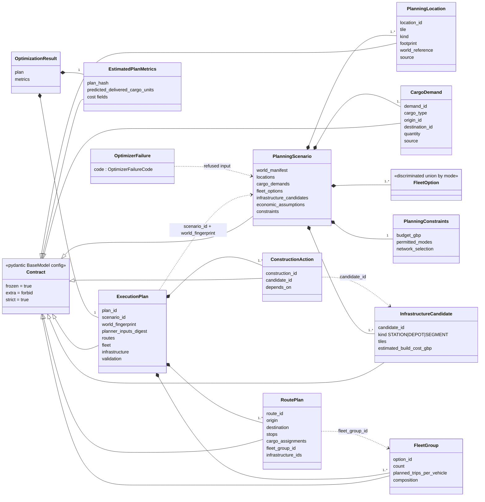
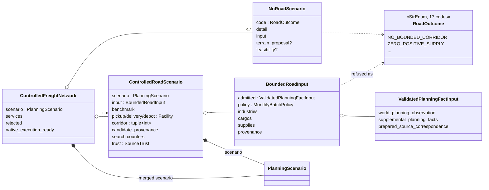
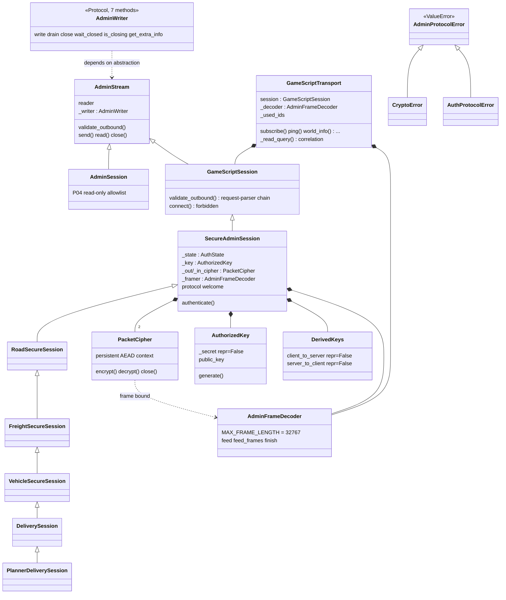

# UML class diagram and object relationships (customer presentation)

**Scope:** the core planning→execution path, documented from source inspection on
2026-11-13 (branch `miles/fright-delivery`, HEAD `90ebadb`). Attributes are
abbreviated to the fields that matter for reading the design; all names,
signatures and relationships were verified against the cited files. Complete
attribute lists live in the source of record.

The dominant pattern: **frozen typed contracts** (Pydantic models) cross every
seam; behavior lives in plain functions around them; the runtime stack is a small
subclass hierarchy of sessions and backends.

## 1. Planning domain (P08 → P05 → validated plan)

Relationships and where they are enforced:

- Every model is a frozen `Contract` (`app/planning/domain.py:46-47`,
  `ConfigDict(frozen=True, extra="forbid", strict=True)`); identifier and digest
  types are bounded (`Identifier` regex/length `domain.py:36-40`, `Digest` = 64 hex
  `:41`).
- `ExecutionPlan` ↔ `PlanningScenario` identity is enforced by digest comparison,
  not by trust: `validate_execution_plan(plan, scenario)` re-parses both models
  through JSON before checking (`app/planning/validation.py:78-86`, anti-bypass
  comment) and refuses `SCENARIO_MISMATCH` on any identity difference (`:87-93`).
- The optimizer is a pure transformation: `optimize_candidate_network(scenario:
  PlanningScenario) -> OptimizationResult` (`app/planning/optimizer.py:573-609`),
  emitting typed `OptimizerFailure(ValueError)` with an `OptimizerFailureCode`
  StrEnum (`:40-53`) instead of returning partial results.
- Source-level references: `PlanningScenario` `domain.py:266-299`;
  `ExecutionPlan` `:384-399`; `EstimatedPlanMetrics` `:402-417`;
  `InfrastructureCandidate` `:165-178`; `RoutePlan` `:313-323`; `FleetGroup`
  `:347-357`; `ConstructionAction` `:364-371`.

## 2. P08 candidate generation objects

- `adapt_planning_facts(ValidatedPlanningFactInput, MonthlyBatchPolicy) ->
  BoundedRoadInput` revalidates at the admission seam and tags provenance
  (`app/planning/p08_adapter.py:159-220`); `AdapterError` classifies the
  authoritative validator's failure without reimplementing its gates (`:39-53`).
- `generate_road_scenario(...) -> ControlledRoadScenario | NoRoadScenario`
  (`app/planning/p08_road.py:322-484`): the two-class union makes infeasibility a
  value, not an exception path — 17 typed `RoadOutcome` codes
  (`p08_adapter.py:19-36`).
- `generate_freight_network(inputs, ...) -> ControlledFreightNetwork` merges up to
  16 per-service packages into one multi-OD `PlanningScenario` with shared supply
  and resource constraints (`app/planning/p08_network.py:32-197`, max 16 at `:20`).
- `ValidatedPlanningFactInput` composes the three observation-side inputs
  (`app/simulation/openttd/planning_fact_input.py:13-17`).

## 3. Transport and session stack (encrypted AdminPort)

- `AdminWriter` is a structural typing `Protocol` with exactly the seven methods
  the stream needs (`app/simulation/openttd/admin_session.py:14-20`) — clients
  depend on the narrow interface, not on a concrete socket type.
- Each subclass narrows the outbound policy; none weakens a parent's guarantees
  (subclass rules are supersets — see [customer-solid-analysis.md](customer-solid-analysis.md)
  LSP section). Chain cites: `RoadSecureSession`
  (`proof/road_mutation.py:61`), `FreightSecureSession`
  (`proof/road_freight_infrastructure.py:39`), `VehicleSecureSession`
  (`proof/road_vehicle_lifecycle.py:152`), `DeliverySession`
  (`proof/freight_delivery.py:487-496`), `PlannerDeliverySession` (`:499-582`).
- `PacketCipher` closes itself on any framing/decode failure
  (`admin_crypto.py:105-114, 129-132`); `AuthorizedKey._secret` is `repr=False`
  (`admin_crypto.py:25-27`).
- The transport owns exactly one correlated in-flight request and refuses
  duplicate request IDs beyond `MAX_REQUESTS`/budget
  (`gamescript_transport.py:235-236, 321-322, 532-543`).

## 4. Runner, compiler and evidence objects

```mermaid
classDiagram
    direction LR
    class NativeBackend {
        kind = "REAL"
        process
        session : SecureAdminSession
        transport : GameScriptTransport
        _key : AuthorizedKey
        preflight() launch()
    }
    class CargoPageNativeBackend
    class StructuralNativeBackend
    class QualificationNativeBackend
    class VehicleBackend
    class DemoBackend {
        preflight() cleanup() validate_launch()
    }
    class PlannerBackend {
        qualification_coordinator
        secure_connection
    }
    class PreparedProof {
        directory
        spec : LaunchSpecification
        key_path endpoints
        request
        dispose()
    }
    class EndpointReservation {
        game_port admin_port
        allocate() close()
    }
    class PlannedFreightService {
        road : ControlledRoadScenario
        execution_plan_digest
        selection_request()
        validate_native_selection()
    }
    class PlanningSelectionRequest {
        plan : Digest
        a : 10 ints
        path : 2..47 ints
        depot_front
    }
    class DeliveryRequest {
        op INSPECT|BUILD|READ|OBSERVE|FINISH
        request_id max_cost
    }
    class DeliveryReadback {
        status a f s e
        parse_for() digest()
    }
    class DeliveryPlan {
        prelaunch_digest
        source_save_digest
        admission_digest
        digest
    }
    class NetworkEvaluation {
        plan_digest
        services
        verified_batch_subtotals
        evidence_refs
    }
    class PerformanceInsights {
        metrics services
        time_series
        bottlenecks recommendations
        comparisons
    }
    NativeBackend <|-- CargoPageNativeBackend
    CargoPageNativeBackend <|-- StructuralNativeBackend
    StructuralNativeBackend <|-- QualificationNativeBackend
    NativeBackend <|-- VehicleBackend
    VehicleBackend <|-- DemoBackend
    DemoBackend --|> PlannerBackend : mixed with QualificationNativeBackend
    NativeBackend *-- SecureAdminSession
    NativeBackend *-- GameScriptTransport
    PreparedProof *-- LaunchSpecification
    PreparedProof o-- EndpointReservation
    PlannedFreightService o-- ControlledRoadScenario
    PlannedFreightService ..> PlanningSelectionRequest : builds
    PlannedFreightService ..> DeliveryReadback : cross-checks
    DeliveryReadback ..> DeliveryPlan : admit()
    NetworkEvaluation ..> ExecutionPlan : evaluates
    NetworkEvaluation ..> DeliveryPlan : replays receipts
    PerformanceInsights ..> NetworkEvaluation : analyzes
```

- Backend hierarchy: `NativeBackend` → `CargoPageNativeBackend` →
  `StructuralNativeBackend` → `QualificationNativeBackend`
  (`proof/native.py:215-279`, `proof/cargo_page_native.py:93`,
  `proof/structural_native.py:230`, `proof/qualification_native.py:64`);
  `DemoBackend(VehicleBackend)` (`proof/freight_delivery.py:229+`);
  `PlannerBackend(DemoBackend, QualificationNativeBackend)` — deliberate multiple
  inheritance mixing the demo lifecycle with qualification capability (`:476-484`).
- `NativeBackend` refuses to exist without `authorized_one_launch`
  (`proof/native.py:218-220`) and refuses a second spawn (`:275-276`).
- Wire models `DeliveryRequest`/`DeliveryReadback`/`DeliveryPlan` with
  `admit(...)` and `verify_delivery(...)` (`app/simulation/openttd/freight_delivery.py:19-283`).
- Compiler: `compile_freight_service(road, plan) -> PlannedFreightService` checks
  the plan digest against the scenario before any native work
  (`app/simulation/openttd/freight_planning.py:151-191`).
- P07: `NetworkEvaluation` (`app/experiments/freight_network.py:42-55`) and
  `PerformanceInsights` (`app/experiments/performance_insights.py:196-213`) are
  the reporting-side contract models; evaluation replays native receipts before
  accepting any service actuals (`:87-120`).

## 5. Cross-cutting relationships worth knowing

| Relationship | Kind | Anchor |
| --- | --- | --- |
| `Contract` base model → every planner/wire model | inheritance (Pydantic) | `app/planning/domain.py:46-47` |
| `ValidatedPlanningFactInput` → P08 → `PlanningScenario` → P05 → `ExecutionPlan` → compiler → native | dependency chain across seams, all frozen contracts | sections 1–2, 4 |
| Session subclass chain (7 levels) | inheritance + policy override | section 3 |
| `PacketCipher`/`AdminFrameDecoder`/`AdminStream` | composition inside `SecureAdminSession` | `secure_admin.py:136-162` |
| `OwnershipGraph` / `EndpointReservation` / frozen-source inventory | composition inside the attempt lifecycle | `proof/harness.py:107-169`, `runtime/ownership.py` |
| `FreightHistory` (SQLAlchemy) → P07 | persistence behind the reporting layer | README "Optional historical experiments" |
| `Viewer` (GUI spectator) | owns only its client process | `app/openttd_demo.py:95-238` |

## 6. Not shown (deliberately)

The per-milestone corridor protocol families (`corridor_*` wire modules), the
`.nut` GameScript packages (Squirrel, not Python classes), the canonical-fleet and
five-year continuous modules, and the P07 persistence models are siblings of the
diagrammed core with the same patterns (frozen contracts + staged packages +
replay verifiers); they are itemized in [customer-architecture.md](customer-architecture.md)
§2 and the module map in [AI_HANDOFF.md](../AI_HANDOFF.md).
