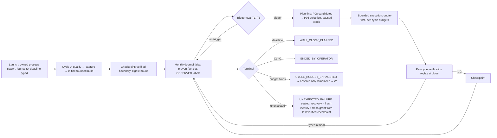

# Long-Running Closed-Loop Experiment (LR) — Scope Proposal, 2026-11-13

**Status: PROPOSED — reviewable design only, awaiting operator approval (milestone
M-LR-0).** Produced by the Stage-1 grilling + Stage-2 wayfinder charting session of
2026-11-13, after the Phase C terminal statement (E202), the approved Phase D scope
(proposal 2026-11-12; M0 granted, M1 quality floor green, M2 = tickets 12–15
pending) and the complete Phase D ticket review (issues 01–29). This proposal
**grants no runtime authority of any kind**: no OpenTTD launch, no AdminPort
connection, no staging, no signing, no claim, no retry of any consumed attempt, no
evidence regeneration, no commit, no push. **Selecting closed-loop mode authorizes
nothing autonomically**; every native attempt needs its own explicit operator grant.
Vocabulary (VERIFIED / PROVEN / PREPARED / PARTIAL / FAILED / UNKNOWN, consumed,
sealed) means exactly what `AI_HANDOFF.md` defines. **LR is a working name only**;
formal successor naming (e.g., "Phase E") is a later operator decision.

Provenance: all artifacts of this session are uncommitted working-tree files —

- this proposal (`docs/lr-long-run-scope-proposal-2026-11-13.md`),
- the wayfinder map (`.scratch/lr-long-run/map.md`, label `wayfinder:map`),
- its decision tickets (`.scratch/lr-long-run/issues/01…08`).

No application code was modified; no native run occurred; no evidence byte was
touched; E36 stays OPEN and FD-C-2 stays `INCOMPLETE_EVIDENCE`.

## 1. Charter and scope finding

LR is a **successor effort** to the approved Phase D scope. It does not reopen
Phase D M0, does not modify Phase D tickets 01–29, and is hard-gated on Phase D
M2 (tickets 12–15) landing. Phase D's battery outcomes (tickets 24–26) inform
LR's risk register but never block it (D20).

**Destination.** A persistent two-hour closed-loop simulation experiment in which
the Python logistics system repeatedly observes the actual game state, analyzes
it, generates and validates plans, executes bounded operations, verifies
outcomes, and feeds verified actuals into subsequent planning cycles — on a fresh
256×256 random world at normal speed — while preserving a complete,
machine-verifiable history of decisions and outcomes. Wall-clock is the primary
bound; in-game duration is a **measured outcome** with a proposed expectation
band of **~3.5–7 economy years** at the proposed cycle cap (derived, never a
guarantee).

**Native envelope anchor of record.** The longest proven continuous native
session is T-032 (E193): one session, ≤7200 s wall, 10,861 requests, five economy
years observed. LR's full attempt matches that envelope in duration and exceeds
it only in per-cycle heterogeneity (build ops interleaved with observation). LR
never exceeds 2 h; behavior beyond that envelope is UNKNOWN and out of scope.

**Honest expectation (stated up front, not an edge case).** On the bounded
profile, constructible candidates are scarce and typed: the 2026 battery produced
`candidate_count 0` in two terminals and `1` in the third (E157/E198–E199), and
P08 remains `INCOMPLETE_TILE_CLASSIFICATION` until Phase D tickets 03/14 land.
Once the initial fleet is built (expand-only, vehicles then run autonomously
under their orders), most cycles will honestly be observe-only or
`ZERO_CANDIDATES`. The longitudinal value of LR is the verified multi-year record
(economics, delivery, failure modes, planner decisions over years), not repeated
construction.

## 2. Decisions of record (Stage-1 grilling, 2026-11-13)

Settled with the operator across three rounds; the question-and-answer record is
the session transcript. One line each.

| # | Question | Decision |
|---|---|---|
| D1 | Time-bound semantics | **Wall-clock primary** (7200 s proposed for full attempts); in-game years are measured outcomes; proposed band ~3.5–7 years at cap 8; no binary patching or speed modification, ever |
| D2 | Attempt / recovery model | Failure seals its attempt terminally; **recovery = fresh identity + fresh operator grant, resuming from the last verified checkpoint only**; no in-session retry; no replay of uncertain commands |
| D3 | Cycle scope | **Expand-only + bounded**: each cycle may construct new services under sealed per-cycle budgets; no teardown, no vehicle retirement, no unrestricted replanning; typed refusals and duplicate prevention preserved |
| D4 | Cadence | **Event-driven**: monthly journal observations always; planning cycles only when named observed triggers fire; per-cycle paused cost cap 3–6 min **proposed, pending offline validation** |
| D5 | Checkpoint policy | **Checkpoint after every verified cycle boundary**, binding native save digest + journal cursor + completed receipt set; recovery loads verified checkpoints only; no manufactured checkpoints |
| D6 | Evidence architecture | **Append-only JSONL event journal + per-cycle receipts + incremental manifests + final report**; economics offline-first with OBSERVED/DERIVED/UNKNOWN labels; revenue never profit; PostgreSQL not required |
| D7 | Charter placement | **Separate successor effort, working name LR**; no Phase D ticket re-scoped; formal naming deferred to the operator |
| D8 | Budget/identity surface | **New sealed schema `long-run-prelaunch-v1`**: budgets linear in planned cycles, hard caps, typed exhaustion outcomes, per-cycle request namespaces, 512-byte reply bound and per-request wire trust anchor unchanged; identity family distinct from existing loop schemas |
| D9 | World start | **Fresh 256×256 random world at the proven product defaults (towns 3, industries 3)**; seed operator-selected at grant time, never-consumed verified; cycle 0 = existing qualify → capture → initial bounded P08/P05 build; battery checkpoints are never LR starting states |
| D10 | Qualification model | **Qualify+capture once in cycle 0**; later cycles plan from cycle-0 facts + `exclude=` service exclusions + lightweight monthly observations; full re-qualification only on named typed staleness events backed by directly observed signals; UNKNOWN stays UNKNOWN; no proxy triggers |
| D11 | Planning caps | `max_planning_cycles = 8`; `max_total_paused_seconds = 2400`; whichever binds first stops further planning (observe-only remainder); both **proposed parameters pending offline validation**, not acceptance criteria |
| D12 | Zero-candidate semantics | `ZERO_CANDIDATES` (and `BUDGET_REFUSED`/`WINDOW_REFUSED` classes) are **typed per-cycle outcomes, not run terminals**; the loop's `abandoned_world` K=2 auto-fence is NOT carried into LR; run-level terminals: `WALL_CLOCK_ELAPSED`, `ENDED_BY_OPERATOR`, `UNEXPECTED_FAILURE`, `CYCLE_BUDGET_EXHAUSTED`; planning cooldown is a trigger-policy parameter |
| D13 | Native appetite | **LR ceiling 5**: ×1 shakedown (≤15 min proposed) + ×1 full 2 h attempt + ×2 recovery rounds + ×1 optional second full attempt; serial; each its own complete four-gate ceremony; completely separate from Phase D's native budget; ceiling ≠ authorization or promised consumption |
| D14 | Economics surface | **Aggregate-only OPEX**; vehicle running costs, loan interest, and other categories stay UNKNOWN; `compare_arms` guards preserved; revenue is not profit; no engine value is derived and mislabeled OBSERVED; per-category OPEX observation is a named successor decision |
| D15 | Checkpoint validation depth | **Digest-only binding in-run**; full semantic correspondence (`EXACT_NATIVE_SEMANTIC_CORRESPONDENCE` shape) verified at recovery and post-run; the limitation — consistency is verified at recovery, not continuously — is recorded verbatim |
| D16 | Shakedown outcomes | **`LIFECYCLE_PROVEN` / `LIFECYCLE_PARTIAL`**, with the operator's consistency correction: the shakedown never manufactures a trigger or a checkpoint to satisfy its own criteria; `LIFECYCLE_PARTIAL` is never represented as closed-loop proof — planning capability stays UNKNOWN until a genuine planning cycle is verified; recovery is not natively exercised in the shakedown (risk-register UNKNOWN) |
| D17 | Verified cycle (definition of record) | **Retained command receipts + successful offline verification replay rc 0 + the cycle's observation receipt, all at cycle close** — the only checkpoint-eligible state |
| D18 | Monthly observation content | **Proven-fact set**: balance, freight revenue, delivered cargo totals, vehicle count/states, cargo-waiting backlog point-samples, production point-samples for planned-over industries — from the already-proven read families, each labeled OBSERVED with its source digest; backlog is a point-sample, never demand |
| D19 | Planning-trigger set | Fire a planning cycle when **T1** budget remains AND **T2** the candidate pipeline is plausibly non-empty AND (**T3** backlog above a proposed threshold OR **T4** a year anniversary arrives); **T5** a typed staleness event forces re-qualification before planning; **T6** cooldown of K cycles after `ZERO_CANDIDATES` (proposed K=2) suppresses re-triggering; deterministic anniversary floor included; all thresholds proposed parameters pending offline validation |
| D20 | Sequencing | **Hard implementation gate = Phase D M2 only** (tickets 12–15); battery outcomes inform the LR risk register and seed choice but never block implementation |
| D21 | Carried corrections | Headless operator stop is Ctrl-C typed `ENDED_BY_OPERATOR` (no GUI window semantics); recovery rewinds the crashed cycle's executed-but-unverified mutations and rewinds the exclusion ledger consistently (world and ledger rewind together — no false duplicates); the 2 h run sits exactly at the proven T-032 envelope — beyond it, UNKNOWN |

## 3. Vocabulary of record (new LR terms)

`CONTEXT.md` is byte-pinned and prepend-only; these terms live here, not there.

- **LR (working name)** — the successor effort defined by this proposal.
- **Long run** — a controller-driven experiment bounded by wall-clock, never by
  game date; the deadline is measured from the owned process spawn instant,
  typed into the journal as t0.
- **Cycle 0** — the initial lifecycle on a fresh world: qualify → capture →
  initial bounded P08/P05 build (whatever it types, including an empty fleet).
- **Planning cycle** — one trigger-gated plan/execute/verify iteration after
  cycle 0; expand-only; may legitimately end `ZERO_CANDIDATES`.
- **Journal tick** — a monthly, event-driven observation appended to the journal.
- **Verified cycle** — D17's definition; the only checkpoint-eligible state.
- **Checkpoint** — native save + journal cursor + receipt set, digest-bound at a
  verified cycle boundary. Constructed-fleet saves by construction (the proven
  reload path, E176/E190).
- **Recovery round** — a fresh attempt identity under a fresh grant resuming from
  the last verified checkpoint; unverified mutations of the crashed cycle are
  rolled back.
- **Staleness event** — a named typed condition, backed by directly observed
  signals, forcing full re-qualification (D10). No proxy-based triggers.
- **Trigger set** — the T1–T6 observed-signal conditions gating planning cycles.
- **Shakedown** — the first native LR attempt; terminal `LIFECYCLE_PROVEN` or
  `LIFECYCLE_PARTIAL` (D16).
- **`WALL_CLOCK_ELAPSED`** — the designed success terminal at the deadline.
- **`CYCLE_BUDGET_EXHAUSTED`** — typed outcome when the planning budget binds
  first; the remainder of the run is observe-only.
- **`long-run-prelaunch-v1`** — the LR seal schema family (D8).
- **Journal / incremental manifest** — the append-only evidence architecture
  (D6); **new machinery** built in a new identity family, not the existing
  finalize-at-end manifests.

## 4. Workstreams

### LR-01 — Run Lifecycle and Controller

**Goal.** The controller state machine: wall-clock enforcement, terminal
taxonomy, pause/unpause seams, per-cycle request-id namespaces, and the
`console_ack` echo handshake on every console save (the ticket-06 fix, proven
E157).

| Class | Items |
|---|---|
| PROVEN anchors | T-032 two-hour envelope (E193); loop engine `run_loops`/`loop_gate` with per-cycle recordings (E143/E157); soft-end typing `ENDED_BY_OPERATOR` (E148/E149); per-cycle id maker (E155 fix); owned cleanup certification |
| PREPARED (the work) | The LR controller (new state machine); `long-run-prelaunch-v1` seal; per-cycle namespaces at LR depth; deadline anchor + typed t0 |
| UNKNOWN (preserved) | Controller behavior under LR's cycle heterogeneity; any behavior beyond 2 h (out of scope) |
| OUT | Speed modification/binary patching; GUI window semantics in headless runs |

**Offline bar.** Decision tickets 01/04/05 resolved; controller lifecycle tests
green over a simulated multi-cycle timeline including every terminal class.
**Native surface.** Consumed by the shakedown and full attempts.

### LR-02 — Persistent Observation and Telemetry

**Goal.** The append-only journal and its monthly proven-fact ticks (D18), plus
per-cycle observation receipts.

| Class | Items |
|---|---|
| PROVEN anchors | Continuous annual/monthly/quarterly receipts (E190/E193); census read families (E16 pattern); 512-byte reply bound; 19-integer tile responses |
| PREPARED (the work) | Journal schema and event taxonomy (ticket 02); incremental manifest design (ticket 03); monthly content set (D18) |
| UNKNOWN (preserved) | Packet-budget behavior over hundreds of exchanges at LR depth; journal volume over 10 years |
| OUT | PostgreSQL persistence; derived-proxy signals; promoting UNKNOWN to a number |

### LR-03 — Closed-Loop Planning

**Goal.** Cycle 0, then trigger-gated planning from cycle-0 qualified facts +
`exclude=` exclusions + monthly observations, with typed staleness events (D10,
D19).

| Class | Items |
|---|---|
| PROVEN anchors | P08/P05 bounded selection (seed 7, E199 — the battery's only planned run); `exclude=` funnel and typed zero-service outcomes (E143/E157); qualification caps (≤32 industries observed, ≤16 relationships, ≤8 services/vehicles, one vehicle per service) |
| PREPARED (the work) | Trigger set T1–T6 operationalization; staleness-event list (each trigger tied to an observed signal); cooldown policy; threshold validation method |
| UNKNOWN (preserved) | Candidate scarcity on the bounded profile (`candidate_count 0` dominant — expected); planning-with-classification rides Phase D tickets 03/14 and may be decided as non-integration |
| OUT | Service teardown; vehicle retirement; automatic parameter change (Phase D D11's boundary: typed feedback only, opt-in, evidence-gated, never automatic) |

### LR-04 — Bounded Execution and Verification

**Goal.** Expand-only construction under per-cycle sealed budgets; quote-first
purchase; per-cycle verified-cycle replay at close (D17).

| Class | Items |
|---|---|
| PROVEN anchors | Quote-first purchase ≤ £5,000 cap and 60-day per-attempt spending authority pattern (E51); budget enforcement with typed refusals; ADR-0001 funds taxonomy (E125, CONFIRMED DECISION OF RECORD); `verify_loop_receipt` per-cycle replay (E144/E158) |
| PREPARED (the work) | Per-cycle budget derivation for `long-run-prelaunch-v1` (ticket 04); LR per-cycle verify command of record (ticket 03) |
| UNKNOWN (preserved) | Native behavior of back-to-back build+observe sessions at LR depth |
| OUT | Unrestricted replanning; mutating sealed wire contracts of the corridor/loop families |

### LR-05 — Checkpoint and Recovery

**Goal.** Verified-boundary checkpoints with digest-only in-run binding (D15);
recovery rounds with rewind consistency (D2, D21).

| Class | Items |
|---|---|
| PROVEN anchors | Constructed-fleet save/restore + `EXACT_NATIVE_SEMANTIC_CORRESPONDENCE` (E2/E189/E190); GameScript rides the save (GSDT, E174/E176); console save with `console_ack` handshake (E157); failure-save path |
| PREPARED (the work) | Checkpoint package (save + cursor + receipt binding); recovery contract (ticket 06): identity binds checkpoint digest + journal cursor; rewind-consistency checks |
| UNKNOWN (preserved) | Native recovery behavior end-to-end (no LR recovery has ever run; deferred per D16); in-process reload mid-run (rejected — out of scope) |
| OUT | Per-mutation saves; manufactured checkpoints; replaying uncertain commands |

### LR-06 — Long-Run Economics and Analytics

**Goal.** Per-cycle/monthly/annual P&L derived offline from retained receipts;
aggregate-only OPEX (D14); every number labeled and digest-sourced.

| Class | Items |
|---|---|
| PROVEN anchors | Receipts carry `freight_revenue`, cash, delivered cargo, quarterly/annual expense aggregates (E190/E192/E193); `compare_arms` guards (E192); T-033 consolidation pattern (E194) |
| PREPARED (the work) | LR receipt-shape audit → per-cycle P&L extension (the Phase D tickets 22–23 pattern) |
| UNKNOWN (preserved) | OPEX categories; ROI; running-cost split; per-category OPEX observation (named successor decision) |
| OUT | Deriving engine values and mislabeling them OBSERVED; forecasts; revenue-as-profit |

### LR-07 — Evidence, Replay, and Final Reporting

**Goal.** Journal + incremental manifests + post-run replay + the final report
covering infrastructure, vehicles, cargo, delivery, finances, failures, and
planner decisions — each field tied to its receipt class and evidence label.

| Class | Items |
|---|---|
| PROVEN anchors | `artifact-manifest.sha256` discipline and standing sweeps (E165/E195/E196); P07 outputs (`results.md`, `evaluation.json`, `operations.html`, SVG, `operational-history.json`); typed verify-of-record patterns |
| PREPARED (the work) | LR verify command of record (ticket 03); final report schema + P07 integration (ticket 07); final manifest completion at terminal |
| UNKNOWN (preserved) | End-to-end first execution of the whole contract |
| OUT | Evidence regeneration; relabeling any consumed identity; sealing over gaps |

## 5. Run model (synthesis)

- **Pause model.** The world clock pauses for capture and planning (the
  `paused_world_clock` decision of record, natively proven four times:
  E150/E198/E199/E201); game time does not advance while planning. The
  wall-clock deadline is independent of game date (D1).
- **Cycle state machine.** OBSERVE → TRIGGER_EVAL → [PLAN → EXECUTE → VERIFY] →
  CHECKPOINT → next | terminal. A cycle that ends `ZERO_CANDIDATES` (or any
  typed per-cycle refusal) records the outcome and returns to observation; the
  run continues (D12).
- **Recovery.** Only from a verified checkpoint; the crashed cycle's executed
  but unverified mutations are rolled back and the exclusion ledger rewinds
  with the world (D21).

## 6. Parameters of record (proposals pending offline validation)

None of these is an acceptance criterion; each must be validated offline before
any native use, and each may be amended by operator decision.

| Parameter | Proposed value | Status |
|---|---|---|
| Full-attempt wall-clock budget | 7200 s | Proposed; deadline from process spawn |
| Shakedown wall-clock bound | ≤900 s (15 min) | Proposed |
| `max_planning_cycles` | 8 | Decided cap (D11); cost model unvalidated |
| `max_total_paused_seconds` | 2400 (33% of wall) | Decided cap (D11); cost model unvalidated |
| Per-cycle paused cost | 3–6 min | Estimate pending offline validation |
| Cooldown after `ZERO_CANDIDATES` | K = 2 | Proposed |
| Backlog trigger threshold | TBD by offline validation | Named fog |
| In-game expectation band | ~3.5–7 economy years at cap 8 | Derived estimate; recomputed once caps validate |
| P05 solver bound | 1–60 s (unchanged, of record) | Existing bound |
| Per-exchange read timeout | 20 s (`EXCHANGE_SECONDS`, of record) | Existing bound |
| Reply bound / trust anchor | 512 B / per-request wire trust anchor (unchanged) | Existing bounds |

## 7. Milestones and acceptance criteria

- **M-LR-0 — Proposal approved (operator).** This document + map reviewed and
  approved. Approval covers offline design tickets only; no runtime authority.
- **M-LR-1 — Design complete (offline).** Decision tickets 01–08 resolved, each
  with its Answer of record in-file.
- **M-LR-2 — Implementation bar (gated on Phase D M2 + operator approval of
  implementation tickets).** Journal/manifest/schema/controller landed additive;
  focused suites green; loop/corridor/canonical v1 identities byte-equal, pinned
  by tests; LR fixtures derived from retained bytes (never targets); ruff / ty /
  py_compile / `git diff --check` clean; full-suite gate run per the REPRODUCE
  cadence (pre-native-round).
- **M-LR-3 — Shakedown (native ×1, four gates).** Terminal `LIFECYCLE_PROVEN`
  (a genuine post-cycle-0 planning cycle completed with receipts, replay, and
  verified checkpoints — ≥2 genuine verified-boundary checkpoints) **or**
  `LIFECYCLE_PARTIAL` (cycle 0, observation, trigger evaluation, journal,
  incremental manifest, and clean wall-clock termination complete, but no
  legitimate trigger fired). `LIFECYCLE_PARTIAL` is never represented as
  closed-loop proof; planning capability stays UNKNOWN until a genuine planning
  cycle is verified. No manufactured triggers or checkpoints, ever.
- **M-LR-4 — Full attempt (native ×1, four gates).** Terminal per the D12
  taxonomy; ≥1 verified cycle is expected but not guaranteed (sparse-candidate
  worlds may honestly produce observe-only runs); final report + evidence
  contracts complete; post-run replay rc 0.
- **M-LR-5 — Recovery/close-out.** Recovery rounds only as needed (fresh
  identity + fresh grant each, from the last verified checkpoint); unused
  allocations return to ceiling accounting with the reason of record; E-row +
  ledger row + REPRODUCE addendum per round; optional second full attempt only
  by operator decision.

**Offline acceptance criteria (summary).** Every new surface additive in a new
identity family; no sealed identity byte changed; every typed refusal preserved;
fixtures from retained bytes; per-cycle replay verification green; v1
byte-compatibility pinned by tests; the standing full-suite gate cadence
honored.

**Native acceptance criteria (summary).** The four-gate ceremony per attempt;
one launch; no retry/reconnect; certified cleanup; stop on first unexpected
failure; typed terminal whatever it is; nothing relabeled; LR ceiling 5 serial.

## 8. Risk register

| # | Risk / UNKNOWN | Class | Disposition |
|---|---|---|---|
| R1 | 2 h native duration matches the longest proven continuous monitoring envelope (T-032/E193); behavior beyond it is UNKNOWN | UNKNOWN | LR never exceeds 2 h; out of scope beyond |
| R2 | Cycle 0 may legitimately produce an empty fleet | Expected possibility | Longitudinal observation without construction is a valid run outcome; typed honestly |
| R3 | Recovery rewinds unverified mutations; the exclusion ledger must rewind consistently | Design constraint | Rewind-consistency checks named in ticket 06; no false duplicates possible when world + ledger rewind together |
| R4 | Headless operator termination is Ctrl-C, typed `ENDED_BY_OPERATOR`; no GUI window semantics | Design constraint | Carried verbatim from D21 |
| R5 | Checkpoint semantic consistency is verified at recovery, not continuously in-run | Known limitation | Recorded verbatim (D15); digest-only binding in-run; full correspondence at recovery/post-run |
| R6 | Sparse candidates: planning cycles may rarely fire; `LIFECYCLE_PARTIAL` and observe-only full runs are expected possibilities | Expected possibility | Typed per-cycle outcomes; never manufactured (D16) |
| R7 | The pause budget may bind before the wall deadline → `CYCLE_BUDGET_EXHAUSTED` observe-only remainder | Typed outcome | Not a failure; recorded |
| R8 | Packet-budget growth at LR depth (hundreds of exchanges over 2 h within the 512 B bound) | UNKNOWN until shakedown | Exchange counts sealed in `long-run-prelaunch-v1` with hard caps + typed exhaustion |
| R9 | GameScript Save/Load round-trip proven only to 2 loop cycles (E157); LR depth is UNKNOWN | UNKNOWN | Per-cycle state lives Python-side (the `loop-excluded-sources` pattern); GS Save/Load round-trip pinned by offline package-VM tests |
| R10 | Save-stall class regression (E156 attempt-5: unacknowledged console command consumed 15 s late) | Closed with condition | Every console save rides the `console_ack` handshake (E157); pinned by tests |
| R11 | Month-window straddle class (E156: supplemental capture outside the final M2 month) | Known gate | Monthly ticks bounded inside month windows; typed refusal preserved, never weakened |
| R12 | Request-id namespace collisions at LR depth (E155 class) | Fixed class | Per-cycle namespace (the `cycle_request_id` fix); drift-guard tests |
| R13 | Memory / long-session stability | UNKNOWN within envelope | Within the T-032 envelope; observed via journal; no claims beyond |
| R14 | In-game year yield below the band if overhead exceeds assumptions | Parameter risk | Bands recomputed offline before any native round; never a guarantee |
| R15 | Phase D M2 slip delays LR implementation | Dependency | Hard gate by operator decision (D20); no workaround invented |
| R16 | LR planning-with-classification depends on Phase D tickets 03/14 (non-integration possible) | Dependency | If non-integration is decided, LR plans on corridor-bound-classified evidence only; candidate scarcity worsens; risk noted, never hidden |

## 9. Authorization gates

- **Design exit (M-LR-0).** Operator approval of this proposal. It covers
  offline design tickets only.
- **Implementation publication.** Implementation tickets are published only
  after proposal approval (the Phase D pattern); nothing is implemented from
  this proposal before then.
- **Hard implementation gate.** Phase D M2 (tickets 12–15) must land first
  (D20).
- **Native rounds (LR ceiling 5, serial, D13).** Each attempt through the full
  four-gate ceremony: staging approval → independent review → Gate C signing →
  separate explicit launch approval, each an in-session operator decision; one
  launch; no retry/reconnect; certified cleanup; stop on first unexpected
  failure; consumed identities never reused; all prior grants (any phase) void
  for reuse. Identity families at ticket time (`lr-shakedown-*`,
  `lr-full-*`, `lr-recovery-*`); never shared with Phase D grants.
- **Standing rule.** Selecting closed-loop mode authorizes nothing
  autonomically; the ceiling is a ceiling, not a promise; every consumed grant
  is void.
- **Housekeeping.** Commits and pushes are separate operator decisions;
  `artifacts/` is immutable and transfer-only; E36 stays OPEN and FD-C-2 stays
  `INCOMPLETE_EVIDENCE`; Phase A–D records and UNKNOWNs are preserved.

## 10. Evidence contracts

- **Per LR native attempt.** New run dir under a new identity; append-only
  journal (JSONL) from t0; per-cycle receipt files; checkpoint records (save
  digest + journal cursor + receipt set); incremental manifest chunks during
  the run and a complete final `artifact-manifest.sha256` at terminal; typed
  `result.json`; certified `cleanup.json`; the LR verify command of record rc 0
  post-run (or its typed refusal, honestly); per-attempt EVIDENCE_INDEX row +
  TASKS ledger row + REPRODUCE addendum under the version/release-notes
  discipline.
- **Post-run.** Offline replay over the retained receipts; P07-style final
  report under a new identity (never relabeling any prior record); the
  manifest sweep includes the new manifests in the standing regression rounds.
- **Offline design rounds.** Each resolved decision ticket records its Answer
  in-file (the Phase D pattern); the map's Decisions-so-far gains one line per
  closed ticket.

## 11. Relationship to Phase D (explicit non-duplication)

| LR consumes / reuses | Phase D source | LR does NOT touch |
|---|---|---|
| Observation-window v2 | Ticket 01 decision + ticket 12 implementation | Any ticket's scope or status |
| Capture-scheduler capacity | Ticket 02 decision + ticket 13 implementation | The battery's commands of record |
| Per-world census integration (or its non-integration decision) | Ticket 03 decision + ticket 14 implementation | The fusion gate (stays CLOSED, E16) |
| Backbone offline-bar integration precedent | Ticket 15 | The battery rounds 24–26 (they are Phase D's; their outcomes only feed LR's risk register) |
| Typed feedback boundary (opt-in, evidence-gated, never automatic) | Tickets 06/21 | Any automatic parameter change |
| Receipt-shape audit / per-cycle P&L patterns | Tickets 22/23 | The consolidated OPEX records (E192/E194) |
| Delivered-class line (separate corridor workstream) | Tickets 05/16/17/27/28 | — (no LR surface) |
| Rail (offline-only in Phase D) | Tickets 04/08/18/19/20 | — (no LR surface) |
| GUI capstone | Ticket 29 | — (LR headless only) |

## 12. Out of scope

- WS2 Advanced Logistics Network (concurrency, shared-asset reuse, concurrent
  payment windows) — excluded by the operator in Phase D; stays excluded.
- New world capabilities: slopes/obstructed clearing as executable
  construction, bridges/tunnels, >256×256 maps, >32 industries.
- Service teardown, vehicle retirement, unrestricted replanning.
- Automatic parameter change, retraining, any non-opt-in feedback.
- Binary patching or any game-speed modification.
- Starting from Phase D battery checkpoints; battery worlds are Phase D's.
- PostgreSQL persistence in the LR demo path.
- Rail construction or delivery of any kind in LR.
- GUI window semantics in LR headless runs (the GUI capstone is Phase D's).
- Formal successor naming ("Phase E") — a later operator decision.
- Re-running, re-signing, or relabeling any consumed identity; regenerating
  retained evidence; any implementation before this proposal is approved;
  behavior beyond the 2 h envelope.
