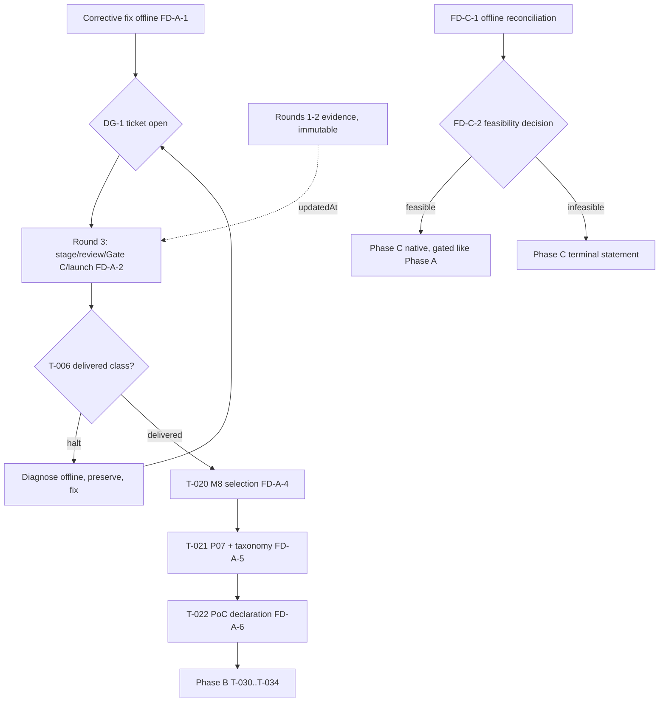

# Project scope & roadmap — 2026-11-05

**Status: this document is the intent/navigation layer of record for scope and
roadmap. It records future intent, not results. `artifacts/`, the retained
reports and `EVIDENCE_INDEX.md` remain the authority for what actually
happened — when they disagree with this document, trust the evidence.**

This doc grants **no runtime authority** of any kind: it does not authorize an
OpenTTD launch, an AdminPort connection, a retry of a consumed attempt, staging,
signing, a claim, evidence regeneration or a commit. Every gate named below
still requires its own explicit operator approval in-session.

## 0. How to read this document

- **Live status is never here.** Per-ticket journals live in
  `docs/poc-ticket-backlog-2026-11-04.md`; the task ledger lives in
  `TASKS.md`; per-experiment results live in `EVIDENCE_INDEX.md` rows
  (E1…E111). This document points at them and states intent only.
- **Vocabulary is the retained one.** VERIFIED / PROVEN / PREPARED / PARTIAL /
  FAILED / UNKNOWN and "native terminal result" mean exactly what `AI_HANDOFF.md`
  defines. A candidate that has launched is **consumed** forever: never
  relaunched, never re-signed, never relabeled. A halt is preserved evidence,
  not a failure to be retried.
- **Effort is counted in gated rounds**, never calendar dates. One native
  attempt = one launch = one fresh candidate identity, advanced through four
  operator gates (staging → independent review → Gate C signing → launch).
  Outcomes are nondeterministic at the launch gate by construction, so any
  forecast expressed in dates would be fiction.
- **Three tiers of work exist.** Phase A is bound to the PoC of record and has
  a checkable terminal state. Phase B and Phase C are separately approved
  scope: passing them is not required for PoC completion, and PoC completion
  is not required for them.

---

## 1. Complete feature inventory (as of this document)

| # | Feature / capability | State class | Evidence | Owner phase |
|---|---|---|---|---|
| F01 | Fixed fixed-demo CLI + spectator lifecycle (`app.openttd_demo`) | VERIFIED native gameplay | E1 | A (maintain) |
| F02 | Isolated OpenTTD runtime, staging, cleanup + evidence retention | VERIFIED across attempts | E1, E35, E40–E44, E49, E82–E110 | all |
| F03 | Qualified observations + supplemental capture (planning facts) | VERIFIED on fixed/controlled worlds; random capture corrected offline | E5 | A/B/C |
| F04 | P08 bounded road candidates: flat-land routing, 2..47-tile paths | VERIFIED on retained worlds; `INCOMPLETE_TILE_CLASSIFICATION` global | E5, E35, E40 | A/C |
| F05 | P08 terrain-aware reachability oracle + terrain-modification planning (planning-only diagnostics) | PREPARED (offline implemented, planning-only; no native construction contract) | `docs/p08-bounded-terrain-aware-routing.md` | B/C |
| F06 | P05 CP-SAT service selection (bounded 1–60 s, ≤16 relationships, ≤8 services) | VERIFIED in the fixed demo (E1); on-corridor selection NOT demonstrated | E1, E36 | A (T-020) |
| F07 | ExecutionPlan compile/admit/execute/replay pipeline | VERIFIED in fixed demo; v2 protocol lines verified offline + replay | E1, E51 | A |
| F08 | Freight delivery v1 (protocol 5) | CONSUMED, not delivered (`D5-FREIGHT-1`, cargo-1 acceptance 0) | E36 | A (superseded by F07/F09 lineage) |
| F09 | D5 chain components: D4 road+station construction (v3), A0 survey, A1 corridor spur + bay truck stop, post-A1 accept census, depot-mutation/reload chain | VERIFIED native, consumed, replay-verified | E35, E40, E42–E44, E49, F-12/E97–E99 lineage, E105–E108 pins | A (prerequisites, complete) |
| F10 | D5-CargoFlow-2 (protocol 11): site/engine/purchase/cycle ladder + funds model of record | PARTIAL — implemented + reviewed offline; two halts preserved (R1 `INVALID_SITE` fixed in T-007; R2 `ENGINE_PIN_MISMATCH` root-caused E111, fix NOT yet applied) | E101–E111 | A (the active front) |
| F11 | Canonical company create + fresh-process reload (Q3) | PROVEN historically (create pending-fresh-reload; reload-only verified) | E2 | B (T-030 basis) |
| F12 | P07 offline reporting/evaluation (results, charts, operational history) | VERIFIED on fixed-demo receipts; corridor closed loop pending | E1 lineage | A (T-021) |
| F13 | Random World: seeded generation, discovery, 512-tile capture profile, bounded budgets | PREPARED offline/controlled; native gen/discovery/GUI verified in Seed 17; **service execution never verified** | E4, E5 | C |
| F14 | Tile Classification V2 capture (staged AI + GameScript census) | VERIFIED capture; fusion verdict **REJECTED** (83 `PROJECTED_FLAGS_DIFFER`) | E16 | C (reconciliation open) |
| F15 | Emergency/demo operations monitoring (terminal observation paths) | VERIFIED offline paths | E3 lineage | B |
| F16 | PostgreSQL persistence (alembic) | Optional research persistence, not a demo prerequisite | — | B (T-033 storage choice) |
| F17 | Evidence/staging/gate infrastructure (PRELAUNCH, preflight, verify, Gate C, claim, launch-consumed, replay, certified cleanup) | VERIFIED across the attempt families; the operating discipline of record | E82–E111 | all |

Explicitly **not** supported anywhere in the shipped system: arbitrary slopes /
obstructed clearing as executable construction, bridges/tunnels, arbitrary-world
road feasibility, > 32 industries, > 256×256 maps, direct player control of the
Python-operated company. Stage-gating these forward is Phase B/C territory with
explicit contracts only.

---

## 2. Phase A — Corridor PoC (active, committed scope)

**Definition of record:** one delivered freight cycle on the pinned corridor
world (A1 lineage; depot `45487`, pickup `45748`, bay `50862`, coal, engine
123), then optimizer-driven route selection, then closed-loop reporting, then
the completion declaration. The PoC ladder, per-ticket journals and acceptance
criteria are in `docs/poc-ticket-backlog-2026-11-04.md`.

### 2.1 Current position (facts of record)

- Round 1 (candidate-1, seal `c7a1c5d5…333b`): launched once → terminal halt
  `INVALID_SITE` at `site-00` (E104) → diagnosed as the `GSRoad`
  Set-before-Get defect (E105) → fixed inline in `SiteOp` (T-007, E106,
  committed `07aaaf2`).
- Round 2 (candidate-2, seal `f991a440…55d4e`): staged (E107), reviewed 45/45
  READY-FOR-GATE-C (E108), Gate-C signed (E109), launched once (E110):
  `site-00` measured **READY live** (the T-007 fix proven on-world), then
  terminal halt `ENGINE_PIN_MISMATCH` at `engine-00`. Replay reconciles
  exactly; certified cleanup complete; candidate-2 consumed.
- Root cause of record (E111, high confidence): the engine census join at
  `d5_cargoflow2_package/main.nut:452` requires `(raw >> 8) == 421`, but the
  script surface already returns the display figure; the required raw ≥
  107,776 is unreachable on the pinned binary → deterministic, unsatisfiable
  gate. Mirrors in `app/simulation/openttd/corridor_cargoflow2.py:1014/:1153`.
  **The corrective fix was executed offline 2026-11-05 (T-009, approved
  at DG-1): the display figure compared to its pin with no second
  shift, both mirrors dropped of the shift, the 8.8 funds arithmetic
  preserved exactly via the display/365 reconstruction, the full E111
  regression-lock matrix, suites 88 + 38 green, ruff/ty clean —
  awaiting the round-3 candidate cycle.**
- The consumed pre-fix evidence (candidates 1 and 2) is immutable history;
  the corrective work moves forward on a fresh candidate round.

### 2.2 Remaining ladder (intent)

Spec of record for this whole ladder:
[`docs/specs/d5-corridor-poc-tail.md`](specs/d5-corridor-poc-tail.md)
(`ready-for-agent`, published 2026-11-05).

1. **FD-A-1 — corrective fix (offline) — ✅ EXECUTED 2026-11-05 as ticket
   T-009** under operator gate DG-1: the E111 direction applied in full
   — the `main.nut` display-against-pin join (no second shift), both
   Python mirrors, comment + design-§4 corrections via a marked bullet,
   and all four regression locks (READY-with-421, refusal at 107776/0,
   `admit_running_cost` accepts 421/refuses others, byte-level
   no-second-shift assertion). Suites 88 (wire+VM) + 38 (native)
   passed exit 0; ruff/ty "All checks passed!".
2. **FD-A-2 — fresh candidate round 3.** Stage → independent review →
   Gate C sign → ONE launch, each gate separately approved. A pass here is the
   first attempt to reach the never-executed tail (purchase, departure gates,
   cycle ladder, delivery).
3. **FD-A-3 — T-006 delivered class.** Read-only reconciliation of the round
   verdict into the delivery ledger. On halt: preserve, diagnose (E105/E111
   method), fix offline, next round — the corrective loop is part of this
   phase by design, not an exception.
4. **FD-A-4 — T-020 M8 route selection.** ≥2 natively executable route
   candidates; P05 selects under its boundedness; the selected route lands in
   a delivered attempt with its own gate ladder. Closes the E36 "no
   competing executable route" finding.
5. **FD-A-5 — T-021 P07 closed loop + funds taxonomy.** Operator decides the
   funds taxonomy (condition outstanding since E50); P07 replays native
   receipts into fresh sibling output.
6. **FD-A-6 — T-022 PoC completion declaration.** Assemble the delivery
   receipt + M8 selection + P07 replay into the completion record; round-close
   E-row appended. **Phase A terminal state.**

### 2.3 Phase A effort shape

- Done since this document was written: the offline fix sweep (FD-A-1,
  2026-11-05).
- At minimum remaining: one full gated round (FD-A-2).
- Unknown-but-bounded extra: one corrective round per new halt class exposed
  at the round-3 launch or inside A live tail. Each is the same 4-gate cycle;
  nothing about this loop is unbound — the executed surface shrinks every
  round.
- There is no "partial credit": until T-022's E-row, Phase A is open.

---

## 3. Phase B — post-PoC research (P2 backlog; separately approved)

Declared out of the PoC definition in `docs/poc-ticket-backlog-2026-11-04.md`
and upheld here. Each ticket is an independent operator-authorized effort; none
may be smuggled into a PoC round's budget or evidence.

| Ticket | Work | Historical anchor | Done-ness criterion |
|---|---|---|---|
| T-030 | Fleet/capacity native exercise: purchase/dispatch/unpause at 15.3 with canonical correspondence | Q3 create/reload PROVEN (E2); fourth-vehicle question open | Native exercise receipts + canonical correspondence record + E-row |
| T-031 | Matched A/B experiments: separately authorized arms from the same verified canonical state | Attempt 19 is context only, not a matched arm | Descriptive comparison record with per-arm receipts + E-row |
| T-032 | Five-year continuous operation experiment with its own finalization contract | Attempt 19 terminal FAILED (E3), offline recovery separate | Per-year OPEX/ROI derived only from observed accounting + E-row |
| T-033 | Consolidated OPEX/ROI with provenance labels | OPEX/net profit/ROI remain UNKNOWN today (financial boundaries) | Aggregation record; OBSERVED/DERIVED/CONTROLLED segregation; UNKNOWN stays UNKNOWN |
| T-034 | Full regression over the 15.3 qualification set | OpenTTD 13.4 proofs are historical-only | Regression suite result + E-row |

Recommended internal order when Phase B finally opens: T-030 → T-031 →
T-032 → T-033, T-034 as the standing qualification gate (re-runnable any
round). F06/F11 are the prerequisite capabilities this phase leans on.

---

## 4. Phase C — Random World (research track; authorization-fenced)

**State of record.** Native generation/discovery/GUI verified in Seed 17
(E4/E5); the fresh Seed 17 smoke was consumed with P08 returning
`NO_BOUNDED_CORRIDOR` on the only capturable pair — proven complete-search
infeasibility, not a defect. Tile Classification V2 capture is recorded
native-VERIFIED, and the SOURCE_SAVE_FUSION reconciliation of the fresh census
against the historical `TileFact` projection is **REJECTED** (83
`PROJECTED_FLAGS_DIFFER` disagreements; 19 retained-UNKNOWN tiles stay
UNKNOWN) — P08 stands at `INCOMPLETE_TILE_CLASSIFICATION` (E16).
**Service execution on random worlds has never been native-verified.**

**Intent ladder:**

1. **FD-C-1 — offline semantic reconciliation** of the V2 census vs the
   historical projection (the E16 open continuation): disposition of the 83
   disagreements, the 19 fresh-CLEAR/retained-UNKNOWN tiles, and a resulting
   feasibility statement. Offline only, own reviewed record.
2. **FD-C-2 — feasibility statement decision.** If reconciliation proves
   random-world feasibility reachable, the next sub-phase (frozen inputs +
   separate authorization + one-launch discipline, identical to Phase A
   mechanics) becomes scoppable. If it proves infeasibility for supported
   construction, Phase C ends there with the statement as its terminal
   evidence — native random delivery is not pursued without it.

**Standing fences for any Phase C native work:** freshly frozen current code,
finite settings/budgets, one server + encrypted Admin session, zero retry/
reconnect, owned-runtime cleanup certified, and a feasibility statement under
which a "valid unsupported-world result" remains distinct from a delivery.

---

## 5. Decision gates ledger (open operator decisions)

| Gate | Topic | Where it binds | Current state |
|---|---|---|---|
| DG-1 | Open the corrective fix ticket for the E111 census-scale inversion | Phase A FD-A-1 | ✅ approved 2026-11-05; executed offline as T-009 |
| DG-2..DG-5 | Staging / independent review / Gate C / launch per round | Every candidate round | ⏳ per-round, in-session |
| DG-6 | T-006 verdict reconciliation method | Phase A FD-A-3 | In place (recorded discipline) |
| DG-7 | Funds taxonomy (running-cost category question) | T-021 | ⏳ outstanding since E50 |
| DG-8 | Phase B ticket authorizations, individually | §3 | ⏳ not opened |
| DG-9 | Phase C native authorization after FD-C-1 | §4 | ⏳ not opened |
| DG-10 | Commit/staging authority for any ledger change (incl. this document) | Repo-wide | ⏳ current tree intentionally uncommitted |

---

## 6. Dependency graph

Phase C is independent of the Phase A graph and may be worked (offline) at any
time; Phase B requires the T-022 terminal state first per the P2 backlog.

---

## 7. Risk register (what is genuinely unknown)

- **Launch-gate-only defects.** Purchase, departure gates, cycle ladder and
  delivery on this protocol-11 line have never executed; each first execution
  risks a new halt class and costs a fresh gated round (bounded loop, §2.3).
- **Residuals carried from E111:** exact live road-type value in the R1
  instance (unmeasurable, launch spent); A1 in-save `inflation` flag
  truthiness; A1's own running-cost display value; content-level save-delta
  attribution beyond the dated clock advance. All recorded as UNKNOWN, none
  guessed.
- **Finance truth.** Revenue is not profit; OPEX categories beyond observed
  cash deltas remain UNKNOWN until DG-7 + T-032/T-033.
- **Clone drift.** Tests backed by retained `artifacts/` evidence may fail on
  a fresh clone — that is missing evidence, never a reason to regenerate it.
- **Two authorities drift.** If any ledger and this document disagree on live
  status, the ledger wins; file an erratum here instead of rewriting there.

## 8. Invariants that this roadmap assumes and protects

`artifacts/` is immutable, transfer-only, never regenerated. Every consumed
attempt stays consumed. Native runs are operator-gated, one launch, no retries.
`CONTEXT.md` stays byte-pinned under the authority manifests. GameScript only
executes commands; optimization, identity, validation and deadlines stay in
Python. Staging/signing/claims/launches are separate approvals, in-session.
Nothing is relabeled; offline recovery lives in a separate derived space.

## 9. What this document is NOT

Not a test plan, not a launch authorization, not an ADR, not a calendar, and
not a per-ticket journal. It is the map from here to "all tasks, all
features" — Phase A's T-022 E-row being the first genuine finish line, Phase B
and C defined so their ends are as checkable as its own.
